# Mathematical Analysis, lectures 2025/26

[Русский](../../ru/lectures-2025-26/index.md) · **English** · [Español](../../es/lectures-2025-26/index.md)

These notes are transcribed from the PDF lecture files of D. E. Apushkinskaya (RUDN University). Typed slides were extracted from the PDF text layer, handwritten pages were transcribed from their images, and the figures are embedded as illustrations. Formulas use LaTeX (MathJax) and diagrams use Mermaid; both work in Obsidian and on GitHub.

**Coverage: lectures 0–38 without gaps, in Russian, English and Spanish.** Semester 1 ends with lecture 32; semester 2 consists of lectures 33–64. For lectures 31–38, all 123 pages of the five new PDFs were reviewed; 17 shared JPEG figures were inspected individually. Page attribution and source hashes are recorded in the [manifest](../../assets/lectures-2025-26/figures-31-38.json).

## Semester 1 — lectures 0–32

| Lecture | Date | Content | File | Source PDF |
|---|---|---|---|---|
| 0 | 1 Sep 2025 | Sets, inclusion, mathematical logic, operations, De Morgan's laws | [lecture-00.md](lecture-00.md) | `МА2526_лекция_0.pdf` |
| 1–2 | 4 Sep 2025 | Maps, injection, surjection, bijection, cardinality, countable sets | [lecture-01-02.md](lecture-01-02.md) | `ma25_26-lectures_1-2_notes.pdf` |
| 3 | 11 Sep 2025 | At most countable sets, uncountability, the continuum | [lecture-03.md](lecture-03.md) | `ма25_26_лекция_3_notes.pdf` |
| 4 | 11 Sep 2025 | Axioms of the field and order of the real numbers | [lecture-04.md](lecture-04.md) | `ма25_26_лекция_4_notes.pdf` |
| 5–6 | — | Intervals, extended real line, Archimedean and Cantor axioms, induction, binomial theorem, sup and inf | [lecture-05-06.md](lecture-05-06.md) | `ma25_26-lectures_5-6_notes.pdf` |
| 7 | — | Maximum and minimum of a finite set, integer part, density of ℚ in ℝ | [lecture-07.md](lecture-07.md) | `ma25_26_лекция_7_notes.pdf` |
| 8 | — | Limit of a sequence: definition, uniqueness, boundedness, passage to the limit, squeeze theorem | [lecture-08.md](lecture-08.md) | `ма25_26_лекция_8_notes.pdf` |
| 9–10 | 2 Oct 2025 | Infinitesimal and infinitely large sequences, arithmetic of limits, indeterminate forms | [lecture-09-10.md](lecture-09-10.md) | `ma25_26-lectures_9-10_notes.pdf` |
| 11–12 | 9 Oct 2025 | Exact bounds, monotone sequences, the number e, subsequences, Bolzano–Weierstrass theorem | [lecture-11-12.md](lecture-11-12.md) | `ma25_26-lectures_11-12_notes.pdf` |
| 13 | 16 Oct 2025 | Upper and lower limits, fundamental sequences, Bolzano–Cauchy criterion | [lecture-13.md](lecture-13.md) | `ma25_26_лекция_13_notes.pdf` |
| 14 | 16 Oct 2025 | Limit points and isolated points, limit of a function by Cauchy and by Heine, uniqueness, local boundedness | [lecture-14.md](lecture-14.md) | `ма25_26_лекция_14_notes.pdf` |
| 15 | 23 Oct 2025 | Stabilization of sign, arithmetic of function limits, composition, one-sided limits, monotone functions, Cauchy criterion for functions | [lecture-15.md](lecture-15.md) | `ма25_26_лекция_15_notes_pdf.pdf` |
| 16 | 23 Oct 2025 | Continuity at a point (5 forms), discontinuities of the 1st and 2nd kind, removable discontinuity, Dirichlet and Riemann functions, C(D) | [lecture-16.md](lecture-16.md) | `ма25_26_лекция_16_notes.pdf` |
| 17–18 | 30 Oct 2025 | Arithmetic and composition of continuous functions, Weierstrass theorem, uniform continuity, Cantor and Bolzano–Cauchy theorems | [lecture-17-18.md](lecture-17-18.md) | `ma25_26-lectures_17-18_notes.pdf` |
| 19–20 | 6 Nov 2025 | Monotone functions and the inverse function, the five remarkable limits | [lecture-19-20.md](lecture-19-20.md) | `ma25_26-lectures_19-20_notes.pdf` |
| 21 | 13 Nov 2025 | Comparison of functions: O, o, equivalence; vertical, oblique and horizontal asymptotes | [lecture-21.md](lecture-21.md) | `ma25_26_lecture_21_notes.pdf` |
| 22–23 | 13 Nov 2025 | The derivative and differentiability, differentiability criterion, the tangent as a limit of secants, rules of differentiation, the chain rule | [lecture-22-23.md](lecture-22-23.md) | `ma25_26_lectures_22-23_notes.pdf` |
| 24–25–26 | 20 Nov 2025 | Inverse-function derivative, differentials, mean value theorems and L’Hôpital’s rule | [lecture-24-25-26.md](lecture-24-25-26.md) | `ma25_26-lectures_24-25-26_notes.pdf` |
| 27–28 | 4 Dec 2025 | Higher derivatives and differentials, Leibniz formula, Taylor–Peano | [lecture-27-28.md](lecture-27-28.md) | `ma25_26-lectures_27-28_notes.pdf` |
| 29–30 | 11 Dec 2025 | Taylor–Lagrange, remainders, monotonicity and extrema | [lecture-29-30.md](lecture-29-30.md) | `ma25_26-lectures_29-30_notes.pdf` |
| 31–32 | 18 Dec 2025 | Necessary and sufficient extremum conditions, Darboux’s theorem, convexity and the three-chords lemma; end of semester 1 | [lecture-31-32.md](lecture-31-32.md) | `ma25_26-lectures_31-32_notes.pdf` |

## Semester 2 — lectures 33–64 (here: 33–38)

> **Semester-2 duplication.** Material for lectures 33–64 is already represented in the [Russian `ru/lectures/` folder](../../ru/lectures/index.md) and the [original `МАТАН_Л/` archive](../../../source/MathInMind/МАТАН_Л/). The files for 33–38 below are full illustrated transcriptions of the new PDFs, not replacement pointers. Overlapping sections: [§3.8](../../ru/lectures/01-convexity-3-8.md), [§4.1](../../ru/lectures/02-antiderivatives-4-1.md), and [the start of §4.2](../../ru/lectures/03-riemann-integral-4-2.md). The continuation, 39–64, is currently available in that existing folder, not in this series.

| Lecture | Date | Content | File | Source PDF |
|---|---|---|---|---|
| 33–34 | 12 Feb 2026 | Convexity, one-sided derivatives, supporting lines, tangents and asymptotes | [lecture-33-34.md](lecture-33-34.md) | `ma25_26-lectures_33-34_notes.pdf` |
| 35 | 19 Feb 2026 | Second-derivative criterion for convexity, inflection points | [lecture-35.md](lecture-35.md) | `ma25_26_lecture_35_notes.pdf` |
| 36 | 19 Feb 2026 | Antiderivatives, the integral as a family, set arithmetic, existence conditions | [lecture-36.md](lecture-36.md) | `ma25_26_lecture_36_notes.pdf` |
| 37–38 | 26 Feb 2026 | Substitution, integration by parts, rational and non-elementary integrals, partitions and Riemann sums | [lecture-37-38.md](lecture-37-38.md) | `ma25_26-lectures_37-38_notes.pdf` |

Figures extracted from handwritten pages are in the shared folder [`../../assets/lectures-2025-26/`](../../assets/lectures-2025-26/).

## Conventions

- Numbers of definitions, theorems and corollaries are kept as in the source slides. In lectures 5–6 the label "Definition 1.3.5" is repeated three times; see the note in the file.
- Handwritten pages are headed "Handwritten page N (PDF p. N)".
- Editor's notes are set as blockquotes and begin with "Editor's note" or "Remark".
- Lectures 31–38 distinguish typed-slide numbers from PDF-page numbers. Handwritten-page attribution was checked using contact sheets with filenames on every tile; each referenced crop was viewed separately.
- Restored hypotheses, source-typo corrections and supplementary proofs are explicitly labelled as editorial, not attributed to the PDF.

```mermaid
flowchart LR
    A["Lecture 0: sets"] --> B["Lectures 1–2: maps and countability"]
    B --> C["Lecture 3: at most countable sets and the continuum"]
    C --> D["Lecture 4: axioms of the real numbers"]
    D --> E["Lectures 5–6: completeness axioms, induction, binomial"]
    E --> F["Lecture 7: maximum, minimum, density of ℚ"]
    F --> G["Lecture 8: limit of a sequence"]
    G --> H["Lectures 9–10: infinitesimal and infinitely large"]
    H --> I["Lectures 11–12: exact bounds, monotone sequences"]
    I --> J["Lecture 13: upper and lower limits, Cauchy criterion"]
    J --> K["Lecture 14: limit of a function by Cauchy and Heine"]
    K --> L["Lecture 15: one-sided limits, monotone functions"]
    L --> M["Lecture 16: continuity and discontinuities"]
    M --> N["Lectures 17–18: Weierstrass, Cantor, Bolzano–Cauchy"]
    N --> O["Lectures 19–20: monotone functions, remarkable limits"]
    O --> P["Lecture 21: O, o, equivalence, asymptotes"]
    P --> Q["Lectures 22–23: the derivative and rules of differentiation"]
    Q --> R["Lectures 24–26: inverse function, mean value theorems, L'Hopital"]
    R --> S["Lectures 27–28: higher derivatives, Taylor-Peano"]
    S --> T["Lectures 29–30: Taylor-Lagrange, monotonicity, extrema"]
    T --> U["Lectures 31–32: extrema, Darboux, convexity — end of semester 1"]
    U --> V["Lectures 33–34: supporting lines and asymptotes — semester 2"]
    V --> W["Lecture 35: second derivative and inflection points"]
    W --> X["Lecture 36: antiderivatives and the indefinite integral"]
    X --> Y["Lectures 37–38: integration methods and Riemann sums"]
```

