# Mathematical Analysis, lectures 2025/26

[Русский](../../ru/lectures-2025-26/index.md) · **English** · [Español](../../es/lectures-2025-26/index.md)

These notes are transcribed from the PDF lecture files of D. E. Apushkinskaya (RUDN University). Typed slides were extracted from the PDF text layer, handwritten pages were transcribed from their images, and the figures are embedded as illustrations. Formulas use LaTeX (MathJax) and diagrams use Mermaid; both work in Obsidian and on GitHub.

| Lecture | Date | Content | File | Source PDF |
|---|---|---|---|---|
| 0 | 1 Sep 2025 | Sets, inclusion, mathematical logic, operations, De Morgan's laws | [lecture-00.md](lecture-00.md) | `МА2526_лекция_0.pdf` |
| 1–2 | 4 Sep 2025 | Maps, injection, surjection, bijection, cardinality, countable sets | [lecture-01-02.md](lecture-01-02.md) | `ma25_26-lectures_1-2_notes.pdf` |
| 3 | 11 Sep 2025 | At most countable sets, uncountability, the continuum | [lecture-03.md](lecture-03.md) | `ма25_26_лекция_3_notes.pdf` |
| 4 | 11 Sep 2025 | Axioms of the field and order of the real numbers | [lecture-04.md](lecture-04.md) | `ма25_26_лекция_4_notes.pdf` |
| 5–6 | — | Intervals, extended real line, Archimedean and Cantor axioms, induction, binomial theorem, sup and inf | [lecture-05-06.md](lecture-05-06.md) | `ma25_26-lectures_5-6_notes.pdf` |
| 7 | — | Maximum and minimum of a finite set, integer part, density of ℚ in ℝ | [lecture-07.md](lecture-07.md) | `ma25_26_лекция_7_notes.pdf` |
| 8 | — | Limit of a sequence: definition, uniqueness, boundedness, passage to the limit, squeeze theorem | [lecture-08.md](lecture-08.md) | `ма25_26_лекция_8_notes.pdf` |
| 9–10 | 2 Oct 2025 | Infinitesimal and infinitely large sequences, arithmetic of limits, indeterminate forms | [lecture-09-10.md](lecture-09-10.md) | `ma25_26-lectures_9-10_notes.pdf` |
| 11–12 | 9 Oct 2025 | Exact bounds, monotone sequences, the number e, subsequences, Bolzano–Weierstrass theorem | [lecture-11-12.md](lecture-11-12.md) | `ma25_26-lectures_11-12_notes.pdf` |
| 13 | 16 Oct 2025 | Upper and lower limits, fundamental sequences, Bolzano–Cauchy criterion | [lecture-13.md](lecture-13.md) | `ma25_26_лекция_13_notes.pdf` |
| 14 | 16 Oct 2025 | Limit points and isolated points, limit of a function by Cauchy and by Heine, uniqueness, local boundedness | [lecture-14.md](lecture-14.md) | `ма25_26_лекция_14_notes.pdf` |
| 15 | 23 Oct 2025 | Stabilization of sign, arithmetic of function limits, composition, one-sided limits, monotone functions, Cauchy criterion for functions | [lecture-15.md](lecture-15.md) | `ма25_26_лекция_15_notes_pdf.pdf` |

Figures extracted from handwritten pages are in the shared folder [`../../assets/lectures-2025-26/`](../../assets/lectures-2025-26/).

## Conventions

- Numbers of definitions, theorems and corollaries are kept as in the source slides. In lectures 5–6 the label "Definition 1.3.5" is repeated three times; see the note in the file.
- Handwritten pages are headed "Handwritten page N (PDF p. N)".
- Editor's notes are set as blockquotes and begin with "Editor's note" or "Remark".

```mermaid
flowchart LR
    A["Lecture 0: sets"] --> B["Lectures 1–2: maps and countability"]
    B --> C["Lecture 3: at most countable sets and the continuum"]
    C --> D["Lecture 4: axioms of the real numbers"]
    D --> E["Lectures 5–6: completeness axioms, induction, binomial"]
    E --> F["Lecture 7: maximum, minimum, density of ℚ"]
    F --> G["Lecture 8: limit of a sequence"]
    G --> H["Lectures 9–10: infinitesimal and infinitely large"]
    H --> I["Lectures 11–12: exact bounds, monotone sequences"]
    I --> J["Lecture 13: upper and lower limits, Cauchy criterion"]
    J --> K["Lecture 14: limit of a function by Cauchy and Heine"]
    K --> L["Lecture 15: one-sided limits, monotone functions"]
```

