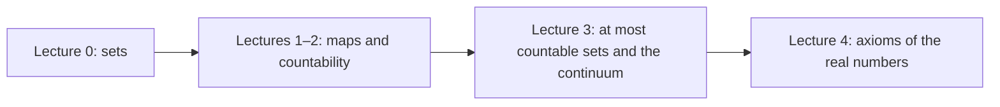

# Mathematical Analysis, lectures 2025/26

[Русский](../../ru/lectures-2025-26/index.md) · **English** · [Español](../../es/lectures-2025-26/index.md)

These notes are transcribed from the PDF lecture files of D. E. Apushkinskaya (RUDN University). Typed slides were extracted from the PDF text layer, handwritten pages were transcribed from their images, and the figures are embedded as illustrations. Formulas use LaTeX (MathJax) and diagrams use Mermaid; both work in Obsidian and on GitHub.

| Lecture | Date | Content | File | Source PDF |
|---|---|---|---|---|
| 0 | 1 Sep 2025 | Sets, inclusion, mathematical logic, operations, De Morgan's laws | [lecture-00.md](lecture-00.md) | `МА2526_лекция_0.pdf` |
| 1–2 | 4 Sep 2025 | Maps, injection, surjection, bijection, cardinality, countable sets | [lecture-01-02.md](lecture-01-02.md) | `ma25_26-lectures_1-2_notes.pdf` |
| 3 | 11 Sep 2025 | At most countable sets, uncountability, the continuum | [lecture-03.md](lecture-03.md) | `ма25_26_лекция_3_notes.pdf` |
| 4 | 11 Sep 2025 | Field and order axioms of the real numbers | [lecture-04.md](lecture-04.md) | `ма25_26_лекция_4_notes.pdf` |

Illustrations taken from handwritten pages are in the shared folder [`../../assets/lectures-2025-26/`](../../assets/lectures-2025-26/).

## Conventions

- Numbers of definitions, theorems and corollaries are kept as on the original slides.
- Handwritten pages are labelled "Handwritten page N (PDF p. N)".
- Editor's notes are set as quotations and begin with "Note" or "Editor's".
- The English translation follows the Russian source; Russian is the reference text.

