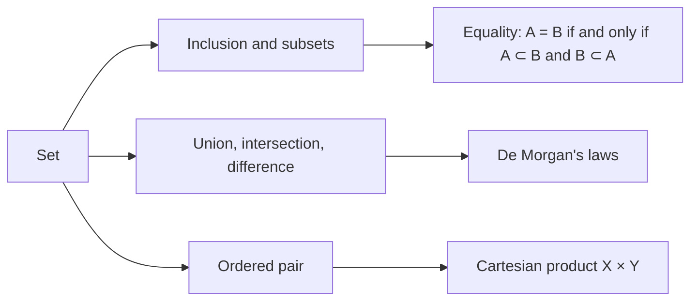

# Lecture 0 — Sets and mathematical logic

[Lecture index](index.md) · [Lectures 1–2 →](lecture-01-02.md) · [Terms & theorems](../term-index.md) · [Русский](../../ru/lectures-2025-26/lecture-00.md) · [Español](../../es/lectures-2025-26/lecture-00.md)

> **Source:** `МА2526_лекция_0.pdf` — 17 slides (Beamer), D. E. Apushkinskaya, RUDN University, 1 September 2025. The text was extracted from the PDF text layer and checked against the slide images; formulas were rewritten in LaTeX. This file has no illustrations because the slides contain only text and formulas.

## Slide 1. Title

Mathematical Analysis · Lecture 0 · 1 September 2025.

## Slide 2. Aim of the lecture

- We get acquainted with the basic definitions of set theory.
- We discuss logical notation and operations on sets.
- We state De Morgan's laws.
- We discuss ordered pairs and the Cartesian product.

## Slide 3. Chapter 1, §0. Sets

<a id="def-1-0-1"></a>**Definition 1.0.1.** A set is a collection, aggregate or family of objects, called the elements of the set. Sets may be finite or infinite. Sets are usually denoted by capital Latin letters.

Strictly speaking, [Definition 1.0.1](#def-1-0-1) is not a formal definition: the set is an undefined notion. Without strictly defining the notion of a set, we will nevertheless discuss its properties and the rules for working with it.

In a course of mathematical analysis it is more convenient to remain within "naive" set theory.

## Slide 4. Ways of specifying sets

Ways of specifying a set:

1. Listing its elements.
2. Selecting the elements of a set by means of some property.

Describing a set by a property can sometimes lead to a contradiction (Russell's paradox).

**Notation.** The element $`a`$ belongs to the set $`A`$: $`a \in A`$. The element $`a`$ does not belong to the set $`A`$: $`a \notin A`$.

## Slide 5. Inclusion (subset)

<a id="def-1-0-2"></a>**Definition 1.0.2.** If every element of a set $`X`$ belongs to a set $`Y`$, one says that $`X`$ is contained in $`Y`$ (equivalently, $`X`$ is a subset of $`Y`$, $`X`$ is a part of $`Y`$, $`Y`$ contains $`X`$) and writes

```math
X \subset Y \quad\text{or}\quad Y \supset X .
```

Membership: an element itself belongs to the set: $`\{1, 2\} \in \{3, 4, \{1, 2\}\}`$.

Inclusion: all elements of one of the sets are elements of the second: $`\{1, 2\} \subset \{3, 4, 1, 2\}`$.

## Slide 6. The empty set

It is convenient to introduce the empty set — the set with no elements at all. The empty set is denoted by $`\varnothing`$.

$`\varnothing \subset X`$ for every $`X`$; that is, the empty set is a subset of any other set.

## Slide 7. Properties of inclusion; equality of sets

Properties of inclusion:

- $`A \subset A`$, i.e. a set is a subset of itself;
- $`A \subset B`$ and $`B \subset C \Rightarrow A \subset C`$.

<a id="def-1-0-3"></a>**Definition 1.0.3.** If the sets $`A`$ and $`B`$ consist of the same elements, they are called equal, and one writes $`A = B`$.

In other words, $`A = B`$ if and only if $`A \subset B`$ and $`B \subset A`$.

## Slide 8. Number sets

Several number sets have standard notation:

- $`\mathbb{N}`$ — the set of natural numbers;
- $`\mathbb{Z}_+`$ — the set of non-negative integers;
- $`\mathbb{Z}`$ — the set of integers;
- $`\mathbb{Q}`$ — the set of rational numbers, i.e. fractions $`\dfrac{p}{q}`$ with $`p \in \mathbb{Z}`$, $`q \in \mathbb{N}`$;
- $`\mathbb{R}`$ — the set of real numbers;
- $`\mathbb{C}`$ — the set of complex numbers.

## Slide 9. Mathematical language: implication, equivalence, negation

If $`P`$ and $`Q`$ are two statements, the expression

```math
P \Rightarrow Q
```

is called an implication and means that if $`P`$ holds, then $`Q`$ holds too. The expression $`Q \Leftarrow P`$ means the same.

One also says: $`Q`$ follows from $`P`$; $`P`$ implies $`Q`$; $`P`$ is sufficient for $`Q`$; $`Q`$ is necessary for $`P`$.

If $`P \Rightarrow Q`$ and $`Q \Rightarrow P`$, the statements $`P`$ and $`Q`$ are called equivalent, or $`P`$ is necessary and sufficient for $`Q`$, and one writes $`P \Leftrightarrow Q`$.

The negation of a statement $`P`$ is denoted by $`\neg P`$.

## Slide 10. Mathematical language: quantifiers

To shorten notation it is often convenient to use two special symbols, called [quantifiers](../01-logic-sets-functions.md#sec-1-1):

- $`\forall`$ — the universal quantifier; it replaces the words "any", "every", "each", or "for any", "for every", "for each";
- $`\exists`$ — the existential quantifier; it replaces the words "there exists", "one can find", "one can choose".

A colon in formulas with quantifiers replaces the words "such that", but it will not always be used.

## Slide 11. Families of sets

A set is determined by its elements, so it makes no sense to say that some element belongs to a set in several copies, or that a set contains several identical elements. To consider several copies of the same element, one uses the notion of a family.

<a id="def-1-0-4"></a>**Definition 1.0.4.** Let $`X`$ and $`A`$ be sets, and suppose some elements of $`X`$ are equipped with (indexed by) elements of $`A`$ (indices). Each index is used exactly once, but an element of $`X`$ may carry more than one index. The latter means that the elements of $`X`$ may appear in a family in many copies. Families are denoted by $`\{x_\alpha\}_{\alpha \in A}`$ or $`(x_\alpha)_{\alpha \in A}`$.

## Slide 12. Operations on sets: union

<a id="def-1-0-5"></a>**Definition 1.0.5.** Let $`\{X_\alpha\}_{\alpha \in A}`$ be a family of sets. The union of the family $`\{X_\alpha\}_{\alpha \in A}`$ is the set of all elements that belong to at least one of the sets $`X_\alpha`$:

```math
\bigcup_{\alpha \in A} X_\alpha = \{\, x : \exists\, \alpha \in A,\ x \in X_\alpha \,\}.
```

If the family consists of two sets $`X`$ and $`Y`$, one writes $`X \cup Y`$ (it does not matter how the sets are indexed).

Clearly,

```math
(X \cup Y) \cup Z = X \cup (Y \cup Z), \qquad X \cup Y = Y \cup X, \qquad X \cup X = X \cup \varnothing = X .
```

## Slide 13. Operations on sets: intersection

<a id="def-1-0-6"></a>**Definition 1.0.6.** Let $`\{X_\alpha\}_{\alpha \in A}`$ be a family of sets. The intersection of the family is the set of all elements that belong to each of the sets $`X_\alpha`$:

```math
\bigcap_{\alpha \in A} X_\alpha = \{\, x : \forall\, \alpha \in A,\ x \in X_\alpha \,\}.
```

If the family consists of two sets $`X`$ and $`Y`$, one writes $`X \cap Y`$ (it does not matter how the sets are indexed).

Clearly,

```math
(X \cap Y) \cap Z = X \cap (Y \cap Z), \qquad X \cap Y = Y \cap X, \qquad X \cap X = X, \qquad X \cap \varnothing = \varnothing .
```

## Slide 14. Operations on sets: difference and complement

<a id="def-1-0-7"></a>**Definition 1.0.7.** The difference of the sets $`X`$ and $`Y`$ is the set of all elements that belong to $`X`$ but do not belong to $`Y`$:

```math
X \setminus Y = \{\, x : x \in X,\ x \notin Y \,\}.
```

[Definition 1.0.7](#def-1-0-7) does not assume that $`Y \subset X`$. If $`Y \subset X`$, the difference $`X \setminus Y`$ is also called the complement of $`Y`$ in $`X`$. The complement of $`X`$ in a fixed ambient set $`U`$ is called the complement of $`X`$ and is denoted by $`X^c`$.

Clearly,

```math
(X^c)^c = X, \qquad X \cup X^c = U, \qquad X \cap X^c = \varnothing .
```

## Slide 15. De Morgan's laws

<a id="thm-1-0-1"></a>**Theorem 1.0.1.** Let $`\{X_\alpha\}_{\alpha \in A}`$ be a family of sets and $`Y`$ a set. Then

```math
Y \setminus \bigcup_{\alpha \in A} X_\alpha = \bigcap_{\alpha \in A} \left(Y \setminus X_\alpha\right),
```

```math
Y \setminus \bigcap_{\alpha \in A} X_\alpha = \bigcup_{\alpha \in A} \left(Y \setminus X_\alpha\right),
```

```math
Y \cap \bigcup_{\alpha \in A} X_\alpha = \bigcup_{\alpha \in A} \left(Y \cap X_\alpha\right),
```

```math
Y \cup \bigcap_{\alpha \in A} X_\alpha = \bigcap_{\alpha \in A} \left(Y \cup X_\alpha\right).
```

## Slide 16. Ordered pair

<a id="def-1-0-8"></a>**Definition 1.0.8.** An ordered pair is a two-element family whose index set is $`\{1, 2\}`$.

In the notation of an ordered pair $`(a, b)`$, the element indexed by $`1`$ is written in the first place and the element indexed by $`2`$ in the second. Two pairs $`(a, b)`$ and $`(c, d)`$ are equal when $`a = c`$ and $`b = d`$.

Similarly, an ordered $`m`$-tuple $`(x_1, x_2, \dots, x_m)`$ is defined. The elements of an ordered tuple are called its coordinates or components.

## Slide 17. Cartesian (direct) product

<a id="def-1-0-9"></a>**Definition 1.0.9.** The Cartesian (or direct) product of the sets $`X`$ and $`Y`$ is the set of all ordered pairs such that the first element of the pair belongs to $`X`$ and the second to $`Y`$:

```math
X \times Y = \{\, (x, y) : x \in X,\ y \in Y \,\}.
```

This definition extends to several factors:

```math
X_1 \times \cdots \times X_m = \{\, (x_1, \dots, x_m) : x_i \in X_i \ \ \forall\, i = 1, \dots, m \,\}.
```

**The order of the factors matters!**

## Lecture map


