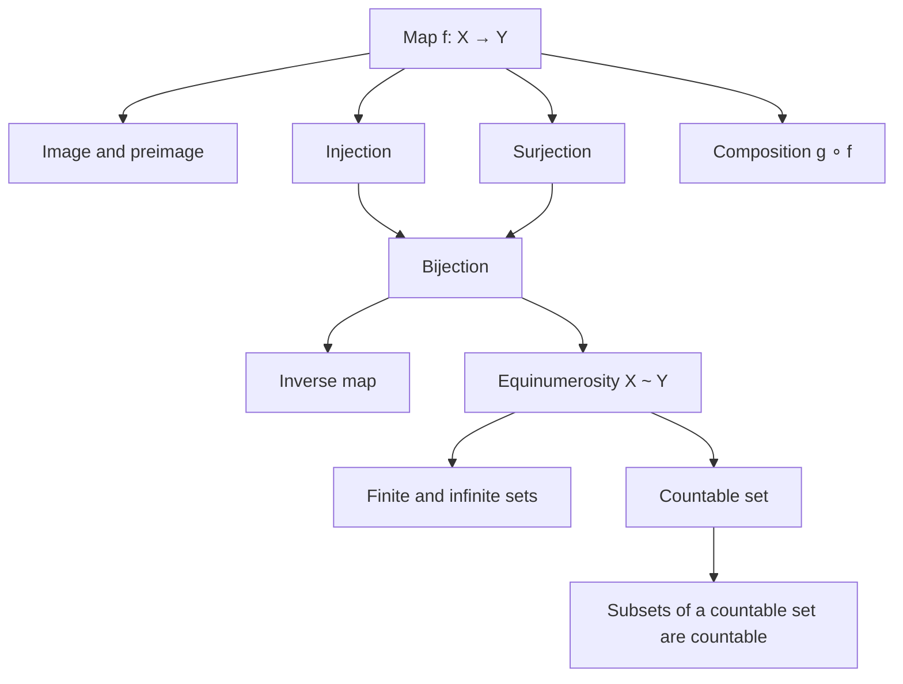

# Lectures 1–2 — Maps and countable sets

[← Lecture 0](lecture-00.md) · [Lecture index](index.md) · [Lecture 3 →](lecture-03.md) · [Terms & theorems](../term-index.md) · [Русский](../../ru/lectures-2025-26/lecture-01-02.md) · [Español](../../es/lectures-2025-26/lecture-01-02.md)

> **Source:** `ma25_26-lectures_1-2_notes.pdf` — 23 pages: 15 typed slides with a text layer and 8 handwritten pages (no text layer). The typed slides were extracted from the text layer and checked against the images; the handwritten pages were transcribed from the images. Figures from handwritten pages 13, 14 and 15 are embedded as illustrations. PDF page numbers are given in the headings.

## Slide 2. Quote of the day

> "The first lecture always begins with a session of ritual intimidation. Hello, I am Baba Yaga from the fairy tale, Professor A., and I will be lecturing you on this subject. Tremble, for the hour of reckoning is near.
>
> If you miss K lectures, you will be considered a hardened truant. If you skip M lectures, your portrait will appear on the dean's door with the inscription "Wanted", and if N, then you never existed. And so on.
>
> This part of the lecture is always listened to attentively: the subject may not interest students at all, but everyone wants to survive until the next semester…"
>
> — tchainka, LiveJournal

## Slide 3. Aim of the lecture

- We discuss maps and notions related to them.
- We introduce the notion of equivalence.
- We discuss [countable](#def-1-2-5) and [uncountable](lecture-03.md#thm-1-2-5) sets.

## §1. Maps

<a id="def-1-1-1"></a>
### Slide 4. Definition 1.1.1

Consider two arbitrary sets $`X`$ and $`Y`$. If to every element $`x`$ of $`X`$ a single element $`y`$ of $`Y`$ is assigned by a definite rule $`f`$, one says that a map from $`X`$ to $`Y`$ is given, and writes

```math
f : X \to Y \qquad\text{or}\qquad X \xrightarrow{\ f\ } Y .
```

This description cannot be regarded as a strict definition of the word "map", since it contains the not-yet-defined notions of "rule" and "assigned". For us it is more convenient to treat the notion of a map as undefined.

### Slide 5. Maps

A map is a triple of objects $`(X, Y, f)`$. If the context makes clear which sets $`X`$ and $`Y`$ are meant, one specifies only the rule $`f`$ and speaks of "the map $`f`$".

The set $`X`$ is called the domain (of definition) and the set $`Y`$ the codomain (range of values) of the map.

The element $`y \in Y`$ that the rule $`f`$ assigns to $`x \in X`$ is denoted $`f(x)`$ and is called the value of the map $`f`$ at $`x`$, or the image of $`x`$. Here $`x`$ is called the argument of the map, or the independent variable, and $`y`$ the value of the map, or the dependent variable.

If $`X`$ and $`Y`$ are numerical sets, the map is called a function.

### Slide 6. Image and preimage

<a id="def-1-1-2"></a>**Definition 1.1.2.** Let $`f : X \to Y`$ and let $`A`$ be a set. The set

```math
f(A) = \{\, y \in Y : \exists\, x \in A,\ f(x) = y \,\}
```

is called the image of $`A`$ under $`f`$. The set of values of $`f`$ is $`f(X)`$, i.e. the image of $`X`$.

<a id="def-1-1-3"></a>**Definition 1.1.3.** Let $`f : X \to Y`$ and let $`B`$ be a set. The set

```math
f^{-1}(B) = \{\, x \in X : f(x) \in B \,\}
```

is called the preimage of $`B`$ under $`f`$.

### Slide 7. Injection, surjection, bijection

<a id="def-1-1-4"></a>**Definition 1.1.4.** A map $`f : X \to Y`$ is called injective (an injection) if

```math
\forall\, x_1, x_2 \in X:\quad x_1 \neq x_2 \ \Rightarrow\ f(x_1) \neq f(x_2).
```

<a id="def-1-1-5"></a>**Definition 1.1.5.** A map $`f : X \to Y`$ is called surjective (a surjection) if

```math
\forall\, y \in Y\ \ \exists\, x \in X:\quad f(x) = y .
```

<a id="def-1-1-6"></a>**Definition 1.1.6.** A map $`f : X \to Y`$ is called bijective (a bijection) if it is injective and surjective.

### Handwritten page 8 (PDF p. 8). Examples

The map $`f : X \to Y`$, $`f(x) = x^2`$.

1. If $`X = Y = \mathbb{R}`$, then $`f`$ is not [surjective](#def-1-1-5) (it takes no negative values); $`f`$ is not [injective](#def-1-1-4), since $`f(-1) = f(1) = 1`$.
2. If $`X = \mathbb{R}`$, $`Y = \mathbb{R}_+`$, then $`f`$ is surjective but not injective.
3. If $`X = \mathbb{R}_+`$, $`Y = \mathbb{R}`$, then $`f`$ is injective but not surjective.
4. If $`X = Y = \mathbb{R}_+`$, then $`f`$ is surjective and injective, i.e. [bijective](#def-1-1-6).

### Slide 9. Graph of a map and inverse map

<a id="def-1-1-7"></a>**Definition 1.1.7.** Let $`f : X \to Y`$. The graph of the map is the set

```math
\Gamma_f = \{\, (x, y) : x \in X,\ y = f(x) \,\}.
```

<a id="def-1-1-8"></a>**Definition 1.1.8.** Let $`f : X \to Y`$ be injective. The map that assigns to each $`y \in f(X)`$ the (unique) $`x \in X`$ with $`f(x) = y`$ is called the inverse of $`f`$ and is denoted $`f^{-1}`$.

### Slide 10. Composition

<a id="def-1-1-9"></a>**Definition 1.1.9.** Let $`f : X \to Y`$, $`g : Y_0 \to Z`$, $`f(X) \subset Y_0 \subset Y`$. The map $`h : X \to Z`$ defined by

```math
h(x) = g(f(x)), \qquad x \in X,
```

is called the composition (or superposition) of $`f`$ and $`g`$ and is denoted $`g \circ f`$. Here $`g`$ is called the outer map and $`f`$ the inner map.

In general $`g \circ f \neq f \circ g`$, even when both compositions are defined.

### Slide 11. Identity map. Restriction and extension

<a id="def-1-1-10"></a>**Definition 1.1.10.** The map $`\mathrm{id}_X : X \to X`$ that sends every $`x \in X`$ to itself is called the identity map on $`X`$.

<a id="def-1-1-11"></a>**Definition 1.1.11.** Let $`f : X \to Y`$ and $`X_0 \subset X`$. The map that sends each $`x \in X_0`$ to $`f(x)`$ is called the restriction of $`f`$ to $`X_0`$ and is denoted $`f|_{X_0}`$. If a map $`g`$ is a restriction of $`f`$, then $`f`$ is called an extension of $`g`$.

## §2. Cardinality. Countable and uncountable sets

<a id="def-1-2-1"></a>
### Slide 12. Definition 1.2.1 (equinumerosity)

**Definition 1.2.1.** The sets $`X`$ and $`Y`$ are called equivalent, or equinumerous, and one writes $`X \sim Y`$, if there exists a bijection $`\varphi : X \to Y`$. In other words, two sets are equivalent if a one-to-one correspondence can be established between them.

### Handwritten pages 13, 14, 15 (PDF pp. 13–15). Examples of equinumerous sets

**Page 13.** Examples of [equinumerous](#def-1-2-1) sets:

1. Opposite sides of a rectangle are equinumerous: opposite points are paired with each other.
2. The hypotenuse and a leg of a right triangle are also equinumerous, although their lengths differ: the one-to-one correspondence is the projection of the hypotenuse onto the leg.


**Page 14.**

3. Any two non-degenerate segments $`[a,b]`$ and $`[c,d]`$ are equinumerous: one of the bijections is given by the formula

```math
 y = \frac{x-a}{b-a}\, d + \frac{b-x}{b-a}\, c .
```

4. Concentric circles are equinumerous: points lying on one ray emanating from the centre are paired with each other.
5. The interval $`(-1, 1)`$ is equinumerous with $`\mathbb{R}`$: one of the bijections is given by $`y = \operatorname{tg}\!\left(\dfrac{\pi x}{2}\right)`$.


**Page 15.**

6. A circle with one point removed and a line are equinumerous. The one-to-one correspondence shown in the figure is called the **stereographic projection**.


### Slide 16. Finite and infinite sets

<a id="def-1-2-2"></a>**Definition 1.2.2.** A set $`X`$ is called finite if it is equivalent to some segment of $`\mathbb{N}`$ (a segment of $`\mathbb{N}`$ consists of $`n`$ consecutive natural numbers).

<a id="def-1-2-3"></a>**Definition 1.2.3.** A set $`X`$ is called infinite if it is not finite, or if it is equivalent to one of its proper subsets.

### Slide 17. Equivalence relation

<a id="def-1-2-4"></a>**Definition 1.2.4.** A relation $`\sim`$ between elements of a set is called an equivalence relation if it has the following three properties:

1. Reflexivity: $`A \sim A`$.
2. Symmetry: if $`A \sim B`$, then $`B \sim A`$.
3. Transitivity: if $`A \sim B`$ and $`B \sim C`$, then $`A \sim C`$.

<a id="prop-1-2-1"></a>**Proposition 1.2.1.** Equinumerosity of sets is an equivalence relation.

### Handwritten page 18 (PDF p. 18). Proof of Proposition 1.2.1

Since $`\mathrm{id}_A`$ is a bijection of $`A`$ onto itself, $`A \sim A`$.

If $`\varphi : A \to B`$ is a bijection, then $`\varphi^{-1} : B \to A`$ is also a bijection; hence from $`A \sim B`$ it follows that $`B \sim A`$.

If $`\varphi : A \to B`$ and $`\psi : B \to C`$ are bijections, then $`\psi \circ \varphi : A \to C`$ is also a bijection.

Therefore from $`A \sim B`$ and $`B \sim C`$ it follows that $`A \sim C`$.

### Slide 19. Countable set

<a id="def-1-2-5"></a>**Definition 1.2.5.** A set is called countable if it is equivalent to the set of natural numbers.

Thus a set is countable if its elements can be arranged in a sequence $`A = \{a_1, a_2, a_3, \dots\}`$, i.e. numbered by natural numbers so that every element receives exactly one number and the whole natural series is used up.

### Handwritten page 20 (PDF p. 20). Examples of countable sets

1. The set $`A = \{2, 4, 6, 8, 10, \dots\}`$ of all even natural numbers is countable. Bijection: $`a_n = 2n`$.
2. The set $`A = \{1, 4, 9, 16, 25, \dots\}`$ of all squares of natural numbers is countable. Bijection: $`a_n = n^2`$.
3. The set $`\mathbb{Z} = \{0, \pm 1, \pm 2, \dots\}`$ is countable. Bijection:

```math
 a_{2n-1} = 1 - n, \qquad a_{2n} = n .
```

For $`n=1`$: $`a_1 = 0`$, $`a_2 = 1`$; for $`n=2`$: $`a_3 = -1`$, $`a_4 = 2`$; for $`n=3`$: $`a_5 = -2`$, $`a_6 = 3`$, …

### Slide 21. Subsets of a countable set

<a id="thm-1-2-1"></a>**Theorem 1.2.1.** Every infinite set contains a countable subset.

<a id="thm-1-2-2"></a>**Theorem 1.2.2.** Every infinite subset of a countable set is countable: if $`A`$ is countable, $`B \subset A`$ and $`B`$ is infinite, then $`B`$ is countable.

### Handwritten page 22 (PDF p. 22). Proof of Theorem 1.2.1

Let the set $`A`$ be infinite. Then it contains an element $`a_1`$.

The set $`A \setminus \{a_1\}`$ is infinite, so there exists $`a_2 \in A \setminus \{a_1\}`$.

The set $`A \setminus \{a_1, a_2\}`$ is also infinite, so there exists $`a_3 \in A \setminus \{a_1, a_2\}`$.

Since $`A`$ is infinite, this process never stops at any step. Continuing it, we obtain the set $`B = \{a_1, a_2, a_3, \dots\}`$, which by construction is a countable subset of $`A`$.

### Handwritten page 23 (PDF p. 23). Proof of Theorem 1.2.2

Arrange the elements of $`A`$ in a sequence $`A = \{a_1, a_2, a_3, a_4, \dots\}`$.

Number the elements of $`B`$ in the order in which they appear in this sequence. Then every element of $`B`$ receives exactly one number.

Since $`B`$ is infinite, the whole of $`\mathbb{N}`$ is used in the numbering.

## Lecture map


