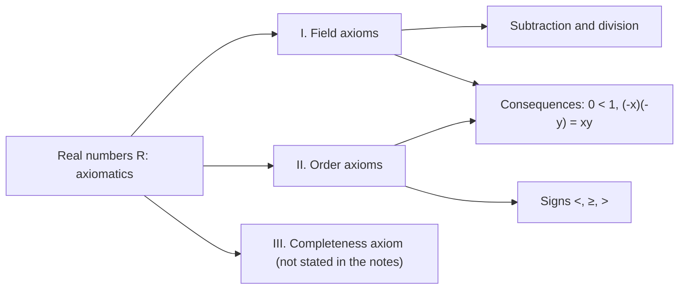

# Lecture 4 — Axioms of the real numbers

[← Lecture 3](lecture-03.md) · [Lecture index](index.md) · [Lectures 5–6 →](lecture-05-06.md) · [Terms & theorems](../term-index.md) · [Русский](../../ru/lectures-2025-26/lecture-04.md) · [Español](../../es/lectures-2025-26/lecture-04.md)

> **Source:** `ма25_26_лекция_4_notes.pdf` — 10 pages: 9 typed slides with a text layer and 1 handwritten page (page 9). The handwritten page has no figures.
>
> **Note on completeness.** The file sets out the field axioms (I) and the order axioms (II). The [completeness axiom](../02-real-numbers.md#completeness-axiom) is not stated in these notes, so it does not appear in this transcription either.

## Slide 2. Quote of the day

> "Do what you must, and let come what will."
>
> — Marcus Aurelius

## Slide 3. Aim of the lecture

- We describe a number of axioms of the field of real numbers (field, order and completeness axioms).

## §3. Real numbers

### Slide 4. Introduction

A precise definition of a real number is most likely unknown. In this section we define the set of real numbers axiomatically: the set $`\mathbb{R}`$ is called the set of real numbers if some collection of conditions (axioms) is satisfied.

For convenience we split the axioms, sixteen in total, into groups.

### Slide 5. I. Field axioms (I.1–I.4)

On the set $`\mathbb{R}`$ two operations are defined, called addition and multiplication, acting from $`\mathbb{R} \times \mathbb{R}`$ into $`\mathbb{R}`$ and satisfying the following properties.

- **I.1** Associativity of addition: $`(x + y) + z = x + (y + z)`$.
- **I.2** Commutativity of addition: $`x + y = y + x`$.
- **I.3** There exists a neutral element for addition, $`0`$, such that $`\forall x \in \mathbb{R}:\ x + 0 = x`$.
- **I.4** $`\forall x \in \mathbb{R}\ \exists`$ an additive inverse $`\tilde{x} \in \mathbb{R}`$ such that $`x + \tilde{x} = 0`$. This element is denoted by $`-x`$.

### Slide 6. I. Field axioms (I.5–I.9)

- **I.5** Associativity of multiplication: $`(xy)z = x(yz)`$.
- **I.6** Commutativity of multiplication: $`xy = yx`$.
- **I.7** There exists a neutral element for multiplication, $`1`$, such that $`\forall x \in \mathbb{R}:\ x \cdot 1 = x`$.
- **I.8** $`\forall x \in \mathbb{R} \setminus \{0\}\ \exists`$ a multiplicative inverse $`x^{-1} \in \mathbb{R}`$ such that $`x \cdot x^{-1} = 1`$. This element is also denoted by $`\dfrac{1}{x}`$.
- **I.9** Distributivity: $`x(y + z) = xy + xz`$.

### Slide 7. Field; subtraction and division

A set on which two operations satisfying I.1–I.9 are defined is called a **field**, and the properties I.1–I.9 are called the field axioms.

Axiom I.4 allows us to define subtraction:

```math
x - y = x + (-y),
```

and axiom I.8 allows division by any non-zero number:

```math
\frac{x}{y} = x \cdot \frac{1}{y}.
```

### Slide 8. II. Order axioms

On the elements of $`\mathbb{R}`$ a relation $`\leq`$ is defined with the following properties.

- **II.1** $`\forall x, y \in \mathbb{R}`$ we have $`x \leq y`$ or $`y \leq x`$.
- **II.2** Transitivity: if $`x \leq y`$ and $`y \leq z`$, then $`x \leq z`$.
- **II.3** If $`x \leq y`$ and $`y \leq x`$, then $`x = y`$.
- **II.4** If $`x \leq y`$, then $`x + z \leq y + z`$ for all $`z \in \mathbb{R}`$.
- **II.5** If $`0 \leq x`$ and $`0 \leq y`$, then $`0 \leq xy`$.

A field equipped with a relation of order that satisfies II.1–II.5 is called an **ordered field**.

### Handwritten page 9 (PDF p. 9). Other inequality signs

The other inequality signs are defined as follows:

- $`a < b`$ means that $`a \leq b`$ and $`a \neq b`$;
- $`a \geq b`$ means that $`b \leq a`$;
- $`a > b`$ means that $`b \leq a`$ and $`a \neq b`$.

### Slide 10. Remark on the field and order axioms

The field and order axioms are the familiar properties of arithmetic operations and inequalities with real numbers. Other familiar properties (for example $`0 < 1`$ or $`(-x)(-y) = xy`$) are theorems when the real numbers are defined axiomatically by this system of axioms, and they can be derived from the axioms.

## Lecture map


