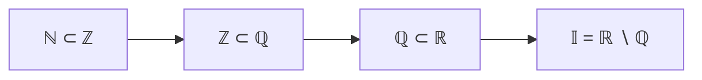

# Lectures 5–6 — Intervals, completeness axioms, induction, the binomial theorem, extrema

[← Lecture 4](lecture-04.md) · [Lecture index](index.md) · [Lecture 7 →](lecture-07.md) · [Terms & theorems](../term-index.md) · [Русский](../../ru/lectures-2025-26/lecture-05-06.md) · [Español](../../es/lectures-2025-26/lecture-05-06.md)

> **Source:** `ma25_26-lectures_5-6_notes.pdf` — 32 pages: typed slides with a text layer and handwritten pages without a usable text layer. Handwritten pages were transcribed from their images. The figure from page 12 is embedded as an illustration. PDF page numbers are given in the headings.
>
> **Editor's note on numbering.** In the source slides the label "[Definition 1.3.5](#def-1-3-5)" appears three times: for the ordered Archimedean field (page 10), for the inductive set and for the set of natural numbers (page 18). The numbering is kept as in the source and was not corrected. Likewise, "[Definition 1.3.2](#def-1-3-2)" refers to rays and "[Definition 1.3.3](#def-1-3-3)" to a point lying between two numbers.

## Slide 2. Quote of the day

> Several scientists were asked to prove that all odd integers greater than 2 are prime.
>
> Mathematician: 3 is prime, 5 is prime, 7 is prime, and by [induction](../01-logic-sets-functions.md#example-induction) every odd integer greater than 2 is prime.
>
> Physicist: 3 is prime, 5 is prime, 7 is prime, 9 is an experimental error, 11 is prime. To be sure, let us check a few randomly chosen numbers: 17 is prime, 23 is prime.
>
> Engineer: 3 is prime, 5 is prime, 7 is prime, 9 is an approximation of a prime, 11 is prime.

## Slide 3. Aim of the lecture

- Continue with the axioms of the field of real numbers (the [Archimedean axiom](#def-1-3-5) and Cantor's axiom of nested segments).
- State the principle of mathematical induction.
- Prove the binomial theorem.
- Discuss several consequences of the completeness axioms.
- Prove the statements about the maximum and minimum of a finite set.
- Talk about the density of the rational numbers.

## §3. Real numbers

### Slide 4. Segments and intervals

The order allows us to define intervals in the set $`\mathbb{R}`$.

<a id="def-1-3-1"></a>**Definition 1.3.1.** Let $`a, b \in \mathbb{R}`$. If $`a \le b`$, the set

```math
[a, b] = \{ x \in \mathbb{R} : a \le x \le b \}
```

is called a **closed interval** (or **segment**).

If $`a < b`$, the set

```math
(a, b) = \{ x \in \mathbb{R} : a < x < b \}
```

is called an **open interval**, and the sets

```math
[a, b) = \{ x \in \mathbb{R} : a \le x < b \}, \qquad (a, b] = \{ x \in \mathbb{R} : a < x \le b \}
```

are called **half-open intervals**.

### Handwritten page 6 (PDF p. 6). The notation ⟨a, b⟩

$`\langle a, b\rangle`$ denotes an interval of any of the four types: $`[a,b]`$, $`(a,b)`$, $`[a,b)`$ or $`(a,b]`$. This notation is used when it does not matter whether the endpoints $`a, b`$ belong to the interval or not. Analogously one writes $`\langle a, b]`$, $`[a, b\rangle`$, $`\langle a, +\infty)`$, etc.

### Slide 5. More definitions

When $`a = b`$, the segment $`[a,a]`$ consists of one point and is called **degenerate**.

<a id="def-1-3-2"></a>**Definition 1.3.2.** The sets

```math
[a, +\infty) = \{ x \in \mathbb{R} : a \le x \},\qquad (a, +\infty) = \{ x \in \mathbb{R} : a < x \},
```
```math
(-\infty, b] = \{ x \in \mathbb{R} : x \le b \},\qquad (-\infty, b) = \{ x \in \mathbb{R} : x < b \}
```

are called **rays** (the first and third are closed rays, the second and fourth are open rays).

The whole set $`\mathbb{R}`$ is also denoted $`(-\infty, +\infty)`$. The symbols $`-\infty`$ and $`+\infty`$ have no independent meaning in these notations.

### Slide 7. Still more

<a id="def-1-3-3"></a>**Definition 1.3.3.** If $`a, b \in \mathbb{R}`$ and a point $`c`$ belongs to the interval with endpoints $`a`$ and $`b`$, we say that $`c`$ lies between $`a`$ and $`b`$.

We also denote by $`\mathbb{R}_+`$ the set of non-negative numbers: $`\mathbb{R}_+ = [0, +\infty)`$.

<a id="def-1-3-4"></a>**Definition 1.3.4.** The set $`\overline{\mathbb{R}} = \mathbb{R} \cup \{-\infty, +\infty\}`$ is called the **extended real line**.

### Slide 8. The improper elements $`+\infty`$ and $`-\infty`$

Some operations with the improper elements are defined. One sets:

```math
x + (+\infty) = (+\infty) + x = +\infty, \quad x \in \mathbb{R},
```
```math
x + (-\infty) = (-\infty) + x = -\infty, \quad x \in \mathbb{R},
```
```math
x \cdot (+\infty) = (+\infty) \cdot x = \begin{cases} +\infty, & x > 0, \\ -\infty, & x < 0, \end{cases}
\qquad
x \cdot (-\infty) = (-\infty) \cdot x = \begin{cases} -\infty, & x > 0, \\ +\infty, & x < 0, \end{cases}
```
```math
(+\infty) + (+\infty) = +\infty, \quad (-\infty) + (-\infty) = -\infty,
```
```math
(+\infty) \cdot (+\infty) = (-\infty) \cdot (-\infty) = +\infty, \quad (+\infty) \cdot (-\infty) = (-\infty) \cdot (+\infty) = -\infty.
```

### Handwritten page 9 (PDF p. 9). Undefined expressions

No value is assigned to the expressions

```math
(+\infty) + (-\infty),\quad (+\infty) - (+\infty),\quad (-\infty) - (-\infty),\quad 0 \cdot (\pm\infty),\quad (\pm\infty)\cdot 0.
```

Note in the margin: "Future: $`0 \cdot (+\infty) = 0 \cdot \frac{1}{0} = \frac{0}{0}`$ — this will be resolved in limit theory (soon!)."

### Slide 10. III. The Archimedean axiom

**III.1.** For any positive numbers $`x, y \in \mathbb{R}`$ there exists a natural number $`n`$ such that $`nx > y`$.

<a id="def-1-3-5"></a>**Definition 1.3.5.** An ordered field in which the Archimedean axiom holds is called **Archimedean**.

The Archimedean axiom implies that there exist arbitrarily large natural numbers.

### Slide 11. IV. Cantor's axiom of nested segments

The 15 axioms formulated so far do not yet determine the set $`\mathbb{R}`$ completely: these axioms are also satisfied, for example, by the set $`\mathbb{Q}`$. Therefore we need further axioms that distinguish $`\mathbb{R}`$ from $`\mathbb{Q}`$.

**IV.1.** Let $`\{[a_n, b_n]\}_{n=1}^{\infty}`$ be a sequence of nested segments, that is,

```math
a_n \le a_{n+1} \le b_{n+1} \le b_n, \qquad \forall n \in \mathbb{N}.
```

Then there exists a point belonging to all the segments $`[a_n, b_n]`$ simultaneously, that is,

```math
\bigcap_{n=1}^{\infty} [a_n, b_n] \ne \varnothing.
```

In the set $`\mathbb{Q}`$ this statement does not hold.

### Handwritten page 12 (PDF p. 12). Example: $`\mathbb{Q}`$ has "gaps"

For example, consider the sets

```math
\{ x \in \mathbb{Q} : x > 0 \text{ and } x^2 < 2 \}, \qquad \{ y \in \mathbb{Q} : y > 0 \text{ and } y^2 > 2 \}.
```


Let $`x^2 < 2`$ and $`y^2 > 2`$. Then $`y^2 > x^2 \Rightarrow (y - x)(y + x) > 0 \Rightarrow y - x > 0 \Rightarrow y > x`$.

Suppose there exists $`c \in \mathbb{Q}`$ such that $`x \le c \le y`$.

### Handwritten page 13 (PDF p. 13). The proof that $`c^2 \neq 2`$

There are three cases: ① $`c^2 > 2`$; ② $`c^2 < 2`$; ③ $`c^2 = 2`$. We show that none of them can occur.

**③** Let $`c^2 = 2`$ with $`c \in \mathbb{Q}`$. Then $`c = \frac{p}{q}`$ is an irreducible fraction, $`\gcd(p, q) = 1`$. From $`\frac{p^2}{q^2} = 2`$ we get $`p^2 = 2q^2`$ ⇒ $`p = 2k`$ ⇒ $`4k^2 = 2q^2`$ ⇒ $`2k^2 = q^2`$ ⇒ $`q = 2m`$. Hence $`p`$ and $`q`$ are both divisible by $`2`$, contradicting $`\gcd(p, q) = 1`$. Therefore $`c^2 \ne 2`$ (case ③ is impossible).

### Handwritten page 14 (PDF p. 14). Case ②: $`c^2 < 2`$

**②** $`c^2 < 2`$. Find $`\varepsilon > 0`$, $`\varepsilon \in \mathbb{Q}`$, such that $`(c+\varepsilon)^2 < 2`$:

```math
c^2 + 2c\varepsilon + \varepsilon^2 < 2 \ \Rightarrow\ 2c\varepsilon + \varepsilon^2 < 2 - c^2 \ \Rightarrow\ \varepsilon(2c + \varepsilon) < 2 - c^2.
```

Consider $`\varepsilon`$ with $`0 < \varepsilon < 1`$. It suffices to find $`\varepsilon`$ such that $`\varepsilon(2c+1) < 2 - c^2`$, since $`\varepsilon(2c+\varepsilon) < \varepsilon(2c+1)`$.

Set $`\varepsilon = \dfrac{2 - c^2}{(2c+1)\cdot 2025}`$. Then $`c + \varepsilon > c`$ and $`(c+\varepsilon)^2 < 2`$ — a contradiction (marked with a zigzag arrow on the handwritten page).

**①** Analogous to case ②.

### Handwritten page 15 (PDF p. 15). Irrational numbers and a remark on Cantor's axiom

```math
\mathbb{R} = \mathbb{Q} \cup \mathbb{I},
```

where $`\mathbb{Q}`$ is the set of rational numbers and $`\mathbb{I}`$ the set of irrational numbers: $`\sqrt{2}, \sqrt{3}, \dots`$; $`\pi \approx 3.14\dots`$; $`e \approx 2.718\dots`$

**Remark.** In Cantor's axiom it is essential that we are dealing with segments, that is, with $`[a_n, b_n]`$ (on the handwritten page this is boxed and marked with an exclamation mark). The intersection of nested intervals of another type may be empty. For example,

```math
\bigcap_{n=1}^{\infty} \left(0, \frac{1}{n}\right] = \varnothing \qquad \text{or} \qquad \bigcap_{n=1}^{\infty} [n, +\infty) = \varnothing.
```

### Slide 16. The principle of mathematical induction

**Principle of mathematical induction.** Let $`\{P_n\}`$ be a sequence of statements. If

1. $`P_1`$ holds;
2. for every $`n \in \mathbb{N}`$, $`P_n`$ implies $`P_{n+1}`$,

then $`P_n`$ holds for all $`n \in \mathbb{N}`$.

Statement 1) is called the **base of induction**, and statement 2) the **induction step**; $`P_n`$ is called the **induction hypothesis**.

Note that when checking statement 2) one must prove not the truth of $`P_n`$, but the implication from $`P_n`$ to $`P_{n+1}`$.

### Handwritten page 17 (PDF p. 17). A modification of the induction principle

Sometimes a **modification** of the principle of mathematical induction is used: $`\{P_n\}_{n=m}^{\infty}`$, where $`m`$ is an integer. In this case the base of induction is the statement $`P_m`$, and the induction step is carried out for all $`n \ge m`$.

### Slide 18. The set $`\mathbb{N}`$

In an axiomatic definition of the natural numbers, the principle of mathematical induction (or some closely related statement) is taken as an axiom. We shall not give the axiomatics of $`\mathbb{N}`$; instead we define $`\mathbb{N}`$ as a subset of $`\mathbb{R}`$.

**Definition 1.3.5** (inductive set). A set $`M \subset \mathbb{R}`$ is called **inductive** if $`1 \in M`$ and, together with each of its elements $`x`$, the set $`M`$ also contains $`x + 1`$.

**Definition 1.3.5** (natural numbers). The set of natural numbers is the minimal (with respect to inclusion) inductive subset of $`\mathbb{R}`$.

> **Editor's note.** The number "1.3.5" is repeated; see the note at the beginning of this file.



### Slide 19. More definitions and notation

1. If $`m, n \in \mathbb{Z}`$ and $`m \le n`$, one sets

```math
\sum_{k=m}^{n} a_k = a_m + \dots + a_n, \qquad \prod_{k=m}^{n} a_k = a_m \cdot \dots \cdot a_n.
```

2. If $`m > n`$, the sum $`\sum_{k=m}^{n} a_k`$ is defined to be $`0`$, and the product $`\prod_{k=m}^{n} a_k`$ to be $`1`$.

3. The following transformation is called a **shift of the summation index**: if $`p \in \mathbb{Z}`$, then

```math
\sum_{k=m}^{n} a_k = \sum_{j=m+p}^{n+p} a_{j-p}.
```

### Slide 20. Factorials and binomial coefficients

If $`n \in \mathbb{Z}_+`$, the product $`n! = \prod_{k=1}^{n} k`$ is called the **factorial** of $`n`$; by convention $`0! = 1`$.

The numbers

```math
C_n^k = \frac{n!}{k!\,(n-k)!}
```

are called **binomial coefficients**.

Note that

```math
C_n^0 = C_n^n = 1, \qquad C_n^1 = C_n^{n-1} = n, \qquad C_{n+1}^k = C_n^{k-1} + C_n^k.
```

We agree that $`x^0 = 1`$ for all $`x`$, including $`x = 0`$.

### Slide 21. Newton's binomial formula

<a id="thm-1-3-1"></a>**Theorem 1.3.1.** If $`n \in \mathbb{Z}_+`$ and $`x, y \in \mathbb{R}`$, then

```math
(x + y)^n = \sum_{k=0}^{n} C_n^k\, x^k y^{n-k}.
```

### Handwritten pages 22–25 (PDF pp. 22–25). Proof of Theorem 1.3.1

**Proof ([Theorem 1.3.1](#thm-1-3-1)).**

**① Base of induction ($`n = 1`$).**

```math
(x+y) = C_1^0 x^0 y^1 + C_1^1 x^1 y^0 = y + x,
```

where $`C_1^0 = \dfrac{1!}{0!\,(1-0)!} = 1`$, $`C_1^1 = \dfrac{1!}{1!\,(1-1)!} = 1`$, and $`x^0 = y^0 = 1`$. The statement holds for $`n = 1`$, so the base of induction is verified ✓.

**② Induction hypothesis.** Assume the formula holds for $`n = m`$:

```math
(x+y)^m = \sum_{k=0}^{m} C_m^k x^k y^{m-k}.
```

**③ Induction step.** We must prove the formula for $`n = m+1`$.

```math
(x+y)^{m+1} = (x+y)(x+y)^m = (x+y) \sum_{k=0}^{m} C_m^k x^k y^{m-k}
= \sum_{k=0}^{m} C_m^k x^{k+1} y^{m-k} + \sum_{k=0}^{m} C_m^k x^k y^{m+1-k}.
```

Recall that the summation index may be shifted (as seen earlier in the lectures): $`\sum_{k=m}^{n} a_k = \sum_{j=m+p}^{n+p} a_{j-p}`$. In the first sum we shift the index by $`j = k+1`$:

```math
= \sum_{j=1}^{m+1} C_m^{j-1} x^{j} y^{m+1-j} + \sum_{k=0}^{m} C_m^k x^k y^{m+1-k}
```
```math
= C_m^m x^{m+1} y^0 + \sum_{k=1}^{m} C_m^{k-1} x^k y^{m+1-k} + C_m^0 x^0 y^{m+1} + \sum_{k=1}^{m} C_m^k x^k y^{m+1-k}.
```

Collecting the sums over $`k`$ (the sum $`\sum_{k=1}^m`$):

```math
= C_m^m x^{m+1} y^0 + \sum_{k=1}^{m} \left( C_m^{k-1} + C_m^k \right) x^k y^{m+1-k} + C_m^0 x^0 y^{m+1}.
```

We use Pascal's identity $`C_m^{k-1} + C_m^k = C_{m+1}^k`$. Check:

```math
C_m^{k-1} + C_m^k = \frac{m!}{(k-1)!\,(m+1-k)!} + \frac{m!}{k!\,(m-k)!}
= \frac{m!}{(k-1)!\,(m-k)!}\left[\frac{1}{m-k+1} + \frac{1}{k}\right]
```
```math
= \frac{m!}{(k-1)!\,(m-k)!}\cdot\frac{k + m - k + 1}{(m-k+1)\,k} = \frac{(m+1)!}{k!\,(m+1-k)!} = C_{m+1}^k.
```

(On the handwritten page "$`m+1`$" is written above the numerator.)

Since $`C_m^m = \dfrac{m!}{m!\,0!} = 1 = C_{m+1}^{m+1} = \dfrac{(m+1)!}{(m+1)!\,0!}`$ and $`C_m^0 = \dfrac{m!}{0!\,m!} = 1 = C_{m+1}^0`$, we get

```math
C_{m+1}^{m+1} x^{m+1} y^0 + \sum_{k=1}^{m} C_{m+1}^k x^k y^{m+1-k} + C_{m+1}^0 x^0 y^{m+1} = \sum_{k=0}^{m+1} C_{m+1}^k x^k y^{m+1-k}.
```

This is the formula for $`n = m+1`$. ∎

> **Editor's note.** On the last line of handwritten page 25 the formula reads $`C_m^k`$; the intended term is $`C_{m+1}^k`$. This is a slip in the handwriting and has been corrected in the text.

### Handwritten page 26 (PDF p. 26). Example: Bernoulli's inequality

**Example.** Prove by mathematical induction **Bernoulli's inequality**: for all $`n \in \mathbb{N}`$ and all $`x \in \mathbb{R}`$ with $`x \ge -1`$,

```math
(1+x)^n \ge 1 + nx.
```

**Base of induction** ($`n = 1`$): $`1 + x \ge 1 + x`$ for all $`x \ge -1`$ ✓.

**Induction hypothesis** ($`n = m`$): for all $`x \in \mathbb{R}`$, $`x \ge -1`$: $`(1+x)^m \ge 1 + mx`$.

**Induction step** ($`m \mapsto m+1`$). See the detailed computation on the next page.

### Handwritten page 27 (PDF p. 27). The induction step for Bernoulli's inequality

Let $`x \ge -1`$.

```math
(1+x)^{m+1} = (1+x)^m (1+x) \ge (1+mx)(1+x)
\quad\text{(by the induction hypothesis; the factor } 1+x \ge 0\text{)}.
```

```math
= 1 + mx + x + mx^2 = 1 + (m+1)x + mx^2 \ge 1 + (m+1)x,
```

because $`mx^2 \ge 0`$, since $`m \in \mathbb{N}`$ and $`x^2 \ge 0`$ for all $`x \in \mathbb{R}`$. The condition $`x \ge -1`$ is used at the multiplication step (marked in red on the page: "The condition $`x \ge -1`$ was used here"). ∎

### Slide 28. Bounded sets

<a id="def-1-3-7"></a>**Definition 1.3.7.** A set $`A \subset \mathbb{R}`$ is called **bounded above** if

```math
\exists c \in \mathbb{R}:\ \forall x \in A\ \ x \le c.
```

The number $`c`$ is then called an **upper bound** of $`A`$.

<a id="def-1-3-8"></a>**Definition 1.3.8.** A set $`A \subset \mathbb{R}`$ is called **bounded below** if

```math
\exists c \in \mathbb{R}:\ \forall x \in A\ \ x \ge c.
```

The number $`c`$ is then called a **lower bound** of $`A`$.

### Slide 29. Bounded sets (continued)

<a id="def-1-3-9"></a>**Definition 1.3.9.** A set $`A \subset \mathbb{R}`$ is called **bounded** if it is bounded both above and below.

**Remark.** If $`M`$ is an [upper bound](../02-real-numbers.md#sec-2-2) of a set $`A`$, then every number larger than $`M`$ is also an upper bound of $`A`$. If $`m`$ is a lower bound of $`A`$, then every number smaller than $`m`$ is also a lower bound of $`A`$.

### Slide 30. Supremum and maximum

<a id="def-1-3-10"></a>**Definition 1.3.10.** A number $`a`$ is called the **supremum** (least upper bound) of a set $`A \subset \mathbb{R}`$ if

1. $`a`$ is an upper bound of $`A`$;
2. for every $`\tilde a \in A`$: $`\tilde a < a`$ and $`\tilde a`$ is not an upper bound of $`A`$ — in other words, no number smaller than $`a`$ is an upper bound of $`A`$.

The [supremum](lecture-11-12.md#def-2-3-1) is the smallest of all upper bounds. Notation: $`\sup A`$.

> **Editor's note.** The slide writes the condition as "$`\forall \tilde a \in A`$"; in substance it refers to every number $`\tilde a < a`$, not only to elements of $`A`$. The text follows the slide, with the condition stated in this sense.

<a id="def-1-3-11"></a>**Definition 1.3.11.** A number $`M`$ is called the **maximum** (or largest element) of a set $`A \subset \mathbb{R}`$ if $`M \in A`$ and $`x \le M`$ for all $`x \in A`$. Notation: $`\max A`$.

### Handwritten page 31 (PDF p. 31). Example: sup, max, inf, min for intervals

**Example.**

- **⟨1⟩** $`[a, b]`$: $`\sup [a,b] = b`$; $`\max [a,b] = b`$.
- **⟨2⟩** $`[a, b)`$: $`\sup [a,b) = b`$; $`\max [a,b)`$ does not exist.
- **⟨3⟩** $`[a, +\infty)`$: $`\sup [a,+\infty)`$ does not exist; $`\max [a,+\infty)`$ does not exist; $`\inf [a,+\infty) = a`$; $`\min [a,+\infty) = a`$.
- **⟨4⟩** $`(a, b]`$: $`\inf (a,b] = a`$; $`\min (a,b]`$ does not exist.

> **Editor's note.** In block ⟨3⟩ the last line of the handwriting reads "$`\max [a,+\infty) = a`$"; in substance this is $`\min`$, since $`a`$ is the smallest element of $`[a,+\infty)`$. In block ⟨4⟩ the right endpoint is written as "$`>`$"; in substance it is "$`]`$". Both are corrected in the text.

### Slide 32. Infimum and minimum

<a id="def-1-3-12"></a>**Definition 1.3.12.** A number $`a`$ is called the **infimum** (greatest lower bound) of a set $`A \subset \mathbb{R}`$ if

1. $`a`$ is a lower bound of $`A`$;
2. no number greater than $`a`$ is a lower bound of $`A`$.

The [infimum](lecture-11-12.md#def-2-3-2) is the largest of all lower bounds. Notation: $`\inf A`$.

<a id="def-1-3-13"></a>**Definition 1.3.13.** A number $`m`$ is called the **minimum** (or smallest element) of a set $`A \subset \mathbb{R}`$ if $`m \in A`$ and $`x \ge m`$ for all $`x \in A`$. Notation: $`\min A`$.

## Non-content pages

- Page 1 is the title page; page 2 is the quote of the day (translated above).
- There is no page 33 in the PDF; all handwritten pages 6–31 are covered in the sections above.
