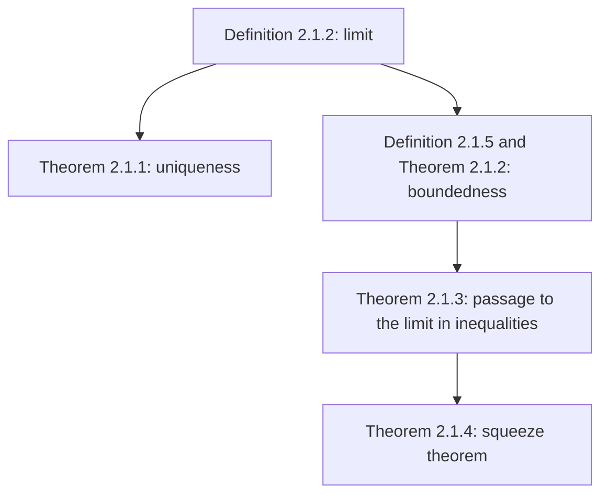

# Lecture 8 — Limit of a sequence

[← Lecture 7](lecture-07.md) · [Lecture index](index.md) · [Lectures 9–10 →](lecture-09-10.md) · [Terms & theorems](../term-index.md) · [Русский](../../ru/lectures-2025-26/lecture-08.md) · [Español](../../es/lectures-2025-26/lecture-08.md)

> **Source:** `ма25_26_лекция_8_notes.pdf` — 25 pages: typed slides with a text layer and handwritten pages (6–9, 13, 14, 17, 19, 21, 24, 25). Handwritten pages were transcribed from their images. PDF page numbers are given in the headings. The lecture contains no figures.

## Slide 2. Quote of the day

> Everything that happens happens for the best. It just isn't always for yours.

## Slide 3. Aim of the lecture

- Give the definition of the [limit of a sequence](#def-2-1-2).
- Prove several statements about limits of sequences: uniqueness of the limit, boundedness of [convergent sequences](#def-2-1-3), passage to the limit in inequalities, the [squeeze theorem](#thm-2-1-4).

## §1. The limit of a sequence

### Slide 4. Definitions

<a id="def-2-1-1"></a>**Definition 2.1.1.** A numerical sequence is a map from the set of natural numbers $`\mathbb{N}`$ to the set of real numbers $`\mathbb{R}`$.

<a id="def-2-1-2"></a>**Definition 2.1.2.** Let $`\{x_n\}_{n=1}^{\infty}`$ be a sequence of real numbers. A number $`a \in \mathbb{R}`$ is called the **limit** of the sequence $`\{x_n\}`$, and one writes

```math
\lim_{n \to \infty} x_n = a \qquad\text{or}\qquad x_n \xrightarrow[n\to\infty]{} a,
```

if for every positive number $`\varepsilon`$ there exists a number $`N`$ such that for all $`n`$ greater than $`N`$ the inequality $`|x_n - a| < \varepsilon`$ holds:

```math
\forall \varepsilon > 0\ \ \exists N \in \mathbb{N}:\ \forall n \in \mathbb{N},\ n > N \ \Rightarrow\ |x_n - a| < \varepsilon.
```

### Slide 5. Convergence

<a id="def-2-1-3"></a>**Definition 2.1.3.** A sequence that has some number as its limit is called **convergent**; otherwise (that is, if no number is a limit of the sequence) it is called **divergent**.

One also says "$`x_n`$ converges to $`a`$" or "$`x_n`$ tends to $`a`$".

### Handwritten page 6 (PDF p. 6). Example ①: $`\frac1n \to 0`$ by the definition

**Example ①.** Let us prove from the definition that the number $`a = 0`$ is the limit of $`x_n = \dfrac1n`$.

Take some (arbitrary, any) $`\varepsilon > 0`$. We try to find $`N \in \mathbb{N}`$ such that $`\forall n > N`$ we have $`\left|\dfrac1n - 0\right| < \varepsilon`$.

```math
\left|\frac1n - 0\right| = \frac1n < \varepsilon \ \Rightarrow\ n > \frac1\varepsilon \ \Rightarrow\ N := \left[\frac1\varepsilon\right] + 1.
```

- For $`\varepsilon = 1`$: $`N = \left[\tfrac11\right] + 1 = 2`$; for all $`n > 2`$: $`x_n = \dfrac1n < \dfrac12 < 1 = \varepsilon`$.
- For $`\varepsilon = \tfrac13`$: $`N = \left[\tfrac{1}{1/3}\right] + 1 = 4`$; for all $`n > 4`$: $`x_n = \dfrac1n < \dfrac14 < \dfrac13`$.

### Handwritten page 7 (PDF p. 7). Example ②: a constant sequence

**Example ②.** Let $`x_n = a`$ for all $`n`$. We prove that $`\lim_{n\to\infty} x_n = a`$.

Such a sequence is called **constant** or **stationary**.

Take $`\varepsilon > 0`$: $`|x_n - a| = |a - a| = 0 < \varepsilon`$ — this holds for every $`\varepsilon > 0`$ and every $`n \in \mathbb{N}`$. Hence any number $`N`$ works in the definition, for example $`N = 1`$.

### Handwritten page 8 (PDF p. 8). Negation of the definition of a limit

The number $`a`$ is a limit of $`\{x_n\}`$: $`\forall \varepsilon > 0\ \exists N \in \mathbb{N}:\ \forall n > N\ |x_n - a| < \varepsilon`$.

The number $`a`$ is **not** a limit of $`\{x_n\}`$. By the rules for negating quantified statements we get:

```math
\exists \varepsilon^* > 0\ \ \forall N \in \mathbb{N}\ \ \exists n > N:\ \ |x_n - a| \ge \varepsilon^*.
```

**Example.** We prove that $`x_n = (-1)^n`$ has no limit, that is, no number $`a`$ is its limit.

### Handwritten page 9 (PDF p. 9). Continuation: $`(-1)^n`$ does not converge

Let $`a \in \mathbb{R}`$. Put $`\varepsilon^* = 1`$ and take $`N \in \mathbb{N}`$.

- If $`a < 0`$, put $`n = 2N`$; if $`a \ge 0`$, put $`n = 2N+1`$.

Then $`n > N`$ and

```math
\bigl|(-1)^n - a\bigr| = \begin{cases} |1 - a| \ge 1, & \text{if } a < 0, \\ |-1 - a| \ge 1, & \text{if } a \ge 0. \end{cases}
```

Hence $`a`$ is not a limit of $`\{(-1)^n\}`$.

The sequence is: $`x_1 = -1`$, $`x_2 = 1`$, $`x_3 = -1`$, $`x_4 = 1`$, …

### Slide 10. Remark 1

**Remark 1.** If for some $`\varepsilon_0 > 0`$ a number $`N`$ from the definition of the limit has been found, the same $`N`$ works for every $`\varepsilon > \varepsilon_0`$.

Indeed, if $`|x_n - a| < \varepsilon_0`$ and $`\varepsilon > \varepsilon_0`$, then a fortiori $`|x_n - a| < \varepsilon`$. Therefore it suffices to check the definition (the existence of $`N`$) only for sufficiently small $`\varepsilon`$, that is, for $`\varepsilon`$ smaller than some positive number.

### Slide 11. Remark 2

**Remark 2.** If for some $`\varepsilon_0 > 0`$ a number $`N`$ from the definition has been found, then for the same $`\varepsilon_0`$ every number $`N_1 > N`$ also works.

Indeed, if $`|x_n - a| < \varepsilon`$ holds for all $`n > N`$ and $`N_1 > N`$, then it holds a fortiori for all $`n > N_1`$. For the same reason, in the definition of the limit $`N`$ need not be required to be a natural number.

### Slide 12. Further remarks

**Remark 3.** The definition of the limit remains equivalent to the original if one writes $`n \ge N`$ instead of $`n > N`$ (or in addition) and/or $`|x_n - a| \le \varepsilon`$ instead of $`|x_n - a| < \varepsilon`$.

**Remark 4.** Let sequences $`\{x_n\}`$ and $`\{y_n\}`$ be such that, starting from some index $`n_0`$, their values coincide: $`x_n = y_n`$ for all $`n > n_0`$. Then their limits either both exist or both do not exist, and if they exist, they are equal.

**Remark 5.**

```math
|x_n - a| < \varepsilon \iff a - \varepsilon < x_n < a + \varepsilon.
```

### Handwritten page 13 (PDF p. 13). Explanations of Remarks 3 and 4

**Explanation of Remark 3.** From $`|x_n - a| < \varepsilon`$ it follows that $`|x_n - a| \le \varepsilon`$. Conversely, let $`|x_n - a| \le \varepsilon`$. Take $`\varepsilon > 0`$ and choose $`N`$ such that for all $`n > N`$: $`|x_n - a| \le \varepsilon/2 \Rightarrow |x_n - a| < \varepsilon`$. Since $`\varepsilon`$ is arbitrary, the number $`a`$ satisfies the definition with the strict inequality "$`<`$".

**Explanation of Remark 4.** If $`a = \lim x_n`$ and the index $`N`$ works for $`\varepsilon`$ in the definition of the limit of $`\{x_n\}`$, then $`N_1 = \max\{N, n_0 - 1\}`$ works for the same $`\varepsilon`$ in the definition of the limit of $`\{y_n\}`$.

### Handwritten page 14 (PDF p. 14). Additional conclusion

**Additional conclusion.** If one changes a finite number of terms of $`\{x_n\}`$, its limit does not change. Therefore one may speak of $`\lim_{n\to\infty}\{x_n\}_{n=n_0}^{\infty}`$.

### Slide 15. The $`\varepsilon`$-neighbourhood

<a id="def-2-1-4"></a>**Definition 2.1.4.** The interval $`(a - \varepsilon, a + \varepsilon)`$ is called the **$`\varepsilon`$-neighbourhood** of the point $`a`$ and is denoted $`V_\varepsilon(a)`$.

The definition of the limit of a sequence can be reformulated with neighbourhoods: a number $`a`$ is the limit of $`\{x_n\}`$ if for every neighbourhood of $`a`$ all terms of the sequence, starting from some index, belong to this neighbourhood.

Note also that the intersection of two neighbourhoods of $`a`$ is a neighbourhood of $`a`$:

```math
V_{\varepsilon_1}(a) \cap V_{\varepsilon_2}(a) = V_{\min\{\varepsilon_1, \varepsilon_2\}}(a).
```

### Slide 16. Uniqueness of the limit

<a id="thm-2-1-1"></a>**Theorem 2.1.1.** A sequence cannot have more than one limit: if $`a, b \in \mathbb{R}`$, $`x_n \to a`$ and $`x_n \to b`$, then $`a = b`$.

### Handwritten page 17 (PDF p. 17). Proof of Theorem 2.1.1

**Proof ([Theorem 2.1.1](#thm-2-1-1)).** Suppose the contrary: let $`a \ne b`$ ⇒ $`|a - b| > 0`$.

Take $`\varepsilon = \dfrac{|a - b|}{2}`$.

- $`x_n \to a`$ ⇔ $`\exists N_1`$: $`\forall n > N_1`$ $`|x_n - a| < \varepsilon`$;
- $`x_n \to b`$ ⇔ $`\exists N_2`$: $`\forall n > N_2`$ $`|x_n - b| < \varepsilon`$.

Consider $`n > \max\{N_1, N_2\}`$:

```math
|a - b| = |a - x_n + x_n - b| \le |a - x_n| + |x_n - b| < 2\varepsilon = |a - b|,
```

(using the triangle inequality $`|x + y| \le |x| + |y|`$). Thus $`|a-b| < |a-b|`$ — a contradiction. Hence $`a = b`$. ∎

> **Editor's note.** The margin of the handwritten page carries the lecturer's exclamation "Ура! Бред!" ("Hooray! Nonsense!"); it is kept as written.

### Slide 18. Bounded sequences

<a id="def-2-1-5"></a>**Definition 2.1.5.** A sequence $`\{x_n\}`$ is called **bounded** if its set of values is bounded:

```math
\exists R > 0:\ \forall n \in \mathbb{N}\ \ |x_n| \le R.
```

<a id="thm-2-1-2"></a>**Theorem 2.1.2.** A convergent sequence is bounded.

### Handwritten page 19 (PDF p. 19). Proof of Theorem 2.1.2

**Proof ([Theorem 2.1.2](#thm-2-1-2)).** Let $`\{x_n\}`$ be a convergent sequence, $`x_n \to a`$. Take $`\varepsilon = 1`$. There exists $`N`$ with $`|x_n - a| < 1`$ for all $`n > N`$.

Then for all $`n > [N] + 1`$:

```math
|x_n| = |x_n - a + a| \le |x_n - a| + |a| < 1 + |a|.
```

Put $`R = \max\{ |x_1|, |x_2|, \dots, |x_{[N]+1}|,\ 1 + |a| \}`$. Then $`|x_n| \le R`$ for all $`n \in \mathbb{N}`$.

**Note in the margin:** $`x_1, x_2, \dots, x_{[N]+1}`$ is a finite set of elements, so the largest in absolute value can be found; $`x_{[N]+2}, \dots < 1 + |a|`$ by the definition of the limit. ∎

### Slide 20. Passage to the limit in an inequality

<a id="thm-2-1-3"></a>**Theorem 2.1.3.** Let $`\{x_n\}`$, $`\{y_n\}`$ be real sequences with $`x_n \le y_n`$ for all $`n \in \mathbb{N}`$, $`a, b \in \mathbb{R}`$, $`x_n \to a`$, $`y_n \to b`$. Then $`a \le b`$.

In other words: if $`x_n \le y_n`$ for all $`n`$ and the limits of $`\{x_n\}`$ and $`\{y_n\}`$ exist, then $`\lim x_n \le \lim y_n`$.

**Corollary.**

1. If $`x_n \le b`$ for all $`n`$ and $`\lim x_n`$ exists, then $`\lim x_n \le b`$.
2. If $`x_n \ge a`$ for all $`n`$ and $`\lim x_n`$ exists, then $`\lim x_n \ge a`$.
3. If $`x_n \in [a, b]`$ for all $`n`$ and $`\lim x_n`$ exists, then $`\lim x_n \in [a, b]`$.

### Handwritten page 21 (PDF p. 21). Proof of Theorem 2.1.3

**Proof ([Theorem 2.1.3](#thm-2-1-3)).** Suppose the contrary: let $`a > b`$ ⇒ $`\varepsilon = \dfrac{a - b}{2} > 0`$.

- $`\exists N_1`$: $`\forall n > N_1`$ $`|x_n - a| < \varepsilon`$ ⇒ $`a - \varepsilon < x_n`$.
- $`\exists N_2`$: $`\forall n > N_2`$ $`|y_n - b| < \varepsilon`$ ⇒ $`y_n < b + \varepsilon`$.

[Recap: $`|x_n - a| < \varepsilon \iff a - \varepsilon < x_n < a + \varepsilon`$; $`|y_n - b| < \varepsilon \iff b - \varepsilon < y_n < b + \varepsilon`$.]

Consider $`n > \max\{N_1, N_2\}`$. Then

```math
y_n < b + \varepsilon = b + \frac{a - b}{2} = \frac{a + b}{2} = a - \varepsilon < x_n,
```

which contradicts the condition $`x_n \le y_n`$ for all $`n \in \mathbb{N}`$. ∎

### Slide 22. Remark 6: strict inequalities

**Remark 6.** Under passage to the limit a strict inequality may become non-strict: from $`x_n < y_n`$ for all $`n`$ it does not follow that $`\lim x_n < \lim y_n`$.

### Slide 23. The squeezed sequence (the squeeze or "two policemen" theorem)

<a id="thm-2-1-4"></a>**Theorem 2.1.4.** Let $`\{x_n\}`$, $`\{y_n\}`$, $`\{z_n\}`$ be real sequences with $`x_n \le y_n \le z_n`$ for all $`n`$, $`a \in \mathbb{R}`$, and $`\lim x_n = \lim z_n = a`$. Then the limit of $`\{y_n\}`$ exists and equals $`a`$.

### Handwritten page 24 (PDF p. 24). Proof of Theorem 2.1.4

**Proof ([Theorem 2.1.4](#thm-2-1-4)).** Take $`\varepsilon > 0`$.

- $`x_n \to a`$ ⇔ $`\exists N_1`$: $`\forall n > N_1`$ $`|x_n - a| < \varepsilon`$ ⇔ $`a - \varepsilon < x_n < a + \varepsilon`$.
- $`z_n \to a`$ ⇔ $`\exists N_2`$: $`\forall n > N_2`$ $`|z_n - a| < \varepsilon`$ ⇔ $`a - \varepsilon < z_n < a + \varepsilon`$.

Put $`N = \max\{N_1, N_2\}`$. Then for all $`n > N`$

```math
a - \varepsilon < x_n \le y_n \le z_n < a + \varepsilon \ \Rightarrow\ |y_n - a| < \varepsilon.
```

Hence $`y_n \to a`$. ∎

### Handwritten page 25 (PDF p. 25). Remarks on Theorems 2.1.3 and 2.1.4

**Remark 1 (special case of Theorem 2.1.4).** If $`|y_n| \le z_n`$ for all $`n \in \mathbb{N}`$ and $`z_n \to 0`$, then $`y_n \to 0`$. Indeed, $`|y_n| \le z_n \iff -z_n \le y_n \le z_n`$, and $`-z_n \to 0`$, $`z_n \to 0`$.

**Remark 2.** In [Theorems 2.1.3](#thm-2-1-3) and [2.1.4](#thm-2-1-4) it suffices that the inequalities hold for all $`n \ge n_0`$, where $`n_0 \in \mathbb{N}`$.

## Structure of the lecture



## Non-content pages

- Page 1 is the title page; page 2 is the quote of the day (translated above).
- Page 3 states the aim of the lecture (translated above).
