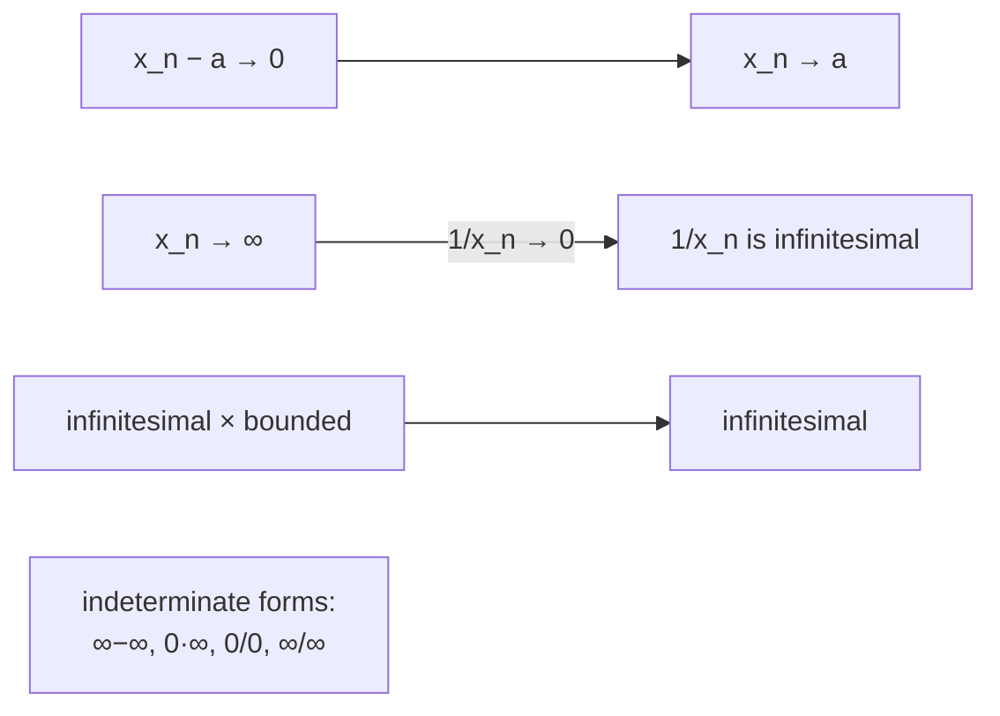

# Lectures 9–10 — Infinitesimal and infinitely large sequences, arithmetic of limits

[Lecture index](index.md) · [Русский](../../ru/lectures-2025-26/lecture-09-10.md) · [Español](../../es/lectures-2025-26/lecture-09-10.md)

> **Source:** `ma25_26-lectures_9-10_notes.pdf` — 28 pages: typed slides with a text layer, slides with handwritten annotations (pages 4, 5), and handwritten pages without a usable text layer (pages 6, 8–11, 14, 16, 19, 21, 24–28). Handwritten pages were transcribed from their images. PDF page numbers are given in the headings. The lecture contains no figures.
>
> **Editor's note.** The numbers ③ and ④ in the remark on pages 26 and 28 do not match. On page 26: ③ is $\infty,\infty$ and ④ is $0,0$; on page 28: ③ is $0,0$ and ④ is $\infty,\infty$. Both versions are kept as written on the respective pages.

## Slide 2. Quote of the day

> Everything can be explained, but not to everyone.

## Slide 3. Aim of the lecture

- Define infinitesimal and infinitely large sequences and discuss their properties.

## §2. Infinitesimal and infinitely large sequences

### Slide 4. Infinitesimal sequence

**Definition 2.2.1.** A numerical sequence is called **infinitesimal** if it tends to zero.

Thus the convergence of $\{x_n\}$ to $a$ is equivalent to the statement that $\{x_n - a\}$ is infinitesimal.

**Handwritten annotation** (margins of slide 4):

$$
x_n \to a \iff x_n - a \to 0 \iff \{x_n - a\}\ \text{is infinitesimal}.
$$

$$
\{x_n\} \text{ converges to } a \iff \{x_n - a\} \text{ is an infinitesimal sequence.}
$$

### Slide 5. Lemma 2.2.1

**Lemma 2.2.1.** The product of an infinitesimal sequence and a bounded sequence is infinitesimal: if $\{x_n\}$, $\{y_n\}$ are real sequences, $\{x_n\}$ is infinitesimal and $\{y_n\}$ is bounded, then $\{x_n y_n\}$ is infinitesimal.

**Handwritten annotation:** $\{x_n\}$ infinitesimal ⇔ $x_n \to 0$; $\{y_n\}$ bounded ⇔ $\exists M \in \mathbb{R}: |y_n| \le M\ \forall n$; ⇒ $\{x_n y_n\}$ infinitesimal ⇔ $x_n y_n \to 0$ as $n \to \infty$.

### Handwritten page 6 (PDF p. 6). Proof of Lemma 2.2.1

**Proof (Lemma 2.2.1).** $\{y_n\}$ is bounded ⇔ $\exists M > 0$: $|y_n| \le M\ \forall n$. "Without loss of generality" we may assume $M \ge 1$.

Take $\varepsilon > 0$. $x_n \to 0$ ⇔ $\exists N$: $\forall n > N$ $|x_n| < \dfrac{\varepsilon}{M}$.

Then for all $n > N$:

$$
|x_n y_n - 0| = |x_n y_n| = |x_n| \cdot |y_n| < \frac{\varepsilon}{M} \cdot M = \varepsilon.
$$

(We used the property of absolute value $|AB| = |A|\cdot|B|$ and $|y_n| \le M$.) ∎

### Slide 7. Arithmetic of convergent sequences

**Theorem 2.2.1.** Let $\{x_n\}$, $\{y_n\}$ be real sequences, $x_0, y_0 \in \mathbb{R}$, $x_n \to x_0$, $y_n \to y_0$. Then

1. $x_n + y_n \to x_0 + y_0$;
2. $x_n y_n \to x_0 y_0$;
3. $x_n - y_n \to x_0 - y_0$;
4. $|x_n| \to |x_0|$;
5. if, in addition, $y_n \ne 0$ for all $n$ and $y_0 \ne 0$, then $\dfrac{x_n}{y_n} \to \dfrac{x_0}{y_0}$.

### Handwritten page 8 (PDF p. 8). Proof of Theorem 2.2.1, item ①

**Proof (Theorem 2.2.1).**

**①** Let $x_n \to x_0$, $y_n \to y_0$. We show that $x_n + y_n \to x_0 + y_0$.

Take $\varepsilon > 0$. $x_n \to x_0$ ⇔ $\exists N_1$: $\forall n > N_1$ $|x_n - x_0| < \dfrac{\varepsilon}{2}$; $\ y_n \to y_0$ ⇔ $\exists N_2$: $\forall n > N_2$ $|y_n - y_0| < \dfrac{\varepsilon}{2}$.

Put $N = \max\{N_1, N_2\}$. For all $n > N$:

$$
|(x_n + y_n) - (x_0 + y_0)| = |(x_n - x_0) + (y_n - y_0)| \le |x_n - x_0| + |y_n - y_0| < \frac{\varepsilon}{2} + \frac{\varepsilon}{2} = \varepsilon.
$$

### Handwritten page 9 (PDF p. 9). Items ② and ③

**②** We estimate $|x_n y_n - x_0 y_0|$:

$$
|x_n y_n - x_0 y_0| = |x_n y_n - x_0 y_n + x_0 y_n - x_0 y_0| = \bigl|(x_n - x_0) y_n + x_0 (y_n - y_0)\bigr|
$$
$$
\le |x_n - x_0|\cdot |y_n| + |x_0|\cdot |y_n - y_0|.
$$

Notes in the margins:

- $|x_n - x_0|$ is **infinitesimal**, since $x_n \to x_0$;
- $|y_n|$ is **bounded**, since $\{y_n\}$ is convergent, and every convergent sequence is bounded;
- $|x_0|$ is **bounded**, since $x_0 \in \mathbb{R}$ is finite;
- $|y_n - y_0|$ is **infinitesimal**, since $y_n \to y_0$.

Thus (infinitesimal)·(bounded) + (bounded)·(infinitesimal) = infinitesimal by item ①.

**③** Follows from ① and ②: $x_n - y_n = x_n + (-1) y_n \to x_0 + (-1) y_0 = x_0 - y_0$.

### Handwritten page 10 (PDF p. 10). Items ④ and ⑤

**④** We use the property of absolute value: $\bigl| |x_n| - |x_0| \bigr| \le |x_n - x_0|$.

**⑤** It suffices to show that $\dfrac{1}{y_n} \to \dfrac{1}{y_0}$, since by item ② we then have

$$
\frac{x_n}{y_n} = x_n\cdot\frac{1}{y_n} \to x_0 \cdot \frac{1}{y_0} = \frac{x_0}{y_0}.
$$

We estimate the difference:

$$
\left|\frac{1}{y_n} - \frac{1}{y_0}\right| = \left|\frac{y_0 - y_n}{y_0 y_n}\right| = |y_n - y_0| \cdot \frac{1}{|y_n|} \cdot \frac{1}{|y_0|}.
$$

Here $|y_n - y_0|$ is infinitesimal and $\dfrac{1}{|y_0|}$ is a constant. It remains to show that $\dfrac{1}{y_n}$ is bounded.

Take $\varepsilon = \dfrac{|y_0|}{2} > 0$, since $y_0 \ne 0$ by assumption. $y_n \to y_0$ ⇔ $\exists N$: $\forall n > N$ $|y_n - y_0| < \varepsilon = \dfrac{|y_0|}{2}$.

### Handwritten page 11 (PDF p. 11). Completion of item ⑤

Then for all $n > N$

$$
|y_n| = |y_0 + y_n - y_0| \ge |y_0| - |y_n - y_0| > |y_0| - \varepsilon = \frac{|y_0|}{2}
$$

(property of absolute value).

Denote $k := \min\left\{ |y_1|, |y_2|, \dots, |y_N|,\ \dfrac{|y_0|}{2} \right\}$. Then $\dfrac{1}{|y_n|} \le \dfrac{1}{k}$ for all $n$, that is, $\left\{\dfrac{1}{y_n}\right\}$ is bounded.

Hence

$$
\left|\frac{1}{y_n} - \frac{1}{y_0}\right| = |y_n - y_0|\cdot\frac{1}{|y_n|}\cdot\frac{1}{|y_0|} = \text{infinitesimal} \cdot \text{bounded} \cdot \text{bounded} = \text{infinitesimal}.
$$

> **Editor's note.** The handwriting does not state that $y_n \ne 0$ for all $n$ (this is needed to define $1/y_n$). For $n \le N$ it is implicitly assumed that $y_n \ne 0$; this is noted as an assumption of the course.

**Remark.** $z_n \to a$ ⇔ $z_n - a \to 0$ ⇔ $\{z_n - a\}$ is infinitesimal.

### Slide 12. Infinitely large sequences: $\pm\infty$

**Definition 2.2.2.** A real sequence $\{x_n\}$ is said to tend to:

1. **plus infinity**, and one writes $\lim_{n\to\infty} x_n = +\infty$ or $x_n \xrightarrow[n\to\infty]{} +\infty$, if

$$
\forall E > 0\ \ \exists N \in \mathbb{N}:\ \forall n > N\ \ x_n > E;
$$

2. **minus infinity**, and one writes $\lim_{n\to\infty} x_n = -\infty$ or $x_n \xrightarrow[n\to\infty]{} -\infty$, if

$$
\forall E > 0\ \ \exists N \in \mathbb{N}:\ \forall n > N\ \ x_n < -E.
$$

**Handwritten annotation:** $x_n > E$ ⇔ $\{x_n\} \to +\infty$; $x_n < -E$ ⇔ $\{x_n\} \to -\infty$ ⇔ $\{-x_n\} \to +\infty$.

### Slide 13. Infinity of indefinite sign

**Definition 2.2.3.** A real sequence $\{x_n\}$ is said to tend to **infinity** (infinity of indefinite sign), and one writes $\lim_{n\to\infty} x_n = \infty$ or $x_n \xrightarrow[n\to\infty]{} \infty$, if

$$
\forall E > 0\ \ \exists N \in \mathbb{N}:\ \forall n > N\ \ |x_n| > E.
$$

**Remark 1.** From the definitions it follows that if $x_n \to \pm\infty$, then $x_n \to \infty$. **The converse is false!**

### Handwritten page 14 (PDF p. 14). Example

**Example.** $x_n = (-1)^n \cdot n$ ⇒ $|x_n| = n \to \infty$.

The values are $-1, 2, -3, 4, -5, \dots$. The sequence **tends neither to $+\infty$ nor to $-\infty$**, but it tends to infinity of indefinite sign.

### Slide 15. Infinitely large sequence

**Definition 2.2.4.** A sequence tending to infinity is called **infinitely large**.

**Remark 2.** From the definitions it follows that if $x_n \to \infty$, then $\{x_n\}$ is unbounded. **The converse is false!**

**Remark 3.** The limit in $\mathbb{R}$ is unique: if $a, b \in \mathbb{R}$, $x_n \to a$ and $x_n \to b$, then $a = b$.

### Handwritten page 16 (PDF p. 16). Example for Remark 2

**Example (for Remark 2).** If $\{x_n\}$ is unbounded, it does not follow that $x_n \to \infty$ (the arrow "⇒" is crossed out on the page). Counterexample:

$$
x_n = \bigl(1 + (-1)^n\bigr) \cdot n: \quad 0,\ 4,\ 0,\ 8,\ 0,\ 10,\ \dots
$$

The sequence is unbounded but does not tend to $\infty$ (the terms with odd indices are equal to $0$).

### Slide 17. Remarks on infinitely large sequences

**Remark 4.** The definition needs to be checked only for sufficiently large numbers $E$; one may also omit the requirement $E > 0$ in the definition.

**Remark 5.** The definition of a convergent sequence does not change: a sequence is called convergent if it has a finite limit. Infinitely large sequences are divergent.

### Slide 18. Neighbourhoods of infinite points

**Definition 2.2.5.**

$$
V(+\infty) = (E, +\infty], \qquad V(-\infty) = (-\infty, -E), \qquad V(\infty) = \{ x \in \mathbb{R} : |x| > E \}.
$$

If one wants $\varepsilon$-neighbourhoods specifically, one sets $V_\varepsilon(+\infty) = \left(\dfrac{1}{\varepsilon}, +\infty\right]$, etc. The $\varepsilon$-neighbourhoods then shrink as $\varepsilon > 0$ decreases.

**Remark 6.**

1. If $x_n > y_n$ for all $n$ and $y_n \to +\infty$, then $x_n \to +\infty$.
2. If $x_n \le y_n$ for all $n$ and $y_n \to -\infty$, then $x_n \to -\infty$.

### Handwritten page 19 (PDF p. 19). Explanation of Remark 6

$y_n \to +\infty$ ⇔ $\forall E > 0\ \exists N_0 \in \mathbb{N}:\ \forall n > N_0\ \ y_n > E$.

For all $n$: $y_n \le x_n$ ⇒ for all $n > N_0$: $x_n > E$ ⇒ $x_n \to +\infty$.

**Remark 6** complements the squeeze theorem (the theorem on two policemen).

### Slide 20. The link between infinitely large and infinitesimal sequences

**Lemma 2.2.2.** Let $\{x_n\}$ be a real sequence with $x_n \ne 0$ for every $n$. Then $\{x_n\}$ is infinitely large if and only if $\left\{\dfrac{1}{x_n}\right\}$ is infinitesimal.

### Handwritten page 21 (PDF p. 21). Proof of Lemma 2.2.2

**Proof (Lemma 2.2.2).**

**①** (⇒): $\{x_n\}$ is infinitely large ⇔ $x_n \to \infty$. We show that $\dfrac{1}{x_n} \to 0$.

Take $\varepsilon > 0$. Put $E = \dfrac{1}{\varepsilon}$. For $E = \dfrac{1}{\varepsilon} > 0$ there exists $N$ with $|x_n| > E$ for all $n > N$, that is, $\varepsilon > \dfrac{1}{|x_n|} = \left|\dfrac{1}{x_n}\right|$ ⇒ $\left\{\dfrac{1}{x_n}\right\}$ is infinitesimal.

**②** (⇐): the proof is analogous (to be completed at home).

### Slide 22. Arithmetic of infinitely large sequences

**Theorem 2.2.2.** Let $\{x_n\}$, $\{y_n\}$ be real sequences and $a, b \in \mathbb{R} \cup \{\infty\}$.

1. If $x_n \to +\infty$ and $\{y_n\}$ is bounded below, then $x_n + y_n \to +\infty$.
2. If $x_n \to -\infty$ and $\{y_n\}$ is bounded above, then $x_n + y_n \to -\infty$.
3. If $x_n \to \infty$ and $\{y_n\}$ is bounded, then $x_n + y_n \to \infty$.
4. If $x_n \to \pm\infty$ and $y_n \ge b > 0$ for all $n$ (or $y_n \to b > 0$), then $x_n y_n \to \pm\infty$.
5. If $x_n \to \pm\infty$ and $y_n \le b < 0$ for all $n$ (or $y_n \to b < 0$), then $x_n y_n \to \mp\infty$.
6. If $x_n \to \infty$ and $|y_n| \ge b > 0$ for all $n$ (or $y_n \to b \ne 0$), then $x_n y_n \to \infty$.
7. If $x_n \to a \ne 0$, $y_n \to 0$ and $y_n \ne 0$ for all $n$, then $\dfrac{x_n}{y_n} \to \infty$.

### Slide 23. Theorem 2.2.2 (continued)

8. If $x_n \to a \in \mathbb{R}$ and $y_n \to \infty$, then $\dfrac{x_n}{y_n} \to 0$.
9. If $x_n \to \infty$, $y_n \to b \in \mathbb{R}$ and $y_n \ne 0$ for all $n$, then $\dfrac{x_n}{y_n} \to \infty$.

### Handwritten page 24 (PDF p. 24). Proof of Theorem 2.2.2, item ①

**Proof (Theorem 2.2.2).** We restrict ourselves to proving statements 1, 6 and 8.

**①** $\{y_n\}$ is bounded below ⇔ $\exists m \in \mathbb{R}$: $\forall n \in \mathbb{N}$ $y_n \ge m$.

Take $E > 0$. $x_n \to +\infty$ ⇒ apply the definition with $E - m$: $\exists N$: $\forall n > N$ $x_n > E - m$ ⇒

$$
x_n + y_n > E - m + m = E.
$$

Since $E$ is arbitrary, this means that $x_n + y_n \to +\infty$.

> **Editor's note.** The handwriting writes $y_m$ in the last inequality; in substance it is $y_n$.

### Handwritten page 25 (PDF p. 25). Item ⑥

**⑥** Let $|y_n| \ge b > 0$ for all $n \in \mathbb{N}$.

Take $E > 0$. $x_n \to +\infty$ ⇒ apply the definition of the limit with $\dfrac{E}{b}$: $\exists N$: $\forall n > N$ $|x_n| > \dfrac{E}{b}$.

Then for all $n > N$: $|x_n y_n| = |x_n|\cdot|y_n| > \dfrac{E}{b}\cdot b = E$.

**Note:** $y_n \to b \ne 0$. Put $b_1 = \dfrac{|b|}{2}$ if $b$ is a number; $b_1 = 1$ if $b = \infty$. Then, starting from some index, $|y_n| \ge b_1$, and we apply the statement proved at the beginning of item ⑥.

### Handwritten page 26 (PDF p. 26). Item ⑧ and the remark on indeterminate forms

**⑧** $\dfrac{x_n}{y_n} = x_n \cdot \dfrac{1}{y_n} \to a \cdot 0 = 0$: here $y_n \to \infty$ ⇒ $\dfrac{1}{y_n}$ is infinitesimal (by Lemma 2.2.2); we apply the theorem on the limit of a product and Lemma 2.2.2.

The other statements are left as exercises.

**Remark.** We cannot say anything about the value of the limit in the following situations:

- **①** $x_n \to +\infty$, $y_n \to -\infty$: $x_n + y_n = ?$
- **②** $x_n \to 0$, $y_n \to \infty$: $x_n \cdot y_n = ?$
- **③** $x_n \to \infty$, $y_n \to \infty$: $\dfrac{x_n}{y_n} = ?$
- **④** $x_n \to 0$, $y_n \to 0$: $\dfrac{x_n}{y_n} = ?$

### Handwritten page 27 (PDF p. 27). Examples

**Examples.**

- **1a)** $x_n = a + n$, $a \in \mathbb{R}$; $y_n = -n$ ⇒ $x_n + y_n = a \to a$.
- **1b)** $x_n = n^2 + n$; $y_n = -n$ ⇒ $x_n + y_n = n^2 \to +\infty$.
- **1c)** $x_n = n^2$; $y_n = -n^2 - n$ ⇒ $x_n + y_n = -n \to -\infty$.
- **1d)** $x_n = n + (-1)^n$; $y_n = -n$ ⇒ $x_n + y_n = (-1)^n$ — **has no limit**.

### Handwritten page 28 (PDF p. 28). Remark on indeterminate forms

**Remark.** In the situations:

1. $x_n \to +\infty$, $y_n \to -\infty$ (sum);
2. $x_n \to 0$, $y_n \to \infty$ (product);
3. $x_n \to 0$, $y_n \to 0$ (quotient $x_n / y_n$);
4. $x_n \to \infty$, $y_n \to \infty$ (quotient $x_n / y_n$)

one says that there is an **indeterminate form** of the type $\infty - \infty$, $0 \cdot \infty$, $\dfrac{0}{0}$, $\dfrac{\infty}{\infty}$ respectively.

In this case, finding the limit is called **resolving the indeterminacy**.

## Non-content pages

- Page 1 is the title page; page 2 is the quote of the day (translated above).
- Pages 4, 5, 12, 13, 15, 17, 18, 20, 22, 23 are typed slides; the handwritten annotations on slides 4 and 5 are included above.
