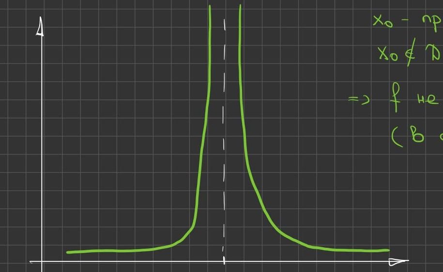
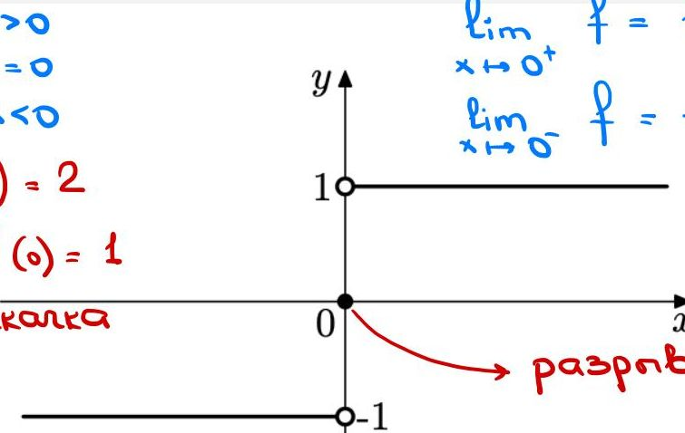
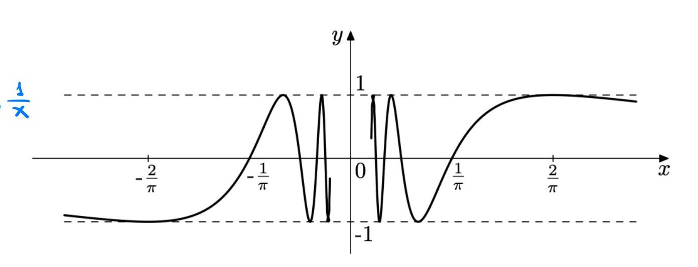
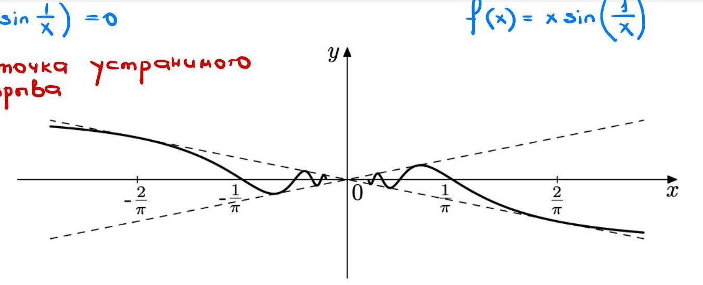
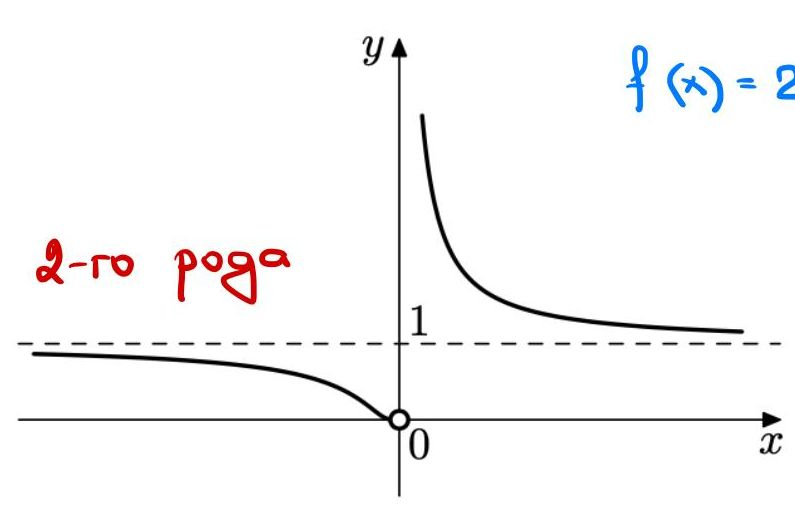
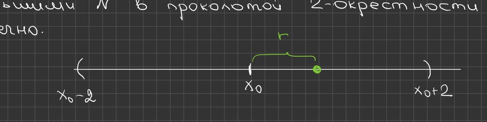
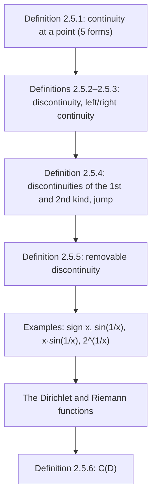

# Lecture 16 — Continuous functions: definitions and points of discontinuity

[← Lecture 15](lecture-15.md) · [Lecture index](index.md) · [Lectures 17–18 →](lecture-17-18.md) · [Terms & theorems](../term-index.md) · [Русский](../../ru/lectures-2025-26/lecture-16.md) · [Español](../../es/lectures-2025-26/lecture-16.md)

> **Source:** `ма25_26_лекция_16_notes.pdf` — 16 pages: typed slides with a text layer (pages 1–4, 7–10, 12, 16; pages 10 and 12 carry coloured handwritten annotations over printed pictures), handwritten pages without a text layer (5, 6, 11, 13–15). Handwritten pages were transcribed from their images. PDF page numbers are given in the headings; the typed slides are numbered "1/10"–"10/10" in the PDF.
>
> **Editor's note.** The lecture date is taken from the footer of the slides ("23 October 2025"). The "quote of the day" on page 2 is the same as in Lecture 15 and is not repeated below.

## Typed slides 1–3. Introduction

**Aim of the lecture.** Give a number of definitions concerning continuous functions.

## Chapter 2. Limit theory. §5. Continuous functions

### Typed slide 4 (PDF p. 4). Definition of continuity at a point

<a id="def-2-5-1"></a>**Definition 2.5.1.** Let $`f : D \subset \mathbb{R} \to \mathbb{R}`$, $`x_0 \in D`$. The function $`f`$ is called **continuous at the point $`x_0`$** if one of the following statements holds.

1. The limit of $`f`$ at $`x_0`$ exists and equals $`f(x_0)`$. This definition applies if $`x_0`$ is a [limit point](lecture-14.md#def-2-4-1) of $`D`$.
2. $`\forall \varepsilon > 0\ \exists \delta > 0\ \forall x \in D : |x - x_0| < \delta \Rightarrow |f(x) - f(x_0)| < \varepsilon`$.
3. $`\forall V(f(x_0))\ \exists V(x_0))\ f(V(x_0) \cap D) \subset V(f(x_0))`$.
4. $`\forall \{x_n\} : x_n \in D,\ x_n \to x_0 \Rightarrow f(x_n) \to f(x_0)`$.
5. $`\Delta y \xrightarrow[\Delta x \to 0]{} 0`$. Here $`\Delta x = x - x_0`$ is the increment of the argument and $`\Delta y = f(x) - f(x_0)`$ is the increment of the function. This definition applies if $`x_0`$ is a limit point of $`D`$.

### Handwritten page 5 (PDF p. 5). Remarks on Definition 2.5.1

(In green, with a drawing of a graph tending to $`+\infty`$ on both sides of the vertical dashed line $`x = x_0`$:) $`x_0`$ is a limit point of $`D`$, $`x_0 \notin D`$, i.e. $`f(x_0)`$ is not defined $`\Rightarrow`$ $`f`$ is not continuous at $`x_0`$ (in the sense of definition ①).



**Remark (handwritten).** ②, ③, ④ mean that the number $`A = f(x_0)`$ is the limit of $`f`$ at $`x_0`$.

In ② the condition $`x \ne x_0`$ is omitted, but at this place it is harmless, because the inequality $`|f(x) - f(x_0)| < \varepsilon`$ is true for $`x = x_0`$.

Similarly, in ③ the condition $`\dot V(x_0)`$ is omitted, and in ④ the condition $`x_n \ne x_0`$.

### Handwritten page 6 (PDF p. 6). An isolated point

**Remark (handwritten).** Let $`x_0`$ be an isolated point of $`D`$ $`\Rightarrow`$ $`\exists \delta > 0 : V_\delta(x_0) \cap D = \{x_0\}`$,

```math
f(V_\delta(x_0) \cap D) = \{f(x_0)\} \subset V(f(x_0)) \qquad \forall f \text{ and } \forall V(f(x_0)).
```

Boxed in yellow: **every function is continuous at an isolated point of its domain.**

### Typed slide 7 (PDF p. 7). Discontinuous functions; continuity from the left and from the right

<a id="def-2-5-2"></a>**Definition 2.5.2.** Let $`f : D \subset \mathbb{R} \to \mathbb{R}`$, $`x_0 \in \mathbb{R}`$. If the function $`f`$ is not continuous at $`x_0`$, one says that $`f`$ is **discontinuous** (has a discontinuity) at $`x_0`$, and $`x_0`$ is called a **point of discontinuity** of $`f`$.

<a id="def-2-5-3"></a>**Definition 2.5.3.** Let $`f : D \subset \mathbb{R} \to \mathbb{R}`$, $`x_0 \in \mathbb{R}`$. If the restriction of $`f`$ to the set $`E_1 = D \cap (-\infty, x_0]`$ ($`E_2 = D \cap [x_0, +\infty)`$) is continuous at $`x_0`$, one says that the function $`f`$ is **continuous from the left (from the right)** at $`x_0`$.

> **Editor's note.** In [Definitions 2.5.2](#def-2-5-2) and [2.5.3](#def-2-5-3) the slide writes $`x_0 \in \mathbb{R}`$ (not $`x_0 \in D`$): a discontinuity is also spoken of at a point where the function is not defined, in agreement with [Definition 2.5.5](#def-2-5-5) below.

### Typed slide 8 (PDF p. 8). Discontinuities of the first and second kind

<a id="def-2-5-4"></a>**Definition 2.5.4.** If the finite limits $`f(x_0^-)`$ and $`f(x_0^+)`$ exist, but the three numbers $`f(x_0^-)`$, $`f(x_0^+)`$, $`f(x_0)`$ are not all equal, then $`x_0`$ is called a **point of discontinuity of the first kind** of $`f`$.

A discontinuity of the first kind is also called a **jump**. The difference $`f(x_0^+) - f(x_0^-)`$ is also called the jump, while the differences $`f(x_0) - f(x_0^-)`$ and $`f(x_0^+) - f(x_0)`$ are called the jumps of $`f`$ from the left and from the right at $`x_0`$.

Otherwise, i.e. if at least one of the [one-sided limits](lecture-15.md#def-2-4-5) at the discontinuity $`x_0`$ is infinite or does not exist at all, $`x_0`$ is called a **point of discontinuity of the second kind** of $`f`$.

### Typed slide 9 (PDF p. 9). Removable discontinuities

<a id="def-2-5-5"></a>**Definition 2.5.5.** Let $`f(x_0^-) = f(x_0^+) = A \in \mathbb{R}`$, but $`f(x_0) \ne A`$ or $`f`$ is not defined at $`x_0`$. Then $`x_0`$ is called a **point of removable discontinuity** of $`f`$.

### Typed slide 10 with handwritten annotations (PDF p. 10). Examples

$`f(x) = \operatorname{sign} x = \begin{cases} 1, & x > 0, \\ 0, & x = 0, \\ -1, & x < 0. \end{cases}`$

Handwritten: $`\lim\limits_{x \to 0^+} f = 1 = f(0^+)`$; $`\lim\limits_{x \to 0^-} f = -1 = f(0^-)`$. Jump $`f(0^+) - f(0^-) = 2`$; $`f(0) - f(0^-) = f(0^+) - f(0) = 1`$; both one-sided jumps (from the right and from the left) $`= 1`$. A red arrow from the point $`(0, 0)`$: "discontinuity of the 1st kind".



$`f(x) = \sin \dfrac{1}{x}`$ (printed graph with marks $`-\dfrac{2}{\pi}`$, $`-\dfrac{1}{\pi}`$, $`\dfrac{1}{\pi}`$, $`\dfrac{2}{\pi}`$ and dashed lines $`y = \pm 1`$).



### Handwritten page 11 (PDF p. 11). A discontinuity of the second kind for $`\sin \frac1x`$

Let us prove that $`0`$ is a [point of discontinuity](#def-2-5-4) of the 2nd kind (for $`f(x) = \sin \dfrac1x`$).

$`x_n = \dfrac{1}{2\pi n}`$, $`x_n > 0`$, $`f(x_n) = \sin\left(\dfrac{1}{1/(2\pi n)}\right) = \sin(2\pi n) = 0 \xrightarrow[n\to\infty]{} 0`$.

$`\widetilde x_n = \dfrac{1}{2\pi n + \pi/2}`$, $`\widetilde x_n > 0`$, $`f(\widetilde x_n) = \sin\left(2\pi n + \dfrac{\pi}{2}\right) = 1 \xrightarrow[n\to\infty]{} 1`$.

In red: $`\Rightarrow`$ $`\lim\limits_{x \to 0^+} \sin \dfrac1x`$ does not exist! $`\Rightarrow`$ $`0`$ is a point of discontinuity of the 2nd kind!

### Typed slide 12 with handwritten annotations (PDF p. 12). Examples-2

$`f(x) = x \sin\left(\dfrac1x\right)`$: handwritten $`\lim\limits_{x \to 0} \left(x \sin \dfrac1x\right) = 0`$ $`\Rightarrow`$ $`0`$ is a point of removable discontinuity.



$`f(x) = 2^{1/x}`$: handwritten $`\lim\limits_{x \to 0^+} 2^{1/x} = +\infty`$; $`\lim\limits_{x \to 0^-} 2^{1/x} = 0`$; "0 is a point of discontinuity of the 2nd kind".



### Handwritten page 13 (PDF p. 13). Example ⟨1⟩: the Dirichlet function

**Examples. ⟨1⟩ The Dirichlet function**

```math
\chi(x) = \begin{cases} 1, & x \in \mathbb{Q}, \\ 0, & x \notin \mathbb{Q} \end{cases}
```

is discontinuous at every point, and all the discontinuities are of the 2nd kind. Indeed, for every $`x_0 \in \mathbb{R}`$ one can choose 2 sequences: of rational numbers $`\{x_n\}`$ and of irrational numbers $`\{y_n\}`$ such that $`x_n, y_n > 0`$ (as written; in meaning, $`x_n, y_n`$ are to the right of $`x_0`$); $`x_n, y_n \to x_0`$.

For example, one can take $`x_n = \dfrac{[n x_0] + 1}{n}`$, $`y_n = x_n + \dfrac{\sqrt2}{n}`$. Then $`\chi(x_n) = 1 \to 1`$, $`\chi(y_n) = 0 \to 0`$.

Hence the right-hand limit of $`\chi`$ at $`x_0`$ does not exist. The non-existence of the left-hand limit is proved similarly.

### Handwritten pages 14–15 (PDF pp. 14–15). Example ⟨2⟩: the Riemann function

**⟨2⟩ The Riemann function**

```math
\psi(x) = \begin{cases} \dfrac1q, & x = \dfrac pq \in \mathbb{Q},\ \text{the fraction in lowest terms}, \\ 0, & x \notin \mathbb{Q} \end{cases}
```

is continuous at all irrational points and has discontinuities of the 1st kind at all rational points. It suffices to show that $`\lim \psi`$ at every point $`x_0`$ equals $`0`$. Take $`\varepsilon > 0`$ and choose $`N`$ so that $`\dfrac1N < \varepsilon`$.

The number of rational numbers with denominators less than $`N`$ in the punctured $`2`$-neighbourhood of $`x_0`$ is finite.



(In green:) Denote by $`r`$ the distance from $`x_0`$ to the nearest of them. Then in the punctured $`r`$-neighbourhood of $`x_0`$ there are no rational numbers with denominators $`< N`$, i.e. all values of $`\psi`$ in this [punctured neighbourhood](lecture-14.md#def-2-4-2) are $`< \varepsilon`$.

It is impossible to draw the graphs of the Dirichlet and Riemann functions because of the chaotic behaviour of these functions.

> **Editor's note.** In the manuscript, at a rational point $`x_0 = p/q`$ the limit of $`\psi`$ equals $`0 \ne \psi(x_0) = 1/q`$, so the discontinuity there is removable; on page 14 it is called a discontinuity of the 1st kind (a removable discontinuity is the particular case in the sense of [Definition 2.5.5](#def-2-5-5) when $`f(x_0^-) = f(x_0^+)`$).

### Typed slide 16 (PDF p. 16). Functions continuous on a set

<a id="def-2-5-6"></a>**Definition 2.5.6.** A function is called **continuous on a set $`D`$** if it is continuous at every point of $`D`$.

The set of functions defined and continuous on $`D`$ is denoted by $`C(D)`$. If $`D = \langle a, b\rangle`$ is an interval, the parentheses are usually omitted and one writes $`C\langle a, b\rangle`$.

## Structure of the lecture



## Service pages

- Page 1 is the title page; page 2 is the "quote of the day" (the same as in Lecture 15); page 3 gives the aim of the lecture.
- The printed pictures on pages 10 and 12 are inserted above as illustrations; their coloured handwritten captions are transcribed into the text.
