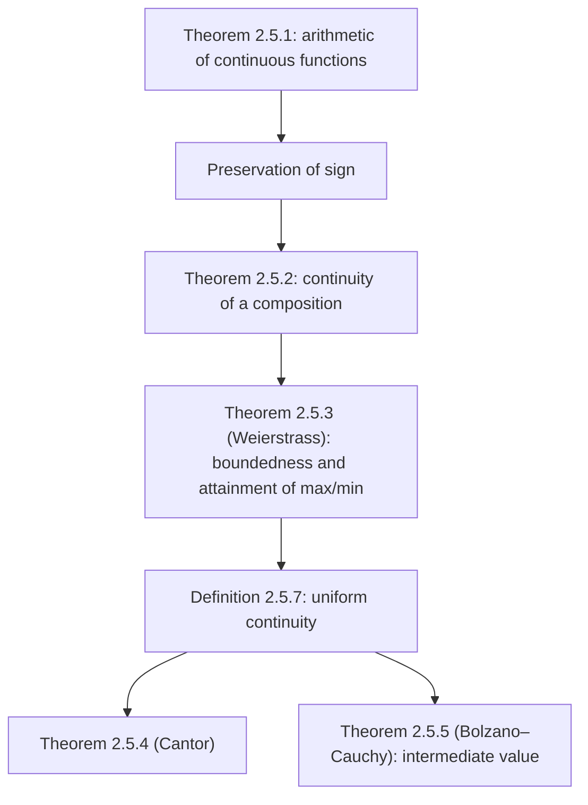

# Lectures 17–18 — Properties of continuous functions on a closed interval

[Lecture index](index.md) · [Русский](../../ru/lectures-2025-26/lecture-17-18.md) · [Español](../../es/lectures-2025-26/lecture-17-18.md)

> **Source:** `ma25_26-lectures_17-18_notes.pdf` — 22 pages: typed slides with a text layer (pages 1–4, 6, 8, 11, 15, 18), handwritten pages without a text layer (5, 7, 9, 10, 12–14, 16, 17, 19–22). Handwritten pages were transcribed from their images. PDF page numbers are given in the headings; the typed slides are numbered "1/9"–"9/9" in the PDF.
>
> **Editor's note.** The lecture date is taken from the footer of the slides ("30 October 2025").

## Typed slides 1–3. Introduction

**Quote of the day (slide 2).** Question: what do you get if you divide the circumference of a jack-o'-lantern by the diameter of the lantern? Answer: pumpkin Pi!

**Aim of the lecture.** Prove a series of statements about continuous functions (arithmetic operations on continuous functions, preservation of sign of a continuous function, continuity of a composition, Weierstrass theorem). Introduce the notion of uniform continuity and prove Cantor theorem and the Bolzano–Cauchy theorem.

## §5. Continuous functions (continued)

### Typed slide 4 (PDF p. 4). Arithmetic operations on continuous functions

**Theorem 2.5.1.** Let the functions $f, g : D \subset \mathbb{R} \to \mathbb{R}$ be continuous at $x_0 \in D$. Then the functions $f \pm g$, $fg$, $|f|$ are continuous at $x_0$, and if $g(x_0) \ne 0$, then $\dfrac{f}{g}$ is also continuous at $x_0$.

### Handwritten page 5 (PDF p. 5). Proof of Theorem 2.5.1

**Proof (Theorem 2.5.1).** If $x_0$ is an isolated point of $D$, the statement is trivial!

If $x_0$ is a limit point of $D$, then $f(x) \xrightarrow[x \to x_0]{} f(x_0)$, $g(x) \xrightarrow[x \to x_0]{} g(x_0)$. But then $f(x) + g(x) \xrightarrow[x \to x_0]{} f(x_0) + g(x_0)$, which is exactly the continuity of the sum of $f$ and $g$ at $x_0$.

The other operations are analogous. $\blacksquare$

### Typed slide 6 (PDF p. 6). Preservation of sign of a continuous function

If a function $g : D \subset \mathbb{R} \to \mathbb{R}$ is continuous at $x_0 \in D$ and $g(x_0) \ne 0$, then there exists a neighbourhood $V(x_0)$ such that the sign of $g(x)$ coincides with the sign of $g(x_0)$ for all $x \in V(x_0) \cap D$.

### Handwritten page 7 (PDF p. 7). Justification of preservation of sign

For an isolated point $x_0$ this statement is trivial, and for a limit point it follows from the theorem on preservation of sign of a function having a limit (Theorem 2.4.4 from Lecture 15).

### Typed slide 8 (PDF p. 8). Continuity of a composition

**Theorem 2.5.2.** Let $f : D \subset \mathbb{R} \to \mathbb{R}$, $g : E \subset \mathbb{R} \to \mathbb{R}$, $f(D) \subset E$, let $f$ be continuous at $x_0 \in D$ and $g$ be continuous at $f(x_0)$. Then $g \circ f$ is continuous at $x_0$.

### Handwritten page 9 (PDF p. 9). Proof of Theorem 2.5.2

**Proof (Theorem 2.5.2).** Let $\{x_n\} : x_n \in D$, $x_n \xrightarrow[n \to \infty]{} x_0$.

Write $\begin{cases} f(x_n) =: y_n \\ f(x_0) =: y_0 \end{cases} \Rightarrow y_n, y_0 \in E$.

$g$ is continuous at $f(x_0)$ $\Rightarrow$ $g(y_n) \xrightarrow[n \to \infty]{} g(y_0)$. (In the manuscript the step "$y_n \to y_0$ by continuity of $f$ at $x_0$" is not written out separately.)

Now recall that $\begin{cases} g(y_n) = g(f(x_n)) = g \circ f\,(x_n) \\ g(y_0) = g(f(x_0)) = g \circ f\,(x_0) \end{cases} \Rightarrow g \circ f\,(x_n) \xrightarrow[n \to \infty]{} g \circ f\,(x_0)$.

Since $\{x_n\}$ was arbitrary, we obtain the continuity of $g \circ f$. $\blacksquare$

### Handwritten page 10 (PDF p. 10). Remark: the limit of a composition without continuity

**Remark (handwritten).** Let $f(x) = x \sin \dfrac1x$, $g(y) = |\operatorname{sign} y|$ (in the upper right corner the graph of $g$ is drawn in red: the line $y = 1$ for $y \ne 0$ with an open circle at $(0, 1)$ and a filled point $(0, 0)$).

$f(x) \xrightarrow[x \to 0]{} 0$, $g(y) \xrightarrow[y \to 0]{} 1$, but $\lim\limits_{x \to 0} (g \circ f) = g(f(x))$ does not exist.

1) Why there is no limit: $(g \circ f)\left(\dfrac{1}{\pi n}\right) = 0 \to 0$; $(g \circ f)\left(\dfrac{1}{\pi n + \pi/2}\right) = 1 \to 1$.

In red: this example shows that if $f(x) \xrightarrow[x \to a]{} A$ and $g(x) \xrightarrow[x \to A]{} B$, then $(g \circ f)(x) \xrightarrow[x \to a]{} B$ may fail!

> **Editor's note.** Cf. Theorem 2.4.6 on the limit of a composition (Lecture 15): its condition 3 fails here — in every punctured neighbourhood of zero, $f$ takes the value $A = 0$.

### Typed slide 11 (PDF p. 11). Weierstrass theorem on continuous functions

**Theorem 2.5.3.**

1. A function continuous on a closed interval is bounded.
2. A function continuous on a closed interval attains its greatest and least values.

**Remark.** Both conditions — continuity of the function and the fact that its domain is a closed interval — are essential.

### Handwritten page 12 (PDF p. 12). Examples for the remark

**Examples for the remark.**

① $f_1(x) = x$ is continuous on $\mathbb{R}$ but not bounded on $\mathbb{R}$.

② $f_2(x) = \dfrac1x$ is continuous on $(0, 1]$ but not bounded on $(0, 1]$.

③ $f_1(x) = x$ on $[0, 1)$: $f_1$ is continuous on $[0, 1)$, bounded on $[0, 1)$, but has no greatest value on $[0, 1)$ ($\sup\limits_{[0,1)}$ exists, $\max\limits_{[0,1)}$ does not).

④ $f_3(x) = \begin{cases} \dfrac1x, & x \in (0, 1], \\ 0, & x = 0. \end{cases}$

$f_3$ is discontinuous at $0$, unbounded, and has no greatest value on $[0, 1]$ (there is no finite $\sup\limits_{[0,1]}$, and no $\max\limits_{[0,1]}$ either).

### Handwritten pages 13–14 (PDF pp. 13–14). Proof of Weierstrass theorem

**Proof (Theorem 2.5.3, Weierstrass).** Let $f \in C[a, b]$, i.e. $f$ is continuous on $[a, b]$.

① Suppose $f$ is unbounded $\Rightarrow$ $\forall n \in \mathbb{N}$ there is a point $x_n \in [a, b]$ with $|f(x_n)| > n$ $\Rightarrow$ we get a sequence $\{x_n\}$ $\Rightarrow$ by the Bolzano–Weierstrass principle there is a subsequence $\{x_{n_k}\}$ with $x_{n_k} \to c \in [a, b]$ (by closedness of the interval).

$\begin{cases} c \in [a, b] \\ x_{n_k} \xrightarrow[k \to \infty]{} c \\ f \in C[a, b] \end{cases} \Rightarrow$ by the definition of continuity $f(x_{n_k}) \xrightarrow[k \to \infty]{} f(c)$.

By construction $|f(x_{n_k})| > n_k \ge k$ $\forall k \in \mathbb{N}$ — a contradiction (green lightning).

② Let us show, to be definite, that $f$ attains its greatest value.

$M := \sup\limits_{x \in [a,b]} f(x)$ $\Rightarrow$ by part ① $f$ is bounded on $[a, b]$ $\Rightarrow$ $M \in \mathbb{R}$ (the manuscript writes $\mu \in \mathbb{R}$ here; $M$ is meant).

Suppose $M$ is not a value of $f$ $\Rightarrow$ $f(x) < M$ $\forall x \in [a, b]$ $\Rightarrow$ $\varphi(x) = \dfrac{1}{M - f(x)}$ is continuous on $[a, b]$ $\Rightarrow$ by part ① $\varphi$ is bounded above on $[a, b]$ $\Rightarrow$ $\exists \mu > 0 : \varphi(x) \le \mu$ $\forall x \in [a, b]$ $\Rightarrow$

$$
\frac{1}{M - f(x)} \le \mu \iff M - f(x) \ge \frac1\mu \Rightarrow f(x) \le M - \frac1\mu.
$$

$\begin{cases} M := \sup\limits_{x \in [a,b]} f(x) \\ f(x) \le M - \dfrac1\mu \end{cases} \Rightarrow$ we get a contradiction with the fact that $M = \sup\limits_{[a,b]} f$ is the **least** upper bound. $\blacksquare$

### Typed slide 15 (PDF p. 15). Uniform continuity

Continuity of a function $f : D \subset \mathbb{R} \to \mathbb{R}$ on the set $D$ means that $f$ is continuous at every point $\bar x \in D$. Let us write this in "$\varepsilon$-language":

$$
\forall \bar x \in D\ \forall \varepsilon > 0\ \exists \delta > 0\ \forall \bar{\bar x} \in D : |\bar x - \bar{\bar x}| < \delta \Rightarrow |f(\bar x) - f(\bar{\bar x})| < \varepsilon.
$$

In this formula the number $\delta$ depends on both $\varepsilon$ and the point $\bar x$. The question arises: can one, in the definition of continuity, choose a number $\delta$ depending only on $\varepsilon$ and serving all points $\bar x$ of $D$ simultaneously?

**Definition 2.5.7.** A function $f : D \subset \mathbb{R} \to \mathbb{R}$ is called **uniformly continuous** on the set $D$ if

$$
\forall \varepsilon > 0\ \exists \delta = \delta(\varepsilon) > 0\ \forall \bar x, \bar{\bar x} \in D : |\bar x - \bar{\bar x}| < \delta \Rightarrow |f(\bar x) - f(\bar{\bar x})| < \varepsilon.
$$

### Handwritten page 16 (PDF p. 16). Example: $x^2$ on $\mathbb{R}$

$f$ uniformly continuous $\Rightarrow$ $f$ continuous; the converse is false (a crossed-out red arrow $\Leftarrow$).

**Example.** $f(x) = x^2$ is continuous on $\mathbb{R}$ but is not uniformly continuous on $\mathbb{R}$.

To show this, write the negation of the definition of uniform continuity:

$$
\exists \varepsilon^* > 0\ \forall \delta > 0\ \exists \bar x_\delta, \bar{\bar x}_\delta \in D : |\bar x_\delta - \bar{\bar x}_\delta| < \delta,\quad |f(\bar x_\delta) - f(\bar{\bar x}_\delta)| \ge \varepsilon^*.
$$

(In green:) Put $\varepsilon^* = 1$, take $\delta > 0$, let $\bar x_\delta = \dfrac1\delta$, $\bar{\bar x}_\delta = \dfrac1\delta + \dfrac\delta2$ $\Rightarrow$ $|\bar x_\delta - \bar{\bar x}_\delta| = \dfrac\delta2 < \delta$,

$$
|f(\bar x_\delta) - f(\bar{\bar x}_\delta)| = |\bar x_\delta^2 - \bar{\bar x}_\delta^2| = \left|\left(\frac1\delta\right)^2 - \left(\frac1\delta + \frac\delta2\right)^2\right| = \frac\delta2\left(\frac2\delta + \frac\delta2\right) = 1 + \frac{\delta^2}{4} > 1 = \varepsilon^*.
$$

### Handwritten page 17 (PDF p. 17). Geometric interpretation of uniform continuity

The picture shows the graph $y = f(x)$ (a red "hill") and three identical green rectangles of width $\delta(\varepsilon)$ and height $\varepsilon$ (as labelled in the manuscript) through which the graph passes in different places: the same $\delta$ "serves" all points.

(In green:) $f(x) = \dfrac1x$ is uniformly continuous on $[1, +\infty)$ but is not uniformly continuous on $(0, 1)$; $f(x) = e^x$ is uniformly continuous on $(0, 1)$.

### Typed slide 18 (PDF p. 18). Cantor and Bolzano–Cauchy theorems

**Theorem 2.5.4 (Cantor).** A function continuous on a closed interval is uniformly continuous.

**Theorem 2.5.5 (Bolzano–Cauchy).** Let a function $f$ be continuous on $[a, b]$. Then for every number $C$ lying between $f(a)$ and $f(b)$ there is $c \in (a, b)$ such that $f(c) = C$.

**Remark.** The Bolzano–Cauchy theorem can also be stated as follows: if a function continuous on an interval takes two values, then it takes all values lying between them.

### Handwritten page 19 (PDF p. 19). Proof of Cantor theorem

**Proof (Theorem 2.5.4).** Let $f \in C[a, b]$. Suppose that $f$ is not uniformly continuous $\Rightarrow$ $\exists \varepsilon^* > 0$ $\forall n \in \mathbb{N}$ $\exists \bar x_n, \bar{\bar x}_n \in [a, b]$: $|\bar x_n - \bar{\bar x}_n| < \dfrac1n$, $|f(\bar x_n) - f(\bar{\bar x}_n)| > \varepsilon^*$ (underlined in yellow; in the negation of the definition on p. 16 it was $\ge \varepsilon^*$).

$\{\bar x_n\}$ $\Rightarrow$ by the Bolzano–Weierstrass selection principle $\exists \{\bar x_{n_k}\}$: $\bar x_{n_k} \to c \in [a, b]$.

But then $\bar{\bar x}_{n_k} \xrightarrow[k \to \infty]{} c$, since

$$
|\bar{\bar x}_{n_k} - c| = |\bar{\bar x}_{n_k} - \bar x_{n_k} + \bar x_{n_k} - c| \le \underbrace{|\bar{\bar x}_{n_k} - \bar x_{n_k}|}_{<\, 1/n_k} + |\bar x_{n_k} - c| < \frac{1}{n_k} + |\bar x_{n_k} - c| \to 0.
$$

$\begin{cases} f \in C[a, b] \\ \bar x_{n_k} \to c \\ \bar{\bar x}_{n_k} \to c \end{cases} \Rightarrow f(\bar x_{n_k}) - f(\bar{\bar x}_{n_k}) \xrightarrow[k \to \infty]{} 0$ $\Rightarrow$ from some index on, $|f(\bar x_{n_k}) - f(\bar{\bar x}_{n_k})| < \varepsilon^*$ — a contradiction (yellow lightning). $\blacksquare$

### Handwritten page 20 (PDF p. 20). Remark on the Bolzano–Cauchy theorem

Here it is essential both that the function is continuous and that it is given on an interval $[a, b]$!

The function $\operatorname{sign}(x) = \begin{cases} 1, & x > 0, \\ 0, & x = 0, \\ -1, & x < 0 \end{cases}$ is discontinuous at $0$. It takes the values $-1$ and $1$, but of the numbers between $-1$ and $1$ only $0$ is a value of the function.

The restriction of $\operatorname{sign}$ to $\mathbb{R} \setminus \{0\}$ is continuous but takes no values between $-1$ and $1$.

### Handwritten pages 21–22 (PDF pp. 21–22). Proof of the Bolzano–Cauchy theorem

**Proof (Theorem 2.5.5).**

① Let the numbers $f(a)$ and $f(b)$ have different signs: $f(a) \cdot f(b) < 0$. We prove that there is a point $c \in (a, b)$ with $f(c) = 0$.

Without loss of generality, assume $f(a) < 0 < f(b)$. The second case is similar.

Consider the midpoint of $[a, b]$, the point $c = \dfrac{a+b}{2}$. If $f\left(\dfrac{a+b}{2}\right) = 0$, the theorem is proved $\Rightarrow$ one can put $c = \dfrac{a+b}{2}$.

Otherwise put $[a_1, b_1] = \begin{cases} \left[\dfrac{a+b}{2}, b\right], & \text{if } f\left(\dfrac{a+b}{2}\right) < 0, \\ \left[a, \dfrac{a+b}{2}\right], & \text{if } f\left(\dfrac{a+b}{2}\right) > 0. \end{cases}$

In both cases $f(a_1) < 0 < f(b_1)$. Continue this construction of intervals. If at some step $f$ vanishes at the midpoint of the interval, the proof ends there.

Otherwise we obtain a sequence of nested intervals $\{[a_n, b_n]\}$ with $f(a_n) < 0 < f(b_n)$. These intervals shrink, since $b_n - a_n = \dfrac{b-a}{2^n} \to 0$. By the nested-interval theorem there exists a unique $c \in \bigcap\limits_{n=1}^{\infty} [a_n, b_n]$.

Moreover $a_n \to c$, $b_n \to c$. By passage to the limit in an inequality, from $f(a_n) < 0 < f(b_n)$, where $f(a_n) \to f(c)$ and $f(b_n) \to f(c)$ (downward arrows in the manuscript), we get $f(c) \le 0 \le f(c)$ $\Rightarrow$ $f(c) = 0$, and $c$ is the required point.

② Let us prove the theorem in the general case. Put $\varphi = f - C$. Then $\varphi \in C[a, b]$ as a difference of continuous functions. $\varphi(a) \cdot \varphi(b) < 0$ $\Rightarrow$ $\exists c : \varphi(c) = 0$, i.e. $f(c) = C$. $\blacksquare$

> **Editor's note.** The manuscript writes "$\exists! c$" in the last line; uniqueness of $c$ is not claimed in general, so $\exists c$ is kept here.

## Structure of the lecture

## Service pages

- Page 1 is the title page; page 2 is the "quote of the day" (the jack-o'-lantern photo is inserted above); page 3 gives the aim of the lecture.
- In the proof of Theorem 2.5.3, part ① is on PDF p. 13 and part ② on PDF p. 14.
