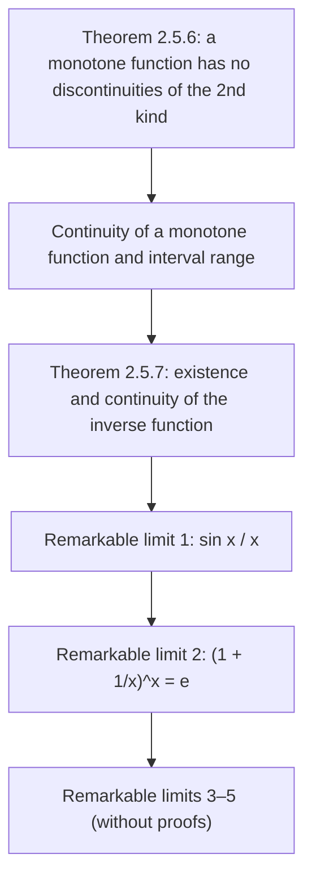

# Lectures 19–20 — Monotone functions, the inverse function, remarkable limits

[← Lectures 17–18](lecture-17-18.md) · [Lecture index](index.md) · [Lecture 21 →](lecture-21.md) · [Terms & theorems](../term-index.md) · [Русский](../../ru/lectures-2025-26/lecture-19-20.md) · [Español](../../es/lectures-2025-26/lecture-19-20.md)

> **Source:** `ma25_26-lectures_19-20_notes.pdf` — 20 pages: typed slides with a text layer (pages 1–4, 8, 11, 12, 16, 20), handwritten pages without a text layer (5–7, 9, 10, 13–15, 17–19). Handwritten pages were transcribed from their images. PDF page numbers are given in the headings; the typed slides are numbered "1/9"–"9/9" in the PDF.
>
> **Editor's note.** The lecture date is taken from the footer of the slides ("6 November 2025"). Proofs are given on the handwritten pages only for remarkable limits 1 and 2; limits 3–5 appear on the slides without proofs. The notation $`\langle a, b\rangle`$ denotes an interval of any type (see Lectures 5–6).

## Typed slides 1–3. Introduction

**Quote of the day (slide 2).** "TYPICAL METHODS OF PROOF — 2":

- *Proof by reference to the literature:* "It follows immediately from a result given in [1]. [1] K. A. Koyto (ed.) Yugoslav Mathematical Society. Session II. 1925. Collection of manuscripts of out-of-section talks. P. 17."
- *Proof by reference to a page:* "The justification is on p. 478 in [2]. [2] Out of Paper. Theory of Numerations. Moscow: Counter, 1990. 396 pp."
- *Proof by reference to:* "The interested reader can find a proof of this result on the homepage of L. User: Eror 404 Page not found" (the slide's spelling is preserved).

**Aim of the lecture.** Talk about the properties of monotone functions (discontinuities and continuity of monotone functions, existence and continuity of the [inverse function](lecture-01-02.md#def-1-1-8)). Prove statements about the remarkable limits.

## §5. Continuous functions (continued): monotone functions

### Typed slide 4 (PDF p. 4). On discontinuities and continuity of a monotone function

<a id="thm-2-5-6"></a>**Theorem 2.5.6.** Let $`f : \langle a, b\rangle \to \mathbb{R}`$ with $`f`$ monotone. Then the following hold:

1. $`f`$ cannot have [discontinuities of the second kind](lecture-16.md#def-2-5-4).
2. Continuity of $`f`$ is equivalent to its range being an interval.

### Handwritten pages 5–7 (PDF pp. 5–7). Proof of Theorem 2.5.6

**Proof ([Theorem 2.5.6](#thm-2-5-6)).** Let, to be definite, $`f`$ be increasing.

① Let $`x_0 \in (a, b\rangle`$, $`x_1 \in (a, x_0)`$ (the manuscript has a picture of the number line with points $`a`$, $`x_1`$ (green), $`x_0`$ (red), $`b`$). Then $`f(x_1) \le f(x) \le f(x_0)`$ $`\forall x \in (x_1, x_0)`$, i.e. $`f`$ is increasing and [bounded above](lecture-05-06.md#def-1-3-7) on $`\langle a, x_0)`$. By the theorem on the limit of a monotone function ([Theorem 2.4.9](lecture-15.md#thm-2-4-9) from Lecture 15) the finite limit $`f(x_0^-)`$ exists, and by passage to the limit in an inequality $`f(x_1) \le f(x_0^-) \le f(x_0)`$.

Similarly one proves that for every $`x_0 \in \langle a, b)`$ the finite limit $`f(x_0^+)`$ exists and $`f(x_0) \le f(x_0^+) \le f(x_2)`$ $`\forall x_2 \in (x_0, b\rangle`$.

② Let $`f(\langle a, b\rangle)`$ be an interval. We show that $`f`$ is continuous from the left at every $`x_0 \in (a, b\rangle`$ (by contradiction).

Suppose $`f(x_0^-) < f(x_0)`$ — existence of the finite left-hand limit was already proved in ①.

Take $`y \in (f(x_0^-), f(x_0))`$ $`\Rightarrow`$ if $`a < x_1 < x_0`$, then $`y \in [f(x_1), f(x_0)]`$ $`\Rightarrow`$ $`y \in f(\langle a, b\rangle)`$ (underlined).

On the other hand, $`\begin{cases} \forall x \in \langle a, x_0) : f(x) \le f(x_0^-) < y \\ \forall x \in [x_0, b\rangle : f(x) \ge f(x_0) > y \end{cases} \Rightarrow`$ $`y`$ is not a value of $`f`$, i.e. $`y \notin f(\langle a, b\rangle)`$ (underlined) — a contradiction.

$`\Rightarrow`$ $`f(x_0^-) = f(x_0)`$. Similarly, $`f`$ is continuous from the right at $`x_0`$. Thus we have shown: $`f(\langle a, b\rangle)`$ is an interval $`\Rightarrow`$ $`f`$ is continuous.

Now let us prove: $`f`$ continuous $`\Rightarrow`$ $`f(\langle a, b\rangle)`$ is an interval.

So, $`f \in C\langle a, b\rangle`$, $`m = \inf\limits_{x \in \langle a,b\rangle} f(x)`$, $`M = \sup\limits_{x \in \langle a,b\rangle} f(x)`$ ($`m, M \in \overline{\mathbb{R}}`$) $`\Rightarrow`$ by the [Bolzano–Cauchy theorem](lecture-17-18.md#thm-2-5-5) $`E := f(\langle a, b\rangle)`$ is convex.

(In green:) **Definition.** A set $`E`$ is called **convex** if, together with any two of its points, it contains the segment joining them. (Drawings: a convex "blob" with a segment inside and a non-convex "heart" where the segment between two red points goes outside.)


$`\Rightarrow`$ $`f(\langle a, b\rangle) = \langle m, M\rangle`$. $`\blacksquare`$

### Typed slide 8 (PDF p. 8). On existence and continuity of the inverse function

<a id="thm-2-5-7"></a>**Theorem 2.5.7.** Let $`f \in C\langle a, b\rangle`$ with $`f`$ strictly monotone, $`m = \inf\limits_{x \in \langle a,b\rangle} f(x)`$, $`M = \sup\limits_{x \in \langle a,b\rangle} f(x)`$. Then the following hold:

1. $`f`$ is invertible and $`f^{-1} : \langle m, M\rangle \to \langle a, b\rangle`$ is a [bijection](lecture-01-02.md#def-1-1-6).
2. $`f^{-1}`$ is strictly monotone in the same sense as $`f`$.
3. $`f^{-1}`$ is continuous on $`\langle m, M\rangle`$.

### Handwritten pages 9–10 (PDF pp. 9–10). Proof of Theorem 2.5.7

**Proof ([Theorem 2.5.7](#thm-2-5-7)).** Let, to be definite, $`f`$ be strictly increasing.

① If $`\begin{cases} x_1, x_2 \in \langle a, b\rangle \\ x_1 < x_2 \end{cases} \Rightarrow f(x_1) < f(x_2)`$ $`\Rightarrow`$ $`f^{-1}`$ exists.

By [Theorem 2.5.6](#thm-2-5-6), part 2, $`f(\langle a, b\rangle) = \langle m, M\rangle`$, and by the general properties of the inverse mapping $`f^{-1}`$ is a bijection, $`f^{-1} : \langle m, M\rangle \to \langle a, b\rangle`$.

② Let us show that $`f^{-1}`$ is strictly increasing.

If $`\begin{cases} y_1, y_2 \in \langle m, M\rangle \\ y_1 < y_2 \end{cases} \Rightarrow \begin{cases} y_1 = f(x_1), & x_1 = f^{-1}(y_1) \\ y_2 = f(x_2), & x_2 = f^{-1}(y_2) \end{cases}`$, $`x_1, x_2 \in \langle a, b\rangle`$ $`\Rightarrow`$ $`f(x_1) < f(x_2)`$.

Moreover $`x_1 < x_2`$, because the possibility $`x_1 \ge x_2`$ is excluded since $`f`$ is **strictly** increasing.

③ $`\begin{cases} f^{-1} \text{ is increasing on } \langle m, M\rangle \\ f^{-1}(\langle m, M\rangle) = \langle a, b\rangle \end{cases} \Rightarrow`$ by [Theorem 2.5.6](#thm-2-5-6), part 2, $`f^{-1}`$ is continuous. $`\blacksquare`$

### Typed slide 11 (PDF p. 11). Properties of monotone functions

1. The set of points of discontinuity of a monotone function is at most [countable](lecture-01-02.md#def-1-2-5).
2. If a function is given on an interval, continuous and invertible, then it is strictly monotone, and hence the inverse function is continuous.
3. There exists an invertible function $`f : \mathbb{R} \to \mathbb{R}`$, continuous at $`0`$, such that $`f^{-1}`$ is discontinuous at $`f(0)`$.

(No proofs of these statements are given on the handwritten pages.)

## §6. Remarkable limits and comparison of functions

### Typed slide 12 (PDF p. 12). The first remarkable limit

The remarkable limits are five equalities often used to resolve indeterminate forms.

1. $`\lim\limits_{x \to 0} \dfrac{\sin x}{x} = 1`$.

**Corollary.** $`\lim\limits_{x \to 0} \dfrac{1 - \cos x}{x^2} = \dfrac12`$, $`\lim\limits_{x \to 0} \dfrac{\tan x}{x} = 1`$ (the slide uses $`\operatorname{tg}`$), $`\lim\limits_{x \to 0} \dfrac{\arcsin x}{x} = 1`$, $`\lim\limits_{x \to 0} \dfrac{\arctan x}{x} = 1`$ (the slide: $`\operatorname{arctg}`$).

### Handwritten pages 13–15 (PDF pp. 13–15). Proof of the first remarkable limit

**Proof.** We show that if $`0 < x < \dfrac\pi2`$, then $`\sin x < x < \operatorname{tg} x`$ (tangent denoted $`\operatorname{tg}`$ as on the slides).

In the picture: the point $`O`$, a ray at angle $`x`$ to the segment $`OA`$, $`|OA| = 1`$, a point $`B`$ on the ray with perpendicular $`BC`$ to $`OA`$ ($`C`$ the foot), and the point $`D`$ where the ray meets the vertical through $`A`$; the segment $`BA`$ is in red, the arc bounds the sector.


$`\triangle OAB \subset`$ sector $`OAB`$ $`\subset \triangle OAD`$,

```math
\underbrace{S_{\triangle OAB}}_{=\,\frac12 |OA|\cdot|BC|} < \underbrace{S_{\text{sector } OAB}}_{=\,\frac12 |OA|^2 x} < \underbrace{S_{\triangle OAD}}_{=\,\frac12 |OA|\cdot|AD|}.
```

$`|OA| = 1`$, $`|BC| = \sin x`$, $`\dfrac{|AD|}{|OA|} = \operatorname{tg} x`$ $`\Rightarrow`$ $`\dfrac12 \sin x < \dfrac12 x < \dfrac12 \operatorname{tg} x`$. ✓

Since $`0 < x < \dfrac\pi2`$, from $`0 < \sin x < x < \operatorname{tg} x`$ we get $`1 < \dfrac{x}{\sin x} < \dfrac{1}{\cos x}`$, i.e. $`1 > \dfrac{\sin x}{x} > \cos x`$.

Let us check that $`\cos x \xrightarrow[x \to 0]{} 1`$: $`0 < 1 - \cos x = 2 \sin^2 \dfrac x2 < 2\left(\dfrac x2\right)^2 = \dfrac{x^2}{2} \xrightarrow[x \to 0]{} 0`$ $`\Rightarrow`$ by the [squeeze theorem](lecture-08.md#thm-2-1-4) ("two policemen") $`1 - \cos x \xrightarrow[x \to 0]{} 0`$.

Then from $`1 > \dfrac{\sin x}{x} > \cos x`$, both outer terms tending to $`1`$ as $`x \to 0`$, the squeeze theorem gives $`\dfrac{\sin x}{x} \xrightarrow[x \to 0]{} 1`$. I.e. we have proved $`\lim\limits_{x \to 0^+} \dfrac{\sin x}{x} = 1`$.

$`x < 0`$ $`\Rightarrow`$ $`\dfrac{\sin x}{x} = \dfrac{-\sin x}{-x} = \dfrac{\sin(-x)}{-x} = \dfrac{\sin y}{y} \xrightarrow[y \to 0^+]{} 1`$, $`y > 0`$ (i.e. $`y = -x`$). $`\blacksquare`$

### Typed slide 16 (PDF p. 16). Remarkable limits-2

2. $`\lim\limits_{x \to \infty} \left(1 + \dfrac1x\right)^x = e`$.

**Remark.** Replacing $`x`$ by $`\dfrac1x`$, the second remarkable limit can also be written as $`\lim\limits_{x \to 0} (1 + x)^{1/x} = e`$.

3. $`\lim\limits_{x \to 0} \dfrac{\log_a(1 + x)}{x} = \dfrac{1}{\ln a}`$, $`a > 0`$, $`a \ne 1`$. In particular, $`\lim\limits_{x \to 0} \dfrac{\ln(1 + x)}{x} = 1`$.

### Handwritten pages 17–19 (PDF pp. 17–19). Proof of the second remarkable limit

**Proof: 2.** (Boxed, from Lectures 11–12:) $`e = \lim\limits_{n \to \infty} \left(1 + \dfrac1n\right)^n`$.

$`f(x) = \left(1 + \dfrac1x\right)^x`$, $`f : \mathbb{R} \setminus [-1, 0] \to \mathbb{R}`$. Take $`\{x_n\}`$ with $`x_n \xrightarrow[n \to \infty]{} \infty`$ and show that $`f(x_n) \xrightarrow[n \to \infty]{} e`$.

① First let $`x_n \in \mathbb{N}`$ $`\forall n`$. $`\forall \varepsilon > 0`$, by the definition of the number $`e`$ there is $`K \in \mathbb{N}`$ such that $`\forall k \in \mathbb{N}`$, $`k > K`$ $`\Rightarrow`$ $`|f(k) - e| < \varepsilon`$. But $`x_n \xrightarrow[n \to \infty]{} \infty`$ (by our choice of $`\{x_n\}`$), so from some index on $`x_n > K`$ $`\Rightarrow`$ $`|f(x_n) - e| < \varepsilon`$.

② $`x_n \to +\infty`$ $`\Rightarrow`$ from some index on $`x_n \ge 1`$ $`\Rightarrow`$ without loss of generality $`x_n \ge 1`$ $`\forall n`$. (The manuscript then directly writes the inequality $`(\ast)`$, obtained from $`[x_n] \le x_n < [x_n] + 1`$ by monotonicity of the base and the exponent:)

```math
\left(1 + \frac{1}{[x_n] + 1}\right)^{[x_n]} \le \left(1 + \frac{1}{x_n}\right)^{x_n} \le \left(1 + \frac{1}{[x_n]}\right)^{[x_n] + 1} \tag{$\ast$}
```

Rewrite $`(\ast)`$ as:

```math
\frac{f([x_n] + 1)}{1 + \dfrac{1}{1 + [x_n]}} \le f(x_n) \le \left(1 + \frac{1}{[x_n]}\right) \underbrace{f([x_n])}_{=\, \left(1 + \frac{1}{[x_n]}\right)^{[x_n]}} \tag{$\ast\ast$}
```

(in green: $`f([x_n] + 1) = \left(1 + \dfrac{1}{[x_n] + 1}\right)^{[x_n] + 1}`$).

$`\{[x_n]\}`$, $`\{[x_n] + 1\}`$ are sequences of natural numbers tending to $`+\infty`$ $`\Rightarrow`$ by ① $`f([x_n]) \to e`$, $`f([x_n] + 1) \to e`$.

In $`(\ast\ast)`$ the numerator of the left side tends to $`e`$, its denominator $`1 + \dfrac{1}{1 + [x_n]} \to 1`$ (red arrow), the factor $`\left(1 + \dfrac{1}{[x_n]}\right) \to 1`$ (red arrow), and $`f([x_n]) \xrightarrow[n \to \infty]{} e`$ $`\Rightarrow`$ by the squeeze theorem $`f(x_n) \to e`$ (underlined in turquoise).

③ Let $`x_n \xrightarrow[n \to \infty]{} -\infty`$. Then $`y_n := -x_n`$, $`y_n \xrightarrow[n \to \infty]{} +\infty`$, $`y_n - 1 \xrightarrow[n \to \infty]{} +\infty`$,

```math
f(x_n) = \left(1 + \frac{1}{-y_n}\right)^{-y_n} = \left(\frac{1 - y_n}{-y_n}\right)^{-y_n} = \left(\frac{y_n - 1}{y_n}\right)^{-y_n} = \left(\frac{y_n}{y_n - 1}\right)^{y_n} = \left(1 + \frac{1}{y_n - 1}\right)^{y_n} = f(y_n - 1)\left(1 + \frac{1}{y_n - 1}\right) \longrightarrow e,
```

where $`f(y_n - 1) \xrightarrow[n \to \infty]{} e`$ (green arrow) and the factor $`\left(1 + \dfrac{1}{y_n - 1}\right) \to 1`$ (red arrow). $`\blacksquare`$

> **Editor's note.** In the chain for ③ the manuscript writes the intermediate fraction as $`\left(\dfrac{1 - y_n}{-y_n}\right)^{-y_n}`$; this equals $`\left(\dfrac{y_n - 1}{y_n}\right)^{-y_n}`$, since $`1 - \dfrac{1}{y_n} = \dfrac{y_n - 1}{y_n}`$.

### Typed slide 20 (PDF p. 20). Remarkable limits-3

4. $`\lim\limits_{x \to 0} \dfrac{(1 + x)^\alpha - 1}{x} = \alpha`$, $`\alpha \in \mathbb{R}`$.

5. $`\lim\limits_{x \to 0} \dfrac{a^x - 1}{x} = \ln a`$, $`a > 0`$. In particular, $`\lim\limits_{x \to 0} \dfrac{e^x - 1}{x} = 1`$.

## Structure of the lecture



## Service pages

- Page 1 is the title page; page 2 is the "quote of the day"; page 3 gives the aim of the lecture.
- The proof of [Theorem 2.5.6](#thm-2-5-6) occupies PDF p. 5 (part 1), p. 6 (part 2, "interval ⇒ continuity") and p. 7 ("continuity ⇒ interval" and the definition of [convexity](lecture-31-32.md#def-3-8-1)).
