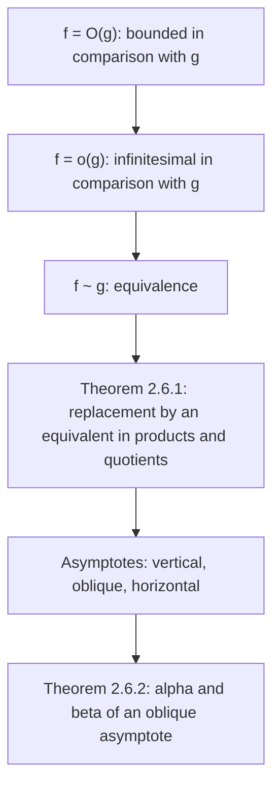

# Lecture 21 — Comparison of functions and asymptotes

[Lecture index](index.md) · [Русский](../../ru/lectures-2025-26/lecture-21.md) · [Español](../../es/lectures-2025-26/lecture-21.md)

> **Source:** `ma25_26_lecture_21_notes.pdf` — 17 pages: typed slides with a text layer (pages 1–4, 7, 8, 10, 12, 13, 15), handwritten pages without a text layer (5, 6, 9, 11, 14, 16, 17). Handwritten pages were transcribed from their images. PDF page numbers are given in the headings; the typed slides are numbered "1/10"–"10/10" in the PDF.
>
> **Editor's note.** The lecture date is taken from the footer of the slides ("13 November 2025"). The "quote of the day" on page 2 is the same as in Lectures 22–23 ("Typical methods of proof — 3") and is given in full in the Lectures 22–23 file; it is not repeated here.

## Typed slides 1–3. Introduction

**Aim of the lecture.** Discuss infinitesimal functions and related statements. Talk about asymptotes.

## Chapter 2. Limit theory. §6. Remarkable limits and comparison of functions (continued)

### Typed slide 4 (PDF p. 4). Infinitesimal and other functions

Let $f, g : D \subset \mathbb{R} \to \mathbb{R}$, let $x_0$ be a limit point of $D$, and suppose there exist a function $\varphi : D \to \mathbb{R}$ and a neighbourhood $V(x_0)$ of $x_0$ such that $f(x) = \varphi(x) g(x)$ $\forall x \in \dot V(x_0) \cap D$.

1. If $\varphi$ is bounded on $\dot V(x_0) \cap D$, one says that $f$ is **bounded in comparison with $g$** as $x \to x_0$, and writes $f(x) = O(g(x))$, $x \to x_0$.
2. If $\varphi(x) \xrightarrow[x \to x_0]{} 0$, one says that $f$ is **infinitesimal in comparison with $g$** as $x \to x_0$, and writes $f(x) = o(g(x))$, $x \to x_0$.

### Handwritten page 5 (PDF p. 5). Remark on 1 and an example

**Remark on 1 (handwritten).** $f(x) = O(g(x))$ as $x \to x_0$ if $\begin{cases} \exists V(x_0) \cap D \\ \exists M \in \mathbb{R} \end{cases}$ (in the manuscript $M$ is denoted by the letter $\mu$) such that $\left|\dfrac{f(x)}{g(x)}\right| \le M$ $\forall x \in \dot V(x_0) \cap D$.

**Example.** $x^3 - 7x^5 + 100x^{2025} = O(x^3)$ as $x \to 0$:

$$
\frac{f(x)}{g(x)} = \frac{x^3 - 7x^5 + 100x^{2025}}{x^3} = 1 - 7x^2 + 100x^{2022} \xrightarrow[x \to 0]{} 1.
$$

But then there is $V(0)$ with $\left|\dfrac{f(x)}{g(x)}\right| \le 10$ $\forall x \in \dot V(0)$.

(In green:) $x^3 - 7x^5 + 100x^{2025} = O(x^{2025})$ as $x \to +\infty$:

$$
\frac{f(x)}{g(x)} = \frac{x^3 - 7x^5 + 100x^{2025}}{x^{2025}} = 100 + \frac{1}{x^{2022}} - \frac{7}{x^{2020}} \xrightarrow[x \to +\infty]{} 100.
$$

> **Editor's note.** In the last equality the manuscript writes $x^{2025}$ in the denominator of the last term; the correct exponent is $2020$ (since $2025 - 5 = 2020$), as corrected above.

### Handwritten page 6 (PDF p. 6). Remark on 2 and an example

**Remark on 2 (handwritten).** $f(x) = o(g(x))$ as $x \to x_0$ if $\lim\limits_{x \to x_0} \dfrac{f(x)}{g(x)} = 0$.

**Example.** $1 - \cos x = o(x)$ as $x \to 0$:

$$
\lim_{x \to x_0} \frac{f(x)}{g(x)} = \lim_{x \to 0} \frac{1 - \cos x}{x} = \lim_{x \to 0} \frac{2\sin^2\frac x2}{x} = \lim_{x \to 0} \left(\frac{\sin\frac x2}{\frac x2}\right)^2 \cdot \frac x2 = 1 \cdot \lim_{x \to 0} \frac x2 = 0,
$$

using $\cos 2\alpha = 1 - 2\sin^2\alpha$, i.e. $2\sin^2\dfrac x2 = 1 - \cos x$, and the factor $\left(\dfrac{\sin\frac x2}{\frac x2}\right)^2 \to 1$ as $x \to 0$ (the first remarkable limit; green brace in the manuscript).

### Typed slide 7 (PDF p. 7). Infinitesimal and other functions-2

3. If $\varphi(x) \xrightarrow[x \to x_0]{} 1$, one says that the functions $f$ and $g$ are **equivalent** or **asymptotically equal** as $x \to x_0$, and writes $f(x) \sim g(x)$, $x \to x_0$.

### Typed slide 8 (PDF p. 8). Replacing by an equivalent function when computing limits

**Theorem 2.6.1.** Let $f, \widetilde f, g, \widetilde g : D \subset \mathbb{R} \to \mathbb{R}$, let $x_0$ be a limit point of $D$, $f(x) \sim \widetilde f(x)$, $g(x) \sim \widetilde g(x)$, $x \to x_0$. Then the following hold:

1. $\lim\limits_{x \to x_0} f(x) g(x) = \lim\limits_{x \to x_0} \widetilde f(x) \widetilde g(x)$.
2. If $x_0$ is a limit point of the domain of $\dfrac{f}{g}$, then $\lim\limits_{x \to x_0} \dfrac{f(x)}{g(x)} = \lim\limits_{x \to x_0} \dfrac{\widetilde f(x)}{\widetilde g(x)}$.

(In both statements the limits simultaneously exist or not, and if they exist, they are equal.)

### Handwritten page 9 (PDF p. 9). Proof of Theorem 2.6.1

**Proof (Theorem 2.6.1).** Let $\lim\limits_{x \to x_0} \dfrac{f(x)}{g(x)} = A$. Let us check that $\lim\limits_{x \to x_0} \dfrac{\widetilde f(x)}{\widetilde g(x)}$ exists:

$$
\lim_{x \to x_0} \frac{\widetilde f(x)}{\widetilde g(x)} = \lim_{x \to x_0} \frac{\widetilde f(x)}{f(x)} \cdot \frac{f(x)}{g(x)} \cdot \frac{g(x)}{\widetilde g(x)} = \underbrace{\lim_{x \to x_0} \frac{\widetilde f(x)}{f(x)}}_{=\,1,\ \text{since } f \sim \widetilde f} \cdot \lim_{x \to x_0} \frac{f(x)}{g(x)} \cdot \underbrace{\lim_{x \to x_0} \frac{g(x)}{\widetilde g(x)}}_{=\,1,\ \text{since } g \sim \widetilde g} = \lim_{x \to x_0} \frac{f(x)}{g(x)} = A. \quad \blacksquare
$$

(In the manuscript the proof is carried out for the quotient; for the product it is analogous.)

### Typed slide 10 (PDF p. 10). Remarks

If $g(x) \ne 0$ on $\dot V(x_0) \cap D$, then also $\widetilde g(x) \ne 0$ on $\dot{\widetilde V}(x_0) \cap D$, and conversely. Hence $x_0$ is simultaneously a limit point, or not, of the domains of $\dfrac{f}{g}$ and $\dfrac{\widetilde f}{\widetilde g}$.

From the hypotheses of Theorem 2.6.1 it does **not** follow that $\lim\limits_{x \to x_0} (f(x) \pm g(x)) = \lim\limits_{x \to x_0} \left(\widetilde f(x) \pm \widetilde g(x)\right)$. In other words, when finding a limit one may replace factors in a product and a quotient by equivalent ones, but, in general, one may not do so with summands in a sum or a difference.

### Handwritten page 11 (PDF p. 11). Example for the remark

**Example (for the remark).** $f(x) = x + 1$, $\widetilde f(x) = g(x) = \widetilde g(x) = x$, $x_0 = +\infty$:

$\lim\limits_{x \to x_0} (f(x) - g(x)) = \lim\limits_{x \to +\infty} (x + 1 - x) = 1$;

$\lim\limits_{x \to x_0} (\widetilde f(x) - \widetilde g(x)) = \lim\limits_{x \to +\infty} (x - x) = 0$.

Circled in red: $1 \ne 0$!!!

### Typed slide 12 (PDF p. 12). Remarks on limits of the form $f^g$

For finding limits of functions of the form $f^g$ ($f > 0$) the transformation $(f(x))^{g(x)} = e^{g(x) \ln f(x)}$ is often convenient.

### Typed slide 13 (PDF p. 13). Asymptotes

1. Let $x_0 \in \mathbb{R}$ and let $f$ be defined at least on $\langle a, x_0)$ or $(x_0, b\rangle$ and map into $\mathbb{R}$. The line $x = x_0$ is called a **vertical asymptote** of $f$ if $f(x_0^+)$ or $f(x_0^-)$ equals $-\infty$ or $+\infty$ (in the slide's text layer the symbol $\infty$ is rendered as "1").
2. Let $\langle a, +\infty) \subset D \subset \mathbb{R}$, $f : D \to \mathbb{R}$, $\alpha, \beta \in \mathbb{R}$. The line $y = \alpha x + \beta$ is called an **oblique asymptote** of $f$ as $x \to +\infty$ if $f(x) = \alpha x + \beta + o(1)$, $x \to +\infty$. The oblique asymptote as $x \to -\infty$ for a function defined at least on $(-\infty, b\rangle$ is defined analogously.
3. A **horizontal asymptote** is the particular case of an oblique one with $\alpha = 0$. The line $y = \beta$ is a horizontal asymptote of $f$ as $x \to \pm\infty$ if and only if $f(x) \xrightarrow[x \to \pm\infty]{} \beta$.

### Handwritten page 14 (PDF p. 14). Pictures of asymptotes

Three pictures without axis labels: on the left (in red) a vertical asymptote $x = x_0$ (yellow line) labelled $\lim\limits_{x \to x_0^-} f(x) = f(x_0^-) = +\infty$ and $\lim\limits_{x \to x_0^+} f(x) = f(x_0^+) = -\infty$; at the top right (in green) a vertical asymptote $x = x_0$ with the graph tending to $+\infty$ from both sides; at the bottom a red curve approaching a green oblique line. Written separately at the bottom left: $e^x \xrightarrow[x \to -\infty]{} 0$ (an example of the horizontal asymptote $y = 0$).

### Typed slide 15 (PDF p. 15). Equation of an oblique asymptote

**Theorem 2.6.2.** Let $\langle a, +\infty) \subset D \subset \mathbb{R}$, $f : D \to \mathbb{R}$, $\alpha, \beta \in \mathbb{R}$. The line $y = \alpha x + \beta$ is an asymptote of $f$ as $x \to +\infty$ if and only if

$$
\alpha = \lim_{x \to +\infty} \frac{f(x)}{x}, \qquad \beta = \lim_{x \to +\infty} (f(x) - \alpha x).
$$

### Handwritten page 16 (PDF p. 16). Proof of Theorem 2.6.2

**Proof (Theorem 2.6.2).**

($\Rightarrow$) The line $y = \alpha x + \beta$ is an asymptote of $f$ as $x \to +\infty$ $\Rightarrow$ (by the definition of an oblique asymptote) $f(x) = \alpha x + \beta + \varphi(x)$ with $\varphi(x) \xrightarrow[x \to +\infty]{} 0$.

Hence $\dfrac{f(x)}{x} - \alpha = \dfrac{\beta + \varphi(x)}{x} \xrightarrow[x \to +\infty]{} 0$, i.e. $\dfrac{f(x)}{x} \xrightarrow[x \to +\infty]{} \alpha$; and $f(x) - \alpha x = \beta + \varphi(x) \xrightarrow[x \to +\infty]{} \beta$.

($\Leftarrow$) $\begin{cases} \lim\limits_{x \to +\infty} \dfrac{f(x)}{x} = \alpha \\ \lim\limits_{x \to +\infty} (f(x) - \alpha x) = \beta \end{cases} \Rightarrow$ put $\varphi(x) := f(x) - \alpha x - \beta$ $\Rightarrow$ $\varphi(x) \xrightarrow[x \to +\infty]{} 0$ $\Rightarrow$ $f(x) = \alpha x + \beta + \varphi(x)$ with $\varphi(x) \xrightarrow[x \to +\infty]{} 0$ $\Rightarrow$ by definition $y = \alpha x + \beta$ is an asymptote of $f$. $\blacksquare$

(In the manuscript the coefficients of the asymptote are written with Latin letters $a$, $b$ instead of the slide's $\alpha$, $\beta$; the slide's notation is kept here.)

### Handwritten page 17 (PDF p. 17). Remark on asymptotic expansions

**Remark (handwritten).** A particular case of asymptotic expansions: $f(x) = f(x_0) + A(x - x_0) + o(x - x_0)$, $x \to x_0$. The study of such asymptotic expansions is what differential calculus deals with (see Lectures 22–23).

## Structure of the lecture

## Service pages

- Page 1 is the title page; page 2 is the "quote of the day" (the same as in Lectures 22–23); page 3 gives the aim of the lecture.
