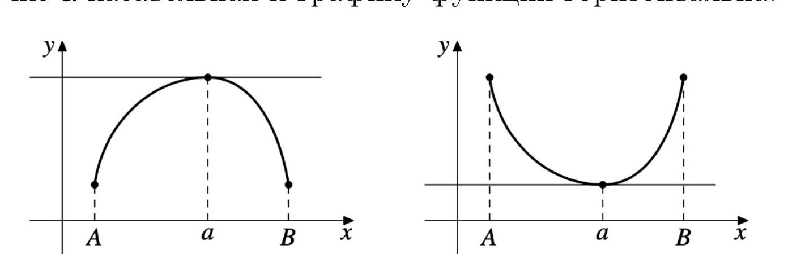
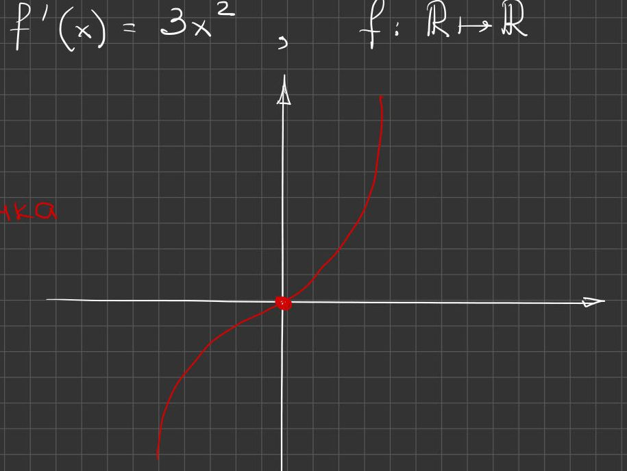
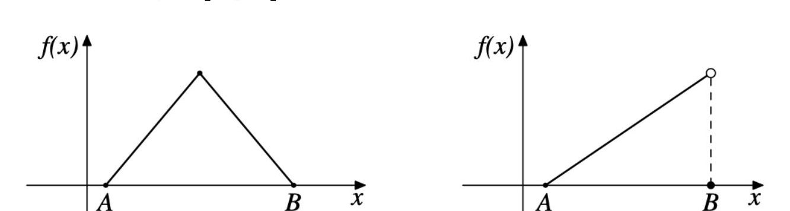
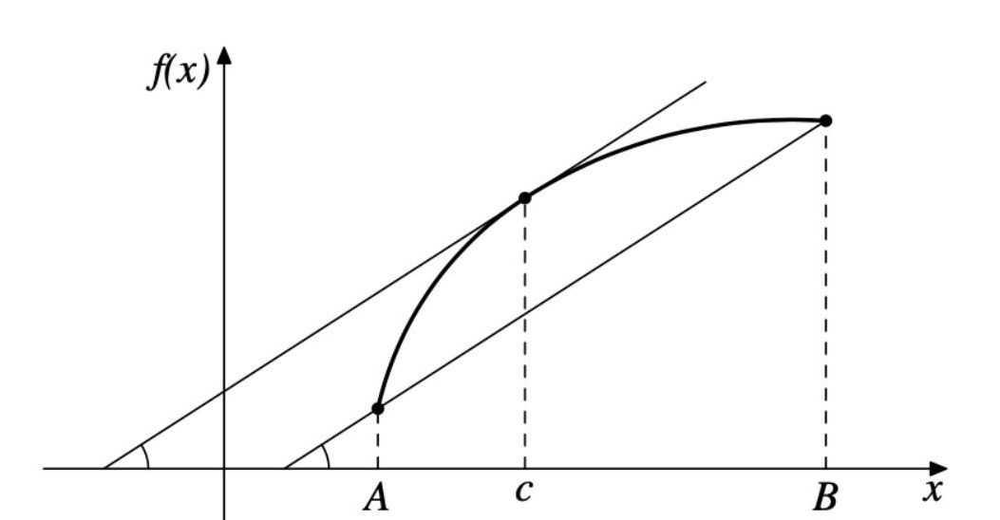
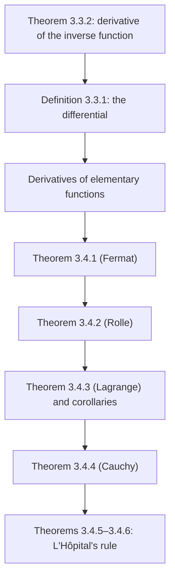

# Lectures 24–26 — Differentiating the inverse function, the differential, mean value theorems and L'Hôpital's rule

[← Lectures 22–23](lecture-22-23.md) · [Lecture index](index.md) · [Lectures 27–28 →](lecture-27-28.md) · [Terms & theorems](../term-index.md) · [Русский](../../ru/lectures-2025-26/lecture-24-25-26.md) · [Español](../../es/lectures-2025-26/lecture-24-25-26.md)

> **Source:** `ma25_26-lectures_24-25-26_notes.pdf` — 42 pages: typed slides with a text layer (pages 1–5, 8, 13–15, 18, 19, 22, 24, 25, 27, 29, 31, 32, 34, 38) and handwritten pages without a text layer (6, 7, 9–12, 16, 17, 20, 21, 23, 26, 28, 30, 33, 35–37, 39–42). Handwritten pages were transcribed from their images. PDF page numbers are given in the headings; the typed slides are numbered "1/20"–"20/20" in the PDF.
>
> **Editor's note.** The lecture date is taken from the footer of the slides ("20 November 2025"). The notation $`\langle A, B\rangle`$ denotes an interval of any type.

## Typed slides 1–3. Introduction

**Quote of the day (slide 2).** "Arnold's principle: if some concept bears a personal name, then it is not the name of its discoverer." (V. I. Arnold)

**Aim of the lecture.** Discuss the rule for differentiating an [inverse function](lecture-01-02.md#def-1-1-8). Introduce the notion of the [differential](#def-3-3-1). Prove theorems relating the values of a function at the endpoints of an interval to the values of its [derivative](lecture-22-23.md#def-3-1-1) at some "mean" points inside the interval. Derive a number of consequences of the mean value theorems, in particular [L'Hôpital's rule](#thm-3-4-5), which is useful for computing limits.

## Chapter 3, §3. Rules of differentiation (continued)

### Typed slide 4 (PDF p. 4). Differentiating an inverse function

<a id="thm-3-3-2"></a>**Theorem 3.3.2.** Let $`f`$ be a strictly monotone continuous function on $`\langle A, B\rangle`$, $`a \in \langle A, B\rangle`$, $`f`$ differentiable at $`a`$, $`f'(a) \ne 0`$. Then the inverse function $`f^{-1}`$ is differentiable at the point $`f(a)`$ and

```math
\left(f^{-1}\right)'(f(a)) = \frac{1}{f'(a)}.
```

### Typed slide 5 (PDF p. 5). Geometric meaning of Theorem 3.3.2

Since the graph of $`f^{-1}`$ is obtained from the graph of $`f`$ by symmetry in the line $`y = x`$,

```math
\left(f^{-1}\right)'(f(a)) = \tan \beta = \cot \alpha = \frac{1}{f'(a)}.
```

In the left picture: the graphs $`y = f(x)`$ and $`y = f^{-1}(x)`$, symmetric with respect to the dashed line $`y = x`$, the tangent lines at the points $`a`$ and $`f(a)`$, and the angles $`\alpha`$, $`\beta`$. In the right picture, the case $`f'(a) = 0`$ (labelled by hand over the slide): the tangent to the graph of $`f`$ at $`a`$ is horizontal, while the tangent to the graph of $`f^{-1}`$ at $`f(a)`$ is vertical.


### Handwritten pages 6–7 (PDF pp. 6–7). Proof of Theorem 3.3.2

**Proof ([Theorem 3.3.2](#thm-3-3-2)).** Let $`y = f(x)`$, $`x = f^{-1}(y)`$.

$`y_0 = f(a)`$ $`\Rightarrow`$ $`a = f^{-1}(y_0)`$ (in yellow). Put $`f(a + h) =: \widetilde y_0`$.

If $`h \ne 0`$ $`\Rightarrow`$ $`\widetilde y_0 \ne y_0`$ (note: since $`f`$ is strictly monotone and $`f^{-1}(y)`$ exists) $`\Rightarrow`$ $`\widetilde y_0 = y_0 + k`$, $`k \ne 0`$.

```math
\frac{f^{-1}(y_0 + k) - f^{-1}(y_0)}{k} = \frac{a + h - a}{\widetilde y_0 - y_0} = \frac{h}{f(a + h) - f(a)}.
```

If $`k \ne 0`$ $`\Rightarrow`$ $`h \ne 0`$ $`\to`$ we may "invert the fraction" (in yellow):

```math
= \frac{1}{\dfrac{f(a + h) - f(a)}{h}}.
```

"Now let us pass to the limit as $`k \mapsto 0`$" (the board has $`k \mapsto \infty`$ here; a slip). Then

```math
\lim_{k \mapsto 0} \frac{f^{-1}(y_0 + k) - f^{-1}(y_0)}{k} = \left(f^{-1}\right)'(y_0) = \left(f^{-1}\right)'(f(a)).
```

On the other hand,

```math
\lim_{k \mapsto 0} \frac{1}{\dfrac{f(a + h) - f(a)}{h}} = \lim_{h \mapsto 0} \frac{1}{\dfrac{f(a + h) - f(a)}{h}} = \frac{1}{f'(a)}.
```

A note with an arrow to the passage $`k \mapsto 0 \to h \mapsto 0`$: if $`k \mapsto 0`$, then $`h \mapsto 0`$; this follows from the continuity of $`f^{-1}`$, and $`f^{-1}`$ is continuous if $`f`$ is continuous and monotone. $`\blacksquare`$

### Typed slide 6 (PDF p. 8). The differential

<a id="def-3-3-1"></a>**Definition 3.3.1.** The differential of a function $`f`$ at a point $`x_0`$ is the function

```math
df(x_0, h) = df(x_0) = f'(x_0) h.
```

### Handwritten pages 9–12 (PDF pp. 9–12). Derivatives of elementary functions

**Derivatives of elementary functions** (title on p. 9).

① $`f(x) = \sin x`$, $`a \in \mathbb{R}`$:

```math
f'(a) = \lim_{x \mapsto a} \frac{f(x) - f(a)}{x - a} = \lim_{x \mapsto a} \frac{\sin x - \sin a}{x - a} = \lim_{x \mapsto a} \frac{2 \sin\dfrac{x - a}{2} \cos\dfrac{x + a}{2}}{x - a} = \lim_{x \mapsto a} \frac{2 \cdot \dfrac{x - a}{2} \cos\dfrac{x + a}{2}}{x - a},
```

where (in yellow) a) $`\dfrac{x - a}{2} \xrightarrow[x \mapsto a]{} 0`$ $`\Rightarrow`$ $`\sin\dfrac{x - a}{2} \sim_a \dfrac{x - a}{2}`$; b) $`\lim\limits_{x \mapsto a} \dfrac{2\sin\dfrac{x - a}{2}}{x - a} = \lim\limits_{x \mapsto a} \dfrac{\sin\dfrac{x - a}{2}}{\dfrac{x - a}{2}} = 1`$ (the first remarkable limit). Total: $`= \lim\limits_{x \mapsto a} \cos\dfrac{x + a}{2} = \cos a`$ ✓.

② $`f(x) \equiv 1`$, $`a \in \mathbb{R}`$:

$`f'(a) = \lim\limits_{x \mapsto a} \dfrac{f(x) - f(a)}{x - a} = \lim\limits_{x \mapsto a} \dfrac{1 - 1}{x - a} = \left[\dfrac00\right]`$.

$`f(x) - f(a) = F(x)(x - a)`$ $`\forall x \in \mathbb{R}`$, $`F(a) = f'(a)`$ (the third statement of the [differentiability](lecture-22-23.md#def-3-2-1) criterion, [Theorem 3.2.1](lecture-22-23.md#thm-3-2-1)).

$`f(x) - f(a) = 1 - 1 = 0`$ $`\Rightarrow`$ $`0 = F(x) \cdot (x - a)`$ $`\forall x \in \mathbb{R}`$ $`\Rightarrow`$ $`F(x) \equiv 0`$ $`\Rightarrow`$ $`f'(a) = 0`$.

③ $`f(x) = b^x`$ ($`b > 0`$), $`a \in \mathbb{R}`$:

```math
f'(a) = \lim_{x \mapsto a} \frac{b^x - b^a}{x - a} = \lim_{x \mapsto a} \frac{b^a (b^{x - a} - 1)}{x - a} = b^a \lim_{x \mapsto a} \frac{b^{x - a} - 1}{x - a} = b^a \ln b,
```

where $`\ln b`$ is written under the last limit; at the side, in yellow: $`\lim\limits_{y \to 0} \dfrac{b^y - 1}{y} = \ln b`$ (the fifth remarkable limit).

④ $`f(x) = x^{\alpha}`$, $`\alpha \ne 0`$:

a) $`\alpha \in \mathbb{N}`$ $`\Rightarrow`$ $`f'(x)`$ is defined on $`\mathbb{R}`$. In the case $`\alpha = 1`$ we take $`x^{\alpha - 1} = 1`$ even at $`x = 0`$, i.e. $`x' \equiv 1`$.

b) $`\alpha \in \mathbb{Z} \setminus \mathbb{N}`$. Then $`f'`$ is defined on $`\mathbb{R} \setminus \{0\}`$.

c) $`\alpha = \dfrac{m}{2n + 1}`$, $`m \in \mathbb{Z}`$, $`n \in \mathbb{N}`$ $`\Rightarrow`$ if $`\alpha > 1`$, $`f'`$ is defined on $`\mathbb{R}`$; if $`\alpha < 1`$, then $`f'`$ is defined on $`\mathbb{R} \setminus \{0\}`$.

d) $`\alpha \in \mathbb{R} \setminus \mathbb{Q}`$ or $`\alpha = \dfrac{2m + 1}{2n}`$, $`m \in \mathbb{Z}`$, $`n \in \mathbb{N}`$ $`\Rightarrow`$ for $`\alpha > 1`$, $`f'`$ is defined on $`[0; +\infty)`$; for $`\alpha < 1`$, on $`(0; +\infty)`$.

```math
f'(a) = \lim_{x \mapsto a} \frac{x^{\alpha} - a^{\alpha}}{x - a} = a^{\alpha} \lim_{x \mapsto a} \frac{\left(\dfrac xa\right)^{\alpha} - 1}{x - a} = a^{\alpha} \lim_{x \mapsto a} \frac{\alpha\left(\dfrac xa - 1\right)}{x - a} = \alpha a^{\alpha - 1},
```

for $`\alpha \in \mathbb{R} \setminus \{0\}`$ in cases a)–c), and for $`a > 0`$ in case d) (using $`(1 + t)^{\alpha} - 1 \sim \alpha t`$ as $`t \to 0`$ — the fourth remarkable limit).

If $`a = 0`$: for $`\alpha < 0`$, $`f(0)`$ is not defined $`\Rightarrow`$ $`f'(0)`$ is not defined;

```math
\alpha > 0 \Rightarrow f'(0) = \lim_{x \mapsto 0} \frac{f(x) - f(0)}{x} = \lim_{x \mapsto 0} \frac{x^{\alpha}}{x} = \lim_{x \mapsto 0} x^{\alpha - 1} = \begin{cases} 0, & \alpha > 1, \\ 1, & \alpha = 1, \\ \infty, & \alpha \in (0, 1). \end{cases}
```

## Chapter 3, §4. Mean value theorems and their applications

### Typed slide 7 (PDF p. 13). Introduction to §4

We first prove a necessary condition for a function to attain its largest or smallest value at a given [interior point](lecture-57-58.md#def-5-3-3) of an interval. This fact will be used later both in proving the mean value theorems and in studying [local extrema](lecture-29-30.md#def-3-7-1).

### Typed slide 8 (PDF p. 14). Fermat's theorem

<a id="thm-3-4-1"></a>**Theorem 3.4.1.** Let $`a \in (A, B)`$, $`f : \langle A, B\rangle \to \mathbb{R}`$ a function differentiable at the point $`a`$. If $`f(a) = \max\limits_{\langle A, B\rangle} f`$ or $`f(a) = \min\limits_{\langle A, B\rangle} f`$, then $`f'(a) = 0`$.

### Typed slide 9 (PDF p. 15). Geometric meaning of Fermat's theorem

(Handwritten note at the top of the slide:) For example, $`f(x) = x`$ on $`[0, 1]`$: the assertion of [Theorem 3.4.1](#thm-3-4-1) is false, since $`\max\limits_{x \in [0,1]} f(x) = f(1) = 1`$, but $`f'(1) = 1 \ne 0`$.

- In the hypotheses of [Theorem 3.4.1](#thm-3-4-1) it is essential that the point $`a`$ lies **inside** the interval.
- The geometric meaning of [Fermat's theorem](#thm-3-4-1) is that at the point $`a`$ the tangent to the graph of the function is horizontal (the pictures show a maximum and a minimum at an interior point $`a`$ with horizontal tangents).



### Handwritten page 16 (PDF p. 16). Proof of Fermat's theorem

**Proof ([Theorem 3.4.1](#thm-3-4-1)).** For definiteness, let $`f(a) = \max\limits_{x \in \langle A, B\rangle} f`$ $`\Rightarrow`$ $`f(x) - f(a) \le 0`$ $`\forall x \in \langle A, B\rangle`$.

If $`x > a`$, then $`\dfrac{f(x) - f(a)}{x - a} \le 0`$ $`\Rightarrow`$ $`f'_+(a) = \lim\limits_{x \mapsto a^+} \dfrac{f(x) - f(a)}{x - a} \le 0`$.

If $`x < a`$, then $`\dfrac{f(x) - f(a)}{x - a} \ge 0`$ $`\Rightarrow`$ $`f'_-(a) = \lim\limits_{x \mapsto a^-} \dfrac{f(x) - f(a)}{x - a} \ge 0`$.

(In yellow:) But! By hypothesis, $`f`$ is differentiable at $`a`$ $`\Rightarrow`$ $`f'(a) = f'_+(a) = f'_-(a)`$ $`\Rightarrow`$ $`f'(a) = f'_+(a) \ge 0`$ and $`f'(a) = f'_-(a) \le 0`$ $`\Rightarrow`$ $`f'(a) = 0`$. $`\blacksquare`$

> **Editor's note.** In the last line on the board, the signs of the [one-sided derivatives](../06-derivatives.md#sec-6-1) are interchanged relative to the lines above (correctly: $`f'_+(a) \le 0`$ and $`f'_-(a) \ge 0`$); the conclusion $`f'(a) = 0`$ is unaffected.

### Handwritten page 17 (PDF p. 17). Remark: Fermat's theorem is not sufficient

**Remark (handwritten).** Fermat's theorem is not a sufficient (underlined in green) condition for an extremum.

**Example.** $`f(x) = x^3`$, $`f'(x) = 3x^2`$, $`f : \mathbb{R} \mapsto \mathbb{R}`$, $`f'(0) = 0`$. (In red:) But $`x = 0`$ is an interior point that is not an extremum point (next to it, the red graph of $`x^3`$ with the point $`0`$ marked).



(In green:) $`f'(a) = 0`$ $`\Rightarrow`$ the point $`a`$ may or may not be an extremum point.

### Typed slide 10 (PDF p. 18). Rolle's theorem

<a id="def-3-4-1"></a>**Definition 3.4.1.** A function $`f : \langle A, B\rangle \to \mathbb{R}`$ is called differentiable on $`\langle A, B\rangle`$ if it is differentiable at every point of the interval $`\langle A, B\rangle`$.

<a id="thm-3-4-2"></a>**Theorem 3.4.2.** Let the function $`f`$ be continuous on $`[A, B]`$ and differentiable on $`(A, B)`$. If $`f(A) = f(B)`$, then there exists a point $`c \in (A, B)`$ with $`f'(c) = 0`$.

### Typed slide 11 (PDF p. 19). Remarks on Rolle's theorem

- The geometric meaning of [Theorem 3.4.2](#thm-3-4-2) is likewise that the tangent to the graph of $`f`$ at the point $`c`$ is horizontal.
- The assertion of [Theorem 3.4.2](#thm-3-4-2) may fail if $`f`$ is not differentiable at some point of $`(A, B)`$ or is discontinuous at one of the endpoints of $`[A, B]`$ (the pictures show a "house" with a corner at the top and a slanted segment with a jump at $`B`$).



### Handwritten pages 20–21 (PDF pp. 20–21). Proof of Rolle's theorem and a remark

**Proof ([Theorem 3.4.2](#thm-3-4-2)).** By hypothesis, $`f`$ is continuous on $`[A, B]`$ $`\Rightarrow`$ by [Weierstrass's theorem](../05-limits-continuity.md#extreme-value-theorem) $`\exists a, b \in [A, B]`$: $`f(a) = \min\limits_{[A, B]} f`$, $`f(b) = \max\limits_{[A, B]} f`$.

① Suppose $`a`$ and $`b`$ are the endpoints of $`[A, B]`$. Since $`f(A) = f(B)`$ by hypothesis $`\Rightarrow`$ $`f`$ is constant on $`[A, B]`$ $`\Rightarrow`$ $`f'(c) = 0`$ $`\forall c \in (A, B)`$.

② Suppose now that $`a`$ or $`b`$ lies in $`(A, B)`$ $`\Rightarrow`$ by Fermat's theorem, either $`f'(a) = 0`$ or $`f'(b) = 0`$. $`\blacksquare`$

**Remark (handwritten, pp. 20–21).** $`f'(a) = \lim\limits_{x \mapsto a} \dfrac{f(x) - f(a)}{x - a}`$ means that $`\dfrac{f(x) - f(a)}{x - a} \approx f'(a)`$ for $`x`$ close to $`a`$. This relation has a global analogue: even for a **fixed** (underlined in green) $`x`$, the difference quotient $`\dfrac{f(x) - f(a)}{x - a}`$ is a derivative of $`f`$, not at the point $`a`$, but at some "mean" point between $`a`$ and $`x`$.

### Typed slide 12 (PDF p. 22). Lagrange's theorem

<a id="thm-3-4-3"></a>**Theorem 3.4.3.** Let the function $`f`$ be continuous on $`[A, B]`$ and differentiable on $`(A, B)`$. Then there exists a point $`c \in (A, B)`$ such that

```math
\frac{f(B) - f(A)}{B - A} = f'(c).
```

### Handwritten page 23 (PDF p. 23). Proof of Lagrange's theorem

**Proof ([Theorem 3.4.3](#thm-3-4-3)).** Consider the function $`g(x) = f(x) - \dfrac{f(B) - f(A)}{B - A}(x - A)`$.

$`g(A) = f(A) - \dfrac{f(B) - f(A)}{B - A} \cdot (A - A) = f(A)`$;

$`g(B) = f(B) - \dfrac{f(B) - f(A)}{B - A} \cdot (B - A) = f(A)`$.

Thus $`\begin{cases} g \text{ is continuous on } [A, B] \\ g \text{ is differentiable on } (A, B) \\ g(A) = g(B) \end{cases} \Rightarrow`$ by [Rolle's theorem](#thm-3-4-2) $`\exists c \in (A, B)`$: $`g'(c) = 0`$.

$`g'(c) = f'(c) - \dfrac{f(B) - f(A)}{B - A} = 0`$. $`\blacksquare`$

### Typed slide 13 (PDF p. 24). Geometric meaning of Lagrange's theorem

The geometric meaning of [Lagrange's theorem](#thm-3-4-3) is as follows: at some point $`c \in (A, B)`$ the tangent to the graph of $`f`$ is parallel to the chord joining the endpoints of the graph of $`f`$ (the picture marks the equal angles of inclination of the chord and the tangent).



### Typed slide 14 (PDF p. 25). Remarks on Lagrange's theorem

1. The point $`c`$ is, in general, not unique.
2. Rolle's theorem is a special case of Lagrange's theorem.
3. The assertion of Lagrange's theorem can be written as $`f(B) - f(A) = f'(c)(B - A)`$. This equality is called the **finite increment formula**, since it expresses the increment of the function $`f`$ on $`[A, B]`$ in terms of the increment of its argument.
4. Lagrange's theorem is often used in the following symmetric form: there exists $`\theta \in (0, 1)`$ such that $`\dfrac{f(B) - f(A)}{B - A} = f'(A + \theta(B - A))`$.

### Handwritten page 26 (PDF p. 26). On remark 4

To prove 4 (framed) it suffices to set $`\theta = \dfrac{c - A}{B - A}`$, where $`c`$ is the point from Lagrange's theorem: $`A + \dfrac{c - A}{B - A} \cdot (B - A) = c`$.

The advantage of the form in 4 is that it is valid also for functions given on $`[B, A]`$ with $`B < A`$. Indeed, the point $`A + \theta(B - A)`$ lies between $`A`$ and $`B`$ for **any** (underlined) $`A`$ and $`B`$ ($`A \ne B`$), and $`\dfrac{f(B) - f(A)}{B - A}`$ does not change when $`A`$ and $`B`$ are interchanged.

### Typed slide 15 (PDF p. 27). Estimating finite increments

<a id="cor-3-4-1"></a>**Corollary 3.4.1.** Let the function $`f`$ be continuous on $`[A, B]`$ and differentiable on $`(A, B)`$. If there exist $`m, M \in \mathbb{R}`$: $`m \le f'(x) \le M`$ $`\forall x \in (A, B)`$, then

```math
m(B - A) \le f(B) - f(A) \le M(B - A).
```

In particular, if $`|f'(x)| \le M`$ for all $`x \in (A, B)`$, then $`|f(B) - f(A)| \le M(B - A)`$.

### Handwritten page 28 (PDF p. 28). Proof of Corollary 3.4.1

**Proof ([Corollary 3.4.1](#cor-3-4-1)).** By the finite increment formula $`f(B) - f(A) = f'(c)(B - A)`$, where

```math
\left. \begin{aligned} m &\le f'(x) \le M \quad \forall x \in (A, B) \\ c &\in (A, B) \end{aligned} \right\} \Rightarrow m \le f'(c) \le M. \qquad \blacksquare
```

### Typed slide 16 (PDF p. 29). On uniform continuity

<a id="cor-3-4-2"></a>**Corollary 3.4.2.** Let $`f`$ be differentiable on $`\langle A, B\rangle`$ and suppose there exists $`M > 0`$ such that $`|f'(x)| \le M`$ $`\forall x \in \langle A, B\rangle`$. Then $`f`$ is uniformly continuous on $`\langle A, B\rangle`$.

### Handwritten page 30 (PDF p. 30). Proof of Corollary 3.4.2

**Proof ([Corollary 3.4.2](#cor-3-4-2)).** For every $`\varepsilon > 0`$ (underlined in green) put $`\delta = \dfrac{\varepsilon}{M}`$ (underlined in green).

If $`x, y \in \langle A, B\rangle`$ and $`|x - y| < \delta`$ (underlined in green) $`\Rightarrow`$ by [Corollary 3.4.1](#cor-3-4-1) $`\Rightarrow`$ $`|f(x) - f(y)| \le M |x - y| < M \cdot \delta = \varepsilon`$ (parts underlined in green). $`\blacksquare`$

### Typed slide 17 (PDF p. 31). Cauchy's theorem

<a id="thm-3-4-4"></a>**Theorem 3.4.4.** Let the functions $`f`$ and $`g`$ be continuous on $`[A, B]`$ and differentiable on $`(A, B)`$. Suppose that $`g'(x) \ne 0`$ $`\forall x \in (A, B)`$. Then there exists a point $`c \in (A, B)`$ such that

```math
\frac{f(B) - f(A)}{g(B) - g(A)} = \frac{f'(c)}{g'(c)}.
```

### Typed slide 18 (PDF p. 32). Remarks on Cauchy's theorem

1. Lagrange's theorem follows from Cauchy's theorem by taking $`g(x) = x`$.
2. Under the hypotheses of [Theorem 3.4.4](#thm-3-4-4) the values of $`g`$ at the points $`A`$ and $`B`$ are distinct, for otherwise, by Rolle's theorem, there would be a point $`a \in (A, B)`$ with $`g'(a) = 0`$.
3. The assertion of Cauchy's theorem can be written in the symmetric form: there exists $`\theta \in (0, 1)`$ such that

```math
\frac{f(B) - f(A)}{g(B) - g(A)} = \frac{f'(A + \theta(B - A))}{g'(A + \theta(B - A))}.
```

### Handwritten page 33 (PDF p. 33). Proof of Cauchy's theorem

**Proof ([Theorem 3.4.4](#thm-3-4-4)).** Put $`h(x) = f(x) - \dfrac{f(B) - f(A)}{g(B) - g(A)} (g(x) - g(A))`$.

$`h(A) = h(B) = f(A)`$ $`\Rightarrow`$ by Rolle's theorem $`\exists c \in (A, B)`$: $`h'(c) = 0`$.

$`h'(c) = f'(c) - \dfrac{f(B) - f(A)}{g(B) - g(A)} \cdot g'(c) = 0`$ $`\Rightarrow`$ $`f'(c) = \dfrac{f(B) - f(A)}{g(B) - g(A)} \cdot g'(c)`$. $`\blacksquare`$

### Typed slide 19 (PDF p. 34). L'Hôpital's rule for infinitesimal functions $`\left[\frac00\right]`$

<a id="thm-3-4-5"></a>**Theorem 3.4.5.** Let $`-\infty \le a < b \le +\infty`$, let the functions $`f`$ and $`g`$ be differentiable on $`(a, b)`$, $`g'(x) \ne 0`$ $`\forall x \in (a, b)`$. Suppose that

1. $`f(x) \xrightarrow[x \to a]{} 0`$ and $`g(x) \xrightarrow[x \to a]{} 0`$;
2. The limit $`\lim\limits_{x \to a} \dfrac{f'(x)}{g'(x)}`$ exists and equals $`L \in \overline{\mathbb{R}}`$.

Then $`\lim\limits_{x \to a} \dfrac{f(x)}{g(x)}`$ also exists and equals $`L`$.

**Remark.** In this formulation, L'Hôpital's rule serves to find a right-hand limit.

### Handwritten pages 35–37 (PDF pp. 35–37). Proof of Theorem 3.4.5

**Proof ([Theorem 3.4.5](#thm-3-4-5)).** We consider two cases: $`a \in \mathbb{R}`$ and $`a = -\infty`$.

① $`a \in \mathbb{R}`$. Extend $`f`$ and $`g`$ by zero at the point $`a`$ $`\Rightarrow`$ $`f`$ and $`g`$ become continuous functions on $`[a, b)`$.

Let $`x \in (a, b)`$ (a green arrow points to the shaded segment $`[a, x]`$ on a number line with the points $`a`$, $`x`$, $`b`$). Then $`\exists c(x) \in (a, x) \subset (a, b)`$ such that (by Cauchy's theorem on $`[a, x]`$, in green; moreover $`g(x) \ne 0`$)

```math
\frac{f(x)}{g(x)} = \frac{f(x) - f(a)}{g(x) - g(a)} = \frac{f'(c(x))}{g'(c(x))}.
```

Since $`a < c(x) < x`$ and both ends tend to $`a`$ as $`x \mapsto a`$ (arrows pointing down), we have $`\lim\limits_{x \mapsto a} c(x) = a`$ and $`c(x) \ne a`$ for $`x \ne a`$.

By the theorem on the limit of a composition,

```math
\lim_{x \mapsto a} \frac{f(x)}{g(x)} = \lim_{x \mapsto a} \frac{f'(c(x))}{g'(c(x))} = \lim_{x \mapsto a} \left(\frac{f'}{g'} \circ c\right)(x) = L,
```

where (in green) $`\dfrac{f'}{g'}(c(x)) = \dfrac{f'}{g'} \circ c`$.

② $`a = -\infty`$. By locality we may assume that $`b \in \mathbb{R}`$. The functions $`\varphi(t) = f(\ln t)`$, $`\psi(t) = g(\ln t)`$ are defined and differentiable on $`(0, e^b)`$ (in yellow: $`t \in (0, e^b)`$ $`\Rightarrow`$ $`\ln t \in (-\infty, b) = (a, b)`$, where $`-\infty`$ is labelled $`a`$).

Moreover, $`\varphi'(t) = f'(\ln t) \cdot \dfrac1t`$, $`\psi'(t) = g'(\ln t) \cdot \dfrac1t`$. Hence $`\psi'(t) \ne 0`$ $`\forall t \in (0, e^b)`$.

By the theorem on the limit of a composition, $`\dfrac{\varphi'(t)}{\psi'(t)} = \left(\dfrac{f'}{g'}\right)(\ln t) \mapsto L`$ as $`t \mapsto 0^+`$.

Since $`\varphi(t) \mapsto 0`$, $`\psi(t) \mapsto 0`$ as $`t \mapsto 0^+`$, the functions $`\varphi`$ and $`\psi`$ satisfy the hypotheses of [Theorem 3.4.5](#thm-3-4-5), which has already been proved for the interval $`\langle 0, e^b\rangle`$. Applying it, we obtain (a yellow arrow closes the loop to $`L`$ above)

```math
\lim_{x \mapsto -\infty} \frac{f(x)}{g(x)} = \lim_{t \mapsto 0^+} \frac{\varphi(t)}{\psi(t)} = \lim_{t \mapsto 0^+} \frac{\varphi'(t)}{\psi'(t)} = L.
```

(In yellow:) Note also that $`g(\ln t) = \psi(t) \ne 0`$ $`\forall t \in (0, e^b)`$ $`\Rightarrow`$ $`g(x) \ne 0`$ $`\forall x \in (a, b)`$. $`\blacksquare`$

### Typed slide 20 (PDF p. 38). L'Hôpital's rule for infinite functions $`\left[\frac\infty\infty\right]`$

<a id="thm-3-4-6"></a>**Theorem 3.4.6.** Let $`-\infty \le a < b \le +\infty`$, let the functions $`f`$ and $`g`$ be differentiable on $`(a, b)`$, $`g'(x) \ne 0`$ $`\forall x \in (a, b)`$. Suppose that

1. $`\lim\limits_{x \to a} g(x) = \infty`$;
2. The limit $`\lim\limits_{x \to a} \dfrac{f'(x)}{g'(x)}`$ exists and equals $`L \in \overline{\mathbb{R}}`$.

Then $`\lim\limits_{x \to a} \dfrac{f(x)}{g(x)}`$ also exists and equals $`L`$.

### Handwritten pages 39–42 (PDF pp. 39–42). Proof of Theorem 3.4.6, a remark and an example

**Proof ([Theorem 3.4.6](#thm-3-4-6)).** We consider only the case $`L \in \mathbb{R}`$. The cases $`L = \pm\infty`$ are an exercise!

① Let first $`L = 0`$. Take $`\varepsilon > 0`$ (underlined in turquoise; next to it, a sketch of the number line: $`(a`$, a red segment $`[x]`$ with a cross at $`x`$, a yellow point $`y`$, $`\sigma`$, $`b`$).

Since $`\lim\limits_{x \mapsto a} \dfrac{f'(x)}{g'(x)} = L = 0`$, there exists $`\sigma \in (a, b)`$ (underlined in turquoise) such that $`\left|\dfrac{f'(t)}{g'(t)}\right| < \dfrac{\varepsilon}{2}`$ $`\forall t \in (a, \sigma)`$.

(In green:) Fix $`y \in (a, \sigma)`$ (underlined in turquoise) and let $`x \in (a, y)`$. By Cauchy's theorem, $`\exists t^* \in (x, y)`$ such that

```math
\frac{f(x) - f(y)}{g(x) - g(y)} = \frac{f'(t^*)}{g'(t^*)} \Rightarrow \left|\frac{f(x) - f(y)}{g(x) - g(y)}\right| < \frac{\varepsilon}{2} \quad \text{(underlined in yellow).}
```

Note that $`\lim\limits_{x \mapsto a} \dfrac{g(x) - g(y)}{g(x)} = 1`$ and $`\lim\limits_{x \mapsto a} \dfrac{f(y)}{g(x)} = 0`$, since $`\lim\limits_{x \mapsto a} g(x) = \infty`$ and the point $`y`$ is fixed (on p. 39 the numerator of the second limit is written $`f(x)`$; by sense and by p. 40 it should be $`f(y)`$).

Therefore (p. 40) $`\exists \delta \in (a, y)`$ (underlined in turquoise) such that

```math
0 < \frac{g(x) - g(y)}{g(x)} < \frac32 \ \text{(underlined in red)} \quad \text{and} \quad \left|\frac{f(y)}{g(x)}\right| < \frac{\varepsilon}{4} \ \text{(underlined in green)} \qquad \forall x \in (a, b)
```

(on p. 40 the range is written as $`(a, b)`$; below, $`x \in (a, \delta)`$ is taken).

Then for all $`x \in (a, \delta)`$ (underlined in turquoise)

```math
\left|\frac{f(x)}{g(x)}\right| = \left|\frac{f(x) - f(y)}{g(x) - g(y)} \cdot \frac{g(x) - g(y)}{g(x)} + \frac{f(y)}{g(x)}\right| \le \left|\frac{f(x) - f(y)}{g(x) - g(y)}\right| \cdot \left|\frac{g(x) - g(y)}{g(x)}\right| + \left|\frac{f(y)}{g(x)}\right| < \frac{\varepsilon}{2} \cdot \frac32 + \frac{\varepsilon}{4} = \varepsilon,
```

where under the braces it is written: $`< \dfrac{\varepsilon}{2}`$ (yellow brace), $`< \dfrac32`$ (red brace), $`< \dfrac{\varepsilon}{4}`$ (green brace).

And this means exactly that $`\lim\limits_{x \mapsto a} \dfrac{f(x)}{g(x)} = 0 = L`$.

② (p. 41) Let now $`L`$ be an arbitrary real number $`\ne 0`$. Put $`h(x) = f(x) - Lg(x)`$. Then $`\lim\limits_{x \mapsto a} \dfrac{h'(x)}{g'(x)} = \lim\limits_{x \mapsto a} \left(\dfrac{f'(x)}{g'(x)} - L\right) = 0`$, and by the already proved part ① we have

```math
\lim_{x \mapsto a} \left(\frac{f(x)}{g(x)} - L\right) = \lim_{x \mapsto a} \left(\frac{f(x) - Lg(x)}{g(x)}\right) = \lim_{x \mapsto a} \frac{h(x)}{g(x)} = 0. \qquad \blacksquare
```

**Remark (handwritten, in yellow).** [Theorems 3.4.5](#thm-3-4-5) and [3.4.6](#thm-3-4-6) cannot be reversed!

**Example (p. 42).** $`f(t) = t + \sin t`$, $`g(t) = t`$. Then $`\lim\limits_{t \mapsto +\infty} \dfrac{f(t)}{g(t)} = \lim\limits_{t \mapsto +\infty} \left(1 + \dfrac{\sin t}{t}\right) = 1`$. But! $`\dfrac{f'(t)}{g'(t)} = \dfrac{1 + \cos t}{1} = 1 + \cos t`$ has no limit as $`t \mapsto +\infty`$.

Below the example there is a picture: a wheel rolling to the right ("$`\to`$ with $`v = 1`$"), with the point $`f(t)`$ marked in red on the rim and the point of contact with the ground labelled $`g(t)`$ (the physical interpretation: a point on the rim of a wheel).


## Structure of the lecture



## Auxiliary pages

- P. 1 — title; p. 2 — quote of the day; p. 3 — aim of the lecture.
- Derivatives of elementary functions: p. 9 (① sine), p. 10 (② constant, ③ exponential), pp. 11–12 (④ power function).
