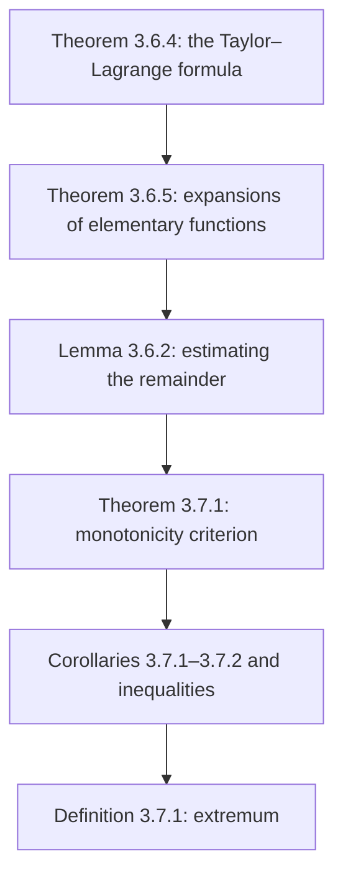

# Lectures 29–30 — The Taylor–Lagrange formula, monotonicity and extrema of functions

[Lecture index](index.md) · [Русский](../../ru/lectures-2025-26/lecture-29-30.md) · [Español](../../es/lectures-2025-26/lecture-29-30.md)

> **Source:** `ma25_26-lectures_29-30_notes.pdf` — 29 pages: typed slides with a text layer (pages 1–5, 9–12, 14, 17–19, 22, 24, 27–29) and handwritten pages without a text layer (6–8, 13, 15, 16, 20, 21, 23, 25, 26). Handwritten pages were transcribed from their images. The headings give the number of the typed slide (18 in total) and the PDF page number.
>
> **Editor's note.** The lecture date is taken from the footer of the slides ("11 December 2025"). The remainder term: $R_{a,n}f(x) = f(x) - \sum\limits_{k=0}^{n} \dfrac{f^{(k)}(a)}{k!} (x - a)^k$ (see remark 2 in lectures 27–28).

## Typed slides 1–3 (PDF pp. 1–3). Introduction

**Quote of the day (slide 2).** A photo of the Cheshire Cat with a caption inside the image: "Life here is interesting, but stressful. That's why we're cheerful, but vicious. 😊"

**Aim of the lecture (slide 3).**

- Continue discussing Taylor's formula (the Taylor–Lagrange formula and estimating the remainder).
- Find the Taylor–Peano expansions (misspelled on the slide) of the elementary functions.
- Study geometric properties of functions: monotonicity and extrema.

## Chapter 3, §6. Taylor's formula (continued)

### Typed slide 4 (PDF p. 4). The Taylor–Lagrange formula

Let $a, x \in \mathbb{R}$, $a \ne x$. Denote by $\Delta_{a,x}$ the closed segment with endpoints $a$ and $x$, and by $\widetilde{\Delta}_{a,x}$ the open interval with endpoints $a$ and $x$.

**Theorem 3.6.4.** Let $n \in \mathbb{Z}_+$, the function $f$ be $n + 1$ times differentiable on $\langle A, B\rangle$, $a, x \in \langle A, B\rangle$. Then there is a point $c \in \widetilde{\Delta}_{a,x}$ such that

$$
f(x) = \sum_{k=0}^{n} \frac{f^{(k)}(a)}{k!} (x - a)^k + \frac{f^{(n+1)}(c)}{(n+1)!} (x - a)^{n+1}.
$$

### Typed slide 5 (PDF p. 5). Remarks

- The assertion of Theorem 3.6.4 can be rewritten as follows: $\exists \theta \in (0, 1)$ such that

$$
f(x) = \sum_{k=0}^{n} \frac{f^{(k)}(a)}{k!} (x - a)^k + \frac{f^{(n+1)}(a + \theta(x - a))}{(n+1)!} (x - a)^{n+1}.
$$

- The hypotheses of Theorem 3.6.4 can be weakened. It would suffice to assume that $f \in C^n(\Delta_{a,x})$ and $f^{(n)}$ is differentiable on $\widetilde{\Delta}_{a,x}$.
- Theorem 3.6.3 will follow from the Taylor–Lagrange formula if in its statement one imposes on the function the following stronger condition: $\exists \delta > 0$ such that $f$ is $n$ times differentiable on $E \cap (a - \delta, a + \delta)$ and $f^{(n)}$ is continuous at the point $a$.

### Handwritten pages (PDF pp. 6–8). Proof of Theorem 3.6.4

**Proof (Theorem 3.6.4).** For $t \in \Delta_{a,x}$ put

$$
\varphi(t) = (x - t)^{n+1}, \qquad F(t) = R_{t,n}f(x) = f(x) - f(t) - \sum_{k=1}^{n} \frac{f^{(k)}(t)}{k!} (x - t)^k.
$$

Then for $t \in \widetilde{\Delta}_{a,x}$

$$
\begin{aligned}
F'(t) &= -f'(t) - \sum_{k=1}^{n} \left( \frac{f^{(k+1)}(t)}{k!} (x - t)^k - \frac{f^{(k)}(t)}{k!} k (x - t)^{k-1} \right) \\
&= -f'(t) + \sum_{k=1}^{n} \frac{f^{(k)}(t)}{(k-1)!} (x - t)^{k-1} - \sum_{k=1}^{n} \frac{f^{(k+1)}(t)}{k!} (x - t)^k.
\end{aligned}
$$

Reindexing the first sum by $m = k - 1$ (labelled in pink) gives

$$
F'(t) = -f'(t) + \sum_{m=0}^{n-1} \frac{f^{(m+1)}(t)}{m!} (x - t)^m - \sum_{k=1}^{n} \frac{f^{(k+1)}(t)}{k!} (x - t)^k,
$$

where the first terms are written under the sums: $\dfrac{f^{(1)}(t)}{1} (x - t)^0 + \dfrac{f''(t)}{1} (x - t) + \ldots$ and $\dfrac{f''(t)}{1} (x - t) + \dfrac{f'''(t)}{2!} (x - t)^2 + \ldots$; the matching terms are struck out in red. In total everything cancels except the extreme terms:

$$
F'(t) = -f'(t) + f'(t) - \frac{f^{(n+1)}(t)}{n!} (x - t)^n = -\frac{f^{(n+1)}(t)}{n!} (x - t)^n.
$$

Note that $F(x) = 0$ (and $\varphi(x) = 0$, $\varphi(a) = (x - a)^{n+1}$) $\Rightarrow$ by Cauchy's theorem $\exists c \in \widetilde{\Delta}_{a,x}$ such that

$$
\frac{F(a)}{(x - a)^{n+1}} = \frac{F(a) - F(x)}{\varphi(a) - \varphi(x)} = \frac{F'(c)}{\varphi'(c)} \Rightarrow \frac{F(a)}{(x - a)^{n+1}} = \frac{-\dfrac{f^{(n+1)}(c)}{n!} (x - c)^n}{-(n+1) (x - c)^n} = \frac{f^{(n+1)}(c)}{n! \, (n+1)} = \frac{f^{(n+1)}(c)}{(n+1)!},
$$

where (a computation on the same page) $\varphi(t) = (x - t)^{n+1}$ $\Rightarrow$ $\varphi'(t) = (n+1)(x - t)^n (-1)$ $\Rightarrow$ $\varphi'(c) = -(n+1)(x - c)^n$, and the factors $(x - c)^n$ are struck out in red. Hence

$$
F(a) = \frac{f^{(n+1)}(c)}{(n+1)!} (x - a)^{n+1}.
$$

On the other hand, $F(t) = f(x) - f(t) - \sum\limits_{k=1}^{n} \dfrac{f^{(k)}(t)}{k!} (x - t)^k$ $\Rightarrow$ $F(a) = f(x) - f(a) - \sum\limits_{k=1}^{n} \dfrac{f^{(k)}(a)}{k!} (x - a)^k$. Comparing, we obtain (PDF p. 8)

$$
f(x) = f(a) + \sum_{k=1}^{n} \frac{f^{(k)}(a)}{k!} (x - a)^k + \frac{f^{(n+1)}(c)}{(n+1)!} (x - a)^{n+1}. \qquad \blacksquare
$$

### Typed slides 6–8 (PDF pp. 9–11). Taylor–Peano expansions of the elementary functions

**Theorem 3.6.5.** Let $n \in \mathbb{Z}_+$. As $x \mapsto 0$ the following assertions hold:

1. $e^x = \sum\limits_{k=0}^{n} \dfrac{x^k}{k!} + o(x^n) = 1 + \dfrac{x}{1!} + \dfrac{x^2}{2!} + \cdots + \dfrac{x^n}{n!} + o(x^n)$.
2. $\sin x = \sum\limits_{k=0}^{n} \dfrac{(-1)^k x^{2k+1}}{(2k+1)!} + o\big(x^{2n+2}\big) = x - \dfrac{x^3}{3!} + \dfrac{x^5}{5!} - \cdots + (-1)^n \dfrac{x^{2n+1}}{(2n+1)!} + o\big(x^{2n+2}\big)$.
3. $\cos x = \sum\limits_{k=0}^{n} \dfrac{(-1)^k x^{2k}}{(2k)!} + o\big(x^{2n+1}\big) = 1 - \dfrac{x^2}{2!} + \dfrac{x^4}{4!} - \cdots + (-1)^n \dfrac{x^{2n}}{(2n)!} + o\big(x^{2n+1}\big)$.
4. $\ln(1 + x) = \sum\limits_{k=1}^{n} \dfrac{(-1)^{k+1} x^k}{k} + o(x^n) = x - \dfrac{x^2}{2} + \dfrac{x^3}{3} - \cdots + (-1)^{n+1} \dfrac{x^n}{n} + o(x^n)$.
5. Let $\alpha \in \mathbb{R}$. Put $C^k_{\alpha} = \dfrac{\alpha(\alpha - 1) \cdots (\alpha - k + 1)}{k!}$ for $k \in \mathbb{Z}_+$. Then

$$
(1 + x)^{\alpha} = \sum_{k=0}^{n} C^k_{\alpha} x^k + o(x^n) = 1 + \frac{\alpha}{1!} x + \frac{\alpha(\alpha - 1)}{2!} x^2 + \cdots + \frac{\alpha(\alpha - 1) \cdots (\alpha - n + 1)}{n!} x^n + o(x^n).
$$

### Typed slide 9 (PDF p. 12). Remarks

- If $\alpha \in \mathbb{Z}_+$ and $\alpha > k$, then $C^k_{\alpha}$ is a binomial coefficient, which justifies the notation chosen. The quantities $C^k_{\alpha}$ are defined for all $\alpha \in \mathbb{R}$ and are called generalised binomial coefficients.
- For $\alpha \in \mathbb{N}$ the function $f(x) = (1 + x)^{\alpha}$ is a polynomial of degree $\alpha$, so $f \equiv T_{0,\alpha} f$. By the previous remark this identity is nothing but Newton's binomial theorem. That is why the Taylor–Peano formula for $(1 + x)^{\alpha}$ is called the binomial expansion.

### Handwritten page (PDF p. 13). Proof of items 1–2 of Theorem 3.6.5

**Proof.**

① $f(x) = e^x$: $f^{(k)}(x) = e^x$ and $f^{(k)}(0) = e^0 = 1$ $\forall k \in \mathbb{N}$, $\forall x \in \mathbb{R}$ $\Rightarrow$ $T_{0,n} f(x) = \sum\limits_{k=0}^{n} \dfrac{x^k}{k!}$.

② Let $f(x) = \sin x$. We first prove that $f^{(m)}(x) = \sin\left(x + \dfrac{\pi m}{2}\right)$ $\forall m \in \mathbb{Z}_+$ (by induction). Then

$$
f^{(m)}(0) = \sin\left(\frac{\pi m}{2}\right) = \begin{cases} 0, & m = 2k, \\ (-1)^k, & m = 2k + 1. \end{cases} \qquad \blacksquare
$$

### Typed slide 10 (PDF p. 14). Estimating the remainder in Taylor's formula

**Lemma 3.6.2.** Let the function $f$ satisfy the hypotheses of Theorem 3.6.4. Suppose there is a number $M > 0$ such that $|f^{(n+1)}(t)| \le M$ for every $t \in \widetilde{\Delta}_{a,x}$. Then

$$
\left| R_{a,n}f(x) \right| \le \frac{M |x - a|^{n+1}}{(n+1)!}.
$$

### Handwritten page (PDF p. 15). Proof of Lemma 3.6.2

**Proof (Lemma 3.6.2).** By the Taylor–Lagrange formula, $R_{a,n}f(x) = \dfrac{f^{(n+1)}(c)}{(n+1)!} (x - a)^{n+1}$ for some $c \in \widetilde{\Delta}_{a,x}$. Then

$$
\left| R_{a,n}f(x) \right| = \left| \frac{f^{(n+1)}(c)}{(n+1)!} (x - a)^{n+1} \right| = \frac{|f^{(n+1)}(c)|}{(n+1)!} |x - a|^{n+1} \le \frac{M}{(n+1)!} |x - a|^{n+1},
$$

where (in green) by hypothesis $|f^{(n+1)}(c)| \le M$. $\blacksquare$

### Handwritten page (PDF p. 16). Examples of remainder estimates

**Examples.** Let $n \in \mathbb{Z}_+$ and $x \in \mathbb{R}$.

① $f(t) = e^t$ $\Rightarrow$ $\left| R_{0,n}f(x) \right| \le \dfrac{e^{\max\{x, 0\}} \cdot |x|^{n+1}}{(n+1)!}$, since $\sup\limits_{t \in \widetilde{\Delta}_{0,x}} \left| f^{(n+1)}(t) \right| = \sup\limits_{t \in \widetilde{\Delta}_{0,x}} e^t = e^{\max\{x, 0\}}$ (circled in green).

② If $f(t) = \sin t$ $\Rightarrow$ $\left| f^{(n+1)}(t) \right| = \left| \cos\left(t + \dfrac{\pi n}{2}\right) \right| \le 1$ $\forall t \in \mathbb{R}$ $\Rightarrow$ $\left| R_{0,n}f(x) \right| \le \dfrac{|x|^{n+1}}{(n+1)!}$.

## Chapter 3, §7. Monotonicity and extrema of functions

### Typed slide 11 (PDF p. 17). §7. Monotonicity and extrema of functions

An important application of differential calculus is the investigation of functions and the plotting of their graphs. First we shall discuss the notions of monotonicity and extremum of a function, which are closely related to the first derivative.

### Typed slide 12 (PDF p. 18). Conditions for monotonicity of a function on an interval

**Theorem 3.7.1.** Let the function $f$ be continuous on $\langle A, B\rangle$ and differentiable on $(A, B)$. The following assertions hold:

1. The function $f$ increases on $\langle A, B\rangle$ if and only if $f'(x) \ge 0$ for every $x \in (A, B)$.
2. If $f'(x) > 0$ for all $x \in (A, B)$, then $f$ strictly increases on $\langle A, B\rangle$.

### Typed slide 13 (PDF p. 19). Remarks

1. The first assertion of Theorem 3.7.1 is called the criterion for $f$ to increase on $\langle A, B\rangle$. The second assertion gives only a sufficient condition for strict increase on $\langle A, B\rangle$. It is not necessary.
2. Interchanging the signs of the inequalities in the theorem for the opposite ones, we obtain the criterion for decrease and a sufficient condition for strict decrease of $f$ on $\langle A, B\rangle$ respectively. To prove them it suffices to apply Theorem 3.7.1 to the function $(-f)$.

### Handwritten pages (PDF pp. 20–21). Proof of Theorem 3.7.1

**Proof (Theorem 3.7.1), statement 1.**

*Necessity* ($\Rightarrow$; on the board, a circled "N"). Let $x, a \in (A, B)$, $x \ne a$.

If $x > a$ $\Rightarrow$ $f(x) \ge f(a)$ [since $f \nearrow$ — in green] $\Rightarrow$ $\dfrac{f(x) - f(a)}{x - a} \ge 0$.

If $x < a$ $\Rightarrow$ $f(x) \le f(a)$ $\Rightarrow$ $\dfrac{f(x) - f(a)}{x - a} \ge 0$.

Hence $f'(a) = \lim\limits_{x \mapsto a} \dfrac{f(x) - f(a)}{x - a} \ge 0$ $\forall a \in (A, B)$.

*Sufficiency* ($\Leftarrow$; on the board, a circled "S" and "statement 1 + statement 2" framed). At the right, in pink, a scheme: ① $f'(x) \ge 0$ $\forall x \in (A, B)$ $\Rightarrow$ $f \nearrow$; ② $f'(x) > 0$ $\forall x \in (A, B)$ $\Rightarrow$ $f$ strictly $\nearrow$.

Let $a, b \in \langle A, B\rangle$, $b > a$ (underlined in turquoise). Use the finite increment formula: $\exists c \in (a, b)$: $f(b) - f(a) = f'(c)(b - a)$.

(PDF p. 21.) **Statement 1** $\Rightarrow$ we know that $f'(c) \ge 0$ and $b - a > 0$ (we chose $b > a$) $\Rightarrow$ $f(b) - f(a) = \underbrace{f'(c)}_{\ge 0} \cdot \underbrace{(b - a)}_{> 0} \ge 0$ $\Rightarrow$ $f(b) \ge f(a)$ (underlined in turquoise) $\Rightarrow$ $f \nearrow$ on $\langle A, B\rangle$.

**Statement 2** $\Rightarrow$ we know that $f'(c) > 0$ and $b - a > 0$ $\Rightarrow$ $f(b) - f(a) = \underbrace{f'(c)}_{> 0} \underbrace{(b - a)}_{> 0} > 0$ $\Rightarrow$ $f(b) > f(a)$ (underlined in turquoise) $\Rightarrow$ $f$ strictly increases on $\langle A, B\rangle$. $\blacksquare$

### Typed slide 14 (PDF p. 22). Criterion for a function to be constant

**Corollary 3.7.1.** Let the function $f$ be continuous on $\langle A, B\rangle$ and differentiable on $(A, B)$. Then the following assertions are equivalent:

1. $f$ is constant on $\langle A, B\rangle$.
2. $f'(x) = 0$ for all $x \in (A, B)$.

### Handwritten page (PDF p. 23). Proof of Corollary 3.7.1

**Proof (Corollary 3.7.1).** ① $\Rightarrow$ ② is obvious!

② $\Rightarrow$ ①: Let $f'(x) = 0$ $\forall x \in (A, B)$. We may say that $f'(x) \ge 0$ $\forall x \in (A, B)$ (in green) $\Rightarrow$ by Theorem 3.7.1, $f \nearrow$ on $\langle A, B\rangle$ $\Rightarrow$ $\left. \begin{aligned} x_1, x_2 &\in \langle A, B\rangle \\ x_1 &< x_2 \end{aligned} \right\} \Rightarrow f(x_1) \le f(x_2)$.

But we may also say that $f'(x) \le 0$ $\forall x \in (A, B)$ (in yellow-green) $\Rightarrow$ $f \searrow$ on $\langle A, B\rangle$ $\Rightarrow$ $\left. \begin{aligned} x_1, x_2 &\in \langle A, B\rangle \\ x_1 &< x_2 \end{aligned} \right\} \Rightarrow f(x_1) \ge f(x_2)$.

Thus we have

$$
\left. \begin{aligned} x_1, x_2 \in \langle A, B\rangle \\ x_1 < x_2 \end{aligned} \right\} \Rightarrow \left\{ \begin{aligned} f(x_1) &\le f(x_2) \\ f(x_1) &\ge f(x_2) \end{aligned} \right\} \Rightarrow f(x_1) = f(x_2). \qquad \blacksquare
$$

### Typed slide 15 (PDF p. 24). On comparing functions on a segment

**Corollary 3.7.2.** Let the functions $f$ and $g$ be continuous on $[A, B]$ and differentiable on $(A, B)$. If $f(A) = g(A)$ and $f'(x) > g'(x)$ for all $x \in (A, B)$, then $f(x) > g(x)$ for every $x \in (A, B]$.

### Handwritten page (PDF p. 25). Proof of Corollary 3.7.2 and an exercise

**Proof (Corollary 3.7.2).** Let $h = f - g$ $\Rightarrow$ $h'(x) > 0$ $\forall x \in (A, B)$ $\Rightarrow$ by statement 2 of Theorem 3.7.1, $h$ strictly increases on $[A, B]$ $\Rightarrow$ for all $x \in (A, B)$ we have $h(x) > h(A) = 0$ $\Rightarrow$ for all $x \in (A, B)$, $f(x) > g(x)$. $\blacksquare$

**Ex.** Formulate the statement if $f(B) = g(B)$.

Corollary 3.7.2 is useful for proving inequalities.

### Handwritten page (PDF p. 26). Examples: proving inequalities

**Examples.**

1 (framed) $\cos x > 1 - \dfrac{x^2}{2}$ $\forall x > 0$. Put $f(x) = \cos x$, $g(x) = 1 - \dfrac{x^2}{2}$. Then $f'(x) - g'(x) = -\sin x - \left(-\dfrac{2x}{2}\right) = x - \sin x > 0$ for $x > 0$, and $f(0) = g(0) = 1$; apply Corollary 3.7.2.

2 (framed) $\sin x > x - \dfrac{x^3}{6}$ $\forall x > 0$. Put $f(x) = \sin x$, $g(x) = x - \dfrac{x^3}{6}$. Then $f'(x) - g'(x) = \cos x - 1 + \dfrac{x^2}{2} > 0$ $\forall x > 0$ (a green brace is labelled "by example 1"); apply Corollary 3.7.2.

### Typed slide 16 (PDF p. 27). Extremum of a function

**Definition 3.7.1.** Suppose $E \subset \mathbb{R}$, $f : E \to \mathbb{R}$, $a \in E$.

1. Suppose there exists $\delta > 0$ such that for all $x \in (a - \delta, a + \delta) \cap E$ the inequality $f(x) \ge f(a)$ holds. Then $a$ is called a minimum point of $f$. If $f(x) \le f(a)$ for all $x \in (a - \delta, a + \delta) \cap E$, then $a$ is called a maximum point of $f$.
2. Suppose there exists $\delta > 0$ such that for all $x \in (a - \delta, a + \delta) \cap E \setminus \{a\}$ the inequality $f(x) > f(a)$ holds. Then $a$ is called a strict minimum point of $f$. If $f(x) < f(a)$ for all $x \in (a - \delta, a + \delta) \cap E \setminus \{a\}$, then $a$ is called a strict maximum point of $f$.
3. If $a$ is a minimum or maximum point of the function $f$, then $a$ is called an extremum point of $f$.

### Typed slide 17 (PDF p. 28). Remarks

- One should not think that the smallest value of the function is attained at a minimum point. It will be smallest only locally, that is, in some neighbourhood of the minimum point. An analogous remark holds for maximum points.
- In Definition 3.7.1 no restrictions were imposed on the function $f$. Later we shall usually assume that $f$ is differentiable at the point $a$.
- Since the notion of an extremum is local, we may restrict ourselves to functions defined on an interval.

### Typed slide 18 (PDF p. 29). The problem of finding extremum points

The solution of this problem is carried out in two stages.

1. Using a necessary condition for an extremum, we discard the points where an extremum is definitely impossible.
2. The remaining points are investigated by means of a sufficient condition for an extremum.

## Structure of the lecture

## Auxiliary pages

- PDF p. 1 — title; p. 2 — quote of the day (photo inserted above); p. 3 — aim of the lecture.
- The proof of Theorem 3.6.4 occupies pp. 6–8; the proof of Theorem 3.7.1 — pp. 20–21.
