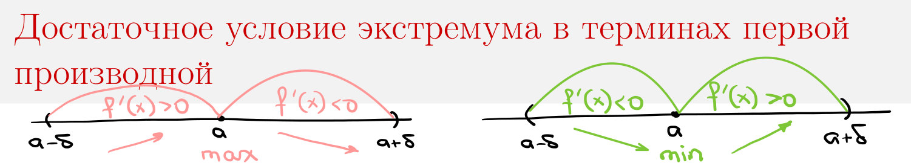
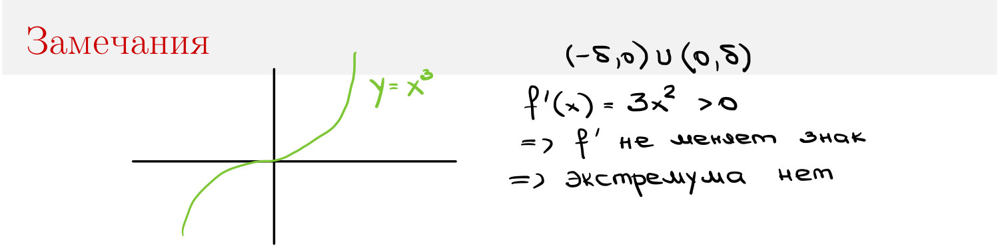
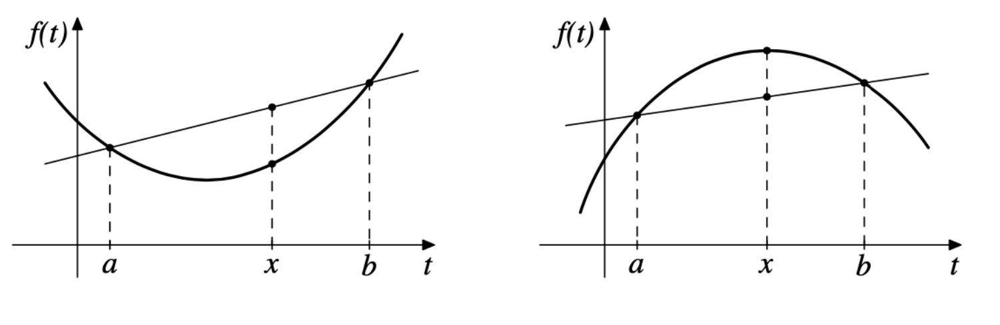
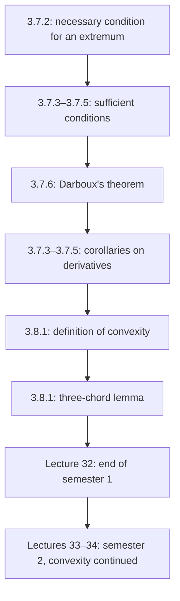

# Lectures 31–32 — Extrema, Darboux's theorem and convex functions

[Lecture index](index.md) · [Русский](../../ru/lectures-2025-26/lecture-31-32.md) · [Español](../../es/lectures-2025-26/lecture-31-32.md)

> **Source:** `ma25_26-lectures_31-32_notes.pdf` — 29 pages, 20 typed slides. Handwritten pages: 6, 10, 12, 15, 17–19, 27–28; handwritten annotations on the slides are also transcribed. Slide numbers differ from PDF page numbers. Date from the title slide and footers: 18 December 2025.
>
> **Semester boundary. Semester 1 ends with lecture 32.** Semester 2 covers **lectures 33–64**. Section 3.8, started here, is repeated and continued in [lectures 33–34](lecture-33-34.md). Duplicate semester-2 material already exists in the [Russian `ru/lectures/` folder](../../ru/lectures/index.md), starting with the [convexity section](../../ru/lectures/01-convexity-3-8.md).
>
> **Conventions.** $I=\langle A,B\rangle$ denotes an interval with any admissible inclusion of its endpoints. The Russian non-strict “increasing” is translated as “nondecreasing”. Typo corrections and additional explanations are explicitly marked as editorial.

## Typed slides 1–3 (PDF pp. 1–3). Introduction

**Quote of the day:** “Two lectures left.”

**Aims:** investigate monotonicity and extrema of functions; discuss convex functions.

## Chapter 3, §7. Monotonicity and extrema of functions — continued

### Typed slides 4–5 (PDF pp. 4–5). A necessary condition for an extremum

**Theorem 3.7.2.** Let $f:I\to\mathbb R$, $a\in(A,B)$, and let $f$ be differentiable at $a$. If $a$ is an extremum point of $f$, then

$$
f'(a)=0.
$$

A point satisfying $f'(a)=0$ is called a **stationary point** of $f$.

**Remarks and handwritten examples (p. 5).**

1. Being stationary does not guarantee an extremum: $f(x)=x^3$ has no extremum at zero, although $f'(0)=0$.
2. An extremum can occur where differentiability fails: $f(x)=\sqrt[3]{x^2}=|x|^{2/3}$ has a minimum at zero but no finite derivative there.
3. The theorem fails for endpoint extrema: $f(x)=x$ on $[0,1]$ has a minimum at zero, but $f'(0)=1$ (the one-sided derivative).
4. A point $a\in(A,B)$ is called **critical**, or a candidate for an extremum, if $f'(a)=0$ or $f$ is not differentiable at $a$. Every interior extremum point is critical, but not every critical point is an extremum point.

### Handwritten page (PDF p. 6). Proof of Theorem 3.7.2

For definiteness, suppose $a$ is a minimum point. There is $\delta>0$ such that $[a-\delta,a+\delta]\subset(A,B)$ and

$$
f(x)\ge f(a)\qquad(x\in[a-\delta,a+\delta]).
$$

Restrict $f$ to this closed interval. The restriction attains its least value at $a$ and is differentiable there. Fermat's theorem gives $f'(a)=0$. The maximum case is analogous. $\blacksquare$

### Typed slide 6 (PDF p. 7). Greatest and least values on a closed interval

A continuous function on $[A,B]$ attains its greatest and least values by Weierstrass's theorem.

1. Find the set $C$ of interior critical points: $f'=0$ or the derivative does not exist.
2. Compare the values at these points and at the endpoints.

The slide writes this as

$$
M=\max\{f(A),f(B),\max_C f\},\qquad
m=\min\{f(A),f(B),\min_C f\},
$$

and then $M=\max_{[A,B]}f$, $m=\min_{[A,B]}f$.

> **Editor's note.** If $C$ is empty, or the separate quantities $\max_C f$, $\min_C f$ do not exist, the inner maxima in this notation cannot be taken literally. A universally valid formulation is to take the maximum and minimum of $f$ over $\{A,B\}\cup C$. This set contains all global extremum points; if $C=\varnothing$, only the endpoints remain.

### Typed slide 7 (PDF p. 8). The first-derivative sufficient condition

**Theorem 3.7.3.** Let $f:I\to\mathbb R$, $a\in(A,B)$, and $(a-\delta,a+\delta)\subset I$. Suppose $f$ is continuous at $a$ and differentiable on $(a-\delta,a)\cup(a,a+\delta)$.

1. If $f'(x)<0$ to the left of $a$ and $f'(x)>0$ to the right, then $a$ is a **strict minimum point**.
2. If $f'(x)>0$ to the left of $a$ and $f'(x)<0$ to the right, then $a$ is a **strict maximum point**.

### Typed slide 8 and handwritten page (PDF pp. 9–10). The condition is not necessary

The slide says: “If $f'$ does not change sign on $(a-\delta,a)\cup(a,a+\delta)$, then $f$ has no extremum at $a$.” The handwritten illustration is $f(x)=x^3$: $f'(x)=3x^2>0$ for $x\ne0$, and there is no extremum at zero.

> **Editor's note.** The remark about unchanged sign presumes **the same strict sign** on both sides and continuity of $f$ at $a$. A merely nonnegative derivative allows non-strict extrema on constant portions; a constant function is the simplest counterexample to a literal reading.

Theorem 3.7.3 gives only a sufficient condition, not a necessary one. The handwritten example is

$$
f(x)=
\begin{cases}
x^2\left(2+\sin\dfrac1x\right),&x\ne0,\\
0,&x=0.
\end{cases}
$$

The function is differentiable on $\mathbb R$, with $f'(0)=0$. Since $f(x)\ge x^2>0$ for $x\ne0$, zero is a strict minimum point. However (p. 10),

$$
f'(x)=2x\left(2+\sin\frac1x\right)-\cos\frac1x\qquad(x\ne0).
$$

The first term tends to zero, while the cosine takes the values $\pm1$ arbitrarily close to zero on both sides. Thus $f'$ does not keep a fixed sign in any punctured neighbourhood of zero.

### Typed slide 9 (PDF p. 11). The second-derivative sufficient condition

**Theorem 3.7.4.** Let $f:I\to\mathbb R$, $a\in(A,B)$, and suppose $f$ is twice differentiable at $a$ and $f'(a)=0$.

1. If $f''(a)>0$, then $a$ is a strict minimum point.
2. If $f''(a)<0$, then $a$ is a strict maximum point.

If $f''(a)=0$, the theorem gives no answer. Handwritten examples: $x^4$ has a minimum at zero, whereas $x^3$ has no extremum there; both second derivatives vanish at zero. An extra parenthesis after $f''(a)>0$ in the printed text has been omitted.

### Handwritten page (PDF p. 12). Proof of Theorem 3.7.4

The first assertion is proved. By the Taylor–Peano formula,

$$
\begin{aligned}
f(x)-f(a)
&=f'(a)(x-a)+\frac{f''(a)}2(x-a)^2+o((x-a)^2)\\
&=\frac{f''(a)}2(x-a)^2\bigl(1+o(1)\bigr),\qquad x\to a.
\end{aligned}
$$

Since $1+o(1)\to1$, this factor is positive in a sufficiently small neighbourhood. For $x\ne a$, all factors are positive, so $f(x)>f(a)$. This is a strict minimum. The case $f''(a)<0$ is analogous. $\blacksquare$

### Typed slide 10 (PDF p. 13). Extrema and higher derivatives

**Theorem 3.7.5.** Let $f:I\to\mathbb R$, $a\in(A,B)$, $n\in\mathbb N$. Suppose $f$ is $n$ times differentiable at $a$,

$$
f'(a)=\cdots=f^{(n-1)}(a)=0,\qquad f^{(n)}(a)\ne0.
$$

1. If $n$ is odd, there is no extremum at $a$.
2. If $n$ is even, $f^{(n)}(a)>0$ gives a strict minimum, and $f^{(n)}(a)<0$ gives a strict maximum.

**Handwritten example:** $f(x)=x^3$, $a=0$; $f'(x)=3x^2$, $f''(x)=6x$, $f'''(x)=6$. The first two derivatives vanish at zero and the third does not; $n=3$, so there is no extremum.

> **Editorial explanation.** The same Taylor–Peano formula gives $f(x)-f(a)=\dfrac{f^{(n)}(a)}{n!}(x-a)^n(1+o(1))$. The parity of $n$ determines whether the sign changes across $a$. There is no separate handwritten proof of Theorem 3.7.5 in the PDF.

### Typed slide 11 (PDF p. 14). A theorem on zeros of derivatives

**Theorem 3.7.6 (G. Darboux).** Let $f$ be differentiable on $I$, let $a,b\in I$, and suppose

$$
f'(a)<0,\qquad f'(b)>0.
$$

Then there is a point $c$ between $a$ and $b$ such that $f'(c)=0$.

### Handwritten page (PDF p. 15). Proof of Theorem 3.7.6

Suppose $a<b$. The function $f$ is continuous on $[a,b]$ and, by Weierstrass's theorem, attains its minimum at some $c\in[a,b]$.

From

$$
f'(a)=\lim_{x\to a+}\frac{f(x)-f(a)}{x-a}<0
$$

we obtain $f(x)<f(a)$ for every sufficiently close $x>a$, so $c\ne a$. Similarly, $f'(b)>0$ gives $f(x)<f(b)$ for nearby $x<b$, so $c\ne b$.

Thus $c\in(a,b)$, and Fermat's theorem gives $f'(c)=0$. $\blacksquare$

> **Editor's note.** The handwritten page treats $a<b$. If $b<a$, apply the same argument to a maximum on $[b,a]$.

### Typed slide 12 (PDF p. 16). Corollaries of Darboux's theorem

**Corollary 3.7.3 (monotonicity with a nonzero derivative).** If $f$ is differentiable on $I$ and $f'(x)\ne0$ everywhere on $I$, then $f$ is strictly monotone on $I$.

**Corollary 3.7.4 (preservation of intervals).** If $f$ is differentiable on $I$, then the image $f'(I)$ is an interval.

**Corollary 3.7.5 (jumps of a derivative).** If $f$ is differentiable on $I$ and $a\in I$, then $f'$ cannot have a jump at $a$ from either the left or the right.

### Handwritten page (PDF p. 17). Proof of Corollary 3.7.3

If the derivative took both positive and negative values, Darboux's theorem would force a zero between the corresponding points, contradicting the hypothesis. Thus $f'$ has a fixed strict sign on $I$. By Theorem 3.7.1, $f$ is strictly increasing if $f'>0$ and strictly decreasing if $f'<0$. $\blacksquare$

### Handwritten page (PDF p. 18). Proof of Corollary 3.7.4

Take $a,b\in I$; for definiteness, $f'(a)\le f'(b)$. We show $[f'(a),f'(b)]\subset f'(I)$. For $\gamma\in(f'(a),f'(b))$, put

$$
F(x)=f(x)-\gamma x.
$$

Then $F'(a)=f'(a)-\gamma<0$ and $F'(b)=f'(b)-\gamma>0$. Darboux's theorem gives a point $c$ between $a$ and $b$ with $F'(c)=0$, that is, $f'(c)=\gamma$. The endpoints already belong to the image. $\blacksquare$

### Handwritten page (PDF p. 19). Proof of Corollary 3.7.5

Suppose $f'$ has a right-hand jump at $a$: the finite limit $L=\lim_{x\to a+}f'(x)$ differs from $f'(a)$. Suppose, for example, $L<f'(a)$. Choose $\gamma\in(L,f'(a))$. For some $\delta>0$,

$$
f'(x)<\gamma\quad(x\in(a,a+\delta)),\qquad f'(a)>\gamma.
$$

The image of $f'$ on $[a,a+\delta)$ contains values on both sides of $\gamma$ but not $\gamma$ itself. It is not an interval, contradicting Corollary 3.7.4. The other ordering of $L$ and $f'(a)$ and a left-hand jump are treated analogously. $\blacksquare$

> **Editor's note.** A derivative need not be continuous: oscillatory discontinuities of the second kind are possible. The Darboux property does not require continuity of the derivative.

## Chapter 3, §8. Convex functions

### Typed slide 13 (PDF p. 20). Definition of convexity

**Definition 3.8.1.** Let $f:I\to\mathbb R$.

1. The function is **convex** on $I$ if for all $a,b\in I$ and $\lambda\in(0,1)$,

$$
f(\lambda a+(1-\lambda)b)\le\lambda f(a)+(1-\lambda)f(b).
$$

2. The function is **strictly convex** if for all distinct $a,b\in I$ and $\lambda\in(0,1)$,

$$
f(\lambda a+(1-\lambda)b)<\lambda f(a)+(1-\lambda)f(b).
$$

### Typed slide 14 (PDF p. 21). Remarks and arithmetic operations

1. We may interchange $a,b$ and assume $a<b$.
2. If $a=b$, the non-strict inequality becomes equality.
3. Reversing the inequalities gives **concavity** and **strict concavity**. In the Russian terminology used here, “convex downwards” and “convex upwards” are synonyms for convexity and concavity, respectively.
4. If $f,g$ are convex on $I$, then $f+g$ is convex; $\alpha f$ is convex for $\alpha>0$ and **concave** for $\alpha<0$.

> **Editorial correction.** The last printed item incorrectly says “convex” also for $\alpha<0$. A red handwritten annotation changes it to “concave”; the corrected statement is given here.

### Typed slides 15–16 (PDF pp. 22–23). Geometric meaning

Let $a<b$ and $x=\lambda a+(1-\lambda)b$. Then

$$
\lambda=\frac{b-x}{b-a},\qquad 1-\lambda=\frac{x-a}{b-a}.
$$

Strict convexity is equivalent to

$$
f(x)<\frac{b-x}{b-a}f(a)+\frac{x-a}{b-a}f(b),\qquad a<x<b. \tag{3.8.1}
$$

The right-hand side defines the chord joining $(a,f(a))$ and $(b,f(b))$. For strict convexity, every chord is strictly above the graph except at its endpoints; for convexity, it is nowhere below the graph.

### Typed slide 17 (PDF p. 24). The three-chord lemma

**Lemma 3.8.1.** For $f:I\to\mathbb R$, the following assertions are equivalent:

1. $f$ is strictly convex on $I$.
2. For all $a<c<b$ in $I$,

$$
\frac{f(c)-f(a)}{c-a}<\frac{f(b)-f(c)}{b-c}.
$$

3. For all $a<c<b$ in $I$,

$$
\frac{f(c)-f(a)}{c-a}
<\frac{f(b)-f(a)}{b-a}
<\frac{f(b)-f(c)}{b-c}.
$$

### Typed slides 18–19 (PDF pp. 25–26). Geometry of the three chords

Let $M=(a,f(a))$, $K=(c,f(c))$, $N=(b,f(b))$. If the chords $MK$, $KN$, $MN$ make angles $\alpha$, $\beta$, $\gamma$ with the $OX$ axis, assertion 3 means

$$
\tan\alpha<\tan\gamma<\tan\beta.
$$

Replacing strict inequalities in assertions 2 and 3 by non-strict ones gives a criterion for ordinary convexity. The proof follows by making the same replacements.

### Handwritten pages (PDF pp. 27–28). Proof of Lemma 3.8.1

It suffices to prove $1\Rightarrow3\Rightarrow2\Rightarrow1$. The implication $3\Rightarrow2$ is immediate.

**$1\Rightarrow3$.** For $a<c<b$, put $\lambda=(b-c)/(b-a)$; then $c=\lambda a+(1-\lambda)b$. Strict convexity gives

$$
f(c)<\lambda f(a)+(1-\lambda)f(b).
$$

Subtracting $f(b)$ yields

$$
f(b)-f(c)>\lambda(f(b)-f(a))
\quad\Longrightarrow\quad
\frac{f(b)-f(c)}{b-c}>\frac{f(b)-f(a)}{b-a}.
$$

On the other hand,

$$
f(c)-f(a)<(1-\lambda)(f(b)-f(a))
\quad\Longrightarrow\quad
\frac{f(c)-f(a)}{c-a}<\frac{f(b)-f(a)}{b-a}.
$$

**$2\Rightarrow1$.** Let $a<b$, $0<\lambda<1$, $c=\lambda a+(1-\lambda)b$. Then

$$
b-c=\frac{\lambda(c-a)}{1-\lambda}.
$$

Substituting into assertion 2 and multiplying by the positive denominators gives

$$
\lambda(f(c)-f(a))<(1-\lambda)(f(b)-f(c)).
$$

Consequently,

$$
f(c)=\lambda f(c)+(1-\lambda)f(c)
<\lambda f(a)+(1-\lambda)f(b).
$$

This is strict convexity. $\blacksquare$

### Typed slide 20 (PDF p. 29). The last but not least

The slide's Christmas algebra joke:

$$
y=\frac{\ln(x/m-sa)}{r^2}
\quad\Longrightarrow\quad
yr^2=\ln(x/m-sa)
\quad\Longrightarrow\quad
e^{yr^2}=\frac{x}{m}-sa,
$$

$$
m e^{yr^2}=x-sam
\quad\Longrightarrow\quad
m e^{r r y}=x-mas.
$$

The last line visually spells out “merry = x-mas”; it is not a new theorem.

## Lecture structure

---

Previous: [lectures 29–30](lecture-29-30.md) · Next: [lectures 33–34 — start of semester 2](lecture-33-34.md).
