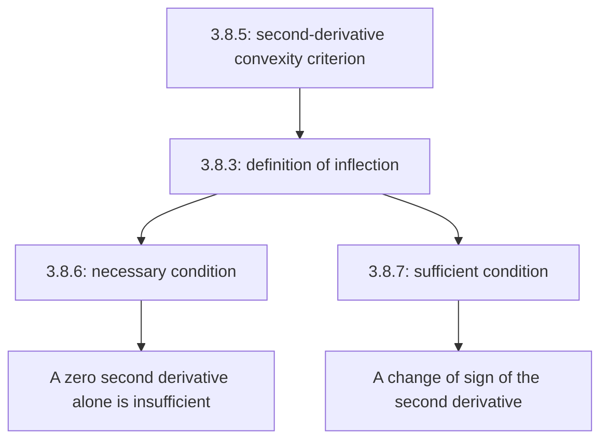

# Lecture 35 — The second derivative, convexity and inflection points

[Lecture index](index.md) · [Русский](../../ru/lectures-2025-26/lecture-35.md) · [Español](../../es/lectures-2025-26/lecture-35.md)

> **Source:** `ma25_26_lecture_35_notes.pdf` — 8 pages, 7 typed slides and one handwritten page (PDF p. 5). Annotations on slides 5–6 are also transcribed. Date: 19 February 2026.
>
> **Semester 2: lectures 33–64; semester 1 ended with lecture 32. Duplication starts at lecture 33.** This material already exists in the [Russian `ru/lectures/` folder](../../ru/lectures/index.md), in [§3.8 “Convexity”](../../ru/lectures/01-convexity-3-8.md), and in the [archived “Lecture 35”](../../../source/MathInMind/МАТАН_Л/Лекция%2035.md). A complete, self-contained illustrated version from the new PDF is retained here.
>
> **Notation.** $I=\langle A,B\rangle$, $\overline{\mathbb R}=\mathbb R\cup\{-\infty,+\infty\}$. The bar over $\mathbb R$ in the inflection definition and Theorem 3.8.7 was checked against the image: an infinite derivative is allowed, although the text layer loses the bar.

## Typed slides 1–3 (PDF pp. 1–3). Introduction

**Quote of the day:** “Tomorrow, today will become yesterday!”

**Aim:** “Finish wrestling with convex functions” — convexity criteria and inflection points.

## Chapter 3, §8. Convex functions — conclusion

### Typed slide 4 (PDF p. 4). The second-derivative criterion

**Theorem 3.8.5.** Let $f:I\to\mathbb R$ be continuous on $I$ and twice differentiable on $(A,B)$.

1. The function $f$ is convex on $I$ if and only if

$$
f''(x)\ge0\qquad\text{for all }x\in(A,B).
$$

2. If $f''(x)>0$ for every $x\in(A,B)$, then $f$ is strictly convex on $I$.

> **Editor's note.** Assertion 1 uses $\ge0$, whereas assertion 2 uses $>0$. The PDF's extracted text does not reliably distinguish these signs. The converse of assertion 2 is false: a strictly convex function may have zero second derivative at individual points.

### Handwritten page (PDF p. 5). Proof of Theorem 3.8.5

By Theorem 3.8.4 and the monotonicity criterion,

$$
f\text{ is convex on }I
\quad\Longleftrightarrow\quad
f'\text{ is nondecreasing on }(A,B)
\quad\Longleftrightarrow\quad
f''(x)\ge0\quad(x\in(A,B)).
$$

If $f''(x)>0$ everywhere on $(A,B)$, the monotonicity criterion makes $f'$ strictly increasing. Theorem 3.8.4 then gives strict convexity of $f$. $\blacksquare$

### Typed slide 5 (PDF p. 6). An inflection point

**Definition 3.8.3.** Let $f:I\to\mathbb R$, $a\in(A,B)$, and suppose:

1. There is $\delta>0$ such that $(a-\delta,a+\delta)\subset(A,B)$, and $f$ has different types of convexity on $(a-\delta,a]$ and $[a,a+\delta)$: convex on one interval and concave on the other.
2. The function $f$ is continuous at $a$.
3. The derivative $f'(a)\in\overline{\mathbb R}$ exists.

Then $a$ is called an **inflection point** of $f$.

> **Editorial explanation.** “Different types” means a genuine change of convexity; an affine function cannot be declared to have an inflection at every point merely because it is both convex and concave. The sketch shows why infinite derivatives are allowed. For example, $f(x)=-\sqrt[3]{x-a}$ is continuous and changes its type of convexity at $a$, where its derivative is $-\infty$; this formula is an editorial example, not a formula written on the figure.

### Typed slide 6 (PDF p. 7). A necessary condition for inflection

**Theorem 3.8.6.** Let $f:I\to\mathbb R$, $a\in(A,B)$, and suppose $f$ is twice differentiable at $a$. If $a$ is an inflection point, then

$$
f''(a)=0.
$$

This is **not a sufficient** condition!

**Handwritten counterexample on the slide:** $f(x)=x^4$ is strictly convex on $\mathbb R$, $f''(x)=12x^2$, $f''(0)=0$, but zero is not an inflection point. The same example shows why strict convexity does not imply $f''>0$ everywhere.

### Typed slide 7 (PDF p. 8). A sufficient condition for inflection

**Theorem 3.8.7.** Let $f:I\to\mathbb R$, $a\in(A,B)$, and suppose $f$ is continuous at $a$ and has a derivative there in $\overline{\mathbb R}$. Suppose there is $\delta>0$ such that $f$ is twice differentiable on $(a-\delta,a)\cup(a,a+\delta)\subset I$, and one of the following holds:

1. $f''>0$ on $(a-\delta,a)$ and $f''<0$ on $(a,a+\delta)$;
2. $f''<0$ on $(a-\delta,a)$ and $f''>0$ on $(a,a+\delta)$.

Then $a$ is an inflection point of $f$.

### Editorial supplement. Relating the two conditions

The PDF contains no separate proofs of Theorems 3.8.6–3.8.7; the following explanations are editorial, not additional handwritten pages.

- For Theorem 3.8.6, a change of convexity means a change in the direction of monotonicity of $f'$. If the finite derivative $f''(a)$ exists, $f'$ has a local extremum at $a$; Fermat's theorem gives $(f')'(a)=f''(a)=0$.
- For Theorem 3.8.7, the signs of $f''$ give different types of convexity by Theorem 3.8.5. Continuity allows $a$ to be adjoined to both one-sided intervals. Together with the existence of the derivative, this gives Definition 3.8.3.
- For example, $f(x)=x^3$ has $f''(x)=6x$: the sign changes at zero, so zero is an inflection point. For $x^4$ the sign does not change, so there is no inflection.

## Lecture structure

---

Previous: [lectures 33–34](lecture-33-34.md) · Next: [lecture 36 — antiderivatives](lecture-36.md) · Duplicate section: [§3.8 in `ru/lectures/`](../../ru/lectures/01-convexity-3-8.md).
