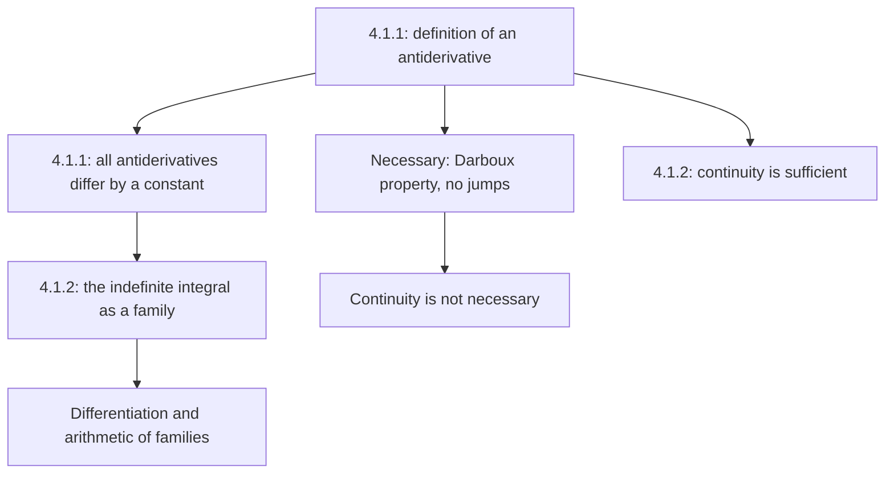

# Lecture 36 — Antiderivatives and the indefinite integral

[← Lecture 35](lecture-35.md) · [Lecture index](index.md) · [Lectures 37–38 →](lecture-37-38.md) · [Terms & theorems](../term-index.md) · [Русский](../../ru/lectures-2025-26/lecture-36.md) · [Español](../../es/lectures-2025-26/lecture-36.md)

> **Source:** `ma25_26_lecture_36_notes.pdf` — 20 pages, 14 typed slides. Handwritten pages: 8, 10–12, 18–19; the diagram on typed PDF p. 4 is also transcribed. Date: 19 February 2026.
>
> **Semester 2: lectures 33–64; semester 1 ends with lecture 32. Starting at lecture 33, duplicate material exists** in the [Russian `ru/lectures/` folder](../../ru/lectures/index.md). For this lecture, see [§4.1 “Antiderivatives and the indefinite integral”](../../ru/lectures/02-antiderivatives-4-1.md) and the [archived “Lecture 36”](../../../source/MathInMind/МАТАН_Л/Лекция%2036.md). This is a complete illustrated transcription of the new PDF, not a shortened reference to the older notes.
>
> **Notation.** $`I=\langle A,B\rangle`$ is an interval, and $`\mathcal P_f(I)`$ is the set of all [antiderivatives](#def-4-1-1) of $`f`$ on it. At included endpoints, [derivatives](lecture-22-23.md#def-3-1-1) are one-sided, as in earlier lectures.

## Typed slides 1–3 (PDF pp. 1–3). Introduction

**Quote of the day:** “Tomorrow, today will become yesterday!”

**Aims:**

- Having studied differentiation, consider the inverse problem: the derivative is known and the function must be found.
- Define an antiderivative and describe all antiderivatives on an interval.
- Discuss operations on indefinite integrals.
- State necessary and sufficient conditions for the existence of antiderivatives.

## Chapter 4. Integral calculus of functions of one real variable

### Typed slide 4 (PDF p. 4). The inverse problem

Handwritten diagram: differentiation maps $`f`$ to $`f'`$, while the inverse problem is to recover $`f`$ from its derivative.


## §1. Antiderivatives and the indefinite integral

### Typed slide 5 (PDF p. 5). An antiderivative on an interval

<a id="def-4-1-1"></a>**Definition 4.1.1.** Let $`f:I\to\mathbb R`$. A function $`F:I\to\mathbb R`$ is an **antiderivative** of $`f`$ on $`I`$ if

1. $`F`$ is [differentiable](lecture-22-23.md#def-3-2-1) on $`I`$;
2. $`F'(x)=f(x)`$ for every $`x\in I`$.

Notation:

```math
\mathcal P_f(I)=\{F:I\to\mathbb R:\ F\text{ is differentiable on }I,\ F'=f\}.
```

### Typed slide 6 (PDF p. 6). Three questions

1. For which $`f`$ is $`\mathcal P_f(I)`$ nonempty?
2. How can we describe $`\mathcal P_f(I)`$ when it is nonempty?
3. How can we compute antiderivatives when they exist?

Start with the second: on an interval, an antiderivative is unique up to an additive constant.

### Typed slide 7 (PDF p. 7). Describing all antiderivatives

<a id="thm-4-1-1"></a>**Theorem 4.1.1.** Let $`f,F,G`$ be defined on $`I`$, with $`F\in\mathcal P_f(I)`$. The following are equivalent:

1. $`G\in\mathcal P_f(I)`$.
2. There exists $`c\in\mathbb R`$ such that $`G(x)=F(x)+c`$ for all $`x\in I`$.

In other words,

```math
\mathcal P_f(I)=\{F+c:\ c\in\mathbb R\}.
```

Thus it suffices to find one antiderivative.

### Handwritten page (PDF p. 8). Proof of Theorem 4.1.1

**$`1\Rightarrow2`$.** Put $`H(x)=G(x)-F(x)`$. Then

```math
H'(x)=G'(x)-F'(x)=f(x)-f(x)=0\qquad(x\in I).
```

By the criterion for a function to be constant, $`H`$ is constant on the interval $`I`$, so $`G=F+c`$.

**$`2\Rightarrow1`$.** If $`G=F+c`$, both functions on the right are differentiable, so $`G`$ is differentiable and

```math
G'(x)=F'(x)+0=f(x)\qquad(x\in I).
```

Hence $`G\in\mathcal P_f(I)`$. $`\blacksquare`$

### Typed slide 8 (PDF p. 9). The indefinite integral

<a id="def-4-1-2"></a>**Definition 4.1.2.** Let $`f:I\to\mathbb R`$, $`F\in\mathcal P_f(I)`$. The set of functions

```math
\{F(x)+c:\ c\in\mathbb R\}
```

is the **indefinite integral** of $`f`$ on $`I`$, denoted by

```math
\int f(x)\,dx.
```

It is simply $`\mathcal P_f(I)`$ expressed using one chosen antiderivative.

> **Editorial correction.** The slide's hypothesis after $`f:I\to\mathbb R`$ omits $`F\in`$ before $`\mathcal P_f(I)`$. The choice of an antiderivative $`F`$ is restored because it is used in the next line.

### Handwritten pages (PDF pp. 10–12). Meaning of the notation

For brevity, one writes

```math
\int f(x)\,dx=F(x)+c,
```

omitting the braces and taking $`c`$ to be an arbitrary real number. This is a **family of functions**, not one function with a preselected constant.

The notation is analogous to that for the [definite integral](lecture-39-40.md#def-4-2-6). Page 10 gives the informal picture

```math
\text{definite integral}\ \sim\
\lim_{\Delta x_k\to0}\sum_k f(x_k)\Delta x_k.
```

On p. 11, $`f(x)\,dx`$ is matched with $`f(x_k)\Delta x_k`$, and $`\int`$ with an elongated letter $`S`$ (summation).

> **Editor's note.** This is an intuitive motivation, not a definition of the limit of [integral sums](lecture-37-38.md#def-4-2-4): [partitions](lecture-37-38.md#def-4-2-2), tags and mesh are introduced in [lectures 37–38](lecture-37-38.md).

In principle, the indefinite integral could be denoted simply by $`\int f`$, but writing $`dx`$ is useful:

1. It specifies the variable of integration. In the example on p. 11:

```math
\int x^y\,dx:\quad x\mapsto x^y,\quad y\text{ is a parameter};
```

```math
\int x^y\,dy:\quad y\mapsto x^y,\quad x\text{ is a parameter}.
```

2. Interpreting $`dx`$ as a [differential](lecture-24-25-26.md#def-3-3-1) makes integration rules convenient to formulate (p. 12).

### Typed slides 9–10 (PDF pp. 13–14). Differentiating an integral

An indefinite integral is a **set of functions**, but some operations on functions extend to these sets.

Suppose $`f`$ has an antiderivative on $`I`$. Every member of the family has the same derivative, so we agree to write

```math
\left(\int f(x)\,dx\right)'=f(x),\qquad x\in I.
```

### Typed slide 11 (PDF p. 15). Arithmetic of sets of functions

Let $`D,E`$ be sets of functions on $`I`$, let $`h:I\to\mathbb R`$, and fix $`\lambda\in\mathbb R`$. Define

```math
D+E=\{f+g:\ f\in D,\ g\in E\},
```

```math
E+h=\{g+h:\ g\in E\},\qquad
\lambda E=\{\lambda g:\ g\in E\}.
```

> **Editor's note.** The slide's last formula puts $`\lambda\in\mathbb R`$ inside the set. When multiplying by a **fixed** scalar $`\lambda`$, only $`g\in E`$ varies, not all possible multipliers $`\lambda`$.

### Typed slide 12 (PDF p. 16). Operations on indefinite integrals

Let $`F,G`$ be antiderivatives of $`f,g`$ on $`I`$, and let $`H:I\to\mathbb R`$. Then

```math
\int f(x)\,dx+\int g(x)\,dx
=\{F(x)+G(x)+c:\ c\in\mathbb R\},
```

```math
\int f(x)\,dx+H(x)
=\{F(x)+H(x)+c:\ c\in\mathbb R\},
```

```math
\lambda\int f(x)\,dx
=\{\lambda F(x)+c:\ c\in\mathbb R\},\qquad\lambda\ne0.
```

> **Editorial explanation.** The restriction $`\lambda\ne0`$ matters for equality of **sets**: $`0\cdot\mathcal P_f(I)=\{0\}`$, whereas the antiderivatives of the zero function are all constant functions. In the second formula, $`H`$ is arbitrary: the assertion is equality of sets of sums, not differentiability of $`H`$.

### Typed slide 13 (PDF p. 17). Necessary conditions for existence

Completely describing functions that have antiderivatives is difficult; necessary and sufficient conditions are considered separately. **Continuity is not a necessary condition.**

### Handwritten page (PDF p. 18). A consequence of Darboux's theorem

If $`f`$ has an antiderivative $`F`$, then $`f=F'`$. Thus $`f`$ has the [Darboux property](lecture-31-32.md#thm-3-7-6): the image of every interval in its domain is an interval. In particular, it cannot have jumps; [discontinuities of the second kind](lecture-16.md#def-2-5-4) may occur.

> **Editorial explanation.** The Darboux property must not be replaced merely by the absence of jumps: having no jump alone does not guarantee an antiderivative. The argument about derivatives appears in [lectures 31–32](lecture-31-32.md).

### Handwritten page (PDF p. 19). A function without an antiderivative

```math
f(x)=
\begin{cases}
1,&x\ge0,\\
-1,&x<0.
\end{cases}
```

At zero, $`f`$ has a jump — a discontinuity of the first kind. Hence it has **no antiderivative on an interval containing zero as an interior point**.


Discontinuities of the second kind are allowed for derivatives, so continuity is not necessary.

> **Editorial example for the last statement.** Lectures 31–32 construct a differentiable function $`u(x)=x^2(2+\sin(1/x))`$ for $`x\ne0`$, $`u(0)=0`$. Its derivative is discontinuous at zero but has the antiderivative $`u`$. This exemplifies an allowable oscillatory discontinuity; it does not assert that every function with a discontinuity of the second kind has an antiderivative.

### Typed slide 14 (PDF p. 20). A sufficient condition for existence

<a id="thm-4-1-2"></a>**Theorem 4.1.2.** If $`f`$ is continuous on $`I`$, then it has an antiderivative on $`I`$.

The PDF states the theorem without proof. Its connection with an integral with variable [upper limit](lecture-13.md#def-2-3-9) is treated when studying the definite integral; see also the [general chapter on Riemann integration](../08-riemann-integration.md).

## Lecture structure



---

Previous: [lecture 35](lecture-35.md) · Next: [lectures 37–38](lecture-37-38.md) · Duplicate section: [§4.1 in `ru/lectures/`](../../ru/lectures/02-antiderivatives-4-1.md).
