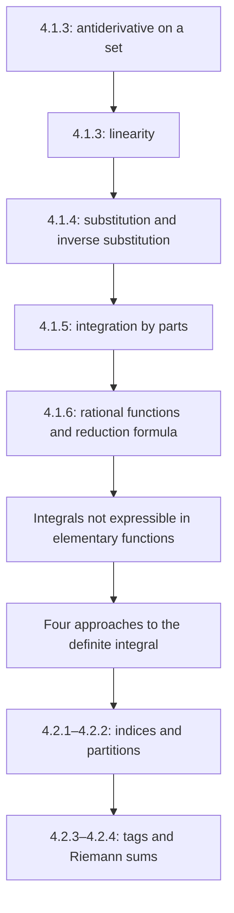

# Lectures 37–38 — Integration methods and the start of the Riemann integral

[Lecture index](index.md) · [Русский](../../ru/lectures-2025-26/lecture-37-38.md) · [Español](../../es/lectures-2025-26/lecture-37-38.md)

> **Source:** `ma25_26-lectures_37-38_notes.pdf` — 38 pages, 21 typed slides. Handwritten pages: 6, 8, 10, 12–13, 15–16, 19–21, 26–27, 29–32, 35. Annotations on typed slides are also transcribed; figures are extracted from their corresponding pages, not redrawn. Date: 26 February 2026.
>
> **Semester 2: lectures 33–64; semester 1 ended with lecture 32. Duplicate material exists starting at lecture 33** in the [Russian `ru/lectures/` folder](../../ru/lectures/index.md). This lecture overlaps [§4.1 “Antiderivatives”](../../ru/lectures/02-antiderivatives-4-1.md) and [§4.2 “The Riemann integral”](../../ru/lectures/03-riemann-integral-4-2.md); the [archived “Lecture 37-38”](../../../source/MathInMind/МАТАН_Л/Лекция%2037-38.md) is also retained. Below is a complete, self-contained illustrated version of the new PDF, including all handwritten calculations.
>
> **Conventions.** $I=\langle A,B\rangle$, $J=\langle C,D\rangle$ are intervals. Indefinite integrals denote families of antiderivatives; calculations with chosen representatives are made up to an arbitrary additive constant. The unnumbered corollary to Theorem 4.1.4 is not assigned a new number.

## Typed slides 1–3 (PDF pp. 1–3). Introduction

**Quote of the day:** “May the cheese fall into your pasta all by itself” — an “Italian wish”, as stated on the slide.

**Aims:** an antiderivative on a set; substitution and integration by parts; rational functions; non-elementary integrals; Riemann sums.

## Chapter 4, §1. Antiderivatives and the indefinite integral — continued

### Typed slide 4 (PDF p. 4). An antiderivative on a set

**Definition 4.1.3.** Let $E\subset\mathbb R$, $f:E\to\mathbb R$. If $F$ is differentiable on $E$ and

$$
F'(x)=f(x)\qquad(x\in E),
$$

then $F$ is an antiderivative of $f$ on the set $E$.

> **Editorial explanation.** The course's convention for derivatives on the domain is used (in particular, at its accumulation points). The assertion “all antiderivatives differ by one constant” was proved for an **interval**, not an arbitrary disconnected set. For example, for $f=0$ on $(-\infty,0)\cup(0,+\infty)$, two independent constants may be chosen on the two components.

### Typed slide 5 and handwritten page (PDF pp. 5–6). Integrating elementary functions

The derivative of an elementary function, wherever it exists, is again elementary. The inverse operation does not have this property.

Example on p. 6:

$$
\int e^{-x^2}\,dx.
$$

If $f$ has an elementary antiderivative, its integral is called **elementarily expressible** (Russian “берущийся”); otherwise it is **non-elementary** (“неберущийся”).

Handwritten remarks:

1. Not all integrals of elementary functions are elementary.
2. There is no universal recipe that produces an elementary antiderivative for every integrand.

> **Editor's note.** “Non-elementary” does not mean “no antiderivative exists”: the continuous function $e^{-x^2}$ has one by Theorem 4.1.2. The issue is the absence of an **elementary expression**; the recipe remark does not deny the existence of algorithms for particular classes of functions.

### Typed slide 6 (PDF p. 7). Linearity

**Theorem 4.1.3.** Suppose $f,g:I\to\mathbb R$ have antiderivatives on $I$. For all $\alpha,\beta\in\mathbb R\setminus\{0\}$,

$$
\int\bigl(\alpha f(x)+\beta g(x)\bigr)\,dx
=\alpha\int f(x)\,dx+\beta\int g(x)\,dx.
$$

### Handwritten page (PDF p. 8). Proof of Theorem 4.1.3

Let $F,G$ be antiderivatives of $f,g$ on $I$. The right-hand side is the set

$$
\{\alpha F(x)+\beta G(x)+c:\ c\in\mathbb R\}.
$$

Since

$$
\bigl(\alpha F(x)+\beta G(x)+c\bigr)'
=\alpha F'(x)+\beta G'(x)
=\alpha f(x)+\beta g(x),
$$

Theorem 4.1.1 identifies it with the entire family of antiderivatives of the sum. $\blacksquare$

> **Editor's note.** The coefficient restrictions are preserved from the slide: multiplying a **set** of antiderivatives by zero loses the arbitrary constant; see [lecture 36](lecture-36.md).

### Typed slide 7 (PDF p. 9). Substitution

**Theorem 4.1.4.** Let $f:I\to\mathbb R$, let $F$ be an antiderivative of $f$ on $I$, and let $\varphi:J\to I$ be differentiable on $J$. Then

$$
\int f(\varphi(x))\varphi'(x)\,dx=F(\varphi(x))+c.
$$

### Handwritten page (PDF p. 10). Proof and differential notation

By the chain rule,

$$
\bigl(F(\varphi(x))+c\bigr)'
=F'(\varphi(x))\varphi'(x)
=f(\varphi(x))\varphi'(x).
$$

Theorem 4.1.1 describes all antiderivatives. $\blacksquare$

**Remark.** Setting $y=\varphi(x)$, $dy=\varphi'(x)\,dx$ gives the formal change

$$
\int f(\varphi(x))\varphi'(x)\,dx
=\int f(y)\,dy=F(y)+c=F(\varphi(x))+c.
$$

### Typed slide 8 (PDF p. 11). The inverse-substitution corollary

**Corollary (unnumbered in the source).** Under the hypotheses of Theorem 4.1.4, suppose $\varphi$ has an inverse $\psi:I\to J$. If $G$ is an antiderivative of $(f\circ\varphi)\varphi'$ on $J$, then

$$
\int f(x)\,dx=G(\psi(x))+c.
$$

### Handwritten pages (PDF pp. 12–13). Proof of the corollary

Let $F$ be an antiderivative of $f$ on $I$. Then $F\circ\varphi$ and $G$ are two antiderivatives of $(f\circ\varphi)\varphi'$ on $J$. By Theorem 4.1.1,

$$
F(\varphi(y))-G(y)=\mathrm{const},\qquad y\in J.
$$

Substitute $y=\psi(x)$:

$$
F(\varphi(\psi(x)))-G(\psi(x))
=F(x)-G(\psi(x))=\mathrm{const}.
$$

Thus $G\circ\psi$ is an antiderivative of $f$. $\blacksquare$

> **Editorial explanation.** There is no need to prove separately that the inverse $\psi$ is differentiable: $G\circ\psi$ already agrees with the differentiable function $F$ up to a constant.

### Typed slide 9 (PDF p. 14). The second form of substitution

Setting $x=\varphi(y)$ gives $dx=\varphi'(y)\,dy$. Therefore

$$
\int f(x)\,dx
=\int f(\varphi(y))\varphi'(y)\,dy
=G(y)+c=G(\psi(x))+c.
$$

### Handwritten pages (PDF pp. 15–16). Substitution examples

**1. The integral of the cotangent.** On an interval where $\sin x\ne0$,

$$
\begin{aligned}
\int\cot x\,dx
&=\int\frac{\cos x}{\sin x}\,dx
=\int\frac{d(\sin x)}{\sin x}\\
&=\int\frac{dy}{y}
=\ln|y|+c=\ln|\sin x|+c,
\qquad y=\sin x.
\end{aligned}
$$

**2. An integral involving a square root.** Put $y=\sqrt x$, $x=y^2$, $dx=2y\,dy$ (for $x>0$):

$$
\begin{aligned}
\int\frac{dx}{1+\sqrt x}
&=\int\frac{2y}{1+y}\,dy
=2\int\left(1-\frac1{1+y}\right)\,dy\\
&=2\int dy-2\int\frac{d(y+1)}{y+1}\\
&=2y-2\ln|y+1|+c\\
&=2\sqrt x-\ln\bigl((\sqrt x+1)^2\bigr)+c.
\end{aligned}
$$

**Separate handwritten diagram on p. 16.** The bottom of the page shows the nesting of smoothness classes; this is not part of the integral calculation:

$$
C^\infty\subset\cdots\subset C^2\subset C^1\subset C,\qquad C=C^0.
$$

### Typed slide 10 (PDF p. 17). Integration by parts

**Theorem 4.1.5.** If $f,g\in C^1(I)$, then

$$
\int f(x)g'(x)\,dx
=f(x)g(x)-\int g(x)f'(x)\,dx. \tag{4.1.1}
$$

### Typed slide 11 (PDF p. 18). Remarks

1. The right-hand side of (4.1.1) is the set

$$
\{f(x)g(x)-H(x)+c:\ c\in\mathbb R\},
$$

where $H$ is an antiderivative of $g f'$.

2. The integrands are continuous and have antiderivatives by Theorem 4.1.2.
3. In differential notation,

$$
\int f\,dg=fg-\int g\,df.
$$

### Handwritten page (PDF p. 19). Proof of Theorem 4.1.5

Let $H'=g f'$. Then

$$
\begin{aligned}
(fg-H+c)'
&=(fg)'-H'\\
&=f'g+fg'-gf'=fg'.
\end{aligned}
$$

By Theorem 4.1.1, the family $\{fg-H+c\}$ equals $\int fg'\,dx$. $\blacksquare$

### Handwritten pages (PDF pp. 20–21). Example: the integral of sin² x

$$
\begin{aligned}
\int\sin^2x\,dx
&=-\int\sin x\,(\cos x)'\,dx\\
&=-\sin x\cos x+\int\cos^2x\,dx\\
&=-\sin x\cos x+\int(1-\sin^2x)\,dx.
\end{aligned}
$$

Write $I=\int\sin^2x\,dx$ to obtain

$$
I=-\sin x\cos x+\int1\,dx-I,
\qquad 2I=-\sin x\cos x+x+c.
$$

Thus

$$
\int\sin^2x\,dx=\frac x2-\frac{\sin x\cos x}{2}+c.
$$

> **Editor's note.** When moving $I$ from one side to the other, representatives of the antiderivatives are chosen and the constants are then absorbed into $c$. This is not literal cancellation of sets under Minkowski arithmetic.

### Typed slides 12–13 (PDF pp. 22–23). Which integrals are elementary?

For several classes of elementary functions, elementary antiderivatives are known to exist and methods of computation have been developed.

Handwritten explanation: a **rational function** is a quotient of two polynomials.

**Theorem 4.1.6.** Every rational function has an elementary antiderivative.

> **Editorial explanation.** The antiderivative is considered on an interval containing no poles of the rational function. Constants on different components of the domain are independent.

### Typed slide 14 (PDF p. 24). Simple fractions

There are two types of simple fractions:

$$
\frac{a}{(x+p)^n},\qquad n\in\mathbb N,\quad a,p\in\mathbb R;
$$

$$
\frac{ax+b}{(x^2+px+q)^n},\qquad
n\in\mathbb N,\quad a,b,p,q\in\mathbb R,\quad p^2<4q.
$$

An algebraic result expresses every rational function as a polynomial plus finitely many such fractions. Polynomials and fractions of the first type are integrated using the standard table; the second type needs an algorithm.

> **Editorial reminder of the table formulas.** For $n=1$, the first fraction gives $a\ln|x+p|+c$; for $n>1$, it gives $\dfrac{a}{1-n}(x+p)^{1-n}+c$. These formulas apply away from $x=-p$.

### Typed slide 15 and handwritten pages (PDF pp. 25–27). Algorithm for the second type

**Step 1: complete the square.** If $p\ne0$, substitute $y=x+p/2$. Then (calculations on p. 26),

$$
x=y-\frac p2,\qquad
ax+b=ay+\widetilde b,\quad \widetilde b=b-\frac{ap}{2},
$$

$$
x^2+px+q
=\left(y-\frac p2\right)^2+p\left(y-\frac p2\right)+q
=y^2+\widetilde q,\qquad
\widetilde q=q-\frac{p^2}{4}>0.
$$

Thus it suffices to treat $p=0$:

$$
\int\frac{ax+b}{(x^2+q)^n}\,dx
=a\int\frac{x\,dx}{(x^2+q)^n}
+b\int\frac{dx}{(x^2+q)^n}.
$$

**Step 2: numerator $x$.** Put $y=x^2+q$, $dy=2x\,dx$:

$$
\int\frac{x\,dx}{(x^2+q)^n}
=\frac12\int y^{-n}\,dy
=\frac{(x^2+q)^{1-n}}{2(1-n)}+c,\qquad n>1.
$$

> **Editorial clarification.** Handwritten p. 26 gives the last formula without excluding $n=1$. For $n=1$, the answer is $\tfrac12\ln|x^2+q|+c$, not an expression with a zero denominator. Page 27 repeats the same substitution as $\tfrac12\int d\varphi(x)/(\varphi(x))^n$ with $\varphi(x)=x^2+q$.

### Typed slide 16 (PDF p. 28). The reduction formula

**Steps 3–4.** Let $q\in\mathbb R\setminus\{0\}$ and

$$
I_n=\int\frac{dx}{(x^2+q)^n},\qquad n\in\mathbb N.
$$

Then

$$
2nq I_{n+1}=(2n-1)I_n+\frac{x}{(x^2+q)^n}.
$$

Applying the reduction $n-1$ times reduces $I_n$ to the tabulated integral $I_1$.

> **Editorial verification of the formula.** $\dfrac d{dx}\left(\dfrac{x}{(x^2+q)^n}\right)=\dfrac{2nq}{(x^2+q)^{n+1}}-\dfrac{2n-1}{(x^2+q)^n}$. Integration yields the formula up to a constant. For an irreducible quadratic fraction, completing the square gives $q>0$, and $I_1=\dfrac1{\sqrt q}\arctan\dfrac{x}{\sqrt q}+c$. If $q<0$, write $q=-a^2$, $a>0$; the base integral is $\dfrac1{2a}\ln\left|\dfrac{x-a}{x+a}\right|+c$ on intervals avoiding the poles.

### Handwritten page (PDF p. 29). Unfolding the reduction

For $n\ge2$,

$$
I_n=\frac1{2(n-1)q}
\left[(2n-3)I_{n-1}+\frac{x}{(x^2+q)^{n-1}}\right].
$$

For $n\ge3$, the next step is

$$
I_n=\frac1{2(n-1)q}
\left[
\frac{2n-3}{2(n-2)q}
\left((2n-5)I_{n-2}+\frac{x}{(x^2+q)^{n-2}}\right)
+\frac{x}{(x^2+q)^{n-1}}
\right].
$$

Continuing gives a linear combination of $I_1$ and rational expressions $x/(x^2+q)^m$, $1\le m\le n-1$.

### Handwritten pages (PDF pp. 30–32). A complete rational-integral example

Compute

$$
\int\frac{2x\,dx}{(x^2+2x+2)^2}.
$$

**1.** Put $y=x+1$, $x=y-1$, $dx=dy$, $x^2+2x+2=y^2+1$. Then

$$
\int\frac{2x\,dx}{(x^2+2x+2)^2}
=2\int\frac{y\,dy}{(y^2+1)^2}
-2\int\frac{dy}{(y^2+1)^2}.
$$

**2.** In the first integral, substitute $z=y^2+1$, $dz=2y\,dy$:

$$
2\int\frac{y\,dy}{(y^2+1)^2}
=\int\frac{dz}{z^2}
=-\frac1z+c
=-\frac1{x^2+2x+2}+c.
$$

**3–4.** Apply the reduction formula to the second integral with $n=1$, $q=1$:

$$
2\int\frac{dy}{(y^2+1)^2}
=\int\frac{dy}{y^2+1}+\frac{y}{y^2+1}
=\arctan y+\frac{y}{y^2+1}+c.
$$

Returning to $x$ and subtracting yields

$$
\begin{aligned}
\int\frac{2x\,dx}{(x^2+2x+2)^2}
&=-\frac1{x^2+2x+2}-\arctan(x+1)
-\frac{x+1}{x^2+2x+2}+c\\
&=-\arctan(x+1)-\frac{x+2}{x^2+2x+2}+c.
\end{aligned}
$$

### Typed slide 17 (PDF p. 33). Other elementary integrals

Other classes are usually reduced to rational functions by suitable substitutions.

### Typed slide 18 (PDF p. 34). Non-elementary integrals

The slide lists:

1. The sine integral: $\displaystyle\int\frac{\sin x}{x}\,dx$.
2. The cosine integral: $\displaystyle\int\frac{\cos x}{x}\,dx$.
3. The logarithmic integral: $\displaystyle\int\frac{dx}{\ln x}$.
4. The exponential integral: $\displaystyle\int\frac{e^x}{x}\,dx$.
5. The Fresnel integrals: $\displaystyle\int\sin(x^2)\,dx$, $\displaystyle\int\cos(x^2)\,dx$.
6. The probability integral: $\displaystyle\int e^{-x^2}\,dx$.

Proving non-elementarity requires algebraic techniques beyond the scope of the course.

> **Editor's note.** The formulas are considered on intervals where the integrands are defined and continuous; for example, $1/\ln x$ requires $x>0$, $x\ne1$. Item 5 contains $\sin(x^2)$ and $\cos(x^2)$, **not** $\sin^2x$ and $\cos^2x$: the integral of $\sin^2x$ was computed on pp. 20–21.

### Handwritten page (PDF p. 35). Four approaches to the definite integral

The diagram is headed “Defining the integral of a continuous function over a closed interval”.

1. **Geometric:** the integral of a nonnegative function is the area of its subgraph. An area theory must first be constructed, which is laborious.
2. **Modified geometric:** approximate that area by sums of rectangle areas; this leads to the Riemann integral.
3. **Axiomatic:** reformulate area properties as axioms for an integral.
4. **Analytic:** the integral is the difference between the values of an antiderivative at the interval's endpoints.

For the last two approaches, the diagram notes that existence of the integral still remains unproved. This motivates the subsequent construction; it is not an existence proof for an arbitrary function.

## Chapter 4, §2. The definite Riemann integral and integrable functions

### Typed slide 19 (PDF p. 36). Partitions and their mesh

**Definition 4.2.1.** Denote the set of integers in $[p,q]$ by

$$
[p:q]=[p,q]\cap\mathbb Z.
$$

**Definition 4.2.2.** Let $[a,b]$ be a nondegenerate closed interval. A collection

$$
\tau=\{x_k\}_{k=0}^{n},\qquad
a=x_0<x_1<\cdots<x_n=b,
$$

is a **partition** of $[a,b]$. Put

$$
\Delta x_k=x_{k+1}-x_k\qquad(k\in[0:n-1]).
$$

The quantity

$$
\lambda=\lambda_\tau=\max_{0\le k\le n-1}\Delta x_k
$$

is the **mesh of the partition** (called its “rank” in the Russian source).

> **Editorial correction.** The handwritten sketch labels the length of $[x_2,x_3]$ as $\Delta x_3=x_3-x_2$. Under the printed convention $\Delta x_k=x_{k+1}-x_k$, this is **$\Delta x_2$**. The image is preserved as in the PDF; formulas follow the printed definition.

### Typed slide 20 (PDF p. 37). Tags and Riemann sums

**Definition 4.2.3.** A collection

$$
\xi=\{\xi_k\}_{k=0}^{n-1},\qquad
\xi_k\in[x_k,x_{k+1}]\quad(k\in[0:n-1]),
$$

is a **tagging of the partition**. The pair $(\tau,\xi)$ is a **tagged partition**.

> **Editor's note.** This handwritten sketch labels the points after $x_1$ as $x_3,x_4$, skipping index $2$. It illustrates choosing one point per subinterval; consistent indexing is given by the definition above. Tags may coincide with subinterval endpoints.

**Definition 4.2.4.** For $f:[a,b]\to\mathbb R$, the sums

$$
\sigma=\sigma_\tau(f,\xi)
=\sum_{k=0}^{n-1}f(\xi_k)\Delta x_k
$$

are **integral sums**, or **Riemann sums**, corresponding to the tagged partition $(\tau,\xi)$.

### Typed slide 21 (PDF p. 38). Geometry of a Riemann sum

For nonnegative $f$, each term is the area of a rectangle with base $[x_k,x_{k+1}]$ and height $f(\xi_k)$; the sum approximates the area of the subgraph.

> **Editorial explanation.** If $f$ takes negative values, the contributions are signed. This PDF introduces only partitions, tags and sums; it does not yet define the integral itself as a common limit as $\lambda_\tau\to0$. That definition must not be attributed to the final slide.

## Lecture structure

---

Previous: [lecture 36](lecture-36.md) · Continue the topic in the duplicate folder: [§4.2 “The Riemann integral”](../../ru/lectures/03-riemann-integral-4-2.md).
