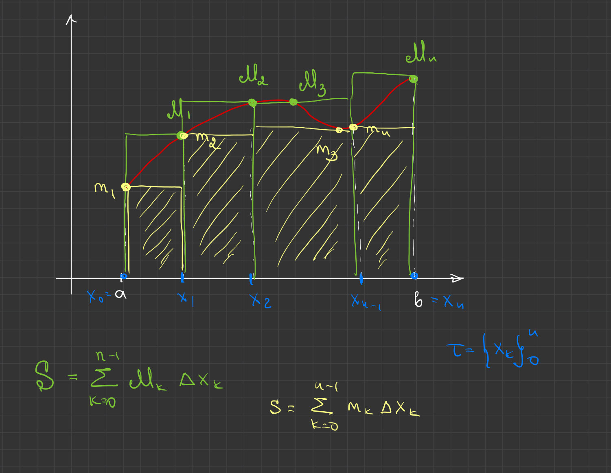
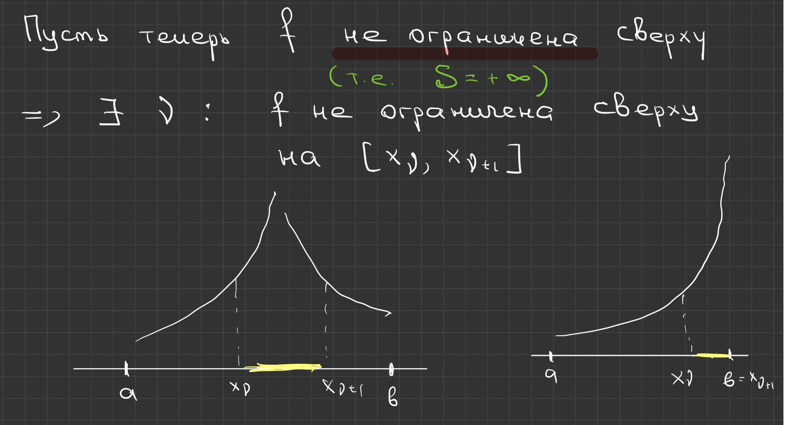
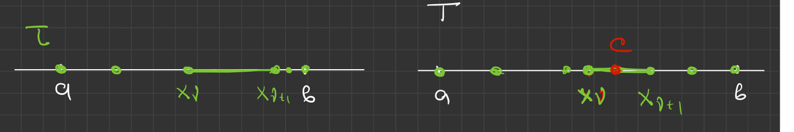
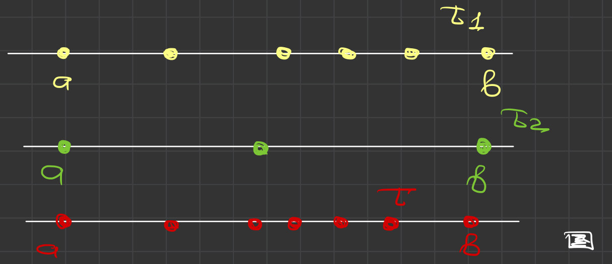
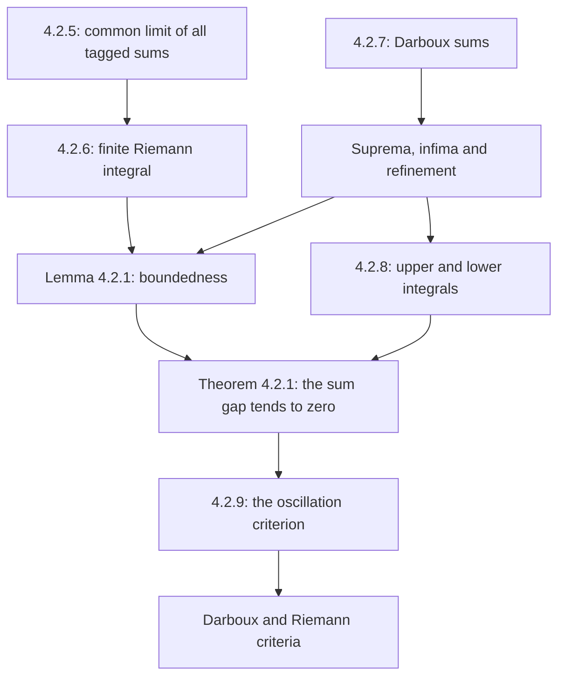

# Lectures 39–40 — The Riemann integral and Darboux sums

[Lecture index](index.md) · [Русский](../../ru/lectures-2025-26/lecture-39-40.md) · [Español](../../es/lectures-2025-26/lecture-39-40.md)

> **Source:** `ma25_26-lectures_39-40_notes.pdf` — 31 pages, 13 printed slides. Handwritten pages: 5, 7, 10–11, 13–21, 25–27, 29, 31. Annotations on printed slides are included. Date: 5 March 2026. Illustrations are individually checked crops of the PDF itself, not redrawings.
>
> **Semester 2: lectures 33–64; semester 1 ended with lecture 32. Duplicate material exists from lecture 33 onward** in the [Russian `ru/lectures/` folder](../../ru/lectures/index.md). This lecture overlaps with [§4.2 “The Riemann integral”](../../ru/lectures/03-riemann-integral-4-2.md); the [archived “Lecture 39-40 1”](../../../source/MathInMind/МАТАН_Л/Лекция%2039-40%201.md) is preserved. Below is a complete, independent illustrated transcription of the new source, not a pointer in place of notes.
>
> **Conventions.** $a<b$, $\tau=\{x_k\}_{k=0}^{n}$, $a=x_0<\cdots<x_n=b$, $\Delta x_k=x_{k+1}-x_k>0$, $\lambda_\tau=\max_k\Delta x_k$, $\xi_k\in[x_k,x_{k+1}]$. Partitions and tags were defined in [lectures 37–38](lecture-37-38.md). Boundedness is not assumed initially: upper sums may equal $+\infty$, and lower sums $-\infty$. The Riemann integral in this lecture is always a **finite real number**.

## Printed slides 1–3 (PDF pp. 1–3). Introduction

The **“quote of the day”** is a picture of “Riemann’s Christmas Tree” and “Lebesgue’s Christmas Tree”: vertical versus horizontal strips. It is a humorous illustration, not a definition of the Lebesgue integral.

**Goals:** limits of Riemann sums; the Riemann integral; Darboux sums and their properties; boundedness of an integrable function; upper and lower Darboux integrals; oscillations; integrability criteria. The goals also mention integrability of continuous and monotone functions; their theorems and proofs occur in the [next PDF, lectures 41–42](lecture-41-42.md).

## Chapter 4, §2. The Riemann integral

### Printed slide 4 (PDF p. 4). Limits of Riemann sums

**Definition 4.2.5.** Let $f:[a,b]\to\mathbb R$. A number $I\in\mathbb R$ is the limit of Riemann sums as the mesh tends to zero if

$$
\forall\varepsilon>0\ \exists\delta>0\ \forall\tau:
\lambda_\tau<\delta\ \forall\xi\qquad
|\sigma_\tau(f,\xi)-I|<\varepsilon.
$$

Notation:

$$
I=\lim_{\lambda_\tau\to0}\sigma_\tau(f,\xi)
=\lim_{\lambda\to0}\sigma.
$$

The same number must approximate the sums for **every** sufficiently fine partition and **every** choice of its tags.

### Handwritten page (PDF p. 5). Sequential formulation

1. The definition can be expressed using sequences: for **every** sequence of tagged partitions $\{(\tau^j,\xi^j)\}$,

$$
\lambda_{\tau^j}\xrightarrow[j\to\infty]{}0
\quad\Longrightarrow\quad
\sigma_{\tau^j}(f,\xi^j)\xrightarrow[j\to\infty]{}I.
$$

2. This is not an ordinary limit of a function of the single variable “mesh”: a Riemann sum depends on the entire tagged partition, not just its mesh. Different partitions and tags with the same mesh can give different sums.

### Printed slide 5 and handwritten page (PDF pp. 6–7). The Riemann integral

**Definition 4.2.6.** If the limit of Riemann sums exists and equals $I\in\mathbb R$, then $f$ is **Riemann integrable** on $[a,b]$, and the number $I$ is its **Riemann integral**, or **definite integral**:

$$
I=\int_a^b f
=\int_a^b f(x)\,dx
=\int_a^b f(r)\,dr.
$$

The handwritten addition on p. 6 recalls:

$$
\sigma_\tau(f,\xi)=\sum_{k=0}^{n-1}f(\xi_k)\Delta x_k,
\qquad I=\lim_{\lambda_\tau\to0}\sigma_\tau(f,\xi).
$$

The notation $\mathcal R[a,b]$ denotes the set of Riemann-integrable functions. The numbers $a,b$ are the limits of integration; $f$ is the integrand. The letter used for the variable of integration does not affect the resulting number.

### Printed slide 6 (PDF p. 8). Three questions

Thus, the integral is a limit of Riemann sums. This raises three questions:

1. Which functions are integrable?
2. What properties does the integral have?
3. How can an integral be calculated?

The first question is addressed next.

### Printed slide 7 and handwritten pages (PDF pp. 9–11). Darboux sums

**Definition 4.2.7.** For $f:[a,b]\to\mathbb R$ and a partition $\tau$, set

$$
M_k=\sup_{x\in[x_k,x_{k+1}]}f(x),\qquad
m_k=\inf_{x\in[x_k,x_{k+1}]}f(x),\qquad k=0,\ldots,n-1.
$$

The **upper** and **lower Darboux sums** are

$$
S_\tau(f)=\sum_{k=0}^{n-1}M_k\Delta x_k,\qquad
s_\tau(f)=\sum_{k=0}^{n-1}m_k\Delta x_k.
$$

> **Editorial explanation of the figure.** The height labels in the sketch start at 1, whereas the definition indexes subintervals from 0. The formulas follow the indexing in the definition.

If $f$ is continuous on $[a,b]$, the Weierstrass theorem gives points $\widetilde\xi_k,\widehat\xi_k$ in each subinterval such that

$$
M_k=\max_{[x_k,x_{k+1}]}f=f(\widetilde\xi_k),\qquad
m_k=\min_{[x_k,x_{k+1}]}f=f(\widehat\xi_k).
$$

**Handwritten remark:** in general, suprema and infima need not be values of the function. Thus Darboux sums **need not be Riemann sums** for any choice of tags. They are simpler in that they do not depend on tags at all.

### Printed slide 8 (PDF p. 12). Four properties of Darboux sums

1. For any partition:

$$
f\text{ is bounded above}\ \Longleftrightarrow\ S_\tau(f)<+\infty,
\qquad
f\text{ is bounded below}\ \Longleftrightarrow\ s_\tau(f)>-\infty.
$$

2. For a fixed partition, the supremum and infimum over all tags are

$$
S_\tau(f)=\sup_\xi\sigma_\tau(f,\xi),\qquad
s_\tau(f)=\inf_\xi\sigma_\tau(f,\xi).
$$

3. Adding partition points cannot increase the upper sum or decrease the lower sum. If $T\supset\tau$, then

$$
s_\tau(f)\le s_T(f)\le S_T(f)\le S_\tau(f).
$$

4. Every lower sum is at most **every** upper sum, even for different partitions:

$$
s_{\tau_1}(f)\le S_{\tau_2}(f).
$$

### Handwritten pages (PDF pp. 13–14). Proof of property 1

Suppose $f(x)\le M$ on $[a,b]$. Then $M_k\le M$, so

$$
S_\tau(f)\le\sum_{k=0}^{n-1}M\Delta x_k=M(b-a)<+\infty.
$$

Conversely, if $f$ is unbounded above, it is unbounded above on at least one of the finitely many subintervals. For that index $\nu$, we have $M_\nu=+\infty$, hence $S_\tau(f)=+\infty$. The analogous argument for the infimum, or application of the result to $-f$, gives the second equivalence. $\blacksquare$

### Handwritten pages (PDF pp. 15–18). Proof of property 2

For any choice of tags, $f(\xi_k)\le M_k$, hence

$$
\sigma_\tau(f,\xi)
=\sum_{k=0}^{n-1}f(\xi_k)\Delta x_k
\le\sum_{k=0}^{n-1}M_k\Delta x_k=S_\tau(f).
$$

We show that this is the **least** upper bound. If $f$ is bounded above, the definition of a supremum allows us, for each $\varepsilon>0$, to choose tags $\xi^*$ with

$$
f(\xi_k^*)>M_k-\frac{\varepsilon}{b-a}.
$$

Multiplying by the positive lengths and summing gives

$$
\begin{aligned}
\sigma_\tau(f,\xi^*)
&>\sum_{k=0}^{n-1}\left(M_k-\frac{\varepsilon}{b-a}\right)\Delta x_k\\
&=S_\tau(f)-\frac{\varepsilon}{b-a}\sum_{k=0}^{n-1}\Delta x_k
=S_\tau(f)-\varepsilon.
\end{aligned}
$$

If $f$ is unbounded above, choose a subinterval $[x_\nu,x_{\nu+1}]$ on which it is unbounded, and arbitrary points $\xi_k^*$ for $k\ne\nu$.

For every $A>0$, the remaining tag can be chosen so that

$$
f(\xi_\nu^*)>
\frac{A-\sum_{k\ne\nu}f(\xi_k^*)\Delta x_k}{\Delta x_\nu}.
$$

Then $\sigma_\tau(f,\xi^*)>A$, so the supremum of all sums is $+\infty=S_\tau(f)$. The infimum is handled analogously with reversed inequalities. $\blacksquare$

### Handwritten pages (PDF pp. 19–21). Proofs of properties 3–4

**3. Refinement.** It suffices to add one point $c\in(x_\nu,x_{\nu+1})$; adding finitely many points repeats this step.

Let $M',M''$ be the suprema on the two new subintervals. Then $M',M''\le M_\nu$. For finite upper sums, the handwritten calculation is

$$
\begin{aligned}
S_\tau-S_T
&=M_\nu(x_{\nu+1}-x_\nu)-M'(c-x_\nu)-M''(x_{\nu+1}-c)\\
&\ge M_\nu\bigl[(x_{\nu+1}-x_\nu)-(c-x_\nu)-(x_{\nu+1}-c)\bigr]=0.
\end{aligned}
$$

> **Editorial explanation.** If the function is unbounded above, both upper sums are infinite by property 1: the comparison still holds, but no difference of infinities is taken. The lower-sum case is analogous. This clarifies when the subtraction in the handwritten proof is legitimate.

For lower sums, the new infima are at least the old one, so $s_T\ge s_\tau$.

**4. Different partitions.** If the partitions coincide, the claim follows from $m_k\le M_k$. In general, set $T=\tau_1\cup\tau_2$ and use property 3:

$$
s_{\tau_1}\le s_T\le S_T\le S_{\tau_2}.
$$

Thus $s_{\tau_1}\le S_{\tau_2}$. $\blacksquare$

### Printed slide 9 (PDF p. 22). Boundedness of an integrable function

**Lemma 4.2.1.** A function integrable on a closed interval is bounded there.

**Handwritten proof.** Suppose otherwise, for example that the function is unbounded above. For every partition, properties 1–2 give

$$
\sup_\xi\sigma_\tau(f,\xi)=S_\tau(f)=+\infty.
$$

Thus, for any proposed limit $I\in\mathbb R$ and an arbitrarily fine partition, there are tags with $\sigma_\tau(f,\xi)>I+1$. The definition of a limit fails. Unboundedness below is analogous. $\blacksquare$

### Printed slide 10 (PDF p. 23). Darboux integrals

**Definition 4.2.8.** The quantities

$$
I^*=\inf_\tau S_\tau(f),\qquad
I_*=\sup_\tau s_\tau(f)
$$

are the **upper** and **lower Darboux integrals**.

Handwritten remarks:

1. Property 4 gives $I_*\le I^*$.
2. As with Darboux sums, upper or lower unboundedness is related to the corresponding infinities:

$$
f\text{ is unbounded above}\ \Longleftrightarrow\ I^*=+\infty,
\qquad
f\text{ is unbounded below}\ \Longleftrightarrow\ I_*=-\infty.
$$

If $f$ is bounded, both quantities are finite.

### Printed slide 11 (PDF p. 24). An integrability criterion

**Theorem 4.2.1.** For $f:[a,b]\to\mathbb R$,

$$
f\in\mathcal R[a,b]
\quad\Longleftrightarrow\quad
\lim_{\lambda_\tau\to0}\bigl(S_\tau(f)-s_\tau(f)\bigr)=0.
$$

That is,

$$
\forall\varepsilon>0\ \exists\delta>0\ \forall\tau:
\lambda_\tau<\delta\quad\Longrightarrow\quad
S_\tau(f)-s_\tau(f)<\varepsilon.
$$

**Corollary (unnumbered).** For an integrable function,

$$
\lim_{\lambda_\tau\to0}S_\tau(f)
=\lim_{\lambda_\tau\to0}s_\tau(f)
=\int_a^b f.
$$

### Handwritten pages (PDF pp. 25–27). Proof of Theorem 4.2.1

**Necessity.** Let $I=\int_a^b f$. Given $\varepsilon>0$, choose $\delta>0$ from the definition of a limit so that, if $\lambda_\tau<\delta$, every choice of tags satisfies

$$
I-\frac{\varepsilon}{3}<\sigma_\tau(f,\xi)<I+\frac{\varepsilon}{3}.
$$

Taking the infimum and supremum over the tags yields

$$
I-\frac{\varepsilon}{3}\le s_\tau\le S_\tau\le I+\frac{\varepsilon}{3},
\qquad
0\le S_\tau-s_\tau\le\frac{2\varepsilon}{3}<\varepsilon.
$$

**Sufficiency.** Suppose the difference of the sums tends to zero. It is then finite for at least one sufficiently fine partition. Both sums for that partition are therefore finite; property 1 implies boundedness of $f$, and consequently finiteness of all sums and both Darboux integrals.

> **Editorial explanation.** This expands the manuscript’s initial step “all sums are finite.” One arrow on p. 26 incorrectly has the mesh tending to infinity; here, as throughout the criterion, $\lambda_\tau\to0$ is required.

For every partition,

$$
s_\tau\le I_*\le I^*\le S_\tau,
\qquad
0\le I^*-I_*\le S_\tau-s_\tau.
$$

The right-hand side tends to zero, hence $I^*=I_*=:I$. Together with $s_\tau\le\sigma_\tau(f,\xi)\le S_\tau$, this gives

$$
|\sigma_\tau(f,\xi)-I|\le S_\tau-s_\tau.
$$

Given $\varepsilon>0$, choose $\delta>0$ from the criterion’s condition. The estimate holds for every partition with $\lambda_\tau<\delta$ and every choice of tags: the limit of the sums is $I$. $\blacksquare$

**Conclusion highlighted in the manuscript:** for every integrable function and every partition,

$$
s_\tau(f)\le\int_a^b f\le S_\tau(f).
$$

### Printed slide 12 and handwritten page (PDF pp. 28–29). Oscillation and the corollary

**Definition 4.2.9.** On a nonempty set $D\subset\mathbb R$, the oscillation of $f:D\to\mathbb R$ is

$$
\omega(f)_D=\sup_{x,y\in D}\bigl(f(x)-f(y)\bigr)
=\sup_{x\in D}f(x)-\inf_{y\in D}f(y).
$$

The annotation on the slide equates the Russian terms “колебание” and “осцилляция” (oscillation).

$$
\omega_k(f)=\omega(f)_{[x_k,x_{k+1}]}=M_k-m_k,
\qquad
S_\tau(f)-s_\tau(f)=\sum_{k=0}^{n-1}\omega_k(f)\Delta x_k.
$$

Theorem 4.2.1 can therefore be written as

$$
f\in\mathcal R[a,b]
\quad\Longleftrightarrow\quad
\lim_{\lambda_\tau\to0}\sum_{k=0}^{n-1}\omega_k(f)\Delta x_k=0.
$$

**Handwritten proof of the corollary on slide 11.** For $I=\int_a^b f$, we already have $s_\tau\le I\le S_\tau$. Thus

$$
0\le S_\tau-I\le S_\tau-s_\tau,
\qquad
0\le I-s_\tau\le S_\tau-s_\tau.
$$

Both right-hand sides tend to zero, proving convergence of both sums to the integral. $\blacksquare$

### Printed slide 13 and handwritten page (PDF pp. 30–31). Two more forms of the criterion

**Remark 1.** The upper and lower Darboux integrals are the limits of their corresponding sums:

$$
\lim_{\lambda_\tau\to0}S_\tau(f)=I^*,\qquad
\lim_{\lambda_\tau\to0}s_\tau(f)=I_*.
$$

For an arbitrary function, these limits may be extended-real quantities.

**Darboux criterion.** The function $f$ is Riemann integrable if and only if it is **bounded** on $[a,b]$ and

$$
I^*=I_*.
$$

**Riemann criterion.** The function $f$ is Riemann integrable if and only if

$$
\forall\varepsilon>0\ \exists\tau\qquad
S_\tau(f)-s_\tau(f)<\varepsilon.
$$

**Handwritten explanation on p. 31:** for sufficiency, the last criterion is more convenient than Theorem 4.2.1: for each tolerance, finding **one** suitable partition is enough. There is no need to check the inequality directly for all sufficiently fine partitions. The names of the two criteria follow the source; separate proofs of them are not supplied here.

> **Editorial note.** Boundedness in the Darboux criterion cannot be replaced merely by equality of the extended integrals: equality of infinite quantities does not produce a finite Riemann integral. In the Riemann criterion, finiteness of even one difference of sums already ensures boundedness by property 1.

## Lecture structure

---

Previous: [lectures 37–38](lecture-37-38.md) · Next: [lectures 41–42](lecture-41-42.md) · [Figure provenance](../../assets/lectures-2025-26/provenance-39-44.md).
