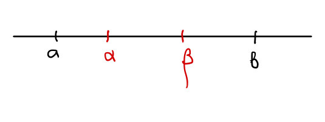
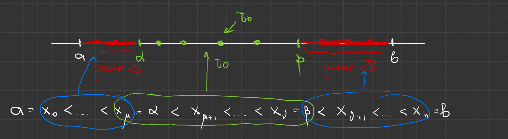
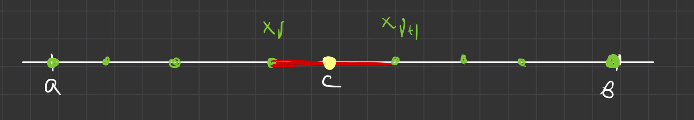
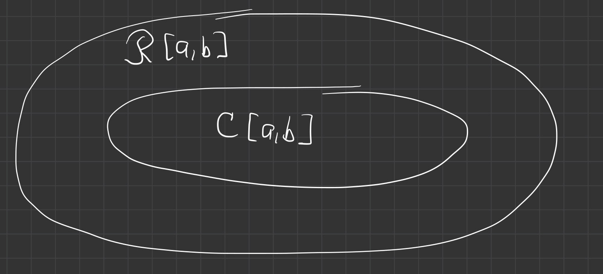
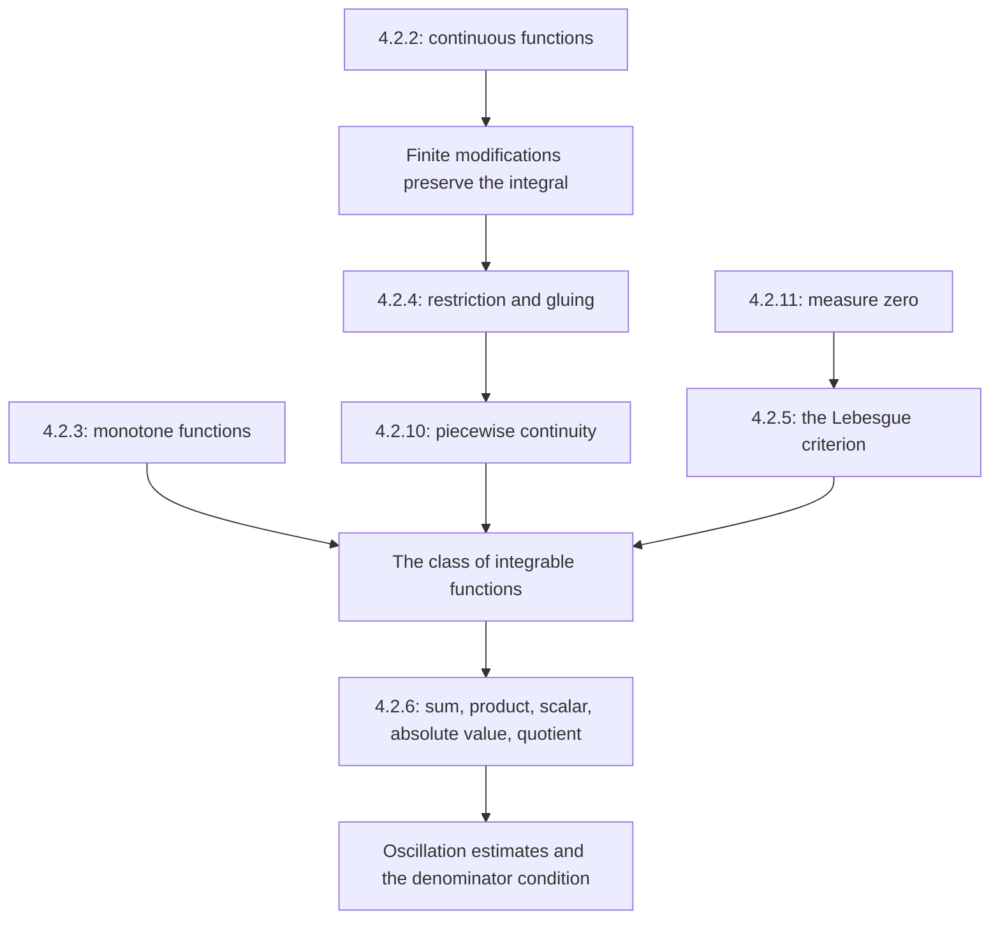

# Lectures 41–42 — Classes of integrable functions

[← Lectures 39–40](lecture-39-40.md) · [Lecture index](index.md) · [Lectures 43–44 →](lecture-43-44.md) · [Terms & theorems](../term-index.md) · [Русский](../../ru/lectures-2025-26/lecture-41-42.md) · [Español](../../es/lectures-2025-26/lecture-41-42.md)

> **Source:** `ma25_26-lectures_41-42_notes.pdf` — 25 pages, 11 printed slides. Handwritten pages: 5–6, 8–9, 11, 13–15, 17–18, 22–25. Drawings and annotations on the slides are included. Date: 12 March 2026. All seven illustrations were extracted from the PDF and checked individually.
>
> **Semester 2: lectures 33–64; semester 1 ended with lecture 32. Duplicate material exists from lecture 33 onward** in the [Russian `ru/lectures/` folder](../../ru/lectures/index.md). This lecture overlaps with [§4.2 “The Riemann integral”](../../ru/lectures/03-riemann-integral-4-2.md); the [archived “Lecture 41-42”](../../../source/MathInMind/МАТАН_Л/Лекция%2041-42.md) is preserved. This is a complete, independent illustrated transcription of the new PDF, including the handwritten proofs.
>
> **Notation.** $`a<b`$; $`\mathcal R[a,b]`$ denotes [Riemann-integrable](lecture-39-40.md#def-4-2-6) functions; $`C[a,b]`$ denotes continuous functions; $`\lambda_\tau`$ is the [mesh of a partition](lecture-37-38.md#def-4-2-2); $`\omega_k(f)`$ is the [oscillation](lecture-39-40.md#def-4-2-9) on its subinterval. See [lectures 39–40](lecture-39-40.md) for the oscillation-sum criterion and definitions.

## Printed slides 1–3 (PDF pp. 1–3). Introduction

**Quote of the day:**

> “Take this integral.”
>
> “No, thanks, I can’t manage it…”
>
> “Take it on credit, in instalments, on a mortgage if you must — it’s a good one.”

**Goals:** continue the integrability criteria; study restrictions and piecewise-continuous functions; define [sets of measure zero](#def-4-2-11) and state the [Lebesgue criterion](#thm-4-2-5); consider arithmetic operations on integrable functions.

## Chapter 4, §2. The Riemann integral — continued

### Printed slide 4 (PDF p. 4). Continuous functions

<a id="thm-4-2-2"></a>**Theorem 4.2.2.** A function continuous on a closed interval is integrable there:

```math
C[a,b]\subset\mathcal R[a,b].
```

### Handwritten pages (PDF pp. 5–6). Proof of Theorem 4.2.2

By the [Heine–Cantor theorem](lecture-17-18.md#thm-2-5-4), $`f`$ is [uniformly continuous](lecture-17-18.md#def-2-5-7) on $`[a,b]`$. For every $`\varepsilon>0`$, there is $`\delta>0`$ such that

```math
x,y\in[a,b],\quad |x-y|<\delta
\quad\Longrightarrow\quad
|f(x)-f(y)|<\frac{\varepsilon}{b-a}.
```

On any subinterval of length less than $`\delta`$, the oscillation is less than $`\varepsilon/(b-a)`$: the maximum and minimum there are attained. For every partition with $`\lambda_\tau<\delta`$,

```math
\sum_{k=0}^{n-1}\omega_k(f)\Delta x_k
<\sum_{k=0}^{n-1}\frac{\varepsilon}{b-a}\Delta x_k
=\frac{\varepsilon}{b-a}(b-a)=\varepsilon.
```

[Theorem 4.2.1](lecture-39-40.md#thm-4-2-1) gives integrability. $`\blacksquare`$

### Printed slide 5 (PDF p. 7). Monotone functions

<a id="thm-4-2-3"></a>**Theorem 4.2.3.** A function monotone on a closed interval is integrable there.

### Handwritten pages (PDF pp. 8–9). Proof of Theorem 4.2.3

For definiteness, suppose $`f`$ is nondecreasing. Then $`f(a)\le f(x)\le f(b)`$.

1. If $`f(a)=f(b)`$, the function is constant, hence continuous and integrable by [Theorem 4.2.2](#thm-4-2-2).
2. If $`f(a)<f(b)`$, for a given $`\varepsilon>0`$, set

```math
\delta=\frac{\varepsilon}{f(b)-f(a)}>0.
```

For every partition with $`\lambda_\tau<\delta`$, monotonicity gives

```math
\omega_k(f)=f(x_{k+1})-f(x_k).
```

Consequently,

```math
\begin{aligned}
\sum_{k=0}^{n-1}\omega_k(f)\Delta x_k
&\le\lambda_\tau\sum_{k=0}^{n-1}\bigl(f(x_{k+1})-f(x_k)\bigr)\\
&=\lambda_\tau\bigl(f(b)-f(a)\bigr)
<\delta\bigl(f(b)-f(a)\bigr)=\varepsilon.
\end{aligned}
```

The sum of differences telescopes. The [integrability criterion](lecture-39-40.md#thm-4-2-1) is satisfied. The proof for a nonincreasing function is analogous, with the differences reversed. $`\blacksquare`$

### Printed slide 6 (PDF p. 10). Changing finitely many values

**Remark.** Changing the values of an integrable function at finitely many points preserves both its integrability and its integral.


### Handwritten page (PDF p. 11). Proof of the remark

Let $`f\in\mathcal R[a,b]`$, and let $`\widetilde f:[a,b]\to\mathbb R`$ differ from it only at $`t_1,\ldots,t_m`$. Boundedness of $`f`$ gives $`|f|\le A`$, hence

```math
|\widetilde f|\le\widetilde A
=\max\{A,|\widetilde f(t_1)|,\ldots,|\widetilde f(t_m)|\}.
```

For the same [tagged partition](lecture-37-38.md#def-4-2-4), at most $`2m`$ summands can differ: each modified point may belong to two adjacent subintervals. Thus

```math
|\sigma_\tau(f,\xi)-\sigma_\tau(\widetilde f,\xi)|
\le2m(A+\widetilde A)\lambda_\tau
\xrightarrow[\lambda_\tau\to0]{}0.
```

Since the sums for $`f`$ converge to its integral, it follows that

```math
\lim_{\lambda_\tau\to0}\sigma_\tau(\widetilde f,\xi)
=\int_a^b f,
\qquad
\int_a^b\widetilde f=\int_a^b f.
```

This proves both integrability of the modified function and equality of the integrals. $`\blacksquare`$

> **Manuscript correction.** The last line of p. 11 incorrectly puts the mesh tending to infinity under the arrow. It must tend to zero. The rigorous conclusion is that the difference of the sums tends to zero and both have the same fixed limit; the changing sum for the original function is not itself a limiting number.

### Printed slide 7 (PDF p. 12). Restriction and gluing

<a id="thm-4-2-4"></a>**Theorem 4.2.4.**

1. If $`f\in\mathcal R[a,b]`$ and $`[\alpha,\beta]\subset[a,b]`$, then $`f\in\mathcal R[\alpha,\beta]`$.
2. If $`a<c<b`$ and $`f:[a,b]\to\mathbb R`$ is integrable on $`[a,c]`$ and on $`[c,b]`$, then $`f\in\mathcal R[a,b]`$.




> **Scope of the statement.** This concerns **integrability**, not the additivity formula for the integral. Equality of the integral with the sum of the integrals over the pieces appears in [lectures 43–44](lecture-43-44.md).

### Handwritten page (PDF p. 13). Proof of part 1

Let $`\alpha<\beta`$. Given $`\varepsilon>0`$, choose $`\delta>0`$ from the integrability criterion for $`f`$ on $`[a,b]`$. Take **any** partition $`\tau_0`$ of $`[\alpha,\beta]`$ with mesh less than $`\delta`$. Add points on the outside pieces to obtain a partition $`\tau`$ of the whole interval with $`\lambda_\tau<\delta`$.



All terms in an oscillation sum are nonnegative. The terms on the subinterval occur in the sum for the whole partition, so

```math
\sum_{[x_k,x_{k+1}]\subset[\alpha,\beta]}\omega_k(f)\Delta x_k
\le\sum_{k=0}^{n-1}\omega_k(f)\Delta x_k<\varepsilon.
```

The criterion holds for every sufficiently fine partition of the subinterval. $`\blacksquare`$

> **Editorial explanation.** If outside endpoints coincide, the empty outside pieces are simply omitted. A degenerate subinterval is covered by the zero-integral convention introduced in lectures 43–44.

### Handwritten pages (PDF pp. 14–15). Proof of part 2

Integrability on both pieces gives boundedness on the whole interval. Denote its total oscillation by $`\omega=\omega(f)_{[a,b]}`$. If $`\omega=0`$, the function is constant and the result is already proved. Suppose $`\omega>0`$.

Given $`\varepsilon>0`$, choose $`\delta_1,\delta_2>0`$ so that the oscillation sums on the respective pieces are less than $`\varepsilon/3`$, and set

```math
\delta=\min\left\{\delta_1,\delta_2,\frac{\varepsilon}{3\omega}\right\}.
```

Consider any partition $`\tau`$ with $`\lambda_\tau<\delta`$. If $`c`$ is a node, its sum splits directly into two parts. But $`c`$ **need not** be a node: there is then a unique subinterval $`[x_\nu,x_{\nu+1}]`$ crossing it.



This subinterval contributes at most $`\omega\lambda_\tau`$. The remaining terms are bounded by the sums for partitions of the two pieces, obtained by adding the gluing point:

```math
\sum_{k=0}^{n-1}\omega_k(f)\Delta x_k
<\frac{\varepsilon}{3}+\frac{\varepsilon}{3}
+\omega\lambda_\tau<\varepsilon.
```

If the gluing point is already a node, the third term is unnecessary. Apply the integrability criterion again. $`\blacksquare`$

### Printed slide 8 (PDF p. 16). Piecewise-continuous functions

<a id="def-4-2-10"></a>**Definition 4.2.10.** A function $`f:[a,b]\to\mathbb R`$ is **piecewise continuous** if its set of discontinuities is empty or finite and all its discontinuities are of the first kind.

**Corollary (unnumbered).** A piecewise-continuous function on a closed interval is integrable there.

### Handwritten pages (PDF pp. 17–18). Proof of the corollary and remarks

If there are no discontinuities, use [Theorem 4.2.2](#thm-4-2-2). Otherwise, list the finitely many interior discontinuities $`a_1<\cdots<a_m`$, and set $`a_0=a`$, $`a_{m+1}=b`$.


On each open piece the function is continuous and has finite [one-sided limits](lecture-15.md#def-2-4-5) at its endpoints. Extend it continuously to the corresponding closed interval:

```math
g_i(x)=
\begin{cases}
f(x),&a_i<x<a_{i+1},\\
f(a_i+0),&x=a_i,\\
f(a_{i+1}-0),&x=a_{i+1},
\end{cases}
\qquad i=0,\ldots,m.
```

Then $`g_i\in C[a_i,a_{i+1}]\subset\mathcal R[a_i,a_{i+1}]`$. The original function may differ from the extension at the endpoints, but that is at most two points; the finite-modification remark gives integrability of the original function on each piece. Repeated application of part 2 of [Theorem 4.2.4](#thm-4-2-4) gives integrability on the whole interval. $`\blacksquare`$

Handwritten remark: integrability does **not imply** continuity or having only finitely many discontinuities. The inclusion of classes goes only one way.



### Printed slide 9 (PDF p. 19). Sets of measure zero

<a id="def-4-2-11"></a>**Definition 4.2.11.** A set $`E\subset\mathbb R`$ has **measure zero** if, for every $`\varepsilon>0`$, it can be covered by an at most countable union of open intervals whose total length is less than $`\varepsilon`$:

```math
E\subset\bigcup_j(\alpha_j,\beta_j),\qquad
\sum_j(\beta_j-\alpha_j)<\varepsilon.
```

The covering family may be finite or [countable](lecture-01-02.md#def-1-2-5).

### Printed slide 10 (PDF p. 20). The Lebesgue criterion

<a id="thm-4-2-5"></a>**Theorem 4.2.5.** A function $`f:[a,b]\to\mathbb R`$ is Riemann integrable if and only if it is bounded on the interval and its set of discontinuities has measure zero.

This PDF states the criterion **without proof**. It does not say that an integrable function must have a finite or countable discontinuity set: the condition is specifically measure zero.

### Printed slide 11 (PDF p. 21). Arithmetic operations

<a id="thm-4-2-6"></a>**Theorem 4.2.6.** Let $`f,g\in\mathcal R[a,b]`$. Then:

1. $`f+g\in\mathcal R[a,b]`$;
2. $`fg\in\mathcal R[a,b]`$;
3. $`\alpha f\in\mathcal R[a,b]`$ for every $`\alpha\in\mathbb R`$;
4. $`|f|\in\mathcal R[a,b]`$;
5. if $`\inf_{x\in[a,b]}|g(x)|>0`$, then $`f/g\in\mathcal R[a,b]`$.

This establishes [closure](lecture-55-56.md#def-5-3-2) of the class of integrable functions; formulas for integral values are considered in the next lecture.

### Handwritten pages (PDF pp. 22–23). Proof of item 1: sum

For any nonempty set $`E\subset[a,b]`$ and $`x,y\in E`$, the triangle inequality gives

```math
\begin{aligned}
|(f+g)(x)-(f+g)(y)|
&\le |f(x)-f(y)|+|g(x)-g(y)|\\
&\le\omega(f)_E+\omega(g)_E.
\end{aligned}
```

Taking the [supremum](lecture-11-12.md#def-2-3-1) yields

```math
\omega(f+g)_E\le\omega(f)_E+\omega(g)_E,
\qquad
\omega_k(f+g)\le\omega_k(f)+\omega_k(g).
```

Multiply by the subinterval lengths and sum:

```math
0\le\sum_{k=0}^{n-1}\omega_k(f+g)\Delta x_k
\le\sum_{k=0}^{n-1}\omega_k(f)\Delta x_k
+\sum_{k=0}^{n-1}\omega_k(g)\Delta x_k
\xrightarrow[\lambda_\tau\to0]{}0.
```

Both sums on the right tend to zero because the original functions are integrable. The criterion proves integrability of their sum. $`\blacksquare`$

### Handwritten page (PDF p. 24). Proof of item 2: product

By [Lemma 4.2.1](lecture-39-40.md#lem-4-2-1) there are finite constants $`K,L\ge0`$ with $`|f|\le K`$, $`|g|\le L`$. Adding and subtracting a mixed product gives

```math
\begin{aligned}
|f(x)g(x)-f(y)g(y)|
&=|[f(x)-f(y)]g(x)+f(y)[g(x)-g(y)]|\\
&\le L|f(x)-f(y)|+K|g(x)-g(y)|.
\end{aligned}
```

Thus

```math
\omega_k(fg)\le L\omega_k(f)+K\omega_k(g).
```

After multiplication by the lengths and summation, the right-hand side tends to zero as in item 1. Hence the product is integrable. $`\blacksquare`$

> **Manuscript correction.** The last estimate on p. 24 incorrectly writes $`\omega_k(f+g)`$ instead of $`\omega_k(fg)`$. The entire preceding calculation and the item being proved concern the product.

### Handwritten page (PDF p. 25). Proofs of items 3–5

**3. Multiplication by a scalar.** This is item 2 with the constant function $`g\equiv\alpha`$, which is continuous and therefore integrable. A zero coefficient is allowed as well.

**4. Absolute value.** The reverse triangle inequality gives

```math
\bigl||f(x)|-|f(y)|\bigr|\le|f(x)-f(y)|
\quad\Longrightarrow\quad
\omega_k(|f|)\le\omega_k(f).
```

The oscillation criterion completes the proof.

**5. Quotient.** Write $`f/g=f\cdot(1/g)`$. It suffices to prove integrability of the reciprocal and apply item 2. Let

```math
m=\inf_{x\in[a,b]}|g(x)|>0.
```

Then the reciprocal is bounded, and for any two points,

```math
\left|\frac1{g(x)}-\frac1{g(y)}\right|
=\left|\frac{g(y)-g(x)}{g(x)g(y)}\right|
\le\frac{|g(y)-g(x)|}{m^2}.
```

Consequently,

```math
\omega_k\!\left(\frac1g\right)\le\frac{\omega_k(g)}{m^2}.
```

The reciprocal’s oscillation sum tends to zero, so it is integrable, and the quotient is integrable as well. $`\blacksquare`$

> **Editorial explanation.** For an arbitrary integrable function, simply having no zeros is insufficient: the theorem requires the denominator to be **bounded away from zero**. If the denominator is continuous and nowhere zero on the closed interval, the positive [lower bound](../02-real-numbers.md#sec-2-2) follows from the [Weierstrass theorem](../05-limits-continuity.md#extreme-value-theorem).

## Lecture structure



---

Previous: [lectures 39–40](lecture-39-40.md) · Next: [lectures 43–44](lecture-43-44.md) · [Figure provenance](../../assets/lectures-2025-26/provenance-39-44.md).
