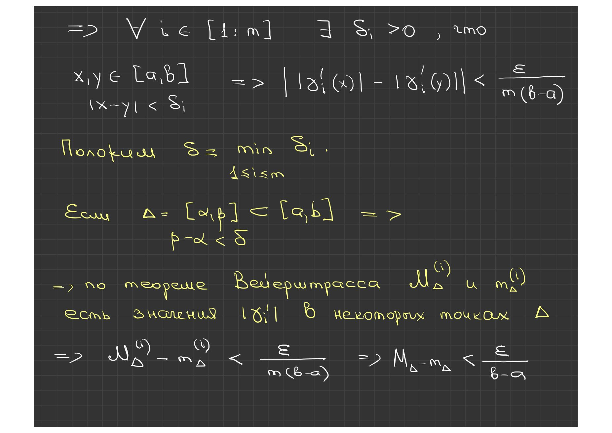
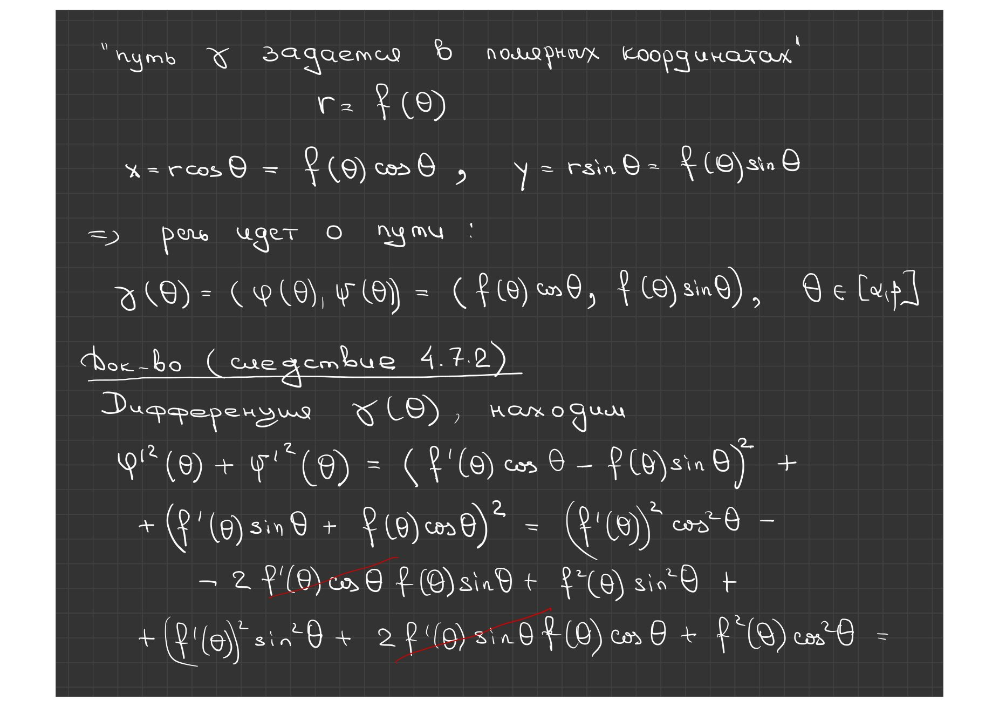
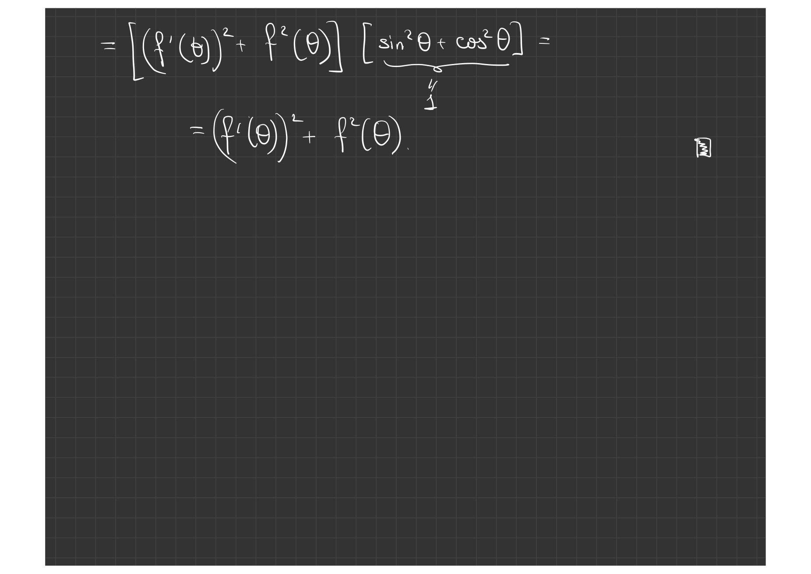

# Lecture 53 — path length and work

[← Lectures 51–52](lecture-51-52.md) · [Lecture index](index.md) · [Lecture 54 →](lecture-54.md) · [Terms & theorems](../term-index.md) · [Русский](../../ru/lectures-2025-26/lecture-53.md) · [Español](../../es/lectures-2025-26/lecture-53.md)


> **Source and coverage.** `ма25_26_лекция_53_notes.pdf.txt`: 20 PDF pages, 11 printed slides and 9 handwritten pages; dated 23 April 2026. Handwritten pages 6–12 and 15–16 are included. Only the attached PDF was used; the source folder was not consulted.

> **Semester-2 duplication.** This lecture overlaps with [§4.7](../../ru/lectures/08-integral-applications-4-7.md); see also the [register](../../ru/lectures/index.md). Semester 2 spans lectures 33–64. Editorial correction: on PDF p. 14 the printed bounds are $`a,b`$, although the curve is defined on $`[\alpha,\beta]`$; the parametrization and handwritten derivation on pp. 15–16 show that the integral should run from $`\alpha`$ to $`\beta`$. On PDF p. 19 the sums print $`f`$ instead of the force $`F`$; $`F`$ is used below and the mismatch is flagged.

## Printed slide 1 (PDF p. 1) — Title slide

“Mathematical Analysis”, lecture 53; 23 April 2026.

## Printed slide 2 (PDF p. 2) — Quote of the day: Student–Teacher game

The student and teacher payoff matrices compare the student strategies “study” and “do not try” with the teacher strategies “pass” and “fail”.

## Printed slide 3 (PDF p. 3) — Lecture goal

Conclude the applications of the [Riemann integral](lecture-39-40.md#def-4-2-6): curve length and work by a variable force.

## Printed slide 4 (PDF p. 4) — Path length and derivative

For a [differentiable](lecture-22-23.md#def-3-2-1) path, the coordinate [derivatives](lecture-22-23.md#def-3-1-1) form the vector $`\gamma'`$; its [Euclidean norm](lecture-54.md#def-5-1-1) is the instantaneous speed.


```math
\|\gamma'(t)\|=\sqrt{\sum_{i=1}^{m}(\gamma_i'(t))^2}
```

## Printed slide 5 (PDF p. 5) — Theorem on the length of a smooth path

<a id="thm-4-7-1"></a>**Theorem 4.7.1.** A smooth path is rectifiable, and its length is the integral of the norm of its derivative. The piecewise-smooth case follows by additivity. For $`\gamma=(\varphi,\psi)`$ in the plane, the integrand is $`\sqrt{\varphi'{}^2+\psi'{}^2}`$.


```math
s_\gamma=\int_a^b\|\gamma'(t)\|\,dt
```


```math
s_\gamma=\int_a^b\sqrt{\varphi'(t)^2+\psi'(t)^2}\,dt
```

## Handwritten page (PDF p. 6) — Proof of the length theorem: coordinate subdivision

Subdivide the parameter interval into short pieces. On each piece, the path increment is estimated using values of the coordinate derivatives at intermediate points. Chord length gives a [lower bound](../02-real-numbers.md#sec-2-2), while coordinate variation controls the [arc length](#thm-4-7-1).

## Handwritten page (PDF p. 7) — Coordinatewise extrema

On each subinterval, take separate minima and maxima for each derivative coordinate. Lower chord sums and upper bounds from coordinate variation enclose the path length.

## Handwritten page (PDF p. 8) — Controlling upper and lower sums

Continuity of the derivatives on a [compact](lecture-57-58.md#def-5-3-7) interval gives [uniform continuity](lecture-17-18.md#def-2-5-7): each coordinate derivative has small [oscillation](lecture-39-40.md#def-4-2-9) on a short subinterval.

## Handwritten page (PDF p. 9) — Editorial note on the sums

The red note warns that sums formed from coordinatewise extrema are not automatically [Darboux sums](lecture-39-40.md#def-4-2-8) for the Euclidean norm of the derivative vector. This step needs a separate estimate; the gap is then controlled by uniform continuity of the components.

## Handwritten page (PDF p. 10) — Convergence to the integral

On a short interval the derivative vector changes very little. Continuity of the Euclidean norm lets the coordinate-extrema estimates be replaced by [integral sums](lecture-37-38.md#def-4-2-4) for the speed function.

## Handwritten page (PDF p. 11) — Completion of the proof

As the [partition](lecture-37-38.md#def-4-2-2) mesh tends to zero, the length bounds agree with the integral of speed. By the definition of length as the [supremum](lecture-11-12.md#def-2-3-1) of inscribed polygonal lengths, the formula follows.




## Handwritten page (PDF p. 12) — Limit of the estimates

For any positive tolerance, uniform continuity gives a sufficiently fine partition for which the total gap between upper and lower estimates is smaller than that tolerance; this completes the length-formula proof.

## Printed slide 6 (PDF p. 13) — Length of a graph

<a id="cor-4-7-1"></a>**Corollary 4.7.1.** The graph of a $`C^1[a,b]`$ function is rectifiable; its length is the integral of the speed of the parametrization $`\Gamma_f(t)=(t,f(t))`$.


```math
s_{\Gamma_f}=\int_a^b\sqrt{1+f'(t)^2}\,dt
```

```math
\Gamma_f(t)=(t,f(t))
```

## Printed slide 7 (PDF p. 14) — Path length in polar coordinates

<a id="cor-4-7-2"></a>**Corollary 4.7.2.** When $`r=f(\theta)`$, the curve length is the integral of the square root of the sum of the squared radius and its derivative.


```math
\gamma(\theta)=(f(\theta)\cos\theta,f(\theta)\sin\theta),\qquad \theta\in[\alpha,\beta]
```


```math
s_\gamma=\int_\alpha^\beta\sqrt{f(\theta)^2+f'(\theta)^2}\,d\theta
```

## Handwritten page (PDF p. 15) — Polar parametrization

Let the polar radius be given by a function f of the angle θ on the interval from α to β. The path coordinates are f(θ) multiplied by cos θ and sin θ, respectively. Differentiating produces mixed terms with opposite signs.



## Handwritten page (PDF p. 16) — Simplifying the polar speed

After expanding the squares, the mixed terms cancel because sine squared plus cosine squared is one. Squared speed is the sum of the squared radius derivative and squared radius; integration gives the polar length formula.



## Printed slide 8 (PDF p. 17) — Work by a variable force

A material point moves along a number line. The force $`F`$ is parallel to the axis; the sign of $`F(x)`$ gives its direction relative to the chosen axis.


```math
F:E\subset\mathbb R\to\mathbb R
```


```math
F(x)>0
```


```math
F(x)<0
```

## Printed slide 9 (PDF p. 18) — Additivity of work

Work is additive over intervals. If the force lies between $`m`$ and $`M`$, its work lies between the works of the constant forces $`m`$ and $`M`$ over that interval.


```math
m(b-a)\le A_F([a,b])\le M(b-a)
```

## Printed slide 10 (PDF p. 19) — Work for a continuous force

For a continuous force, lower and upper Darboux sums bound the work. The printed sums on this page use $`f`$ instead of $`F`$; this is corrected editorially.


> **Редакторское исправление.** В печатной строке PDF буква $`f`$ использована вместо уже обозначенной силы $`F`$; в определении сумм исправлено на $`F`$.


```math
m_k=\inf_{x\in[x_k,x_{k+1}]}F(x),\qquad M_k=\sup_{x\in[x_k,x_{k+1}]}F(x)
```


```math
s_\tau=\sum_{k=0}^{n-1}m_k\Delta x_k,\qquad S_\tau=\sum_{k=0}^{n-1}M_k\Delta x_k
```


```math
s_\tau\le A_F([a,b])\le S_\tau
```

## Printed slide 11 (PDF p. 20) — Work formula

Passing to the integral gives the work of the force in moving from $`a`$ to $`b`$. For an arbitrary force direction, only the component along the motion contributes.


```math
A_F([a,b])=\int_a^bF(x)\,dx
```


---

[← Lectures 51–52](lecture-51-52.md) · [Lecture index](index.md) · [Lecture 54 →](lecture-54.md) · [Terms & theorems](../term-index.md) · [Русский](../../ru/lectures-2025-26/lecture-53.md) · [Español](../../es/lectures-2025-26/lecture-53.md)
