# Lectures 61–62 — Directional derivatives, Jacobians and differentiation rules

> **Source and numbering.** Transcribed solely from the attached PDF `ma25_26-lectures_61-62_notes.pdf.txt`; the source archive was not consulted. Section headings follow the physical PDF pages, in order. “Printed slide” numbers are the footer numbers 1–25 and are kept distinct from PDF pages 1–40; handwritten pages have no printed-slide number. The typed slide text was checked against its text layer and page image; handwritten proofs, calculations and annotations were read from the rendered pages. See the [page inventory, source hash and crop provenance](../../assets/lectures-2025-26/provenance-61-64.md) and [machine-readable manifest](../../assets/lectures-2025-26/figures-61-64.json).
>
> **Semester 2 duplication.** This material overlaps the Russian thematic register for §§6.1–6.3 and is intentionally duplicated in the sequential, trilingual PDF transcription. Semester 2 spans lectures **33–64**. Cross-references: [register index](../../ru/lectures/index.md), [§6.1](../../ru/lectures/14-differentiability-6-1.md), [§6.2](../../ru/lectures/15-differentiation-rules-6-2.md), [§6.3](../../ru/lectures/16-continuous-differentiability-6-3.md).

## Printed slide 1 (PDF p. 1). Title

Mathematical Analysis, lectures 61–62; 21 May 2026. The title page introduces the second chapter on differential calculus.

## Printed slide 2 (PDF p. 2). Quote of the day

Alice asks why the people around her are called mad. The Cat replies that everyone there is mad, including Alice, and that she must be mad because she is there. The slide attributes the excerpt to Lewis Carroll, *Alice’s Adventures in Wonderland*.

## Printed slide 3 (PDF p. 3). Lecture goals

The lecture introduces directional derivatives, differentials, the Jacobian matrix and the gradient; studies the gradient’s extremal property; develops multivariable versions of differentiation rules; and introduces continuous differentiability.

## Printed slide 4 (PDF p. 4). Derivative along a vector — Definition 6.1.4

Let $E\subset\mathbb R^n$, let $a$ be an interior point of $E$, let $f:E\to\mathbb R^m$, and let $e\in\mathbb R^n\setminus\{0\}$. When the finite limit

$$
\lim_{t\to0}\frac{f(a+te)-f(a)}{t},
$$

exists, it is the derivative of $f$ along the vector $e$ at $a$, denoted $\frac{\partial f}{\partial e}(a)$. If additionally $\|e\|=1$, it is the directional derivative in direction $e$. Hereafter “derivative along a vector” means a finite derivative.

## Printed slide 5 (PDF p. 5). Interpretation and componentwise derivatives

The restriction of $f$ to the line through $a$ in direction $e$ is $g(t)=f(a+te)$; its derivative at zero is $\frac{\partial f}{\partial e}(a)$. Since a neighborhood of $a$ lies in $E$, this curve is defined at least for $t\in(-\delta,\delta)$ for some $\delta>0$.

For a map $f=(f_1,\ldots,f_m)$, the vector derivative is the vector of component derivatives:

$$
\frac{\partial f}{\partial e}(a)=\left(\frac{\partial f_1}{\partial e}(a),\ldots,\frac{\partial f_m}{\partial e}(a)\right).
$$

This equality is understood componentwise: if one side is defined, so is the other, and they agree.

## Printed slide 6 (PDF p. 6). Directional derivative of a differentiable map — Theorem 6.1.1

Let $E\subset\mathbb R^n$, let $a$ be an interior point of $E$, and suppose $f:E\to\mathbb R^m$ is differentiable at $a$. For $e\in\mathbb R^n\setminus\{0\}$,

$$
\frac{\partial f}{\partial e}(a)=d_af(e). \tag{6.1.4}
$$

## Handwritten page (PDF p. 7). Proof of Theorem 6.1.1

Write the differentiability expansion as

$$
f(a+h)-f(a)=Th+\alpha(h)\|h\|,\qquad T=d_af,\qquad \alpha(h)\to0.
$$

Substitute $h=te$ and divide by $t\ne0$. Since $T(te)/t=T(e)$ and the norm of the remainder divided by $|t|$ is $\|\alpha(te)\|\|e\|\to0$, the limit is $T(e)=d_af(e)$. This also explains the handwritten identification $T=d_af$.

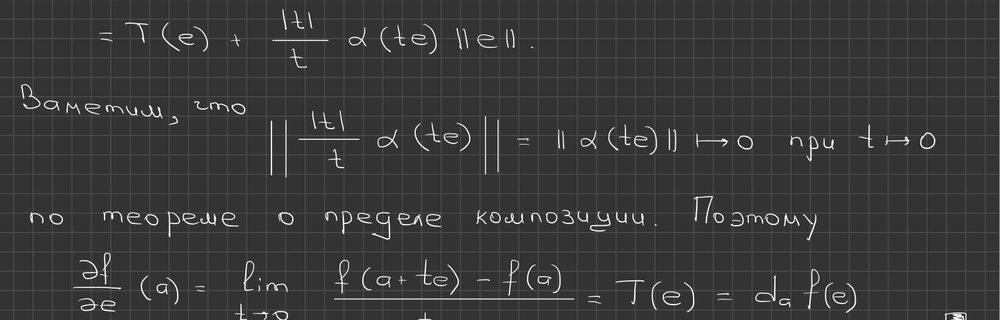

## Printed slide 7 (PDF p. 8). Uniqueness of the differential

**Corollary.** If $f$ is differentiable at $a$, its differential $d_af$ is uniquely determined.

The handwritten annotation argues that for every nonzero $e$, the directional derivative is fixed by its limit and Theorem 6.1.1 identifies it with $d_af(e)$. A linear map is also fixed at $e=0$, since $d_af(0)=0$; hence the differential is unique.

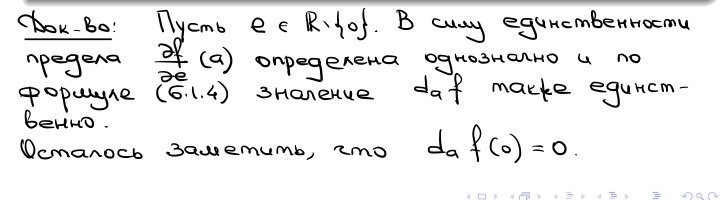

## Printed slide 8 (PDF p. 9). Partial derivatives — Definition 6.1.5

Let $e^1,\ldots,e^n$ be the standard basis vectors, with $e^i_j=1$ when $i=j$ and $0$ otherwise. For $k\in\{1,\ldots,n\}$, the derivative along $e^k$ is the partial derivative with respect to the $k$th variable:

$$
\frac{\partial f}{\partial x_k}(a)=\frac{\partial f}{\partial e^k}(a).
$$

Other notations are $D_kf(a)$, $\partial_kf(a)$ and $f'_{x_k}(a)$. For functions of several variables, the symbol $\partial$ is conventionally used instead of $d$.

## Printed slide 9 (PDF p. 10). Computing partial derivatives

Fix all arguments except the $k$th by setting

$$
\varphi_k(t)=f(a_1,\ldots,a_{k-1},t,a_{k+1},\ldots,a_n).
$$

Then $\frac{\partial f}{\partial x_k}(a)=\varphi_k'(a_k)$. For a vector-valued map with values in $\mathbb R^m$, the partial derivative is computed componentwise:

$$
\frac{\partial f}{\partial x_k}(a)=\left(\frac{\partial f_1}{\partial x_k}(a),\ldots,\frac{\partial f_m}{\partial x_k}(a)\right),
$$
whenever either side is defined.

## Handwritten page (PDF p. 11). Partial-derivative calculation in $\mathbb R^3$

For

$$
f(x,y,z)=x^2z+xy^2(z-3)+\sin(xyz),
$$
the handwritten page differentiates term by term:

$$
\frac{\partial f}{\partial x}=2xz+y^2(z-3)+yz\cos(xyz),\qquad
\frac{\partial f}{\partial y}=2xy(z-3)+xz\cos(xyz),
$$

$$
\frac{\partial f}{\partial z}=x^2+xy^2+xy\cos(xyz).
$$

At $a=(1,1,1)$ this gives $f_x(a)=\cos1$, $f_y(a)=\cos1-4$, and $f_z(a)=\cos1+2$.

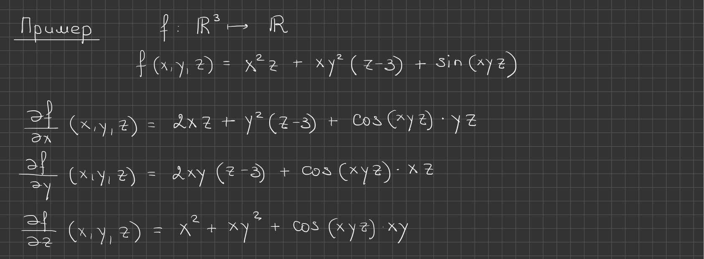

## Printed slide 10 (PDF p. 12). Differential and directional derivative from partials — Theorem 6.1.2

If $f:E\to\mathbb R^m$ is differentiable at the interior point $a\in E\subset\mathbb R^n$, then

$$
d_af(h)=\sum_{k=1}^{n}\frac{\partial f}{\partial x_k}(a)h_k\quad\text{for all }h\in\mathbb R^n; \tag{6.1.5}
$$

$$
\frac{\partial f}{\partial e}(a)=\sum_{k=1}^{n}\frac{\partial f}{\partial x_k}(a)e_k\quad\text{for all }e\in\mathbb R^n\setminus\{0\}. \tag{6.1.6}
$$

## Handwritten page (PDF p. 13). Proof of Theorem 6.1.2

Write $h=(h_1,\ldots,h_n)=\sum_{k=1}^{n}h_ke^k$. By linearity of the differential and Theorem 6.1.1,

$$
d_af(h)=d_af\left(\sum_{k=1}^{n}h_ke^k\right)=\sum_{k=1}^{n}d_af(e^k)h_k=\sum_{k=1}^{n}\frac{\partial f}{\partial x_k}(a)h_k.
$$

This proves (6.1.5); substituting $h=e$ gives (6.1.6).

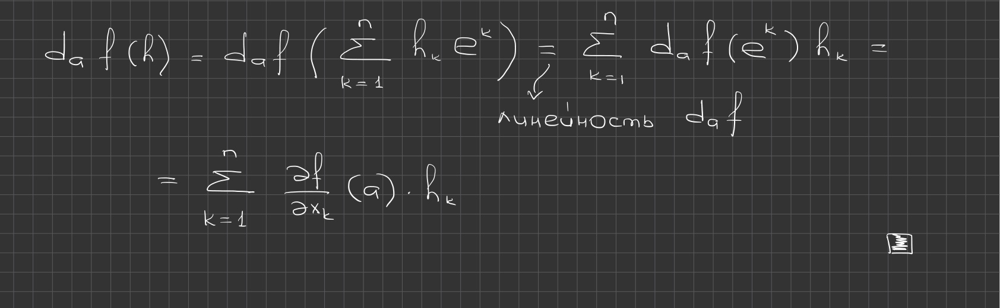

## Printed slide 11 (PDF p. 14). Jacobian matrix and gradient — Definition 6.1.6

For a map $f:E\to\mathbb R^m$ differentiable at $a$, the matrix of the linear operator $d_af$ is the Jacobian matrix of $f$, denoted $f'(a)$. If $m=1$, this $1\times n$ matrix is a vector in $\mathbb R^n$, the gradient of $f$, denoted $\operatorname{grad}f(a)$ or $\nabla f(a)$.

## Handwritten page (PDF p. 15). Jacobian and gradient notation

Writing $f=(f_1,\ldots,f_m)$, the handwritten page records

$$
f'(a)=d_af=\left(\frac{\partial f_i}{\partial x_j}(a)\right)_{1\le i\le m,\,1\le j\le n}.
$$

For a scalar function $g$, $\nabla g$ is the vector of its first partial derivatives. The notes use this component notation in the gradient formulas that follow.

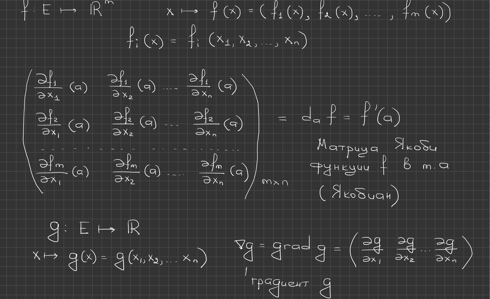

## Printed slide 12 (PDF p. 16). Jacobian conventions

If vectors in $\mathbb R^n$ and $\mathbb R^m$ are written as columns, the differentiability expansion becomes

$$
f(a+h)=f(a)+f'(a)\cdot h+o(h)\qquad(h\to0).
$$

When $m=1$, the product $f'(a)\cdot h$ can be read either as matrix multiplication or as the scalar product $\nabla f(a)\cdot h$; the two give the same value.

## Printed slide 13 (PDF p. 17). Coordinate functions — Lemma 6.1.1

Let $E\subset\mathbb R^n$, let $a$ be an interior point, let $f:E\to\mathbb R^m$, and let $T\in L(\mathbb R^n,\mathbb R^m)$. The following are equivalent:

1. $f$ is differentiable at $a$ and $d_af=T$.
2. Every coordinate function $f_k$ is differentiable at $a$, and $d_af_k=T_k$ for each $k\in\{1,\ldots,m\}$.

## Handwritten page (PDF p. 18). Proof of Lemma 6.1.1

If $f$ is differentiable, composing it with each coordinate projection gives differentiable coordinate functions, whose differentials are the corresponding rows of $T$. Conversely, if all $f_k$ are differentiable with differentials $T_k$, assemble these linear maps as the rows of $T$. Each component remainder is $o(\|h\|)$; because there are finitely many components, their vector-valued remainder is also $o(\|h\|)$. Thus $f$ is differentiable and $d_af=T$.

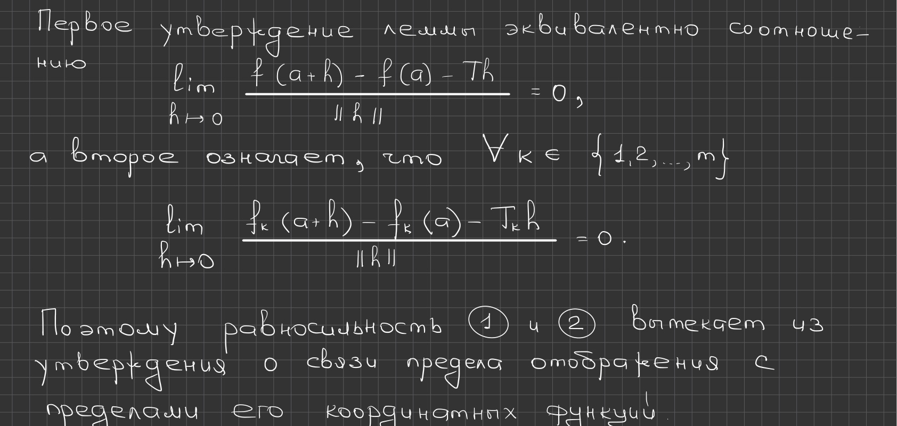

## Printed slide 14 (PDF p. 19). Entries of the Jacobian — Theorem 6.1.3

For $f:E\to\mathbb R^m$ differentiable at an interior point $a\in E\subset\mathbb R^n$,

$$
f'(a)=\begin{pmatrix}
\frac{\partial f_1}{\partial x_1}(a)&\cdots&\frac{\partial f_1}{\partial x_n}(a)\\
\vdots&\ddots&\vdots\\
\frac{\partial f_m}{\partial x_1}(a)&\cdots&\frac{\partial f_m}{\partial x_n}(a)
\end{pmatrix}.
$$

In particular, for $m=1$,

$$
\operatorname{grad}f(a)=\left(\frac{\partial f}{\partial x_1}(a),\ldots,\frac{\partial f}{\partial x_n}(a)\right). \tag{6.1.7}
$$

The rows of the Jacobian are the gradients of the coordinate functions.

## Handwritten page (PDF p. 20). Proof of Theorem 6.1.3

Let $T=d_af=f'(a)$. For each standard basis vector $e^j$, Theorem 6.1.2 gives $T(e^j)=\frac{\partial f}{\partial x_j}(a)$. The $j$th column of the matrix of $T$ is therefore this vector; its $i$th entry is $\frac{\partial f_i}{\partial x_j}(a)$. These are exactly the entries in the displayed Jacobian matrix.

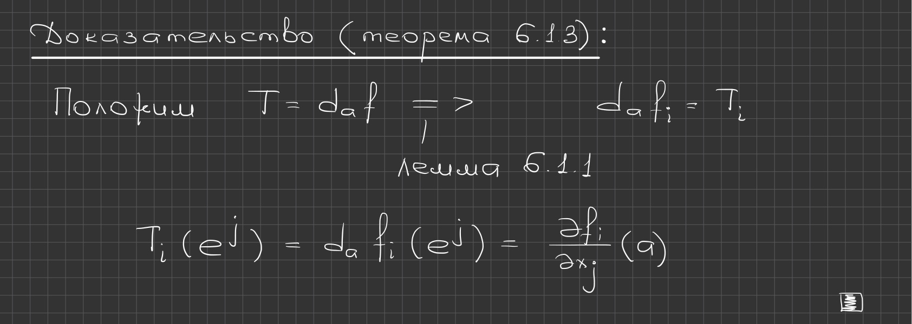

## Printed slide 15 (PDF p. 21). Geometric meaning of the gradient

For a differentiable scalar function $f$ at $a\in E\subset\mathbb R^n$, the tangent hyperplane to its graph is

$$
\{(x,y):x\in\mathbb R^n,\ y=f(a)+\operatorname{grad}f(a)\cdot(x-a)\}.
$$

Equivalently,

$$
\{(x,y):x\in\mathbb R^n,\ y=f(a)+\sum_{k=1}^{n}\frac{\partial f}{\partial x_k}(a)(x_k-a_k)\}. \tag{6.1.8}
$$

For $n=1$ this is the tangent line; for $n=2$ it is the tangent plane in $\mathbb R^3$; in general it is a hyperplane in $\mathbb R^{n+1}$.

## Printed slide 16 (PDF p. 22). Extremal property of the gradient — Theorem 6.1.4

Suppose $f:E\to\mathbb R$ is differentiable at the interior point $a$ and $\operatorname{grad}f(a)\ne0$. For each unit vector $e\in\mathbb R^n$,

$$
\left|\frac{\partial f}{\partial e}(a)\right|\le\|\operatorname{grad}f(a)\|.
$$

Equality holds only for $e=\pm\frac{\operatorname{grad}f(a)}{\|\operatorname{grad}f(a)\|}$. Thus the gradient points in the direction of greatest increase, and its length is the magnitude of the derivative in that direction.

## Handwritten page (PDF p. 23). Proof of the gradient bound

By (6.1.6)–(6.1.7), $\frac{\partial f}{\partial e}(a)=\operatorname{grad}f(a)\cdot e$. The Cauchy–Schwarz inequality and $\|e\|=1$ give the bound. Equality in Cauchy–Schwarz occurs precisely when the two vectors are collinear; hence $e=\pm\operatorname{grad}f(a)/\|\operatorname{grad}f(a)\|$.

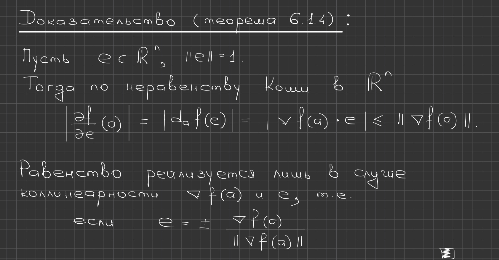

## Handwritten page (PDF p. 24). A differentiable function with discontinuous partial derivatives

The first example is

$$
f(x,y)=\begin{cases}(x^2+y^2)\sin\!\left(\frac{1}{x^2+y^2}\right),&(x,y)\ne(0,0),\\0,&(x,y)=(0,0).\end{cases}
$$

It is differentiable at the origin with differential zero, because $|f(x,y)|\le x^2+y^2=o(\sqrt{x^2+y^2})$. The handwritten page gives this estimate using a remainder factor bounded by $\sqrt{x^2+y^2}$.

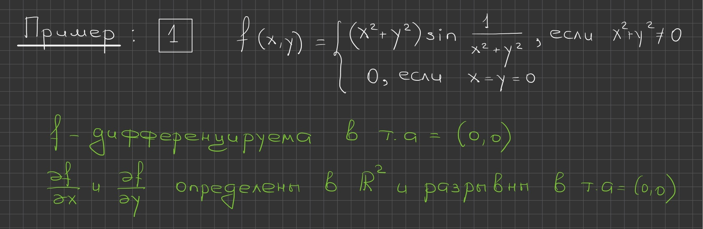

## Handwritten page (PDF p. 25). Partial derivatives in the first example

Away from the origin,

$$
f_x(x,y)=2x\left[\sin\!\left(\frac{1}{x^2+y^2}\right)-\frac{1}{x^2+y^2}\cos\!\left(\frac{1}{x^2+y^2}\right)\right],
$$

$$
f_y(x,y)=2y\left[\sin\!\left(\frac{1}{x^2+y^2}\right)-\frac{1}{x^2+y^2}\cos\!\left(\frac{1}{x^2+y^2}\right)\right].
$$

Both partial derivatives at $(0,0)$ are zero. Along $x_k=1/\sqrt{2\pi k}$, however, $f_x(x_k,0)=-2\sqrt{2\pi k}\to-\infty$; by symmetry $f_y(0,x_k)\to-\infty$. Thus the partial derivatives are not continuous at the origin.

## Handwritten page (PDF p. 26). Partial derivatives need not imply differentiability

The second example is

$$
f(x,y)=\begin{cases}xy\exp\!\left(\frac{1}{x^2+y^2}\right),&(x,y)\ne(0,0),\\0,&(x,y)=(0,0).\end{cases}
$$

The handwritten notes assert that both first partial derivatives exist at every point, while the derivative at the origin exists only for vectors parallel to $e^1=(1,0)$ or $e^2=(0,1)$. For directions with both components nonzero, the directional quotient fails to have a finite limit (worked out on the following pages).

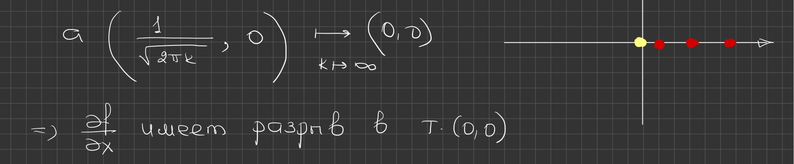

## Handwritten page (PDF p. 27). Derivatives of the second example

For $(x,y)\ne(0,0)$,

$$
f_x(x,y)=y\exp\!\left(\frac{1}{x^2+y^2}\right)\left(1-\frac{2x^2}{(x^2+y^2)^2}\right),\qquad
f_y(x,y)=x\exp\!\left(\frac{1}{x^2+y^2}\right)\left(1-\frac{2y^2}{(x^2+y^2)^2}\right).
$$

At the origin the coordinate partials are zero. Along the diagonal, $f(t,t)=t^2\exp(1/(2t^2))$, so the function is not continuous there.

## Handwritten page (PDF p. 28). Directional quotient and a third example

Let $e=(a,b)$. If $ab\ne0$, then

$$
\frac{f(te)-f(0,0)}{t}=tab\exp\!\left(\frac{1}{t^2(a^2+b^2)}\right),
$$

which has no finite limit as $t\to0$. If $a=0$ or $b=0$, the quotient is identically zero; these and only these directions have a finite directional derivative at the origin.

The third example is

$$
f(x,y)=\begin{cases}1,&x>0\text{ and }y=x^2,\\0,&\text{otherwise}.\end{cases}
$$

## Handwritten page (PDF p. 29). A discontinuous function with every directional derivative

For the third example, $f(1/k,1/k^2)=1$ while $(1/k,1/k^2)\to(0,0)$ and $f(0,0)=0$, so $f$ is discontinuous at the origin. Yet for every fixed $e=(a,b)$, the line $(ta,tb)$ meets the curve $y=x^2$, $x>0$ at at most one nonzero parameter $t$ near zero. Thus $f(te)=0$ for all sufficiently small nonzero $t$ and

$$
\frac{\partial f}{\partial e}(0,0)=0\qquad\text{for every }e\in\mathbb R^2\setminus\{0\}.
$$

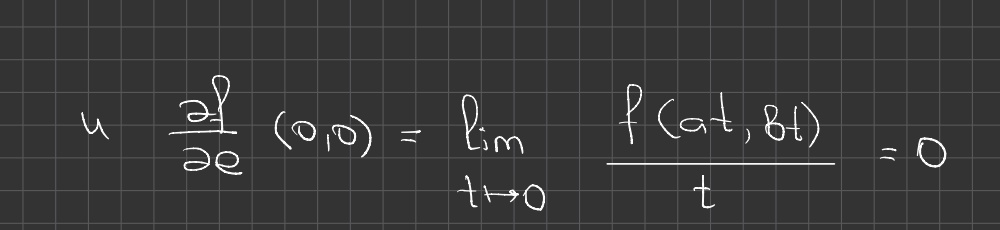

## Handwritten page (PDF p. 30). Conclusions from the examples

The examples show that in two variables the existence of finite partial derivatives is necessary but not sufficient for differentiability. Even the existence of directional derivatives in every nonzero direction is not sufficient: the third function is discontinuous although all of those derivatives exist and equal zero.

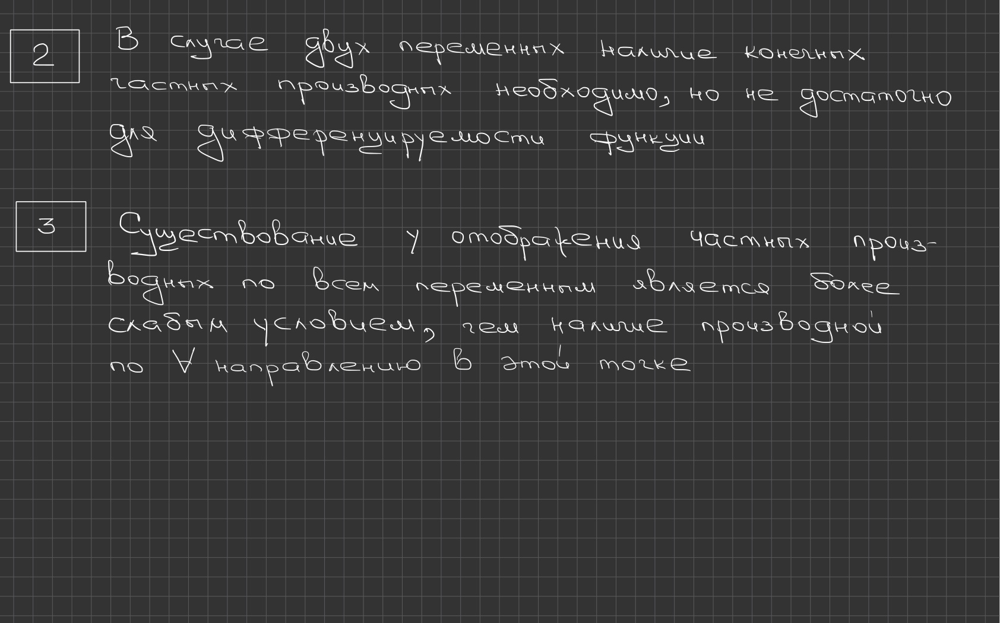

## Printed slide 17 (PDF p. 31). §2 — Rules of differentiation

The lecture moves to multivariable differentiation rules.

## Printed slide 18 (PDF p. 32). Composition and the chain rule — Theorem 6.2.1

Let $E\subset\mathbb R^n$, $F\subset\mathbb R^m$, $f:E\to F$ and $g:F\to\mathbb R^s$. Suppose $a$ is interior to $E$, $f(a)$ is interior to $F$, and $f$ and $g$ are differentiable at $a$ and $f(a)$, respectively. Then $g\circ f$ is differentiable at $a$ and

$$
d_a(g\circ f)=d_{f(a)}g\circ d_af. \tag{6.2.1}
$$

In matrix notation,

$$
(g\circ f)'(a)=g'(f(a))\cdot f'(a). \tag{6.2.2}
$$

The handwritten blue diagram labels the successive spaces and maps: $E\subset\mathbb R^n\xrightarrow{f}F\subset\mathbb R^m\xrightarrow{g}\mathbb R^s$.

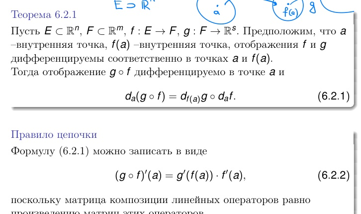

## Printed slide 19 (PDF p. 33). Coordinate form of the chain rule

Under Theorem 6.2.1, for $i\in\{1,\ldots,s\}$ and $j\in\{1,\ldots,n\}$,

$$
\frac{\partial(g\circ f)_i}{\partial x_j}(a)=\sum_{k=1}^{m}\frac{\partial g_i}{\partial x_k}(f(a))\,\frac{\partial f_k}{\partial x_j}(a). \tag{6.2.3}
$$

This follows by equating the $(i,j)$ entries in (6.2.2).

## Printed slide 20 (PDF p. 34). Arithmetic rules — Theorem 6.2.2

Let $f,g:E\to\mathbb R^m$ be differentiable at an interior point $a$. For $\lambda,\mu\in\mathbb R$,

$$
d_a(\lambda f+\mu g)=\lambda\,d_af+\mu\,d_ag.
$$

If a scalar function $\lambda:E\to\mathbb R$ is differentiable at $a$, then

$$
d_a(\lambda\cdot f)=f(a)\cdot d_a\lambda+\lambda(a)\cdot d_af.
$$

## Printed slide 21 (PDF p. 35). Product and quotient rules — Theorem 6.2.2 (continued)

The dot product $f\cdot g$ is differentiable at $a$, with

$$
d_a(f\cdot g)=g(a)\cdot d_af+f(a)\cdot d_ag.
$$

If $m=1$ and $g(a)\ne0$, then $f/g$ is differentiable at $a$ and

$$
d_a\left(\frac{f}{g}\right)=\frac{g(a)\,d_af-f(a)\,d_ag}{g^2(a)}.
$$

## Printed slide 22 (PDF p. 36). Product rule in Jacobian form

For a scalar function $\lambda$ and a differentiable map $f$,

$$
(\lambda f)'(a)=f(a)\cdot\lambda'(a)+\lambda(a)\cdot f'(a).
$$

Indeed, applying both sides to $h\in\mathbb R^n$ gives

$$
(\lambda f)'(a)h=d_a(\lambda f)(h)=f(a)\cdot d_a\lambda(h)+\lambda(a)\cdot d_af(h)
=(f(a)\lambda'(a)+\lambda(a)f'(a))h.
$$

Equivalently, for each $j\in\{1,\ldots,n\}$,

$$
\frac{\partial(\lambda f)}{\partial x_j}(a)=f(a)\cdot\frac{\partial\lambda}{\partial x_j}(a)+\lambda(a)\cdot\frac{\partial f}{\partial x_j}(a).
$$

## Printed slide 23 (PDF p. 37). Differentiating an inverse map — Theorem 6.2.3

Let $f:E\to\mathbb R^n$ be differentiable at the interior point $a\in E$. Assume:

1. the operator $d_af$ is invertible;
2. $f$ is injective;
3. $f(a)$ is an interior point of $f(E)$;
4. $f^{-1}$ is continuous at $f(a)$.

Then $f^{-1}$ is differentiable at $f(a)$ and

$$
d_{f(a)}f^{-1}=(d_af)^{-1}.
$$

## Handwritten page (PDF p. 38). Linearity of the differential

The handwritten proof sets $T=d_af$ and $S=d_ag$ and writes the differentiability expansions for $f$ and $g$ with remainders $\alpha(h)\|h\|$ and $\beta(h)\|h\|$, where $\alpha(h),\beta(h)\to0$. Multiplying the expansions by scalars $\lambda,\mu$ and adding shows that the linear term for $\lambda f+\mu g$ is $(\lambda T+\mu S)h$, while the combined remainder is still $o(\|h\|)$. Therefore

$$
d_a(\lambda f+\mu g)=\lambda\,d_af+\mu\,d_ag.
$$

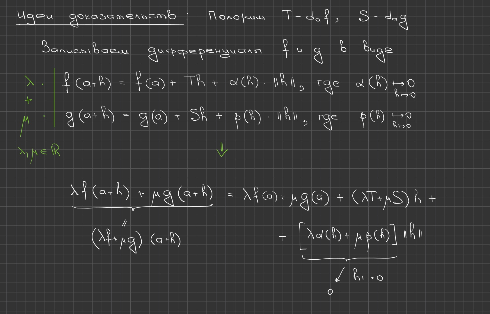

## Printed slide 24 (PDF p. 39). Continuously differentiable maps

For one-variable functions, differentiability at a point is equivalent to existence of the derivative there, a convenient test. In several variables, differentiability is not so simply characterized by existence of partial derivatives. Continuous differentiability, however, is conveniently described in terms of partial derivatives and is often the more useful notion in practice.

## Printed slide 25 (PDF p. 40). Differentiability and continuous differentiability — Definitions 6.3.1–6.3.2

**Definition 6.3.1.** If $E$ is open in $\mathbb R^n$, a map $f:E\to\mathbb R^m$ is differentiable on $E$ when it is differentiable at every point of $E$.

**Definition 6.3.2.** Let $E\subset\mathbb R^n$ and $f:E\to\mathbb R^m$.

1. If $a\in E$, all first partial derivatives of $f$ are defined in a neighborhood of $a$ and are continuous at $a$, then $f$ is continuously differentiable at $a$.
2. If $E$ is open and $f$ is continuously differentiable at every point of $E$, then $f$ is continuously differentiable on $E$.

## Cross-references

This transcription overlaps the following Russian thematic sections (semester-2 material, lectures 33–64): [§6.1 — differentiability, Jacobian and gradient](../../ru/lectures/14-differentiability-6-1.md), [§6.2 — differentiation rules](../../ru/lectures/15-differentiation-rules-6-2.md), and [§6.3 — continuous differentiability](../../ru/lectures/16-continuous-differentiability-6-3.md). The existing register index is [here](../../ru/lectures/index.md).
