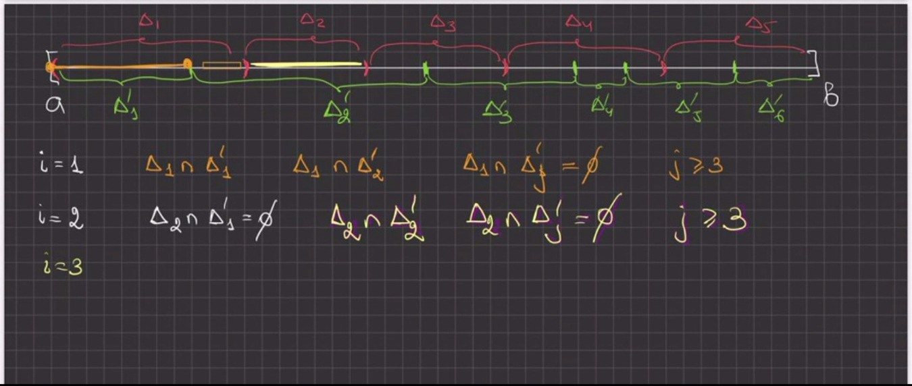
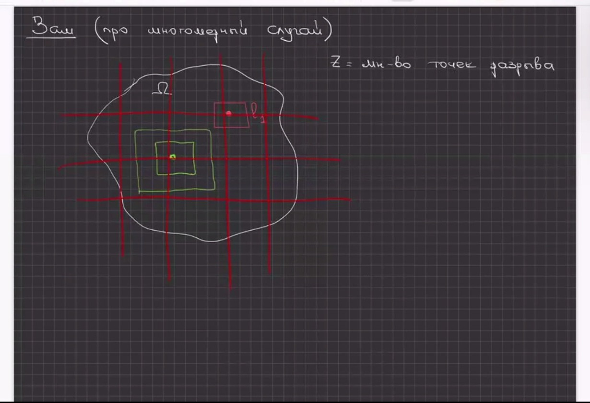
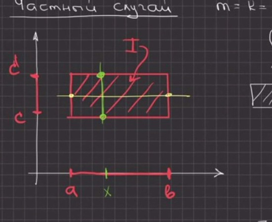

# Lectures 83–84 — properties of the integral over a set, sufficiency in Lebesgue's criterion, Fubini's theorem

[← Lectures 81–82](lecture-81-82.md) · [Lecture index](index.md) · [Terms & theorems](../term-index.md) · [Русский](../../ru/lectures-2025-26/lecture-83-84.md) · [Español](../../es/lectures-2025-26/lecture-83-84.md)

> **Source and numbering.** These notes are compiled from 42 video frames of the Zoom lectures 83–84 of 31 October 2026 (frames p083–p124; the raw text of the frames is in [`ocr/raw/`](../../../ocr/raw/p083.md)): these are the printed slides “k / 10” (frames p083–p090, slides 1–8) and the handwritten blackboard (frames p091–p124). Slides 9 / 10 and 10 / 10 are not in the archive, and Cavalieri's principle, announced among the goals of the lecture, is not stated in the frames received: [Theorem 10.4.2](#thm-10-4-2) and [Corollary 10.4.3](#cor-10-4-3), which precedes it, are restored from the slides of the 2024/25 course (FS p101–p102) and marked with “Restored” blocks; their text is not in the frames of the 2026 lecture. The frames of the first three blackboard pages (out of 11) are missing from the archive; the blackboard frames carry the marks “4 of 11” (p091), “10 of 16” (p103) and “20 of 24” (p116) — the number of blackboard pages grew during the lecture. Neighbouring blackboard frames overlap (the same sheet is captured several times with a small shift, for example p091–p093, p097–p101, p119–p121, p122–p124); repeated text is given once, and the numbers of all frames are kept as page anchors. The order of the frames in the archive is not chronological: judging by the time stamps in the file names (10:37, 11:19, 12:55), the lecturer first proved the sufficiency in [Lebesgue's criterion](lecture-41-42.md#thm-4-2-5) on the blackboard (p091–p102), then showed slides 4–5 / 10 with the properties of the integral and proved properties 1–3 (p103–p105), and only then passed to [Fubini's theorem](../17-multiple-integrals.md#fubini-theorem-continuous) (p106–p124; slides 6–8 / 10 were shown during this part). In the text the frames go in increasing order of numbers, so the statements from the slides (p086–p090) come before the proofs on the blackboard. The numbering of definitions and theorems is the lecturer's; the abbreviation “Zash” on frames p102, p108, p114 and p124 is “Rem.” (remark). Slips in the notes are corrected and marked with “Source correction” blocks; lost passages are restored and marked with “Restored” blocks; the tags match [`ocr/RESOLVED.md`](../../../ocr/RESOLVED.md). Places that still have to be checked against the video recording are listed in [`ocr/ISSUES.md`](../../../ocr/ISSUES.md).

## Goals of the lectures

<a id="p083"></a>

Lectures 83–84 were given on 31 October 2026 (title slide 1 / 10: “Mathematical Analysis, lectures 83–84, 31 October 2026”).

<a id="p084"></a>

**Quote of the day** (slide 2 / 10): “Firewood for sale — I've chopped plenty lately.” (A pun on the Russian idiom “to chop a lot of firewood”, i.e. to make a mess of things.)

<a id="p085"></a>

**Goals of the lectures** (slide 3 / 10):

- to prove the sufficiency in Lebesgue's criterion for [Riemann integrability](lecture-39-40.md#def-4-2-6);
- to continue the discussion of the properties of the multiple integral;
- to study Fubini's theorem and some of its corollaries;
- to state Cavalieri's principle.

The last item is not represented in the frames received (slides 9 / 10 and 10 / 10 are missing from the archive). The statement of Cavalieri's principle ([Theorem 10.4.2](#thm-10-4-2)) is restored from the 2024/25 slides at the end of the file; [Corollary 10.4.3](#cor-10-4-3), which precedes it on the 2024/25 slides, is restored there as well. Of the corollaries of Fubini's theorem, the frames contain [Corollaries 10.4.1](#cor-10-4-1) and [10.4.2](#cor-10-4-2).

## §10.3. General properties of the integral (conclusion)

<a id="p086"></a>

Recall: the integral over an admissible set $`\Omega`$ is defined by the equality $`\int_\Omega f\,dx=\int_If\chi_\Omega\,dx`$, where $`I\supset\Omega`$ is a box ([Definition 10.2.4](lecture-81-82.md#def-10-2-4)), and $`\mu(\Omega)=\int_\Omega1\,dx`$ is the [Jordan measure](lecture-51-52.md#def-4-6-6) ([Definition 10.2.5](lecture-81-82.md#def-10-2-5)). Slides 4 and 5 / 10 (“Properties of the integral”) list the main properties of this integral.

**Properties.** Let $`\Omega\subset\mathbb R^n`$ be an [admissible set](lecture-81-82.md#def-10-2-1) and $`f,g\in R(\Omega)`$. Then:

1. if $`f(x)\ge0`$ for all $`x\in\Omega`$, then $`\int_\Omega f(x)\,dx\ge0`$;
2. if $`f(x)\le g(x)`$ for all $`x\in\Omega`$, then $`\int_\Omega f(x)\,dx\le\int_\Omega g(x)\,dx`$;
3. if $`m\le f(x)\le M`$ for all $`x\in\Omega`$, then $`m\,\mu(\Omega)\le\int_\Omega f(x)\,dx\le M\,\mu(\Omega)`$.

<a id="p087"></a>

Continuation (slide 5 / 10):

4. if $`m=\inf_{x\in\Omega}f(x)`$ and $`M=\sup_{x\in\Omega}f(x)`$, then there is $`\theta\in[m,M]`$ such that $`\int_\Omega f(x)\,dx=\theta\,\mu(\Omega)`$;
5. if $`\Omega`$ is an admissible [connected](../13-metric-spaces.md#sec-13-5) set and $`f:\Omega\to\mathbb R`$ is continuous, then there is $`\xi\in\Omega`$ such that $`\int_\Omega f(x)\,dx=f(\xi)\,\mu(\Omega)`$;
6. if $`m\le f(x)\le M`$ and $`g(x)\ge0`$ for all $`x\in\Omega`$, then $`m\int_\Omega g(x)\,dx\le\int_\Omega f(x)g(x)\,dx\le M\int_\Omega g(x)\,dx`$.

> **Source correction** (M539). In the notes (slides 4–5 / 10; likewise on the slide FS p98 of the 2024/25 course): “Let the functions $`f,g\in\mathcal R(\Omega)`$” — without saying that $`\Omega`$ is admissible. “$`\Omega`$ is an admissible set” has been added: otherwise the measure $`\mu(\Omega)`$ in properties 3–5 is not defined ([Definition 10.2.5](lecture-81-82.md#def-10-2-5)); in property 5 the admissibility of $`\Omega`$ is written explicitly on the slide. The class of integrable functions is denoted $`R(\Omega)`$, as in lectures 81–82 (on the slides, a calligraphic $`\mathcal R`$).

On slide 5 / 10 a hint to property 6 is written in blue ink: the inequalities $`m\le f(x)\le M`$ are multiplied by $`g(x)\ge0`$.

> **Source correction** (S440, T441). The notes have the hint “$`[mg(x)\le f(x)\le Mg(x)]`$” and the product “$`fg(x)`$” on the right-hand side of property 6. In the hint the factor $`g(x)`$ is missing in the middle part: $`m\le f(x)\le M`$ and $`g(x)\ge0`$ give $`mg(x)\le f(x)g(x)\le Mg(x)`$ (as on the slide FS p98: “$`mg(x)\le f(x)g(x)\le Mg(x)`$”); the integrand in property 6 is the product $`f(x)g(x)`$.

The lecturer proved properties 1–3 on the blackboard (frames p103–p105, see below); properties 4–6 are only stated on the slide, and their proofs are restored there as well.

## §10.4. Fubini's theorem

<a id="p088"></a>

Let $`\mathbb R^n=\mathbb R^m\times\mathbb R^k`$, $`m+k=n`$; we write the points of the space $`\mathbb R^n`$ as $`(x,y)`$, where $`x\in\mathbb R^m`$, $`y\in\mathbb R^k`$ (slide 6 / 10, a note in blue ink).

<a id="thm-10-4-1"></a>**Theorem 10.4.1 (Fubini).** Let $`I=I_x\times I_y\subset\mathbb R^n`$, where $`I_x`$ is a box in $`\mathbb R^m`$, $`I_y`$ is a box in $`\mathbb R^k`$, $`m+k=n`$. If the function $`f`$ is integrable on $`I`$ and, moreover,

$`(\ast)`$ for each $`x\in I_x`$ the function $`y\mapsto f(x,y)`$ is integrable on $`I_y`$,

then the function $`F(x)=\int_{I_y}f(x,y)\,dy`$ is integrable on $`I_x`$ and
```math
\int_If(x,y)\,dx\,dy=\int_{I_x}\Bigl(\int_{I_y}f(x,y)\,dy\Bigr)dx .
```

*Figure on the slide (page p088): the rectangle $`I=I_x\times I_y`$ (shaded); the box $`I_x\subset\mathbb R^m`$ is laid off along the horizontal axis, $`I_y\subset\mathbb R^k`$ along the vertical one. The condition $`(\ast)`$ is framed in red on the slide.*

<a id="p089"></a>

Slide 7 / 10, “Reduction of a multiple integral to iterated ones”.

<a id="cor-10-4-1"></a>**Corollary 10.4.1.** Let $`I=I_1\times I_2\times\dots\times I_n\subset\mathbb R^n`$, $`I_i=[a_i,b_i]\subset\mathbb R`$, let the function $`f`$ be integrable on $`I`$, and let condition $`(\ast)`$ hold at each step of the derivation from Theorem 10.4.1, i.e. all the inner integrals on the right exist (this is so, for example, if $`f`$ is continuous on $`I`$). Then
```math
\int_If(x)\,dx=\int_{a_n}^{b_n}dx_n\int_{a_{n-1}}^{b_{n-1}}dx_{n-1}\dots\int_{a_1}^{b_1}f(x_1,x_2,\dots,x_n)\,dx_1 .
```
The right-hand side is read as nested integrals: first, for fixed $`x_2,\dots,x_n`$, the integral over $`x_1`$ from $`a_1`$ to $`b_1`$ is computed, then the result is integrated over $`x_2`$, and so on up to $`x_n`$.

> **Source correction** (M540, S444). In the notes (slide 7 / 10; likewise on the slide FS p100) the conditions on $`f`$ are not stated, and the integrals are written in decreasing order of indices without explanation. Added: $`f\in R(I)`$ and condition $`(\ast)`$ holds at each step (without it the existence of the inner integrals is not guaranteed, see the remark on the role of condition $`(\ast)`$ below); for continuous $`f`$ it holds automatically, since the sections of a continuous function are continuous, and the integral of a continuous function with respect to one of the variables is continuous in the others (§9.1 “Proper [integrals depending on a parameter](lecture-75-76.md#def-9-1-1)”). The order of writing is explained: the innermost integral is the rightmost one, over $`x_1`$.

> **Restored** (the derivation by the standard scheme; on the slide the corollary is given without proof). [Induction](../01-logic-sets-functions.md#example-induction) on $`n`$. For $`n=1`$ the formula is trivial. Let $`n\ge2`$; put $`I_x=I_n=[a_n,b_n]`$ and $`I_y=I_1\times\dots\times I_{n-1}`$ (up to a permutation of coordinates, which does not affect the integral). Condition $`(\ast)`$ means that for each $`x_n\in[a_n,b_n]`$ the function $`(x_1,\dots,x_{n-1})\mapsto f(x_1,\dots,x_n)`$ is integrable on $`I_y`$, and by [Theorem 10.4.1](#thm-10-4-1)
> ```math
> \int_If\,dx=\int_{a_n}^{b_n}\Bigl(\int_{I_y}f(x_1,\dots,x_n)\,dx_1\dots dx_{n-1}\Bigr)dx_n ;
> ```
> the induction hypothesis is applied to the inner $`(n-1)`$-fold integral.

<a id="p090"></a>

Slide 8 / 10.

<a id="cor-10-4-2"></a>**Corollary 10.4.2.** Let $`D\subset\mathbb R^{n-1}`$ be an admissible set, let the functions $`\varphi_1,\varphi_2`$ be continuous on $`\overline D`$ with $`\varphi_1(x)\le\varphi_2(x)`$ for all $`x\in\overline D`$, and let
```math
E=\{(x,y)\in\mathbb R^n:\ x\in D,\ \varphi_1(x)\le y\le\varphi_2(x)\}
```
(here $`x\in\mathbb R^{n-1}`$, $`y\in\mathbb R`$). If $`f\in R(E)`$ and for each $`x\in D`$ the integral $`\int_{\varphi_1(x)}^{\varphi_2(x)}f(x,y)\,dy`$ exists, then
```math
\int_Ef(x,y)\,dx\,dy=\int_Ddx\int_{\varphi_1(x)}^{\varphi_2(x)}f(x,y)\,dy .
```
In blue ink, under the formula, the same right-hand side is written in a different notation: $`\int_D\Bigl(\int_{\varphi_1(x)}^{\varphi_2(x)}f(x,y)\,dy\Bigr)dx`$; the outer integral is taken over the set $`D`$ in the sense of [Definition 10.2.4](lecture-81-82.md#def-10-2-4).

> **Source correction** (M541, S445). In the notes (slide 8 / 10): “Let $`\mathcal D`$ be a bounded set in $`\mathbb R^{n-1}`$ and let $`\mathcal E=\{\dots\}`$. If $`f\in\mathcal R(\mathcal E)`$, then …” — without conditions on $`\varphi_1`$, $`\varphi_2`$ and without requiring the existence of the inner integral. Added: $`D`$ is admissible, $`\varphi_1,\varphi_2`$ are continuous on $`\overline D`$, $`\varphi_1\le\varphi_2`$ (then $`E`$ is bounded, and its boundary lies in the union of the graphs of $`\varphi_1`$, $`\varphi_2`$ over $`\overline D`$ and the cylinder $`\partial D\times[\min\varphi_1,\max\varphi_2]`$ — sets of measure zero, i.e. $`E`$ is admissible), and the existence of the inner integral for each $`x\in D`$: this is condition $`(\ast)`$ of [Theorem 10.4.1](#thm-10-4-1) for the function $`f\chi_E`$ (see the proof below and the remark at its end). The expression to the right of the equality sign on the slide and in the ink note is one and the same formula.

## §10.1. The Riemann integral over an n-dimensional box (conclusion)

### Sufficiency in Lebesgue's criterion (the one-dimensional case)

<a id="p091"></a>

In lectures 81–82, for [Theorem 10.1.2](lecture-81-82.md#thm-10-1-2) (Lebesgue's criterion), necessity was proved and an $`n`$-dimensional proof of sufficiency was given following Zorich. On the blackboard the lecturer proves sufficiency in the one-dimensional case, on the segment $`[a,b]`$ (for $`n=1`$ Lebesgue's criterion — [Theorem 4.2.5](lecture-41-42.md#thm-4-2-5) — was stated in lectures 41–42 without proof). The Cauchy criterion is used.

**Proposition (sufficiency in Lebesgue's criterion, the one-dimensional case).** Let the function $`f`$ be defined and bounded on $`[a,b]`$ and continuous [almost everywhere](../19-measure-theory.md#sec-19-4) on $`[a,b]`$. Then $`f\in R([a,b])`$.

**Proof.** Put $`M=\sup_{[a,b]}|f|<\infty`$. Recall the Cauchy criterion: $`f\in R([a,b])`$ if for every $`\varepsilon'>0`$ there is $`\delta>0`$ such that for any two partitions $`\Delta=\{\Delta_i\}`$ and $`\Delta'=\{\Delta'_j\}`$ of the segment $`[a,b]`$ with mesh (on the blackboard, “rank of the partition”) less than $`\delta`$ and any sets of marked points ([taggings](lecture-37-38.md#def-4-2-4)) $`\xi=\{\xi_i\}`$, $`\xi'=\{\xi'_j\}`$
```math
\bigl|\sigma(f,\Delta,\xi)-\sigma(f,\Delta',\xi')\bigr|<\varepsilon',\qquad\sigma(f,\Delta,\xi)=\sum_if(\xi_i)\,\mu(\Delta_i),
```
where $`\mu(\Delta_i)`$ is the length of the segment $`\Delta_i`$.

*Step 1 (covering the points of discontinuity).* Let $`Z`$ be the set of points of discontinuity of $`f`$ on $`[a,b]`$. By hypothesis $`\mu(Z)=0`$, i.e. (by the definition of a set of measure zero) for every $`\varepsilon>0`$ there is an at most [countable](lecture-01-02.md#def-1-2-5) system of intervals $`\{l_i\}`$ covering $`Z`$ such that $`\sum_i\mu(l_i)<\varepsilon`$ ($`\mu(l_i)`$ is the length of the interval). Fix such an $`\varepsilon>0`$.

*Step 2 (neighbourhoods of points of continuity).* Let $`x\in[a,b]\setminus Z`$ be a point of continuity of $`f`$. Then there is $`\delta(x)>0`$ such that
```math
f\bigl(B_{3\delta(x)}(x)\cap[a,b]\bigr)\subset B_\varepsilon\bigl(f(x)\bigr),
```
where $`B_r(c)=(c-r,c+r)`$.

<a id="p092"></a>

In other words, for all $`\tilde x\in[a,b]`$
```math
|\tilde x-x|<3\delta(x)\ \Longrightarrow\ |f(\tilde x)-f(x)|<\varepsilon .\tag{1}
```
The number $`\varepsilon`$ here is the same as in step 1. A segment with the points $`x-3\delta`$, $`x`$, $`\tilde x`$, $`x+3\delta`$ is drawn on the blackboard.

<a id="p093"></a>

*Step 3 (covering the segment).* The whole segment $`[a,b]`$ is covered by a system of [open sets](lecture-55-56.md#def-5-3-1) consisting of the intervals $`\{l_i\}`$ (they cover $`Z`$) and the neighbourhoods $`B_{\delta(x)}(x)`$ of the points of continuity:
```math
[a,b]\subset\bigcup_il_i\ \cup\bigcup_{x\in[a,b]\setminus Z}B_{\delta(x)}(x).
```

> **Source correction** (M450). The notes say: “the whole segment $`[a,b]`$ will be covered by the system of intervals $`\{l_i\}`$ and $`\bigcup_{x\in Z}B_{3\delta(x)}(x)`$”. The neighbourhoods are built for points of continuity, i.e. for $`x\in[a,b]\setminus Z`$ (for $`x\in Z`$ the numbers $`\delta(x)`$ are not defined); moreover, on the next frame the [finite subcovering](lecture-57-58.md#def-5-3-7) includes neighbourhoods $`B_{\delta(x_j)}(x_j)`$ of radius $`\delta(x_j)`$, not $`3\delta(x_j)`$: the radius $`3\delta(x)`$ is needed only in the continuity condition (1).

<a id="p094"></a>

The segment $`[a,b]`$ is compact, so every covering of it by open sets has a finite subcovering. It has the form
```math
l_{i_1},\ l_{i_2},\ \dots,\ l_{i_p},\quad B_{\delta(x_1)}(x_1),\ B_{\delta(x_2)}(x_2),\ \dots,\ B_{\delta(x_q)}(x_q),
```
i.e. it consists of $`p`$ intervals of the covering $`Z`$ and $`q`$ neighbourhoods of points of continuity $`x_1,\dots,x_q`$. Relabel the chosen intervals $`l_1,\dots,l_p`$, $`l_k=(\alpha_k,\beta_k)`$; then $`\sum_{k=1}^p\mu(l_k)<\varepsilon`$. Choose a number $`\delta>0`$ so that
```math
\delta<\min_{1\le j\le q}\delta(x_j),\qquad2\delta p<\varepsilon .\tag{2}
```

<a id="p095"></a>

*Step 4 (two partitions).* Consider two partitions $`\Delta=\{\Delta_i\}`$ and $`\Delta'=\{\Delta'_j\}`$ of the segment $`[a,b]`$, each of mesh less than $`\delta`$, and let $`\xi=\{\xi_i\}`$, $`\xi'=\{\xi'_j\}`$ be their taggings ($`\xi_i\in\Delta_i`$, $`\xi'_j\in\Delta'_j`$). The segments of each partition cover $`[a,b]`$ and intersect only at endpoints, so $`\mu(\Delta_i)=\sum_j\mu(\Delta_i\cap\Delta'_j)`$ and $`\mu(\Delta'_j)=\sum_i\mu(\Delta_i\cap\Delta'_j)`$ (the intersection $`\Delta_i\cap\Delta'_j`$ is a segment, a point or the empty set; the length of a point and of the empty set is zero). Consequently
```math
\sigma(f,\Delta,\xi)-\sigma(f,\Delta',\xi')=\sum_if(\xi_i)\mu(\Delta_i)-\sum_jf(\xi'_j)\mu(\Delta'_j)=\sum_i\sum_j\bigl(f(\xi_i)-f(\xi'_j)\bigr)\mu(\Delta_i\cap\Delta'_j).\tag{3}
```

<a id="p096"></a>

To visualise the sum over $`i`$ and $`j`$, the lecturer draws both partitions on the same segment: red intervals $`\Delta_1,\dots,\Delta_5`$ above the segment and green ones $`\Delta'_1,\dots,\Delta'_6`$ below it, with endpoints $`a`$ and $`b`$ (frames p096–p097; the figure itself is below).

<a id="p097"></a>



For each $`i`$ only a few $`\Delta'_j`$ intersect $`\Delta_i`$: for $`i=1`$ the intersections $`\Delta_1\cap\Delta'_1`$ and $`\Delta_1\cap\Delta'_2`$ are non-empty, and $`\Delta_1\cap\Delta'_j=\varnothing`$ for $`j\ge3`$; for $`i=2`$ we have $`\Delta_2\cap\Delta'_1=\varnothing`$, only $`\Delta_2\cap\Delta'_2`$ is non-empty (so $`\Delta_2`$ lies entirely in $`\Delta'_2`$), and $`\Delta_2\cap\Delta'_j=\varnothing`$ for $`j\ge3`$; the row $`i=3`$ on the blackboard is unfinished. What matters further is only that the terms of sum (3) with empty intersection are zero and that $`\sum_j\mu(\Delta_i\cap\Delta'_j)=\mu(\Delta_i)`$.

<a id="p098"></a>

*Step 5 (estimate of sum (3)).* Split the terms into two groups:
```math
\bigl|\sigma(f,\Delta,\xi)-\sigma(f,\Delta',\xi')\bigr|\le\Sigma_1+\Sigma_2,
```
where $`\Sigma_1`$ is the sum of $`\sum_j\bigl|f(\xi_i)-f(\xi'_j)\bigr|\mu(\Delta_i\cap\Delta'_j)`$ over all $`i`$ for which $`\xi_i\in\bigcup_{k=1}^pl_k`$, and $`\Sigma_2`$ is the same sum over the remaining $`i`$.

*Case 1: $`\xi_i\in l_k=(\alpha_k,\beta_k)`$ for some $`k\le p`$.* Since $`\xi_i\in\Delta_i`$ and $`\mu(\Delta_i)<\delta`$, we have $`\Delta_i\subset(\alpha_k-\delta,\beta_k+\delta)`$. Assign each such $`\Delta_i`$ to one of the intervals $`l_k`$ containing $`\xi_i`$. The segments $`\Delta_i`$ do not overlap, so the sum of the lengths of the segments assigned to $`l_k`$ does not exceed $`\mu(l_k)+2\delta`$. Since $`|f(\xi_i)-f(\xi'_j)|\le2M`$ and $`\sum_j\mu(\Delta_i\cap\Delta'_j)=\mu(\Delta_i)`$, we get (taking into account $`\sum_k\mu(l_k)<\varepsilon`$ and $`2\delta p<\varepsilon`$)
```math
\Sigma_1\le2M\sum_{i:\ \xi_i\in\bigcup_kl_k}\mu(\Delta_i)\le2M\Bigl(\sum_{k=1}^p\mu(l_k)+2\delta p\Bigr)\le4M\varepsilon .\tag{4}
```

<a id="p099"></a>

*Case 2: $`\xi_i\notin\bigcup_{k=1}^pl_k`$.* Then the point $`\xi_i\in[a,b]`$ is covered by one of the neighbourhoods of the finite subcovering: $`\xi_i\in B_{\delta(x_s)}(x_s)`$ for some $`s\le q`$; put $`\delta_s=\delta(x_s)`$. Let $`\Delta_i\cap\Delta'_j\ne\varnothing`$, and let $`t`$ be a common point of these segments. For every point $`u\in\Delta'_j`$, using the mesh of the partitions and $`\delta<\delta_s`$ from (2),
```math
|u-x_s|\le|u-t|+|t-\xi_i|+|\xi_i-x_s|<\delta+\delta+\delta_s<3\delta_s .
```
Hence $`\Delta'_j\subset B_{3\delta_s}(x_s)`$, and in particular $`\xi'_j\in B_{3\delta_s}(x_s)\cap[a,b]`$; moreover, $`\xi_i\in B_{\delta_s}(x_s)\subset B_{3\delta_s}(x_s)`$.

<a id="p100"></a>

By condition (1) for $`x=x_s`$ we get $`|f(\xi_i)-f(x_s)|<\varepsilon`$ and $`|f(\xi'_j)-f(x_s)|<\varepsilon`$, whence
```math
\Delta_i\cap\Delta'_j\ne\varnothing\ \Longrightarrow\ |f(\xi_i)-f(\xi'_j)|<2\varepsilon ,
```
i.e. the point $`\xi'_j`$ lies near the centre $`x_s`$ of the same neighbourhood of a point of continuity as $`\xi_i`$. The terms with empty intersection are zero, and all the terms are non-negative, so the sum over a subset of indices $`i`$ can be estimated by the sum over all $`i`$:
```math
\Sigma_2\le2\varepsilon\sum_i\sum_j\mu(\Delta_i\cap\Delta'_j)=2\varepsilon(b-a).\tag{5}
```

> **Source correction** (M462, A461, S463, S464, M542). The notes say: “if $`\xi_i\notin\bigcup_{k=1}^pl_k`$, then $`\Delta_i\subset B_{\delta(\xi_i)}(\xi_i)`$; if $`\Delta_i\cap\Delta'_j\ne\varnothing`$, then $`\Delta'_j\subset B_{2\delta(\xi_i)}(\xi_i)`$ (… $`\mu(\Delta'_j)<\delta<\delta(\xi_i)`$ …) $`\Rightarrow f(\xi'_j)\in B_\varepsilon(f(\xi_i))`$”, then “in this case $`\xi_i`$ is a point of continuity, and $`\xi'_j`$ lies near $`\xi_i`$”, and the estimate $`\varepsilon(b-a)`$ instead of (5). The number $`\delta(\xi_i)`$ is defined only for points of continuity, and the inequality $`\delta<\delta(\xi_i)`$ does not follow from $`\delta<\min_j\delta(x_j)`$, since $`\xi_i`$ need not be one of the points $`x_1,\dots,x_q`$; moreover, $`\xi_i\notin\bigcup_{k\le p}l_k`$ does not mean that $`\xi_i`$ is a point of continuity (it may lie in an interval $`l_m`$ that did not enter the finite subcovering and be covered by a neighbourhood $`B_{\delta(x_s)}(x_s)`$ of a point of continuity $`x_s`$). The argument is rewritten through the centre $`x_s`$ of the neighbourhood containing $`\xi_i`$; the radius $`3\delta(x)`$ in condition (1) is needed precisely so that $`\Delta'_j`$ fits into $`B_{3\delta_s}(x_s)`$; the estimate comes with the factor $`2\varepsilon`$ instead of $`\varepsilon`$ (the difference $`f(\xi_i)-f(\xi'_j)`$ is estimated through $`f(x_s)`$ from both sides). The passage from the sum over a subset of indices to the sum over all $`i`$ (S463) is legitimate, since the terms are non-negative and $`\sum_{i,j}\mu(\Delta_i\cap\Delta'_j)=b-a`$.

<a id="p101"></a>

*Step 6 (conclusion).* From (4) and (5) it follows that for any two partitions of mesh less than $`\delta`$ and any of their taggings
```math
\bigl|\sigma(f,\Delta,\xi)-\sigma(f,\Delta',\xi')\bigr|\le4M\varepsilon+2(b-a)\varepsilon=C\varepsilon,\qquad C=4M+2(b-a),
```
where the constant $`C`$ does not depend on $`\varepsilon`$ (on the blackboard: $`\mathrm{const}\cdot\varepsilon`$). Let $`\varepsilon'>0`$ be given. Take $`\varepsilon=\varepsilon'/(2C)`$ and construct $`\delta`$ from it as described in steps 1–3; then for any two partitions of mesh less than $`\delta`$ with any taggings $`\bigl|\sigma(f,\Delta,\xi)-\sigma(f,\Delta',\xi')\bigr|\le\varepsilon'/2<\varepsilon'`$. By the Cauchy criterion the integral sums have a limit as the mesh tends to zero, i.e. $`f\in R([a,b])`$. $`\square`$

> **Source correction** (T465, S466). In the notes the result is written as “$`\bigl|\sigma(f,\xi,\Delta)-\sigma(f,\xi',\Delta')\bigr|\le4\varepsilon\sup|f|+\varepsilon(b-a)=\mathrm{const}\cdot\varepsilon`$” without an explicit reference to the Cauchy criterion. Here the constant is written out ($`C=4M+2(b-a)`$; the second term is doubled for the reason explained above), and the passage from the estimate to the Cauchy criterion is added (step 6).

<a id="p102"></a>

**Remark (on the multidimensional case).** Only the heading of the remark — “Rem. (on the multidimensional case)” — and a figure are written on the blackboard; there is no written text.



The figure shows a region $`\Omega`$ with the caption “$`Z`$ is the set of points of discontinuity”, a grid of red lines (a partition), a red square $`l_1`$ with a [point of discontinuity](lecture-16.md#def-2-5-4) inside, and nested green squares around a point of continuity. Apparently the point is that in $`\mathbb R^n`$ the same scheme works with [bricks](lecture-79-80.md#def-10-1-1) instead of segments: the set $`Z`$ is covered by bricks $`l_i`$ with small total volume, cubic neighbourhoods are taken at each point of continuity, and partitions are drawn as a grid. The full proof of sufficiency in $`\mathbb R^n`$ (with dilations of the covering by factors $`2`$ and $`3`$) is given in lectures 81–82 after [Theorem 10.1.2](lecture-81-82.md#thm-10-1-2).

## §10.3. General properties of the integral (proofs of properties 1–6)

<a id="p103"></a>

*Blackboard mark “10 of 16”.*

**Proof of property 1.** Let $`f(x)\ge0`$ for all $`x\in\Omega`$. By the definition of the integral over a set
```math
\int_\Omega f(x)\,dx=\int_{I\supset\Omega}f\chi_\Omega(x)\,dx,\qquad\chi_\Omega(x)=\begin{cases}1,&x\in\Omega,\\0,&x\notin\Omega\end{cases}
```
(the characteristic function from [Definition 10.2.2](lecture-81-82.md#def-10-2-2)). Since $`f\ge0`$ on $`\Omega`$, and outside $`\Omega`$ the function $`f\chi_\Omega`$ is zero, we have $`f\chi_\Omega(x)\ge0`$ for all $`x\in I`$ (and even for all $`x\in\mathbb R^n`$).

<a id="p104"></a>

The integral $`\int_If\chi_\Omega\,dx`$ is the limit of the integral sums $`\sigma(f\chi_\Omega,P,\xi)`$ as $`\lambda(P)\to0`$ (here $`\lambda(P)`$ is the mesh of the partition $`P`$ of the box $`I`$). All these sums are non-negative (each term $`f\chi_\Omega(\xi_i)\mu(I_i)\ge0`$), so the limit is non-negative too: $`\int_If\chi_\Omega\,dx\ge0`$, i.e. $`\int_\Omega f\,dx\ge0`$. $`\square`$

<a id="p105"></a>

**Proof of property 2.** Put $`\psi(x)=g(x)-f(x)`$. By hypothesis $`\psi(x)\ge0`$ for all $`x\in\Omega`$, and $`\psi\in R(\Omega)`$ as a difference of integrable functions. By property 1 $`\int_\Omega\psi(x)\,dx\ge0`$, and by the linearity of the integral $`\int_\Omega\psi\,dx=\int_\Omega g\,dx-\int_\Omega f\,dx`$ (linearity follows from the linearity of integral sums). Hence $`\int_\Omega f\,dx\le\int_\Omega g\,dx`$. $`\square`$

**Proof of property 3.** Let $`f(x)\ge m`$ for all $`x\in\Omega`$. By property 2 (for the functions $`m`$ and $`f`$) $`\int_\Omega m\,dx\le\int_\Omega f\,dx`$. The integral of a constant equals $`\int_\Omega m\,dx=m\int_\Omega1\,dx=m\,\mu(\Omega)`$ ([Definition 10.2.5](lecture-81-82.md#def-10-2-5)), so $`m\,\mu(\Omega)\le\int_\Omega f\,dx`$. From $`f(x)\le M`$ we likewise get $`\int_\Omega f\,dx\le M\,\mu(\Omega)`$. $`\square`$

> **Restored** (by the standard proof; on slide 5 / 10 properties 4–6 are only stated, and on the slide FS p98 of the 2024/25 course only the hint $`mg(x)\le f(x)g(x)\le Mg(x)`$ is given for property 6).
>
> *Property 4.* The function $`f\in R(\Omega)`$ is bounded ([Theorem 10.2.1](lecture-81-82.md#thm-10-2-1)), so $`m`$ and $`M`$ are finite, and by property 3 $`m\,\mu(\Omega)\le\int_\Omega f\,dx\le M\,\mu(\Omega)`$. If $`\mu(\Omega)>0`$, the number $`\theta=\frac1{\mu(\Omega)}\int_\Omega f\,dx`$ lies in $`[m,M]`$ and $`\int_\Omega f\,dx=\theta\,\mu(\Omega)`$. If $`\mu(\Omega)=0`$, then $`\int_\Omega f\,dx=0`$, and the equality holds for every $`\theta\in[m,M]`$.
>
> *Property 5.* If $`\mu(\Omega)=0`$, both sides are zero for every $`\xi\in\Omega`$. Let $`\mu(\Omega)>0`$, and let $`\theta=\frac1{\mu(\Omega)}\int_\Omega f\,dx\in[m,M]`$ be the number from property 4. The image $`f(\Omega)`$ of a connected set under a continuous map is connected, i.e. it is an interval with endpoints $`m`$ and $`M`$, so each $`\theta\in(m,M)`$ is a value of $`f`$ at some point $`\xi\in\Omega`$. There remains the case $`\theta=m`$ (the case $`\theta=M`$ is similar), when the value $`m`$ may not be attained. Here $`\int_\Omega(f-m)\,dx=0`$. Suppose that $`f>m`$ everywhere on $`\Omega`$. Since $`\mu(\Omega)>0`$, $`\Omega`$ has an [interior point](lecture-57-58.md#def-5-3-3) (otherwise $`\Omega\subset\partial\Omega`$ and $`\mu(\Omega)=0`$); take a closed ball $`K\subset\Omega`$ of positive radius. On the compact set $`K`$ the continuous positive function $`f-m`$ has a positive minimum $`c`$, and $`f-m\ge c\chi_K`$ on $`\Omega`$, whence by property 2 $`\int_\Omega(f-m)\,dx\ge c\,\mu(K)>0`$ — a contradiction. Hence $`f(\xi)=m=\theta`$ for some point $`\xi\in\Omega`$.
>
> *Property 6.* By [Definition 10.2.4](lecture-81-82.md#def-10-2-4) and Lebesgue's criterion the functions $`f\chi_\Omega`$ and $`g\chi_\Omega`$ are bounded and continuous almost everywhere on $`I`$, so $`(fg)\chi_\Omega=(f\chi_\Omega)(g\chi_\Omega)`$ is bounded and continuous almost everywhere as well, i.e. $`fg\in R(\Omega)`$. Multiplying $`m\le f(x)\le M`$ by $`g(x)\ge0`$, we get $`mg(x)\le f(x)g(x)\le Mg(x)`$ for all $`x\in\Omega`$. By property 2 and the linearity of the integral $`m\int_\Omega g\,dx\le\int_\Omega fg\,dx\le M\int_\Omega g\,dx`$. $`\square`$

## §10.4. Fubini's theorem (continued)

### Multiple and iterated integrals

<a id="p106"></a>

The integral $`\int_If(x,y)\,dx\,dy`$ is a multidimensional (multiple) integral over the box $`I`$. The integral
```math
\int_{I_x}\Bigl(\int_{I_y}f(x,y)\,dy\Bigr)dx=\int_{I_x}dx\int_{I_y}f(x,y)\,dy
```
(the second notation is a variant of the first) is called an iterated integral. How is it to be understood? For each fixed $`x\in I_x`$ we compute $`F(x)=\int_{I_y}f(x,y)\,dy`$; we get a function $`F:I_x\to\mathbb R`$; then we integrate $`F`$ over $`I_x`$.

<a id="p107"></a>

Frame p107 captures the same blackboard sheet with a slightly wider view; it contains no new records.

<a id="p108"></a>

**Remark (on the role of condition $`(\ast)`$).** What happens if the requirement

$`(\ast)`$ for each $`x\in I_x`$ the function $`y\mapsto f(x,y)`$ is integrable on $`I_y`$

is removed from the hypotheses of Fubini's theorem?

Without condition $`(\ast)`$ it may happen that $`F(x)`$ does not exist for some $`x\in I_x`$.

<a id="p109"></a>

In that case $`F(x)`$ has to be defined for such $`x`$. It can be defined as follows: take as $`F(x)`$ any number from the segment $`\bigl[\underline J(x),\overline J(x)\bigr]`$, where $`\underline J(x)`$ and $`\overline J(x)`$ are the lower and [upper Darboux integrals](lecture-39-40.md#def-4-2-8) of the function $`y\mapsto f(x,y)`$ on $`I_y`$ ([Definition 10.1.10](lecture-81-82.md#def-10-1-10)). But then one has to show that the set of such $`x`$ has measure zero; then $`F\in R(I_x)`$. The proof of this statement is given below, after the proof of [Theorem 10.4.1](#thm-10-4-1).

### Proof of Fubini's theorem

<a id="p110"></a>

**Proof of [Theorem 10.4.1](#thm-10-4-1).** Let $`|f|\le M`$ on $`I`$ (an integrable function is bounded, [Theorem 10.1.1](lecture-79-80.md#thm-10-1-1)). A partition $`P`$ of the brick $`I=I_x\times I_y`$ is obtained from partitions of its coordinate segments ([Definition 10.1.3](lecture-79-80.md#def-10-1-3)), so it has the form $`P=P_x\times P_y`$, where $`P_x=\{I_{x_i}\}`$ is a partition of the box $`I_x`$, and $`P_y=\{I_{y_j}\}`$ is a partition of the box $`I_y`$; conversely, any pair of partitions $`P_x`$, $`P_y`$ defines a partition $`P`$ with cells $`I_{x_i}\times I_{y_j}`$. Moreover, $`\mu_n(I_{x_i}\times I_{y_j})=\mu_m(I_{x_i})\,\mu_k(I_{y_j})`$ (the index of $`\mu`$ is the dimension of the space).

*Figure in the notes (page p110): the rectangle $`I=I_x\times I_y`$ with the axes $`x`$ and $`y`$; the box $`I_x`$ is laid off along the horizontal axis, $`I_y`$ along the vertical one; a cell $`I_{x_i}\times I_{y_j}`$ of the partition $`P_x\times P_y`$ is shaded.*

For $`x\in I_x`$ put $`f_x(y)=f(x,y)`$ and $`F(x)=\int_{I_y}f(x,y)\,dy`$ (the integral exists by condition $`(\ast)`$); $`|F(x)|\le M\mu_k(I_y)`$. Denote by $`s(F,P_x)=\sum_i\inf_{x\in I_{x_i}}F(x)\,\mu_m(I_{x_i})`$ and $`S(F,P_x)=\sum_i\sup_{x\in I_{x_i}}F(x)\,\mu_m(I_{x_i})`$ the Darboux sums of the function $`F`$ for the partition $`P_x`$, and by $`\underline J_F=\sup_{P_x}s(F,P_x)`$ and $`\overline J_F=\inf_{P_x}S(F,P_x)`$ its lower and upper Darboux integrals (on the blackboard: $`\underline{\int_{I_x}}F\,dx`$ and $`\overline{\int_{I_x}}F\,dx`$). Let us prove that
```math
s(f,P)\le s(F,P_x)\le\underline J_F\le\overline J_F\le S(F,P_x)\le S(f,P).\tag{6}
```

*The lower sum.* By definition
```math
s(f,P)=\sum_{i,j}\inf_{\substack{x\in I_{x_i}\\y\in I_{y_j}}}f(x,y)\,\mu_n(I_{x_i}\times I_{y_j})=\sum_{i,j}\inf_{\substack{x\in I_{x_i}\\y\in I_{y_j}}}f(x,y)\,\mu_m(I_{x_i})\,\mu_k(I_{y_j}).
```

<a id="p111"></a>

By the property of the infimum, $`\inf_{x\in I_{x_i},\,y\in I_{y_j}}f(x,y)\le\inf_{x\in I_{x_i}}\bigl(\inf_{y\in I_{y_j}}f(x,y)\bigr)`$ (in fact there is equality here, but only the inequality is needed). Therefore
```math
s(f,P)\le\sum_{i,j}\inf_{x\in I_{x_i}}\Bigl(\inf_{y\in I_{y_j}}f(x,y)\Bigr)\mu_k(I_{y_j})\,\mu_m(I_{x_i})=\sum_{i,j}\inf_{x\in I_{x_i}}\Bigl(\inf_{y\in I_{y_j}}f(x,y)\cdot\mu_k(I_{y_j})\Bigr)\mu_m(I_{x_i});
```
the factor $`\mu_k(I_{y_j})\ge0`$ can be brought under the [infimum](lecture-11-12.md#def-2-3-2) over $`x`$.

<a id="p112"></a>

The sum of infima does not exceed the infimum of the sum, so
```math
s(f,P)\le\sum_i\inf_{x\in I_{x_i}}\Bigl(\sum_j\inf_{y\in I_{y_j}}f(x,y)\,\mu_k(I_{y_j})\Bigr)\mu_m(I_{x_i}).
```
The expression in brackets is the lower Darboux sum $`s(f_x,P_y)`$ of the function $`f_x`$ for the partition $`P_y`$ (it depends on $`x`$ through $`f_x`$). Thus
```math
s(f,P)\le\sum_i\inf_{x\in I_{x_i}}s(f_x,P_y)\,\mu_m(I_{x_i})\le\sum_i\inf_{x\in I_{x_i}}\Bigl(\sup_{P_y}s(f_x,P_y)\Bigr)\mu_m(I_{x_i}),
```
where the [supremum](lecture-11-12.md#def-2-3-1) is taken over all partitions $`P_y`$ of the box $`I_y`$.

<a id="p113"></a>

But $`\sup_{P_y}s(f_x,P_y)=\underline J(x)`$ is the lower Darboux integral of the function $`f_x`$, and $`\underline J(x)\le F(x)`$. Therefore
```math
s(f,P)\le\sum_i\inf_{x\in I_{x_i}}\underline J(x)\,\mu_m(I_{x_i})\le\sum_i\inf_{x\in I_{x_i}}F(x)\,\mu_m(I_{x_i})=s(F,P_x).
```

> **Source correction** (T484, A485). The notes say “$`\le\sum_i\inf_{x\in I_{x_i}}\bigl(\int_{I_y}f(x,y)\,dy\bigr)\mu_m(I_{x_i})`$”, with the lecturer's orange note “in fact the lower Darboux integral stands here” ($`\underline I`$ on the frame, $`\underline J`$ on frames p109 and p114 and on the slide FS p99). The lower Darboux integral $`\underline J(x)`$ is written — it is what results from $`\sup_{P_y}s(f_x,P_y)`$; under condition $`(\ast)`$ it equals $`F(x)`$ ([Theorem 10.1.3](lecture-81-82.md#thm-10-1-3)), but the proof uses only the inequality $`\underline J(x)\le F(x)`$.

<a id="p114"></a>

For the function $`F`$ the inequalities $`s(F,P_x)\le\underline J_F\le\overline J_F\le S(F,P_x)`$ hold (the exercise after [Definition 10.1.10](lecture-81-82.md#def-10-1-10) in lectures 81–82). The lecturer's remark: for each $`x`$
```math
\underline J(x)\le F(x)=\int_{I_y}f(x,y)\,dy\le\overline J(x)
```
(for an integrable function $`f_x`$ all three numbers coincide). From this and the definition of the upper Darboux sum,
```math
S(F,P_x)=\sum_i\sup_{x\in I_{x_i}}F(x)\,\mu_m(I_{x_i})\le\sum_i\sup_{x\in I_{x_i}}\overline J(x)\,\mu_m(I_{x_i})\le\sum_i\sup_{x\in I_{x_i}}\Bigl(\sum_j\sup_{y\in I_{y_j}}f(x,y)\,\mu_k(I_{y_j})\Bigr)\mu_m(I_{x_i}),
```
because $`\overline J(x)=\inf_{P'_y}S(f_x,P'_y)\le S(f_x,P_y)=\sum_j\sup_{y\in I_{y_j}}f(x,y)\,\mu_k(I_{y_j})`$.

<a id="p115"></a>

By the property of the supremum, $`\sup_{x\in I_{x_i}}\bigl(\sup_{y\in I_{y_j}}f(x,y)\bigr)\le\sup_{x\in I_{x_i},\,y\in I_{y_j}}f(x,y)`$ (again, in fact, equality). The sum of suprema is not less than the supremum of the sum, so
```math
S(F,P_x)\le\sum_{i,j}\sup_{\substack{x\in I_{x_i}\\y\in I_{y_j}}}f(x,y)\,\mu_k(I_{y_j})\,\mu_m(I_{x_i})=S(f,P),
```
since $`\mu_k(I_{y_j})\mu_m(I_{x_i})=\mu_n(I_{x_i}\times I_{y_j})`$.

> **Source correction** (M486, T488). The notes say “$`\underline J\le F(x)=\int_{I_y}f(x,y)\,dy\le\overline J`$” and “$`=S(x,P)`$”. The [upper bound](../02-real-numbers.md#sec-2-2) is $`\overline J(x)`$, which depends on $`x`$ (it is not a constant); the upper Darboux sum of the partition $`P`$ is $`S(f,P)`$, not $`S(x,P)`$.

<a id="p116"></a>

Thus inequalities (6) are proved. Since $`f\in R(I)`$, as $`\lambda(P)\to0`$ both sums $`s(f,P)`$ and $`S(f,P)`$ tend to $`\int_If\,dx\,dy`$: the integral sum for any choice of marked points lies between them, and they themselves are the infimum and supremum of the integral sums over the choice of marked points. The quantities $`\underline J_F`$, $`\overline J_F`$ do not depend on the partition $`P`$. Passing to the limit in (6) as $`\lambda(P)\to0`$ (partitions of the form $`P_x\times P_y`$ with small mesh exist), we get
```math
\int_If\,dx\,dy\le\underline J_F\le\overline J_F\le\int_If\,dx\,dy ,
```
whence $`\underline J_F=\overline J_F=\int_If\,dx\,dy`$. By [Darboux's criterion](lecture-39-40.md#thm-4-2-1) ([Theorem 10.1.3](lecture-81-82.md#thm-10-1-3); $`F`$ is bounded) the function $`F`$ is integrable on $`I_x`$, and
```math
\int_If(x,y)\,dx\,dy=\underline J_F=\overline J_F=\int_{I_x}F(x)\,dx=\int_{I_x}\Bigl(\int_{I_y}f(x,y)\,dy\Bigr)dx .\ \square
```

> **Restored** (by the standard proof; the lecturer only noted that one has to show that the set of $`x`$ for which condition $`(\ast)`$ fails has measure zero). Let $`f\in R(I)`$, condition $`(\ast)`$ not being assumed; $`\underline J(x)\le\overline J(x)`$ are the lower and upper Darboux integrals of the function $`f_x`$ (finite, since $`f`$ is bounded). The proof above used only the inequalities $`\underline J(x)\le F(x)\le\overline J(x)`$, so it works for $`F=\underline J`$, for $`F=\overline J`$ and for any function $`F`$ with values between them. We get: $`\underline J,\overline J\in R(I_x)`$ and $`\int_{I_x}\underline J\,dx=\int_{I_x}\overline J\,dx=\int_If\,dx\,dy`$. Hence the non-negative function $`\varphi=\overline J-\underline J\in R(I_x)`$ has zero integral and is therefore zero outside a set of measure zero: for $`\eta>0`$ and $`\varepsilon>0`$ choose a partition $`P_x`$ with $`S(\varphi,P_x)<\eta\varepsilon`$ (it exists, since $`\inf_{P_x}S(\varphi,P_x)=\int_{I_x}\varphi\,dx=0`$); the cells containing points of the set $`N_\eta=\{x:\ \varphi(x)\ge\eta\}`$ cover $`N_\eta`$, and on each of them $`\sup\varphi\ge\eta`$, so their total measure is less than $`\varepsilon`$; hence $`\mu(N_\eta)=0`$; the set $`\{\varphi>0\}=\bigcup_kN_{1/k}`$ has measure zero by property ④ of sets of measure zero (lectures 81–82). For $`x\notin\{\varphi>0\}`$ the function $`f_x`$ is integrable ([Theorem 10.1.3](lecture-81-82.md#thm-10-1-3)), i.e. condition $`(\ast)`$ fails only on a set of measure zero; on it $`F(x)`$ can be defined as any number from $`[\underline J(x),\overline J(x)]`$, and the equality $`\int_{I_x}F\,dx=\int_If\,dx\,dy`$ is preserved.

### The special case $`n=2`$ and notation

<a id="p117"></a>

*The special case* $`m=k=1`$, i.e. $`n=m+k=2`$. Let $`I=[a,b]\times[c,d]`$. Then
```math
\int_If(x,y)\,dx\,dy=\int_a^b\Bigl(\int_c^df(x,y)\,dy\Bigr)dx=\int_c^d\Bigl(\int_a^bf(x,y)\,dx\Bigr)dy .
```
The first equality is [Theorem 10.4.1](#thm-10-4-1) (condition $`(\ast)`$: for each $`x\in[a,b]`$ the function $`y\mapsto f(x,y)`$ is integrable on $`[c,d]`$), the second is the same theorem with the roles of $`x`$ and $`y`$ exchanged (for each $`y\in[c,d]`$ the function $`x\mapsto f(x,y)`$ is integrable on $`[a,b]`$); both pairs of conditions hold, for example, for continuous $`f`$.



<a id="p118"></a>

**Notation.** For $`n=2`$ the multiple integral over the brick $`I=I_x\times I_y`$ is called a double integral and written
```math
\int_If(x,y)\,dx\,dy=\iint_If(x,y)\,dx\,dy ;
```
for $`n=3`$, a triple integral:
```math
\int_If(x,y,z)\,dx\,dy\,dz=\iiint_If(x,y,z)\,dx\,dy\,dz .
```
The signs $`\iint`$ and $`\iiint`$ are only a notation for a multiple integral; an iterated integral is written with nested integral signs.

### An example

<a id="p119"></a>

**Example.** Compute $`\iiint_If(x,y,z)\,dx\,dy\,dz`$ for $`f(x,y,z)=z\sin(x+y)`$ over the box
```math
I=\{(x,y,z):\ 0\le x\le\pi,\ |y|\le\pi/2,\ 0\le z\le1\}=I_x\times I_y\times I_z,
```
where $`I_x=[0,\pi]`$, $`I_y=[-\pi/2,\pi/2]`$, $`I_z=[0,1]`$, $`I\subset\mathbb R^3`$. The function $`f`$ is continuous on $`I`$, so by [Corollary 10.4.1](#cor-10-4-1)
```math
\iiint_If(x,y,z)\,dx\,dy\,dz=\int_0^1dz\int_{-\pi/2}^{\pi/2}dy\int_0^\pi z\sin(x+y)\,dx .
```
(The order of the differentials $`dz`$, $`dy`$, $`dx`$ is the order of the nested integrals; it need not coincide with the order $`dx\,dy\,dz`$ in the notation of the triple integral.)

<a id="p120"></a>

We compute the inner integral, using $`\cos(\pi+y)=-\cos y`$:
```math
\int_0^\pi z\sin(x+y)\,dx=z\int_0^\pi\sin(x+y)\,dx=-z\cos(x+y)\Big|_{x=0}^{x=\pi}=-z\cos(\pi+y)+z\cos y=2z\cos y .
```
Then
```math
\int_0^1dz\int_{-\pi/2}^{\pi/2}dy\int_0^\pi z\sin(x+y)\,dx=\int_0^1dz\int_{-\pi/2}^{\pi/2}2z\cos y\,dy,
```
and
```math
\int_{-\pi/2}^{\pi/2}2z\cos y\,dy=2z\int_{-\pi/2}^{\pi/2}\cos y\,dy=2z\sin y\Big|_{-\pi/2}^{\pi/2}=4z .
```

<a id="p121"></a>

It remains to compute the outer integral:
```math
\int_0^14z\,dz=4\,\frac{z^2}{2}\Big|_0^1=2 .
```
Thus $`\iiint_If\,dx\,dy\,dz=2`$ (the answer is framed).

### Proof of Corollary 10.4.2

<a id="p122"></a>

**Proof of [Corollary 10.4.2](#cor-10-4-2) (idea of the proof according to the lecturer's record).** Choose a brick $`I=I_x\times I_y\supset E`$, where $`I_x\subset\mathbb R^{n-1}`$ is a box containing $`D`$, and the segment $`I_y\subset\mathbb R`$ contains all the sections
```math
E_x=\{y\in\mathbb R:\ \varphi_1(x)\le y\le\varphi_2(x)\},\qquad x\in D
```
(it exists, since $`E`$ is bounded). By the definition of the integral over a set ([Definition 10.2.4](lecture-81-82.md#def-10-2-4)) and by Fubini's theorem ([Theorem 10.4.1](#thm-10-4-1), applied to the function $`f\chi_E`$ on $`I`$)
```math
\int_Ef(x,y)\,dx\,dy=\int_{I\supset E}f\chi_E(x,y)\,dx\,dy=\int_{I_x}dx\int_{I_y}f\chi_E(x,y)\,dy .
```
The characteristic function of the set $`E`$:
```math
\chi_E(x,y)=\begin{cases}1,&(x,y)\in E,\\0,&(x,y)\notin E.\end{cases}
```
Since $`E`$ consists of the points $`(x,y)`$ with $`x\in D`$ and $`y\in E_x`$ (the lecturer writes $`E=D\times\{\varphi_1(x)\le y\le\varphi_2(x)\}`$),
```math
\chi_E(x,y)=\chi_D(x)\cdot\chi_{E_x}(y),\qquad\chi_{E_x}(y)=\begin{cases}1,&y\in E_x,\\0,&y\notin E_x,\end{cases}
```
i.e. $`\chi_{E_x}(y)=1`$ for $`\varphi_1(x)\le y\le\varphi_2(x)`$ and $`0`$ otherwise.

<a id="p123"></a>

The section $`E_x`$ can also be understood as follows: $`E_x=\varnothing`$ for $`x\notin D`$, i.e. $`E_x`$ is defined for all $`x\in\mathbb R^{n-1}`$ and $`E=\{(x,y):\ y\in E_x\}`$.

> **Source correction** (M498, T500, A499). The notes say “$`E=D\times\{\varphi_1(x)\le y\le\varphi_2(x)\}`$” and “$`E_x=\varnothing`$ for $`x\notin D\Rightarrow E=D\cap E_x`$”. The set $`E`$ is not a Cartesian product (the section depends on $`x`$), so “$`\times`$” is used in a “fibred” sense: $`E=\bigcup_{x\in D}\{x\}\times E_x`$. The record “$`D\cap E_x`$” makes no sense ($`D\subset\mathbb R^{n-1}`$, $`E_x\subset\mathbb R`$); on the 2024/25 slides (FS p100) this place has “$`E=D\times E_x`$” (the sign “$`\times`$” could have been read as “$`\cap`$”). Only the equality $`\chi_E(x,y)=\chi_D(x)\chi_{E_x}(y)`$, true in both descriptions, is used. The notation $`E_x`$ is the section for fixed $`x`$.

Hence, taking $`\chi_D(x)`$ out of the inner integral over $`y`$ (the boxes $`I_x\supset D`$ and $`I_y\supset E_x`$ are chosen in advance and do not depend on $`x`$),
```math
\int_{I_x}dx\int_{I_y}f\chi_E(x,y)\,dy=\int_{I_x}\Bigl(\int_{I_y}f(x,y)\chi_{E_x}(y)\,dy\Bigr)\chi_D(x)\,dx .
```

> **Restored** (verification of the hypotheses of Fubini's theorem; the lecturer calls the proof an “idea” and does not check condition $`(\ast)`$ for $`f\chi_E`$). The application of [Theorem 10.4.1](#thm-10-4-1) to $`f\chi_E\in R(I)`$ is legitimate: for $`x\notin D`$ the function $`y\mapsto f\chi_E(x,y)`$ is identically zero, and for $`x\in D`$ it equals $`f(x,y)`$ on the segment $`[\varphi_1(x),\varphi_2(x)]`$ and zero outside it, i.e. it is integrable on $`I_y`$ by the hypothesis of the corollary, and its integral over $`I_y`$ equals $`\int_{\varphi_1(x)}^{\varphi_2(x)}f(x,y)\,dy`$.

<a id="p124"></a>

The inner integral over $`I_y`$ equals zero for $`x\notin D`$ and $`\int_{\varphi_1(x)}^{\varphi_2(x)}f(x,y)\,dy`$ for $`x\in D`$, therefore
```math
\int_{I_x}\Bigl(\int_{I_y}f(x,y)\chi_{E_x}(y)\,dy\Bigr)\chi_D(x)\,dx=\int_{I_x}\Bigl(\int_{\varphi_1(x)}^{\varphi_2(x)}f(x,y)\,dy\Bigr)\chi_D(x)\,dx=\int_D\Bigl(\int_{\varphi_1(x)}^{\varphi_2(x)}f(x,y)\,dy\Bigr)dx ,
```
where $`\chi_D(x)=1`$ for $`x\in D`$ and $`\chi_D(x)=0`$ otherwise, and the last equality is the definition of the integral over the set $`D`$ ([Definition 10.2.4](lecture-81-82.md#def-10-2-4)). $`\square`$

**Remark.** The integral $`\int_{\varphi_1(x)}^{\varphi_2(x)}f(x,y)\,dy`$ here may also fail to exist on some set of points $`x\in D`$ of measure zero. As in the remark on the role of condition $`(\ast)`$ above, on this set the inner integral is defined as any number between the lower and upper Darboux integrals; the value of the outer integral does not change. That such a set has measure zero is obtained by the same argument applied to the function $`f\chi_E`$ on $`I`$ (for $`x\notin D`$ the integral of $`f\chi_E`$ over $`I_y`$ exists). The same in the record of the 2024/25 lecture, FS p100.

### Cavalieri's principle (restored from the 2024/25 slides)

Cavalieri's principle is not shown in the frames of lectures 83–84: slides 9 / 10 and 10 / 10 are not in the archive, although the last goal of the lecture is “to state Cavalieri's principle”. Below are the corresponding slides of the 2024/25 course (the same lecturer, the same numbering).

> **Restored** (from the slides of the 2024/25 course, FS p101; this slide is not in the frames of lectures 83–84; in the order of the 2024/25 slides it comes right after [Corollary 10.4.2](#cor-10-4-2), so it was probably on the missing slide 9 / 10).
>
> <a id="cor-10-4-3"></a>**Corollary 10.4.3.** Under the hypotheses of [Corollary 10.4.2](#cor-10-4-2) (the set $`D`$ is admissible, $`\varphi_1,\varphi_2`$ are continuous on $`\overline D`$, $`\varphi_1\le\varphi_2`$) the set $`E`$ is admissible and its volume is computed by the formula
> ```math
> \mu(E)=\int_D\bigl(\varphi_2(x)-\varphi_1(x)\bigr)\,dx .
> ```
> The admissibility of $`E`$ is justified in the correction to [Corollary 10.4.2](#cor-10-4-2); the formula is obtained from [Corollary 10.4.2](#cor-10-4-2) for $`f\equiv1`$ (the function $`1`$ is integrable on the admissible set $`E`$, the inner integral $`\int_{\varphi_1(x)}^{\varphi_2(x)}1\,dy=\varphi_2(x)-\varphi_1(x)`$ exists for each $`x\in D`$, and $`\mu(E)=\int_E1\,dx\,dy`$ by [Definition 10.2.5](lecture-81-82.md#def-10-2-5)). On the slide FS p101 the hypotheses are stated as follows: “the set $`D`$ is Jordan measurable, the functions $`\varphi_i:D\to\mathbb R`$, $`i=1,2`$, are continuous”.

> **Restored** (from the slide of the 2024/25 course, FS p102, “Cavalieri's principle”; this slide is not in the frames of lectures 83–84 — it was probably on the missing slide 10 / 10).
>
> <a id="thm-10-4-2"></a>**Theorem 10.4.2 (Cavalieri's principle).** Let $`A`$ and $`B`$ be two bodies in the space $`\mathbb R^3`$ that have volume (i.e. are Jordan measurable). Let $`A_c=\{(x,y,z)\in A:\ z=c\}`$ and $`B_c=\{(x,y,z)\in B:\ z=c\}`$ be the sections of the bodies $`A`$ and $`B`$ by the plane $`z=c`$. If for each $`c\in\mathbb R`$ the sets $`A_c`$, $`B_c`$ are measurable and have the same area, then the bodies $`A`$ and $`B`$ have the same volume.
>
> **Proof** (not given on the slide; by Fubini's theorem). Choose a brick $`I=I_{xy}\times[z_0,z_1]\supset A\cup B`$ ($`I_{xy}`$ a rectangle in the plane $`(x,y)`$). Then $`\mu_3(A)=\int_I\chi_A\,dx\,dy\,dz`$. For each $`c\in[z_0,z_1]`$ the function $`(x,y)\mapsto\chi_A(x,y,c)`$ is the characteristic function of the section $`A_c`$; it is integrable on $`I_{xy}`$, since $`A_c`$ is measurable, and its integral equals the area $`\mu_2(A_c)`$. This is condition $`(\ast)`$ of [Theorem 10.4.1](#thm-10-4-1) (with $`z`$ playing the role of the “outer” variable), so $`\mu_3(A)=\int_{z_0}^{z_1}\mu_2(A_c)\,dc`$. Likewise $`\mu_3(B)=\int_{z_0}^{z_1}\mu_2(B_c)\,dc`$. Since $`\mu_2(A_c)=\mu_2(B_c)`$ for all $`c`$, we get $`\mu_3(A)=\mu_3(B)`$. $`\square`$
>
> On the same page FS p102 of the 2024/25 course there follow a remark that Cavalieri's principle is also stated for $`\mathbb R^n`$ of any dimension, and an example — computing the volume of the $`n`$-dimensional ball; this is not in the frames of lectures 83–84.

## Cross-references

- Course topic: [chapter 17 “Multiple integrals and change of variables”](../17-multiple-integrals.md) — [§17.1 “Definition and iterated integrals”](../17-multiple-integrals.md#sec-17-1) (Fubini's theorem and iterated integrals).
- The one-dimensional case: a set of measure zero ([Definition 4.2.11](lecture-41-42.md#def-4-2-11)) and Lebesgue's criterion ([Theorem 4.2.5](lecture-41-42.md#thm-4-2-5)) — [lectures 41–42](lecture-41-42.md); the $`n`$-dimensional Lebesgue criterion ([Theorem 10.1.2](lecture-81-82.md#thm-10-1-2)), necessity and the $`n`$-dimensional proof of sufficiency — [lectures 81–82](lecture-81-82.md).
- The integral over a set, admissible sets, Jordan measure, [Theorem 10.3.1](lecture-81-82.md#thm-10-3-1) and [Proposition 10.3.1](lecture-81-82.md#prop-10-3-1) — [lectures 81–82](lecture-81-82.md); the beginning of §10.1 (box, partitions, integral sums) — [lectures 79–80](lecture-79-80.md).

---

[← Lectures 81–82](lecture-81-82.md) · [Lecture index](index.md) · [Terms & theorems](../term-index.md) · [Русский](../../ru/lectures-2025-26/lecture-83-84.md) · [Español](../../es/lectures-2025-26/lecture-83-84.md)
