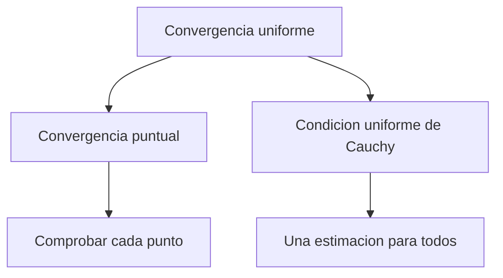

# 10. Sucesiones y series de funciones

[← 9. Integrales impropias y aplicaciones](09-improper-integrals-applications.md) · [Índice](index.md) · [Términos y teoremas](term-index.md) · [11. Series de potencias y funciones analíticas →](11-power-series.md)

> **Objetivo.** Distinguir [convergencia puntual](#sec-10-1) y uniforme y saber cuándo los límites conmutan con las operaciones del análisis.

<a id="sec-10-1"></a>
## 10.1 Dos modos de convergencia

Sean $`f_n,f:E\to\mathbb R`$. La sucesión converge **puntualmente** si

```math
\forall x\in E\;\forall\varepsilon>0\;\exists N\;\forall n\ge N:
|f_n(x)-f(x)|<\varepsilon.
```

Converge **uniformemente** si

```math
\forall\varepsilon>0\;\exists N\;\forall n\ge N\;\forall x\in E:
|f_n(x)-f(x)|<\varepsilon.
```

Equivalentemente, $`\sup_{x\in E}|f_n(x)-f(x)|\to0`$. En convergencia puntual $`N`$ puede depender de $`x`$; en uniforme no.

En $`[0,1]`$, $`f_n(x)=x^n`$ tiende puntualmente a $`0`$ si $`x<1`$ y a $`1`$ si $`x=1`$. El límite es discontinuo, así que la convergencia no puede ser uniforme. En $`[0,r]`$ con $`r<1`$ sí es uniforme porque $`\sup|f_n|=r^n\to0`$.



<a id="sec-10-2"></a>
## 10.2 Criterio uniforme de Cauchy

Una sucesión es uniformemente de Cauchy si para todo $`\varepsilon>0`$ existe $`N`$ tal que

```math
m,n\ge N\implies \sup_{x\in E}|f_n(x)-f_m(x)|<\varepsilon.
```

Para funciones reales, convergencia uniforme y condición uniforme de Cauchy son equivalentes. Es la herramienta principal cuando el límite se desconoce.

Para series $`\sum f_n`$, estas definiciones se aplican a las [sumas parciales](04-numeric-series.md#sec-4-1) $`s_N=\sum_{n=1}^N f_n`$.

> <a id="weierstrass-m-test"></a>**Criterio M de Weierstrass.** Si $`|f_n(x)|\le M_n`$ en $`E`$ y $`\sum M_n<\infty`$, entonces $`\sum f_n`$ converge absoluta y uniformemente en $`E`$.

Se deduce de $`|f_n(x)+\cdots+f_m(x)|\le M_n+\cdots+M_m`$.

<a id="sec-10-3"></a>
## 10.3 Continuidad e integración

> <a id="uniform-limit-continuity"></a>**Teorema de continuidad.** Si cada $`f_n`$ es continua y $`f_n\to f`$ uniformemente, entonces $`f`$ es continua.

La prueba de $`3\varepsilon`$ elige $`n`$ con $`|f_n-f|`$ uniformemente pequeño y después usa la continuidad de esa única $`f_n`$.

> <a id="uniform-limit-integration"></a>**Teorema de integración.** Si las $`f_n`$ son integrables en $`[a,b]`$ y convergen uniformemente a $`f`$, entonces $`f`$ es integrable y
> ```math
> \lim_{n\to\infty}\int_a^b f_n=\int_a^b f.
> ```

Las integrales difieren a lo sumo en $`(b-a)\sup|f_n-f|`$. La convergencia puntual no basta: «picos» triangulares móviles en $`[0,1]`$ pueden tender puntualmente a cero mientras sus integrales siguen siendo uno.

<a id="sec-10-4"></a>
## 10.4 Derivación

La convergencia uniforme de $`f_n`$ no basta para derivar el límite. Un teorema suficiente es:

> Si las $`f_n`$ son [continuamente derivables](15-multivariable-differentiation.md#sec-15-1) en un intervalo acotado $`[a,b]`$, $`f_n(x_0)`$ converge en un punto y $`f_n'\to g`$ uniformemente, entonces $`f_n`$ converge uniformemente en $`[a,b]`$ a una función [derivable](06-derivatives.md#sec-6-1) $`f`$ y $`f'=g`$.

Para series en un intervalo acotado, se deriva término a término cuando la serie derivada converge uniformemente y la original converge en algún punto.

El teorema de Dini ofrece otro caso: en un [compacto](13-metric-spaces.md#sec-13-4), una [sucesión monótona](03-sequences.md#sec-3-3) de funciones continuas que converge puntualmente a un límite continuo converge uniformemente.

## Ejemplo resuelto

Para $`|x|\le r<1`$,

```math
\sum_{n=0}^{\infty}x^n=\frac1{1-x}
```

uniformemente por el criterio M con $`M_n=r^n`$. La derivación está justificada en $`|x|\le r`$ porque $`\sum nx^{n-1}`$ también converge uniformemente. Por tanto

```math
\sum_{n=1}^{\infty}nx^{n-1}=\frac1{(1-x)^2}.
```

Como $`r<1`$ es arbitrario, la identidad vale para todo $`|x|<1`$.

## Errores frecuentes

1. La convergencia puntual no conserva continuidad.
2. El criterio M prueba [convergencia absoluta](04-numeric-series.md#sec-4-3) uniforme, no solo convergencia en puntos elegidos.
3. Para intercambiar derivadas y límites hay que controlar también las derivadas.

## Ejercicios

1. Prueba que $`f_n(x)=x/(1+nx^2)`$ converge uniformemente a cero en $`\mathbb R`$.
2. Decide si $`\sum\sin(nx)/n^2`$ converge uniformemente en $`\mathbb R`$.
3. Da un ejemplo de que la convergencia puntual no conserva las integrales.

<details>
<summary>Respuestas breves</summary>

1. El [supremo](02-real-numbers.md#sec-2-2) de $`|x|/(1+nx^2)`$ es $`1/(2\sqrt n)`$.
2. Sí, por el criterio M con $`M_n=1/n^2`$.
3. Usa un pico triangular en $`(0,1/n)`$ de altura $`2n`$ y área $`1`$; tiende puntualmente a cero.
</details>

---

[← 9. Integrales impropias y aplicaciones](09-improper-integrals-applications.md) · [Índice](index.md) · [Términos y teoremas](term-index.md) · [11. Series de potencias y funciones analíticas →](11-power-series.md)
