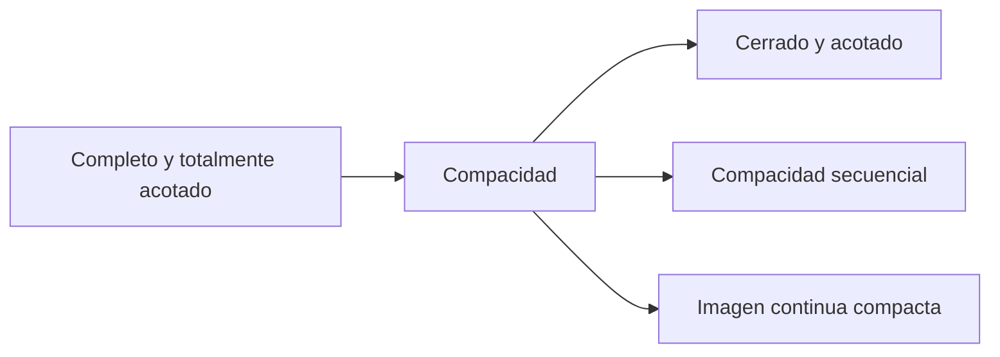

# 13. Espacios métricos, compacidad y completitud

[← 12. Series de Fourier](12-fourier-series.md) · [Índice](index.md) · [Términos y teoremas](term-index.md) · [14. Funciones de varias variables →](14-several-variables.md)

> **Objetivo.** Generalizar el análisis basado en distancias y comprender [compacidad](#sec-13-4) y completitud como propiedades estructurales.

<a id="sec-13-1"></a>
## 13.1 Métricas y ejemplos

Una métrica en $`X`$ es una función $`d:X\times X\to[0,\infty)`$ que cumple

1. $`d(x,y)=0\iff x=y`$;
2. $`d(x,y)=d(y,x)`$;
3. $`d(x,z)\le d(x,y)+d(y,z)`$.

El par $`(X,d)`$ es un espacio métrico. Ejemplos importantes:

```math
d_2(x,y)=\|x-y\|_2\quad\text{en }\mathbb R^n,
```
```math
d_1(x,y)=\sum_{i=1}^{n}|x_i-y_i|,
\qquad
d_\infty(x,y)=\max_i|x_i-y_i|,
```

y la métrica discreta $`d(x,y)=1`$ si $`x\ne y`$. En $`C([a,b])`$, $`d_\infty(f,g)=\max_{x\in[a,b]}|f(x)-g(x)|`$ describe [convergencia uniforme](10-function-sequences-series.md#sec-10-1).

<a id="sec-13-2"></a>
## 13.2 Conjuntos abiertos y cerrados

La bola abierta es $`B_r(x)=\{y\in X:d(x,y)<r\}`$. Un conjunto $`U`$ es **abierto** si cada $`x\in U`$ tiene una bola $`B_r(x)\subseteq U`$. Un conjunto es **cerrado** si su complemento es abierto.

Uniones arbitrarias e intersecciones finitas de abiertos son abiertas. Intersecciones arbitrarias y uniones finitas de cerrados son cerradas.

El interior $`A^\circ`$ es el mayor abierto contenido en $`A`$. La clausura $`\overline A`$ es el menor cerrado que contiene $`A`$, y

```math
x\in\overline A\iff \forall r>0\;B_r(x)\cap A\ne\varnothing.
```

La frontera es $`\partial A=\overline A\setminus A^\circ`$. Un conjunto $`A`$ es denso en $`X`$ si $`\overline A=X`$; por ejemplo, $`\mathbb Q`$ es denso en $`\mathbb R`$.

<a id="sec-13-3"></a>
## 13.3 Convergencia y completitud

Una sucesión $`x_n`$ converge a $`x`$ si $`d(x_n,x)\to0`$. Es de Cauchy si para todo $`\varepsilon>0`$ existe $`N`$ tal que $`d(x_m,x_n)<\varepsilon`$ para $`m,n\ge N`$.

Un [espacio métrico](#sec-13-1) es **completo** si toda [sucesión de Cauchy](03-sequences.md#sec-3-4) converge en él. Los espacios $`\mathbb R^n`$ y $`(C([a,b]),d_\infty)`$ son completos; $`\mathbb Q`$ con su métrica usual no lo es. Un subespacio cerrado de uno completo es completo.

Todo espacio métrico tiene una completación: un espacio completo que contiene una copia isométrica y densa del original. Esto abstrae la construcción de $`\mathbb R`$ a partir de $`\mathbb Q`$.

<a id="sec-13-4"></a>
## 13.4 Compacidad

Un conjunto $`K`$ es **compacto** si todo recubrimiento abierto tiene un subrecubrimiento finito. En espacios métricos equivale a compacidad secuencial: toda sucesión en $`K`$ tiene una subsucesión convergente en $`K`$.

> <a id="heine-borel-theorem"></a>**Teorema de Heine–Borel.** En $`\mathbb R^n`$, un conjunto es compacto exactamente cuando es cerrado y acotado.

En espacios métricos generales, cerrado y acotado no basta. La caracterización general es completo y totalmente acotado: para todo $`\varepsilon>0`$ se puede cubrir con finitas bolas de radio $`\varepsilon`$.

Los compactos son cerrados y acotados. La imagen continua de un compacto es compacta, lo que da el [teorema de Weierstrass](05-limits-continuity.md#extreme-value-theorem). Un compacto en un espacio de Hausdorff, y por tanto métrico, es cerrado.



<a id="sec-13-5"></a>
## 13.5 Continuidad y conexión

Para $`f:X\to Y`$, continuidad en $`a`$ significa

```math
\forall\varepsilon>0\;\exists\delta>0:
d_X(x,a)<\delta\implies d_Y(f(x),f(a))<\varepsilon.
```

Globalmente, $`f`$ es continua exactamente cuando $`f^{-1}(V)`$ es abierto para todo abierto $`V\subseteq Y`$. Las funciones continuas en compactos son [uniformemente continuas](05-limits-continuity.md#sec-5-4).

Un espacio es **conexo** si no puede dividirse en dos abiertos no vacíos y disjuntos. Los subconjuntos conexos de $`\mathbb R`$ son exactamente los intervalos. Las imágenes continuas de conexos son conexas, lo que da el valor intermedio.

> <a id="baire-category-theorem"></a>**Teorema de Baire.** En un [espacio métrico completo](#sec-13-3), una intersección [numerable](01-logic-sets-functions.md#sec-1-5) de abiertos densos es densa. Es una herramienta importante de existencia.

## Ejemplo resuelto

En la métrica discreta, $`B_{1/2}(x)=\{x\}`$, así que todo subconjunto es abierto y cerrado. Una sucesión converge exactamente cuando es finalmente constante. El espacio es completo, pero uno discreto infinito no es compacto: el recubrimiento por singletes no tiene subrecubrimiento finito.

## Errores frecuentes

1. Un conjunto puede ser abierto y cerrado a la vez.
2. La completitud depende de la métrica y del espacio ambiente.
3. Cerrado y acotado implica compacto en $`\mathbb R^n`$, no en todo espacio métrico.

## Ejercicios

1. Describe la convergencia en un espacio métrico discreto.
2. Halla interior, [clausura](#sec-13-2) y frontera de $`(0,1)`$ en $`\mathbb R`$.
3. Prueba que un espacio métrico compacto está acotado.

<details>
<summary>Respuestas breves</summary>

1. Convergen exactamente las sucesiones finalmente constantes.
2. Interior $`(0,1)`$, clausura $`[0,1]`$, frontera $`\{0,1\}`$.
3. Cubre el espacio con bolas $`B_n(x_0)`$ de radios enteros y extrae un subrecubrimiento finito.
</details>

---

[← 12. Series de Fourier](12-fourier-series.md) · [Índice](index.md) · [Términos y teoremas](term-index.md) · [14. Funciones de varias variables →](14-several-variables.md)
