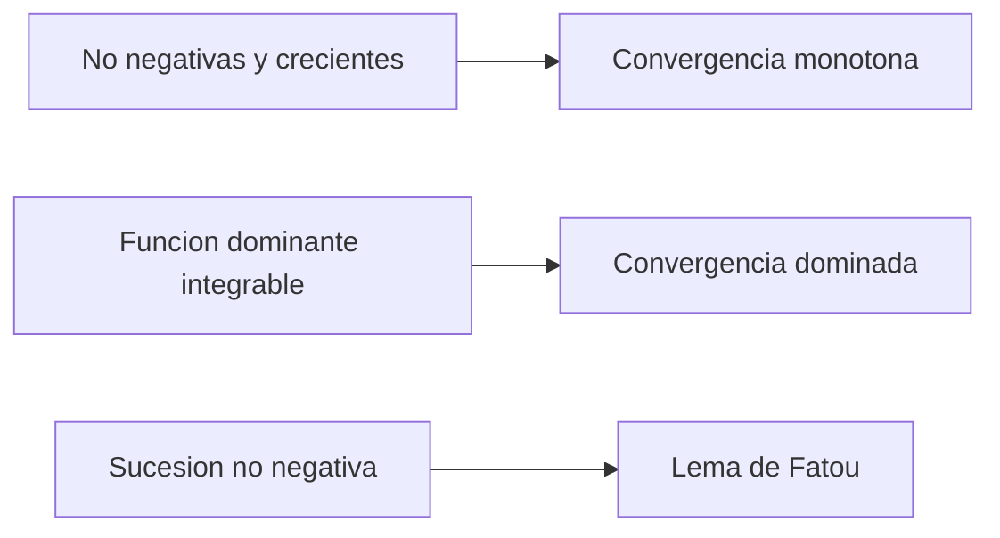

# 20. Integración de Lebesgue y teoremas de convergencia

[← 19. Teoría de la medida y funciones medibles](19-measure-theory.md) · [Índice](index.md) · [Términos y teoremas](term-index.md) · [21. Espacios Lp y modos de convergencia →](21-lp-spaces.md)

> **Objetivo.** Definir la [integral de Lebesgue](#sec-20-1) y aplicar los teoremas de límite que la hacen más flexible que la de Riemann.

<a id="sec-20-1"></a>
## 20.1 Construcción de la integral

Para una [función simple](19-measure-theory.md#sec-19-4) no negativa $`\varphi=\sum_{k=1}^{m}a_k1_{A_k}`$, definimos

```math
\int_X\varphi\,d\mu=\sum_{k=1}^{m}a_k\mu(A_k),
```

con $`0\cdot\infty=0`$. Para una $`f\ge0`$ medible general,

```math
\int_X f\,d\mu
=\sup\left\{\int_X\varphi\,d\mu:
0\le\varphi\le f,\ \varphi\text{ simple}\right\}.
```

El valor puede ser $`+\infty`$. Escribimos $`f^+=\max(f,0)`$ y $`f^-=\max(-f,0)`$, de modo que $`f=f^+-f^-`$ y $`|f|=f^++f^-`$. Una $`f`$ medible es **integrable**, $`f\in L^1(\mu)`$, si

```math
\int_X|f|\,d\mu<\infty,
```

y entonces $`\int f\,d\mu=\int f^+\,d\mu-\int f^-\,d\mu`$.

La integral es lineal y monótona. Cambiar una función en un conjunto nulo no altera su integral. Si $`f`$ es integrable, es finita casi en todas partes, y

```math
\left|\int_Xf\,d\mu\right|\le\int_X|f|\,d\mu.
```

<a id="sec-20-2"></a>
## 20.2 Los tres teoremas fundamentales de límite

> <a id="lebesgue-monotone-convergence-theorem"></a>**Teorema de convergencia monótona.** Si $`0\le f_n\uparrow f`$ casi en todas partes, entonces
> ```math
> \int_Xf_n\,d\mu\uparrow\int_Xf\,d\mu,
> ```
> incluyendo la posibilidad de límite infinito.

> <a id="fatou-lemma"></a>**Lema de Fatou.** Para $`f_n\ge0`$ medibles,
> ```math
> \int_X\liminf_{n\to\infty}f_n\,d\mu
> \le\liminf_{n\to\infty}\int_Xf_n\,d\mu.
> ```

> <a id="dominated-convergence-theorem"></a>**Teorema de convergencia dominada.** Si funciones medibles $`f_n\to f`$ c.t.p. y $`|f_n|\le g`$ para una $`g`$ integrable, entonces
> ```math
> \lim_{n\to\infty}\int_X|f_n-f|\,d\mu=0,
> \qquad
> \lim_{n\to\infty}\int_Xf_n\,d\mu=\int_Xf\,d\mu.
> ```

La dominación es crucial. Las funciones $`n1_{(0,1/n)}`$ tienden puntualmente a cero en $`(0,1)`$, pero todas tienen integral $`1`$. No están acotadas por una única función integrable independiente de $`n`$.



<a id="sec-20-3"></a>
## 20.3 Relación con la integral de Riemann

Una función acotada e integrable Riemann en $`[a,b]`$ es integrable Lebesgue y ambas integrales coinciden. Lebesgue también admite funciones muy discontinuas: $`\int_{[0,1]}1_{\mathbb Q}\,d\lambda=0`$.

Una [integral impropia](09-improper-integrals-applications.md#sec-9-1) de Riemann absolutamente convergente da una integral de Lebesgue con el mismo valor. Una impropia [condicionalmente convergente](04-numeric-series.md#sec-4-3), como $`\int_1^\infty\sin x/x\,dx`$, **no** define una integral de Lebesgue finita en todo el intervalo porque $`\int|\sin x|/x=\infty`$.

<a id="sec-20-4"></a>
## 20.4 Medidas producto y Fubini–Tonelli

Dados [espacios de medida](19-measure-theory.md#sec-19-2) $`\sigma`$-finitos, se construye $`\mu\times\nu`$ con $`(\mu\times\nu)(A\times B)=\mu(A)\nu(B)`$.

- **Tonelli:** para $`f\ge0`$ medible, la integral producto y ambas iteradas son iguales, posiblemente infinitas.
- **Fubini:** si $`\int|f|\,d(\mu\times\nu)<\infty`$, ambas iteradas existen y son iguales a la integral producto.

Sin no negatividad o integrabilidad absoluta, las iteradas pueden diferir o no existir. La $`\sigma`$-finitud cubre $`\mathbb R^n`$ con [medida de Lebesgue](19-measure-theory.md#sec-19-3) y la mayoría de aplicaciones habituales.

## Ejemplo resuelto

Calculamos $`\int_0^1x^{-1/2}\,dx`$. Sea

```math
f_n(x)=x^{-1/2}1_{(1/n,1)}(x).
```

Estas funciones crecen hacia $`x^{-1/2}`$ para $`0<x<1`$. La convergencia monótona da

```math
\int_0^1x^{-1/2}\,dx
=\lim_{n\to\infty}\int_{1/n}^{1}x^{-1/2}\,dx
=\lim_{n\to\infty}2(1-n^{-1/2})=2.
```

## Errores frecuentes

1. La convergencia c.t.p. por sí sola no implica convergencia de integrales.
2. La convergencia impropia condicional no es integrabilidad absoluta de Lebesgue.
3. Fubini exige integrabilidad absoluta; Tonelli, no negatividad.

## Ejercicios

1. Calcula $`\int_{[0,1]}1_{\mathbb Q}\,d\lambda`$.
2. Aplica [convergencia dominada](#dominated-convergence-theorem) a $`\lim_n\int_0^1\frac{1+nx}{n(1+x^2)}\,dx`$.
3. Da un ejemplo de desigualdad estricta en Fatou.

<details>
<summary>Respuestas breves</summary>

1. Es cero porque $`\mathbb Q\cap[0,1]`$ es nulo.
2. Los integrandos están acotados por $`2`$ para $`n\ge1`$ y tienden a $`x/(1+x^2)`$; el límite es $`\frac12\log2`$. La constante $`2`$ es integrable en el intervalo finito.
3. Para $`f_n=n1_{(0,1/n)}`$, el límite puntual es cero c.t.p.; el lado izquierdo es $`0`$ y el derecho $`1`$.
</details>

---

[← 19. Teoría de la medida y funciones medibles](19-measure-theory.md) · [Índice](index.md) · [Términos y teoremas](term-index.md) · [21. Espacios Lp y modos de convergencia →](21-lp-spaces.md)
