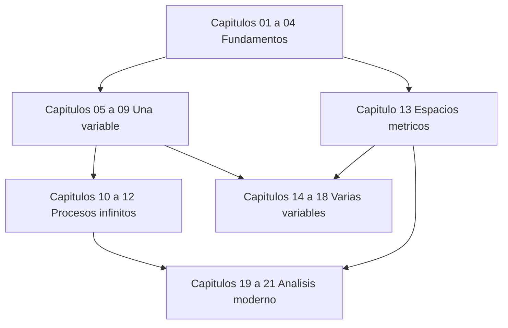

# Análisis matemático

[English](../en/index.md) · [Русский](../ru/index.md) · **Español**

Un curso riguroso desde los fundamentos hasta la integración moderna, en 21 capítulos. Léelo aquí en GitHub o abre `MathInMind-Obsidian/` como vault de Obsidian para tener wikienlaces, vista previa al pasar el ratón y recuadros de teoremas; [la guía de ambas vistas](00-notation.md) explica la diferencia.

## Material de apoyo

- [Índice de términos y teoremas](term-index.md) — cada definición y resultado, a un clic de su enunciado.
- [Cómo leer el curso: vistas y notación](00-notation.md)
- [Hoja de fórmulas](formula-sheet.md)
- [Glosario trilingüe](glossary.md)
- [Libros y colecciones de problemas recomendados](../../REFERENCES.md)

## Lecciones ilustradas 2025/26

- [Índice de todas las lecciones 0–64](lectures-2025-26/index.md): transcripciones completas de las lecciones 2025/26, originales en ruso con traducciones al inglés y al español, incluidas las demostraciones manuscritas y las figuras.
- **Semestre 1:** lecciones 0–32. **Semestre 2:** lecciones 33–64. El semestre 2 se solapa con el [registro ruso `ru/lectures/`](../ru/lectures/index.md), orientado al examen; cada lección enlaza con la sección correspondiente del registro.
- El origen de cada figura (PDF, página y recorte) se registra por lotes en [`assets/lectures-2025-26/`](../assets/lectures-2025-26/).

## Mapa del curso

## Parte I — Fundamentos

1. [Lógica, conjuntos y funciones](01-logic-sets-functions.md) — cuantificadores, demostraciones, cardinalidad.
2. [Los números reales y la completitud](02-real-numbers.md) — supremo, propiedad arquimediana, densidad.
3. [Sucesiones y límites](03-sequences.md) — criterios de monotonía y Cauchy, subsucesiones.
4. [Series numéricas](04-numeric-series.md) — criterios, convergencia absoluta y condicional.

## Parte II — Cálculo de una variable

5. [Límites y continuidad](05-limits-continuity.md) — límites funcionales, valores intermedios, continuidad uniforme.
6. [Derivación](06-derivatives.md) — aproximación lineal, regla de la cadena, funciones inversas.
7. [Teoremas del valor medio, Taylor y convexidad](07-taylor-convexity.md).
8. [La integral de Riemann](08-riemann-integration.md) — sumas de Darboux, teorema fundamental, técnicas.
9. [Integrales impropias y aplicaciones](09-improper-integrals-applications.md) — convergencia, área, longitud, volumen, trabajo.

## Parte III — Procesos infinitos

10. [Sucesiones y series de funciones](10-function-sequences-series.md) — convergencia uniforme e intercambio de operaciones.
11. [Series de potencias y funciones analíticas](11-power-series.md) — radio, cálculo término a término, series de Taylor.
12. [Series de Fourier](12-fourier-series.md) — ortogonalidad, convergencia puntual y cuadrática media.

## Parte IV — Varias variables y topología

13. [Espacios métricos, compacidad y completitud](13-metric-spaces.md).
14. [Funciones de varias variables](14-several-variables.md) — límites conjuntos, continuidad, dominios compactos.
15. [Derivación multivariable](15-multivariable-differentiation.md) — jacobiana, gradiente, hessiana.
16. [Funciones inversas e implícitas; extremos](16-implicit-functions-extrema.md) — teoremas locales y multiplicadores de Lagrange.

## Parte V — Integración en varias variables

17. [Integrales múltiples y cambio de variables](17-multiple-integrals.md) — Fubini, coordenadas polares y esféricas.
18. [Cálculo vectorial y teoremas integrales](18-vector-calculus.md) — línea y superficie, Green, Stokes, Gauss.

## Parte VI — Análisis moderno

19. [Teoría de la medida y funciones medibles](19-measure-theory.md).
20. [Integración de Lebesgue y teoremas de convergencia](20-lebesgue-integration.md).
21. [Espacios $`L^p`$ y modos de convergencia](21-lp-spaces.md) — Hölder, completitud, geometría de Hilbert.

## Rutina de estudio sugerida

1. Lee los objetivos y reproduce cada definición sin mirar.
2. Trabaja los ejemplos e identifica dónde se usa cada hipótesis.
3. Intenta los ejercicios antes de abrir las respuestas.
4. Lleva un registro personal de errores y enlázalo con los capítulos.
5. Repasa con la hoja de fórmulas solo después de entender las deducciones; no sustituye la teoría.

Para un primer curso, estudia los capítulos 1–12 y 14–18, consultando el 13 cuando sea necesario. Para un segundo curso, repasa los resúmenes y concéntrate en los capítulos 13 y 19–21. El archivo de lecciones original se documenta en las [notas de fuentes](../../source/README.md).
