# Análisis Matemático, lecciones 2025/26

[Русский](../../ru/lectures-2025-26/index.md) · [English](../../en/lectures-2025-26/index.md) · **Español**

Estos apuntes se han transcrito a partir de los archivos PDF de las lecciones de D. E. Apushkinskaya (Universidad RUDN). Las diapositivas impresas se extrajeron de la capa de texto del PDF, las páginas manuscritas se transcribieron a partir de su imagen, y las figuras se incluyen como ilustraciones. Las fórmulas usan LaTeX (MathJax) y los diagramas, Mermaid; ambos funcionan en Obsidian y en GitHub.

| Lección | Fecha | Contenido | Archivo | PDF original |
|---|---|---|---|---|
| 0 | 1 sep 2025 | Conjuntos, inclusión, lógica matemática, operaciones, leyes de De Morgan | [lecture-00.md](lecture-00.md) | `МА2526_лекция_0.pdf` |
| 1–2 | 4 sep 2025 | Aplicaciones, inyección, sobreyección, biyección, cardinal, conjuntos numerables | [lecture-01-02.md](lecture-01-02.md) | `ma25_26-lectures_1-2_notes.pdf` |
| 3 | 11 sep 2025 | Conjuntos a lo sumo numerables, no numerabilidad, el continuo | [lecture-03.md](lecture-03.md) | `ма25_26_лекция_3_notes.pdf` |
| 4 | 11 sep 2025 | Axiomas de cuerpo y de orden de los números reales | [lecture-04.md](lecture-04.md) | `ма25_26_лекция_4_notes.pdf` |
| 5–6 | — | Intervalos, recta real extendida, axiomas de Arquímedes y de Cantor, inducción, binomio, sup e inf | [lecture-05-06.md](lecture-05-06.md) | `ma25_26-lectures_5-6_notes.pdf` |
| 7 | — | Máximo y mínimo de un conjunto finito, parte entera, densidad de ℚ en ℝ | [lecture-07.md](lecture-07.md) | `ma25_26_лекция_7_notes.pdf` |
| 8 | — | Límite de una sucesión: definición, unicidad, acotación, paso al límite, teorema del emparedado | [lecture-08.md](lecture-08.md) | `ма25_26_лекция_8_notes.pdf` |
| 9–10 | 2 oct 2025 | Sucesiones infinitésimas e infinitamente grandes, aritmética de límites, indeterminaciones | [lecture-09-10.md](lecture-09-10.md) | `ma25_26-lectures_9-10_notes.pdf` |
| 11–12 | 9 oct 2025 | Cotas exactas, sucesiones monótonas, número e, subsucesiones, teorema de Bolzano–Weierstrass | [lecture-11-12.md](lecture-11-12.md) | `ma25_26-lectures_11-12_notes.pdf` |
| 13 | 16 oct 2025 | Límites superior e inferior, sucesiones fundamentales, criterio de Bolzano–Cauchy | [lecture-13.md](lecture-13.md) | `ma25_26_лекция_13_notes.pdf` |
| 14 | 16 oct 2025 | Puntos de acumulación y puntos aislados, límite de una función por Cauchy y por Heine, unicidad, acotación local | [lecture-14.md](lecture-14.md) | `ма25_26_лекция_14_notes.pdf` |
| 15 | 23 oct 2025 | Conservación del signo, aritmética de límites de funciones, composición, límites laterales, funciones monótonas, criterio de Cauchy para funciones | [lecture-15.md](lecture-15.md) | `ма25_26_лекция_15_notes_pdf.pdf` |
| 16 | 23 oct 2025 | Continuidad en un punto (5 formas), discontinuidades de 1.ª y 2.ª especie, discontinuidad evitable, funciones de Dirichlet y de Riemann, C(D) | [lecture-16.md](lecture-16.md) | `ма25_26_лекция_16_notes.pdf` |
| 17–18 | 30 oct 2025 | Aritmética y composición de funciones continuas, teorema de Weierstrass, continuidad uniforme, teoremas de Cantor y de Bolzano–Cauchy | [lecture-17-18.md](lecture-17-18.md) | `ma25_26-lectures_17-18_notes.pdf` |
| 19–20 | 6 nov 2025 | Funciones monótonas y función inversa, los cinco límites notables | [lecture-19-20.md](lecture-19-20.md) | `ma25_26-lectures_19-20_notes.pdf` |
| 21 | 13 nov 2025 | Comparación de funciones: O, o, equivalencia; asíntotas verticales, oblicuas y horizontales | [lecture-21.md](lecture-21.md) | `ma25_26_lecture_21_notes.pdf` |
| 22–23 | 13 nov 2025 | Derivada y diferenciabilidad, criterio de diferenciabilidad, la tangente como límite de secantes, reglas de derivación, regla de la cadena | [lecture-22-23.md](lecture-22-23.md) | `ma25_26_lectures_22-23_notes.pdf` |
| 24–25–26 | 20 nov 2025 | Derivada de la función inversa, diferencial, derivadas de las funciones elementales, teoremas de Fermat, Rolle, Lagrange y Cauchy, regla de L'Hôpital | [lecture-24-25-26.md](lecture-24-25-26.md) | `ma25_26-lectures_24-25-26_notes.pdf` |
| 27–28 | 4 dic 2025 | Derivadas y diferenciales de orden superior, la escala C^k, fórmula de Leibniz, polinomio de Taylor, fórmula de Taylor–Peano | [lecture-27-28.md](lecture-27-28.md) | `ma25_26-lectures_27-28_notes.pdf` |
| 29–30 | 11 dic 2025 | Fórmula de Taylor–Lagrange, desarrollos de Taylor–Peano de las funciones elementales, estimación del resto, criterio de monotonía, extremos | [lecture-29-30.md](lecture-29-30.md) | `ma25_26-lectures_29-30_notes.pdf` |

Las figuras extraídas de las páginas manuscritas están en la carpeta común [`../../assets/lectures-2025-26/`](../../assets/lectures-2025-26/).

## Convenciones

- Los números de definiciones, teoremas y corolarios se conservan tal como aparecen en las diapositivas originales. En las lecciones 5–6 la etiqueta «Definición 1.3.5» aparece tres veces; véase la nota en el archivo.
- Las páginas manuscritas llevan el encabezado «Página manuscrita N (p. PDF N)».
- Las notas del editor se presentan como citas y comienzan con «Nota del editor» u «Observación».

```mermaid
flowchart LR
    A["Lección 0: conjuntos"] --> B["Lecciones 1–2: aplicaciones y numerabilidad"]
    B --> C["Lección 3: conjuntos a lo sumo numerables y el continuo"]
    C --> D["Lección 4: axiomas de los números reales"]
    D --> E["Lecciones 5–6: axiomas de completitud, inducción, binomio"]
    E --> F["Lección 7: máximo, mínimo, densidad de ℚ"]
    F --> G["Lección 8: límite de una sucesión"]
    G --> H["Lecciones 9–10: infinitésimos e infinitos"]
    H --> I["Lecciones 11–12: cotas exactas, sucesiones monótonas"]
    I --> J["Lección 13: límites superior e inferior, criterio de Cauchy"]
    J --> K["Lección 14: límite de una función por Cauchy y Heine"]
    K --> L["Lección 15: límites laterales, funciones monótonas"]
    L --> M["Lección 16: continuidad y discontinuidades"]
    M --> N["Lecciones 17–18: Weierstrass, Cantor, Bolzano–Cauchy"]
    N --> O["Lecciones 19–20: funciones monótonas, límites notables"]
    O --> P["Lección 21: O, o, equivalencia, asíntotas"]
    P --> Q["Lecciones 22–23: derivada y reglas de derivación"]
```

