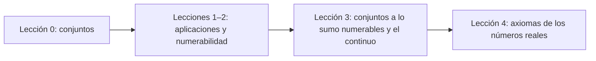

# Análisis Matemático, lecciones 2025/26

[Русский](../../ru/lectures-2025-26/index.md) · [English](../../en/lectures-2025-26/index.md) · **Español**

Estos apuntes se transcriben de los archivos PDF de las lecciones de D. E. Apushkinskaya (Universidad RUDN). Las diapositivas impresas se extrajeron de la capa de texto del PDF, las páginas manuscritas se transcribieron a partir de sus imágenes y las figuras se incluyen como ilustraciones. Las fórmulas usan LaTeX (MathJax) y los diagramas, Mermaid; ambos funcionan en Obsidian y en GitHub.

| Lección | Fecha | Contenido | Archivo | PDF fuente |
|---|---|---|---|---|
| 0 | 1 sep 2025 | Conjuntos, inclusión, lógica matemática, operaciones, leyes de De Morgan | [lecture-00.md](lecture-00.md) | `МА2526_лекция_0.pdf` |
| 1–2 | 4 sep 2025 | Aplicaciones, inyección, sobreyección, biyección, cardinalidad, conjuntos numerables | [lecture-01-02.md](lecture-01-02.md) | `ma25_26-lectures_1-2_notes.pdf` |
| 3 | 11 sep 2025 | Conjuntos a lo sumo numerables, no numerabilidad, el continuo | [lecture-03.md](lecture-03.md) | `ма25_26_лекция_3_notes.pdf` |
| 4 | 11 sep 2025 | Axiomas de cuerpo y de orden de los números reales | [lecture-04.md](lecture-04.md) | `ма25_26_лекция_4_notes.pdf` |

Las ilustraciones tomadas de las páginas manuscritas están en la carpeta común [`../../assets/lectures-2025-26/`](../../assets/lectures-2025-26/).

## Convenciones

- Los números de definiciones, teoremas y corolarios se conservan tal como aparecen en las diapositivas originales.
- Las páginas manuscritas se identifican como «Página manuscrita N (p. N del PDF)».
- Las notas del editor se presentan como citas y empiezan por «Nota» o «Aclaración».
- La versión en español sigue al texto ruso, que es la referencia.

