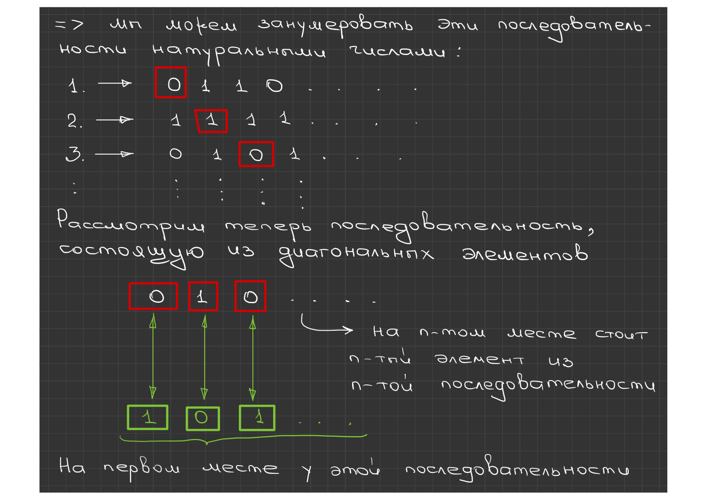
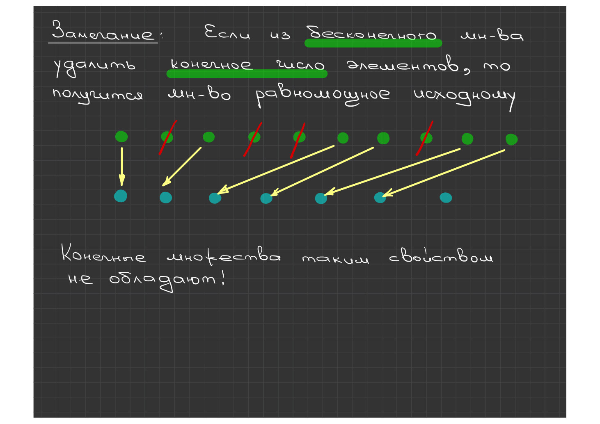
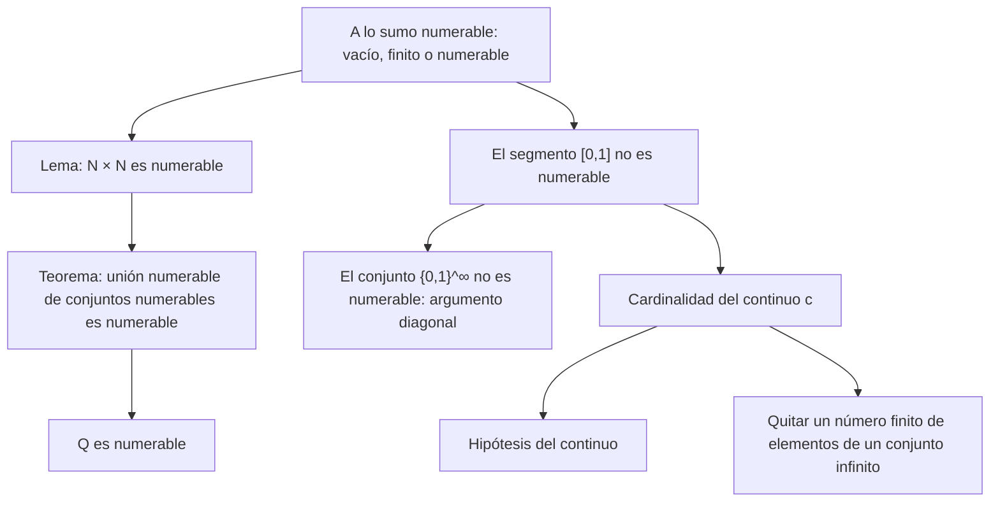

# Lección 3 — Conjuntos a lo sumo numerables y el continuo

[Índice de lecciones](index.md) · [Русский](../../ru/lectures-2025-26/lecture-03.md) · [English](../../en/lectures-2025-26/lecture-03.md)

> **Fuente:** `ма25_26_лекция_3_notes.pdf` — 17 páginas: 9 diapositivas impresas con capa de texto y 8 páginas manuscritas. Las figuras de las páginas manuscritas 5, 12 y 17 se incluyen como ilustraciones. Los números de página del PDF aparecen en los encabezados.

## Diapositiva 2. Cita del día

> «Haz lo que debas, y sea lo que sea.»
>
> — Marco Aurelio

## Diapositiva 3. Objetivo de la lección

- Discutiremos los conjuntos a lo sumo numerables.
- Daremos ejemplos de conjuntos numerables y no numerables.
- Hablaremos de la hipótesis del continuo y de la cardinalidad de los conjuntos. una serie de axiomas del cuerpo de los números reales (axiomas de cuerpo, de orden y de completitud).

## §2. Cardinalidad. Conjuntos numerables y no numerables

### Diapositiva 4. Conjuntos a lo sumo numerables

**Definición 1.2.6.** Un conjunto vacío, finito o numerable se llama a lo sumo numerable.

**Teorema 1.2.3.** Una unión a lo sumo numerable de conjuntos a lo sumo numerables es a lo sumo numerable.

**Lema 1.2.1.** El conjunto $\mathbb{N} \times \mathbb{N}$ es numerable.

### Página manuscrita 5 (p. 5 del PDF). Demostración del lema 1.2.1

Escribamos el conjunto $\mathbb{N} \times \mathbb{N}$ como una tabla infinita en ambas direcciones (una matriz):

$$
\begin{array}{ccccccc}
11 & 12 & 13 & 14 & 15 & 16 & \dots \\
21 & 22 & 23 & 24 & 25 & 26 & \dots \\
31 & 32 & 33 & 34 & 35 & 36 & \dots \\
\vdots & \vdots & \vdots & \vdots & \vdots & \vdots &
\end{array}
$$

Los elementos de $\mathbb{N} \times \mathbb{N}$ pueden numerarse «por diagonales»:

$$
\{\,11,\ 12,\ 21,\ 31,\ 22,\ 13,\ 14,\ 23,\ 32,\ \dots\,\},
$$

o «por cuadrados»:

$$
\{\,11,\ 12,\ 22,\ 21,\ 31,\ 32,\ 33,\ 23,\ 13,\ 14,\ 24,\ \dots\,\}.
$$

### Página manuscrita 6 (p. 6 del PDF). Continuación del lema y demostración del teorema 1.2.3

Dicho de otro modo, se ha dado una biyección entre $\mathbb{N} \times \mathbb{N}$ y $\mathbb{N}$. Con esto queda demostrado que $\mathbb{N} \times \mathbb{N}$ es numerable.

**Demostración (teorema 1.2.3).** Sea $B = \bigcup_{k=1}^{n} A_k$ o $B = \bigcup_{k=1}^{\infty} A_k$, donde los conjuntos $A_k$ son a lo sumo numerables. Escribamos los elementos de $A_1$ en la primera fila de la matriz, los elementos de $A_2 \setminus A_1$ en la segunda fila, y así sucesivamente; es decir, si se da el conjunto $A_k$, los elementos

$$
A_k \setminus \bigcup_{j=1}^{k-1} A_j
$$

se escriben en la $k$-ésima fila de la matriz.

Así, todos los elementos de $B$ quedan escritos en las casillas de la matriz (aunque algunas casillas pueden quedar vacías).

### Página manuscrita 7 (p. 7 del PDF). Final de la demostración del teorema 1.2.3

Por tanto, $B$ es equipotente a algún subconjunto del conjunto numerable (por el lema 1.2.1) $\mathbb{N} \times \mathbb{N}$. Por el teorema 1.2.2, el conjunto $B$ es a lo sumo numerable.

### Diapositiva 8. Ejemplos de conjuntos numerables

**Teorema 1.2.4.** El conjunto $\mathbb{Q}$ es numerable.

**Corolario 1.2.1.** Si $a, b \in \mathbb{R}$ y $a < b$, entonces $\mathbb{Q} \cap (a, b)$ es numerable.

### Página manuscrita 9 (p. 9 del PDF). Demostración del teorema 1.2.4

Introduzcamos la notación:

$$
\mathbb{Q}_+ = \{\, x \in \mathbb{Q} : x > 0 \,\}, \qquad \mathbb{Q}_- = \{\, x \in \mathbb{Q} : x < 0 \,\}, \qquad \mathbb{Q} = \mathbb{Q}_+ \cup \mathbb{Q}_- \cup \{0\}.
$$

$$
\forall\, q \in \mathbb{N} \ \mapsto\ \mathbb{Q}_q = \left\{ \frac{1}{q}, \frac{2}{q}, \frac{3}{q}, \frac{4}{q}, \dots \right\} \quad \text{— conjunto numerable.}
$$

$$
\mathbb{Q}_+ = \bigcup_{q=1}^{\infty} \mathbb{Q}_q \quad \text{— conjunto numerable (por el teorema 1.2.3).}
$$

$\mathbb{Q}_-$ se trata de forma análoga y también es numerable. Por lo tanto, $\mathbb{Q} = \mathbb{Q}_+ \cup \mathbb{Q}_- \cup \{0\}$ también es numerable (por el teorema 1.2.3).

### Diapositiva 10. Ejemplos de conjuntos no numerables

Hasta ahora no hemos dado ni un solo ejemplo de conjunto infinito del que se haya demostrado que no es numerable (tales conjuntos se llaman no numerables).

**Teorema 1.2.5.** El segmento $[0, 1]$ es no numerable.

**Corolario 1.2.2.** Los conjuntos $\mathbb{R}$ y $\mathbb{R} \setminus \mathbb{Q}$ son no numerables.

### Páginas manuscritas 11–13 (pp. 11–13 del PDF). Ejemplo de Cantor (un conjunto no numerable)

**Ejemplo de Cantor.** Consideremos el conjunto de todas las sucesiones infinitas de $0$ y $1$:

$$
\{0, 1\}^{\infty}.
$$

**Afirmación.** El conjunto $\{0,1\}^{\infty}$ no es numerable.

**Demostración (por reducción al absurdo).** Hacemos una suposición $\Rightarrow$ deducciones lógicas $\Rightarrow$ un absurdo (una contradicción) $\Rightarrow$ esto muestra que la suposición inicial es falsa.

Supongamos que el conjunto $\{0,1\}^{\infty}$ es numerable. Entonces podemos numerar estas sucesiones con números naturales:

1. $\to\ 0\ 1\ 1\ 0\ \dots$
2. $\to\ 1\ 1\ 1\ 1\ \dots$
3. $\to\ 0\ 1\ 0\ 1\ \dots$
4. $\vdots$

Consideremos ahora la sucesión formada por los elementos diagonales: $0\ 1\ 0\ \dots$. En el $n$-ésimo lugar está el $n$-ésimo elemento de la $n$-ésima sucesión.

Construyamos la «sucesión verde» (en la figura se escribe debajo de la tabla de elementos diagonales): en cada lugar $n$ se pone un elemento distinto del $n$-ésimo elemento de la $n$-ésima sucesión.

> **Aclaración del editor:** «distinto» significa aquí lo contrario de $0$ o de $1$; en la figura, la sucesión verde es $1\ 0\ 1\ \dots$.

En el primer lugar, esta sucesión tiene algo distinto de lo que tiene la 1.ª sucesión; en el segundo lugar, algo distinto de la 2.ª sucesión; …; en el $n$-ésimo lugar, algo distinto de la $n$-ésima sucesión; …

¿Podría la «sucesión verde» ser la $k$-ésima sucesión de la lista numerada? No, porque en el $k$-ésimo lugar la «sucesión verde» tiene algo distinto de lo que tiene la $k$-ésima sucesión.

Es decir, no hemos contado la «sucesión verde», ¡lo que es una contradicción!

Por tanto, nuestra suposición es falsa, y el conjunto $\{0,1\}^{\infty}$ es no numerable.

### Diapositiva 14. Cardinalidad del continuo

**Definición 1.2.7.** Si un conjunto es equivalente al segmento $[0, 1]$, se dice que tiene la cardinalidad del continuo.

Señalemos, sin demostración, algunos hechos más sobre la cardinalidad de los conjuntos:

1. Todo segmento no degenerado y, en particular, toda la recta $\mathbb{R}$ tiene la cardinalidad del continuo. Más aún, para cualquier $m \in \mathbb{N}$ el conjunto $\mathbb{R}^m$ tiene la cardinalidad del continuo.
2. El conjunto de todas las funciones $f : [0,1] \to \mathbb{R}$ es «más rico» en elementos que el segmento $[0,1]$: no es equipotente al segmento, pero contiene una parte equipotente al segmento.

### Diapositiva 15. Hipótesis del continuo

**Hipótesis del continuo.** Todo subconjunto infinito de $\mathbb{R}$ es equipotente a $\mathbb{N}$ o a $\mathbb{R}$.

1. La hipótesis fue formulada por G. Cantor.
2. En 1934, K. Gödel demostró que la hipótesis del continuo no contradice los demás axiomas de la teoría de conjuntos.
3. En 1964, P. Cohen demostró que su negación tampoco contradice los demás axiomas de la teoría de conjuntos.

### Diapositiva 16. Cardinalidad de un conjunto

Hemos definido la equipotencia de conjuntos sin definir nunca qué es la cardinalidad de un conjunto y sin usar ese concepto.

Para definir la cardinalidad de un conjunto se puede proceder así. Dividamos todos los conjuntos en clases de equivalencia: dos conjuntos pertenecen a la misma clase si son equivalentes. Después llamemos cardinalidad a cada clase.

Usualmente, la cardinalidad de un conjunto de $n$ elementos (la clase de los conjuntos de $n$ elementos) se denota con el número $n$, y la cardinalidad del continuo, con la letra $\mathfrak{c}$.

### Página manuscrita 17 (p. 17 del PDF). Observación

Si de un conjunto infinito se quita un número finito de elementos, el resultado es un conjunto equipotente al original.

**¡Los conjuntos finitos no tienen esta propiedad!**

## Esquema de la lección

