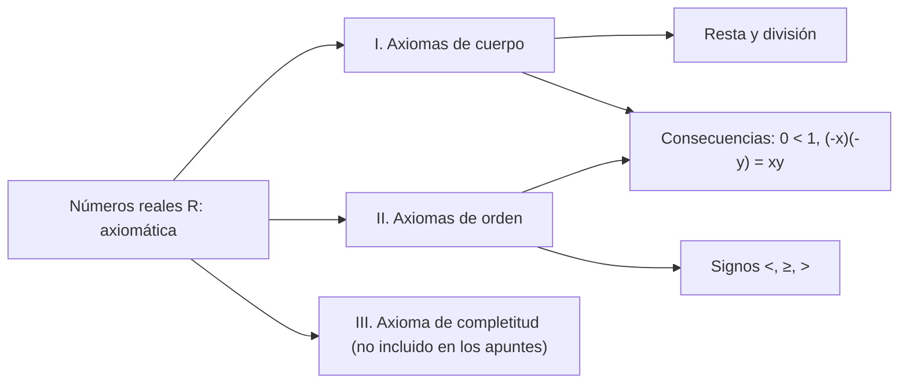

# Lección 4 — Axiomas de los números reales

[Índice de lecciones](index.md) · [Русский](../../ru/lectures-2025-26/lecture-04.md) · [English](../../en/lectures-2025-26/lecture-04.md)

> **Fuente:** `ма25_26_лекция_4_notes.pdf` — 10 páginas: 9 diapositivas impresas con capa de texto y 1 página manuscrita (p. 9). La página manuscrita no tiene figuras.
>
> **Nota sobre la completitud.** El archivo expone los axiomas de cuerpo (I) y de orden (II). El axioma de completitud no aparece en estos apuntes, así que tampoco figura en esta transcripción.

## Diapositiva 2. Cita del día

> «Haz lo que debas, y sea lo que sea.»
>
> — Marco Aurelio

## Diapositiva 3. Objetivo de la lección

- Describiremos una serie de axiomas del cuerpo de los números reales (axiomas de cuerpo, de orden y de completitud).

## §3. Números reales

### Diapositiva 4. Introducción

Probablemente no se conoce una definición precisa de número real. En este párrafo definiremos el conjunto de los números reales de manera axiomática: el conjunto $\mathbb{R}$ se llama conjunto de los números reales si se cumple cierto conjunto de condiciones (axiomas).

Para mayor comodidad, dividiremos los axiomas, que son dieciséis en total, en grupos.

### Diapositiva 5. I. Axiomas de cuerpo (I.1–I.4)

En el conjunto $\mathbb{R}$ están definidas dos operaciones, llamadas suma y multiplicación, que actúan de $\mathbb{R} \times \mathbb{R}$ en $\mathbb{R}$ y satisfacen las siguientes propiedades.

- **I.1** Asociatividad de la suma: $(x + y) + z = x + (y + z)$.
- **I.2** Conmutatividad de la suma: $x + y = y + x$.
- **I.3** Existe un elemento neutro para la suma, $0$, tal que $\forall x \in \mathbb{R}:\ x + 0 = x$.
- **I.4** $\forall x \in \mathbb{R}\ \exists$ un inverso aditivo $\tilde{x} \in \mathbb{R}$ tal que $x + \tilde{x} = 0$. Este elemento se denota por $-x$.

### Diapositiva 6. I. Axiomas de cuerpo (I.5–I.9)

- **I.5** Asociatividad del producto: $(xy)z = x(yz)$.
- **I.6** Conmutatividad del producto: $xy = yx$.
- **I.7** Existe un elemento neutro para el producto, $1$, tal que $\forall x \in \mathbb{R}:\ x \cdot 1 = x$.
- **I.8** $\forall x \in \mathbb{R} \setminus \{0\}\ \exists$ un inverso multiplicativo $x^{-1} \in \mathbb{R}$ tal que $x \cdot x^{-1} = 1$. Este elemento también se denota por $\dfrac{1}{x}$.
- **I.9** Distributividad: $x(y + z) = xy + xz$.

### Diapositiva 7. Cuerpo; resta y división

Un conjunto en el que están definidas dos operaciones que satisfacen las propiedades I.1–I.9 se llama **cuerpo**, y las propias propiedades I.1–I.9 se llaman axiomas de cuerpo.

El axioma I.4 permite definir la resta:

$$
x - y = x + (-y),
$$

y el axioma I.8 permite dividir entre cualquier número distinto de cero:

$$
\frac{x}{y} = x \cdot \frac{1}{y}.
$$

### Diapositiva 8. II. Axiomas de orden

En los elementos de $\mathbb{R}$ está definida una relación $\leq$ con las siguientes propiedades.

- **II.1** $\forall x, y \in \mathbb{R}$ se cumple $x \leq y$ o $y \leq x$.
- **II.2** Transitividad: si $x \leq y$ e $y \leq z$, entonces $x \leq z$.
- **II.3** Si $x \leq y$ e $y \leq x$, entonces $x = y$.
- **II.4** Si $x \leq y$, entonces $x + z \leq y + z$ para todo $z \in \mathbb{R}$.
- **II.5** Si $0 \leq x$ y $0 \leq y$, entonces $0 \leq xy$.

Un cuerpo en el que se ha introducido una relación de orden que satisface II.1–II.5 se llama **cuerpo ordenado**.

### Página manuscrita 9 (p. 9 del PDF). Otros signos de desigualdad

Los demás signos de desigualdad se definen así:

- $a < b$ significa que $a \leq b$ y $a \neq b$;
- $a \geq b$ significa que $b \leq a$;
- $a > b$ significa que $b \leq a$ y $a \neq b$.

### Diapositiva 10. Observación sobre los axiomas de cuerpo y de orden

Los axiomas de cuerpo y de orden son las propiedades habituales de las operaciones aritméticas y de las desigualdades con números reales. Otras propiedades conocidas (por ejemplo, $0 < 1$ o $(-x)(-y) = xy$) son teoremas cuando los números reales se definen axiomáticamente mediante este sistema de axiomas, y pueden deducirse de los axiomas.

## Esquema de la lección

