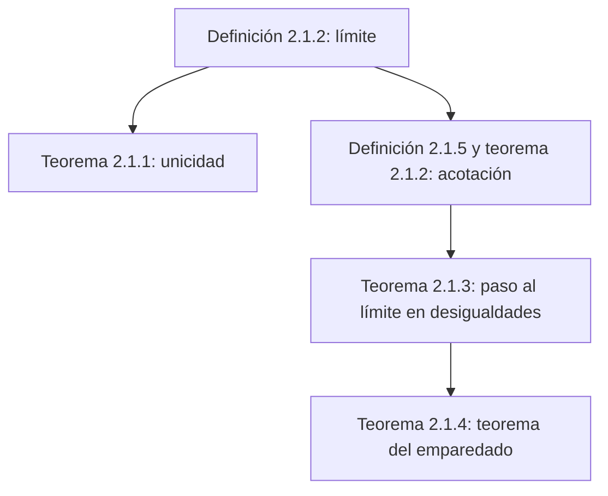

# Lección 8 — Límite de una sucesión

[← Lección 7](lecture-07.md) · [Índice de lecciones](index.md) · [Lecciones 9–10 →](lecture-09-10.md) · [Términos y teoremas](../term-index.md) · [Русский](../../ru/lectures-2025-26/lecture-08.md) · [English](../../en/lectures-2025-26/lecture-08.md)

> **Fuente:** `ма25_26_лекция_8_notes.pdf` — 25 páginas: diapositivas impresas con capa de texto y páginas manuscritas (6–9, 13, 14, 17, 19, 21, 24, 25). Las páginas manuscritas se transcribieron a partir de su imagen. Los números de página del PDF aparecen en los encabezados. La lección no contiene figuras.

## Diapositiva 2. Cita del día

> Todo lo que ocurre, ocurre para bien. Solo que no siempre para el tuyo.

## Diapositiva 3. Objetivo de la lección

- Dar la definición de [límite de una sucesión](#def-2-1-2).
- Demostrar varios resultados sobre límites de sucesiones: unicidad del límite, acotación de las [sucesiones convergentes](#def-2-1-3), paso al límite en desigualdades, [teorema del emparedado](#thm-2-1-4).

## §1. Límite de una sucesión

### Diapositiva 4. Definiciones

<a id="def-2-1-1"></a>**Definición 2.1.1.** Una sucesión numérica es una aplicación del conjunto de los números naturales $`\mathbb{N}`$ en el conjunto de los números reales $`\mathbb{R}`$.

<a id="def-2-1-2"></a>**Definición 2.1.2.** Sea $`\{x_n\}_{n=1}^{\infty}`$ una sucesión de números reales. Un número $`a \in \mathbb{R}`$ se llama **límite** de la sucesión $`\{x_n\}`$, y se escribe

```math
\lim_{n \to \infty} x_n = a \qquad\text{o}\qquad x_n \xrightarrow[n\to\infty]{} a,
```

si para todo número positivo $`\varepsilon`$ existe un número $`N`$ tal que para todos los números $`n`$ mayores que $`N`$ se cumple la desigualdad $`|x_n - a| < \varepsilon`$:

```math
\forall \varepsilon > 0\ \ \exists N \in \mathbb{N}:\ \forall n \in \mathbb{N},\ n > N \ \Rightarrow\ |x_n - a| < \varepsilon.
```

### Diapositiva 5. Convergencia

<a id="def-2-1-3"></a>**Definición 2.1.3.** Una sucesión que tiene algún número como límite se llama **convergente**; en caso contrario (es decir, si ningún número es límite de la sucesión) se llama **divergente**.

También se dice «$`x_n`$ converge a $`a`$» o «$`x_n`$ tiende a $`a`$».

### Página manuscrita 6 (p. PDF 6). Ejemplo ①: $`\frac1n \to 0`$ por definición

**Ejemplo ①.** Demostremos por definición que el número $`a = 0`$ es el límite de $`x_n = \dfrac1n`$.

Tomemos un $`\varepsilon > 0`$ (algún número, arbitrario). Intentemos hallar $`N \in \mathbb{N}`$ tal que $`\forall n > N`$ se cumpla $`\left|\dfrac1n - 0\right| < \varepsilon`$.

```math
\left|\frac1n - 0\right| = \frac1n < \varepsilon \ \Rightarrow\ n > \frac1\varepsilon \ \Rightarrow\ N := \left[\frac1\varepsilon\right] + 1.
```

- Para $`\varepsilon = 1`$: $`N = \left[\tfrac11\right] + 1 = 2`$; para todo $`n > 2`$: $`x_n = \dfrac1n < \dfrac12 < 1 = \varepsilon`$.
- Para $`\varepsilon = \tfrac13`$: $`N = \left[\tfrac{1}{1/3}\right] + 1 = 4`$; para todo $`n > 4`$: $`x_n = \dfrac1n < \dfrac14 < \dfrac13`$.

### Página manuscrita 7 (p. PDF 7). Ejemplo ②: sucesión constante

**Ejemplo ②.** Sea $`x_n = a`$ para todo $`n`$. Demostremos que $`\lim_{n\to\infty} x_n = a`$.

Una sucesión así se llama **constante** o **estacionaria**.

Tomemos $`\varepsilon > 0`$: $`|x_n - a| = |a - a| = 0 < \varepsilon`$ — se cumple para todo $`\varepsilon > 0`$ y todo $`n \in \mathbb{N}`$. Por tanto, en la definición sirve cualquier número $`N`$, por ejemplo $`N = 1`$.

### Página manuscrita 8 (p. PDF 8). Negación de la definición de límite

El número $`a`$ es límite de $`\{x_n\}`$: $`\forall \varepsilon > 0\ \exists N \in \mathbb{N}:\ \forall n > N\ |x_n - a| < \varepsilon`$.

El número $`a`$ **no** es límite de $`\{x_n\}`$. Aplicando las reglas de negación de enunciados con [cuantificadores](../01-logic-sets-functions.md#sec-1-1) obtenemos:

```math
\exists \varepsilon^* > 0\ \ \forall N \in \mathbb{N}\ \ \exists n > N:\ \ |x_n - a| \ge \varepsilon^*.
```

**Ejemplo.** Demostremos que $`x_n = (-1)^n`$ no tiene límite, es decir, ningún número $`a`$ es su límite.

### Página manuscrita 9 (p. PDF 9). Continuación: $`(-1)^n`$ no converge

Sea $`a \in \mathbb{R}`$. Tomemos $`\varepsilon^* = 1`$ y $`N \in \mathbb{N}`$.

- Si $`a < 0`$, tomamos $`n = 2N`$; si $`a \ge 0`$, tomamos $`n = 2N+1`$.

Entonces $`n > N`$ y

```math
\bigl|(-1)^n - a\bigr| = \begin{cases} |1 - a| \ge 1, & \text{si } a < 0, \\ |-1 - a| \ge 1, & \text{si } a \ge 0. \end{cases}
```

Por tanto, $`a`$ no es límite de $`\{(-1)^n\}`$.

La sucesión es: $`x_1 = -1`$, $`x_2 = 1`$, $`x_3 = -1`$, $`x_4 = 1`$, …

### Diapositiva 10. Observación 1

**Observación 1.** Si para algún $`\varepsilon_0 > 0`$ se encontró un número $`N`$ de la definición de límite, el mismo $`N`$ sirve para todo $`\varepsilon > \varepsilon_0`$.

En efecto, si $`|x_n - a| < \varepsilon_0`$ y $`\varepsilon > \varepsilon_0`$, entonces a fortiori $`|x_n - a| < \varepsilon`$. Por eso basta comprobar la definición (la existencia de $`N`$) solo para $`\varepsilon`$ suficientemente pequeños, es decir, para $`\varepsilon`$ menores que cierto número positivo.

### Diapositiva 11. Observación 2

**Observación 2.** Si para algún $`\varepsilon_0 > 0`$ se encontró un número $`N`$ de la definición, entonces para el mismo $`\varepsilon_0`$ sirve también cualquier número $`N_1 > N`$.

En efecto, si $`|x_n - a| < \varepsilon`$ se cumple para todo $`n > N`$ y $`N_1 > N`$, entonces a fortiori se cumple para todo $`n > N_1`$. Por la misma razón, en la definición de límite no es necesario exigir que $`N`$ sea un número natural.

### Diapositiva 12. Más observaciones

**Observación 3.** La definición de límite sigue siendo equivalente a la original si se escribe $`n \ge N`$ en lugar de $`n > N`$ (o además) y/o $`|x_n - a| \le \varepsilon`$ en lugar de $`|x_n - a| < \varepsilon`$.

**Observación 4.** Sean $`\{x_n\}`$ y $`\{y_n\}`$ tales que, a partir de cierto índice $`n_0`$, sus valores coinciden: $`x_n = y_n`$ para todo $`n > n_0`$. Entonces sus límites existen simultáneamente o no existen, y si existen, son iguales.

**Observación 5.**

```math
|x_n - a| < \varepsilon \iff a - \varepsilon < x_n < a + \varepsilon.
```

### Página manuscrita 13 (p. PDF 13). Explicaciones de las observaciones 3 y 4

**Explicación de la observación 3.** De $`|x_n - a| < \varepsilon`$ se sigue $`|x_n - a| \le \varepsilon`$. Recíprocamente, sea $`|x_n - a| \le \varepsilon`$. Tomemos $`\varepsilon > 0`$ y elijamos $`N`$ tal que para todo $`n > N`$: $`|x_n - a| \le \varepsilon/2 \Rightarrow |x_n - a| < \varepsilon`$. Como $`\varepsilon`$ es arbitrario, el número $`a`$ satisface la definición con la desigualdad estricta «$`<`$».

**Explicación de la observación 4.** Si $`a = \lim x_n`$ y el índice $`N`$ sirve para $`\varepsilon`$ en la definición de límite de $`\{x_n\}`$, entonces $`N_1 = \max\{N, n_0 - 1\}`$ sirve para el mismo $`\varepsilon`$ en la definición de límite de $`\{y_n\}`$.

### Página manuscrita 14 (p. PDF 14). Conclusión adicional

**Conclusión adicional.** Si se cambia un número finito de términos de $`\{x_n\}`$, su límite no cambia. Por eso se puede hablar de $`\lim_{n\to\infty}\{x_n\}_{n=n_0}^{\infty}`$.

### Diapositiva 15. El $`\varepsilon`$-entorno

<a id="def-2-1-4"></a>**Definición 2.1.4.** El intervalo $`(a - \varepsilon, a + \varepsilon)`$ se llama **$`\varepsilon`$-entorno** del punto $`a`$ y se denota $`V_\varepsilon(a)`$.

La definición de límite de una sucesión puede reformularse con entornos: un número $`a`$ es límite de $`\{x_n\}`$ si para todo entorno de $`a`$ todos los términos de la sucesión, a partir de cierto índice, pertenecen a dicho entorno.

Observemos también que la intersección de dos entornos de $`a`$ es un entorno de $`a`$:

```math
V_{\varepsilon_1}(a) \cap V_{\varepsilon_2}(a) = V_{\min\{\varepsilon_1, \varepsilon_2\}}(a).
```

### Diapositiva 16. Unicidad del límite

<a id="thm-2-1-1"></a>**Teorema 2.1.1.** Una sucesión no puede tener más de un límite: si $`a, b \in \mathbb{R}`$, $`x_n \to a`$ y $`x_n \to b`$, entonces $`a = b`$.

### Página manuscrita 17 (p. PDF 17). Demostración del teorema 2.1.1

**Demostración ([teorema 2.1.1](#thm-2-1-1)).** Supongamos lo contrario: sea $`a \ne b`$ ⇒ $`|a - b| > 0`$.

Tomemos $`\varepsilon = \dfrac{|a - b|}{2}`$.

- $`x_n \to a`$ ⇔ $`\exists N_1`$: $`\forall n > N_1`$ $`|x_n - a| < \varepsilon`$;
- $`x_n \to b`$ ⇔ $`\exists N_2`$: $`\forall n > N_2`$ $`|x_n - b| < \varepsilon`$.

Consideremos $`n > \max\{N_1, N_2\}`$:

```math
|a - b| = |a - x_n + x_n - b| \le |a - x_n| + |x_n - b| < 2\varepsilon = |a - b|,
```

(usando la desigualdad triangular $`|x + y| \le |x| + |y|`$). Así, $`|a-b| < |a-b|`$ — contradicción. Por tanto, $`a = b`$. ∎

> **Nota del editor.** En el margen de la página manuscrita aparece la exclamación del profesor «¡Hurra! ¡Absurdo!» («Ура! Бред!»); se conserva tal como está.

### Diapositiva 18. Sucesiones acotadas

<a id="def-2-1-5"></a>**Definición 2.1.5.** Una sucesión $`\{x_n\}`$ se llama **acotada** si su conjunto de valores está acotado:

```math
\exists R > 0:\ \forall n \in \mathbb{N}\ \ |x_n| \le R.
```

<a id="thm-2-1-2"></a>**Teorema 2.1.2.** Toda sucesión convergente es acotada.

### Página manuscrita 19 (p. PDF 19). Demostración del teorema 2.1.2

**Demostración ([teorema 2.1.2](#thm-2-1-2)).** Sea $`\{x_n\}`$ una sucesión convergente, $`x_n \to a`$. Tomemos $`\varepsilon = 1`$. Existe $`N`$ con $`|x_n - a| < 1`$ para todo $`n > N`$.

Entonces, para todo $`n > [N] + 1`$:

```math
|x_n| = |x_n - a + a| \le |x_n - a| + |a| < 1 + |a|.
```

Sea $`R = \max\{ |x_1|, |x_2|, \dots, |x_{[N]+1}|,\ 1 + |a| \}`$. Entonces $`|x_n| \le R`$ para todo $`n \in \mathbb{N}`$.

**Nota al margen:** $`x_1, x_2, \dots, x_{[N]+1}`$ es un conjunto finito de elementos, así que se puede hallar el mayor en valor absoluto; $`x_{[N]+2}, \dots < 1 + |a|`$ por la definición de límite. ∎

### Diapositiva 20. Paso al límite en una desigualdad

<a id="thm-2-1-3"></a>**Teorema 2.1.3.** Sean $`\{x_n\}`$, $`\{y_n\}`$ sucesiones reales con $`x_n \le y_n`$ para todo $`n \in \mathbb{N}`$, sean $`a, b \in \mathbb{R}`$, $`x_n \to a`$, $`y_n \to b`$. Entonces $`a \le b`$.

Dicho de otro modo: si $`x_n \le y_n`$ para todo $`n`$ y existen los límites de $`\{x_n\}`$ e $`\{y_n\}`$, entonces $`\lim x_n \le \lim y_n`$.

**Corolario.**

1. Si $`x_n \le b`$ para todo $`n`$ y existe $`\lim x_n`$, entonces $`\lim x_n \le b`$.
2. Si $`x_n \ge a`$ para todo $`n`$ y existe $`\lim x_n`$, entonces $`\lim x_n \ge a`$.
3. Si $`x_n \in [a, b]`$ para todo $`n`$ y existe $`\lim x_n`$, entonces $`\lim x_n \in [a, b]`$.

### Página manuscrita 21 (p. PDF 21). Demostración del teorema 2.1.3

**Demostración ([teorema 2.1.3](#thm-2-1-3)).** Supongamos lo contrario: sea $`a > b`$ ⇒ $`\varepsilon = \dfrac{a - b}{2} > 0`$.

- $`\exists N_1`$: $`\forall n > N_1`$ $`|x_n - a| < \varepsilon`$ ⇒ $`a - \varepsilon < x_n`$.
- $`\exists N_2`$: $`\forall n > N_2`$ $`|y_n - b| < \varepsilon`$ ⇒ $`y_n < b + \varepsilon`$.

[Repaso: $`|x_n - a| < \varepsilon \iff a - \varepsilon < x_n < a + \varepsilon`$; $`|y_n - b| < \varepsilon \iff b - \varepsilon < y_n < b + \varepsilon`$.]

Consideremos $`n > \max\{N_1, N_2\}`$. Entonces

```math
y_n < b + \varepsilon = b + \frac{a - b}{2} = \frac{a + b}{2} = a - \varepsilon < x_n,
```

lo que contradice la condición $`x_n \le y_n`$ para todo $`n \in \mathbb{N}`$. ∎

### Diapositiva 22. Observación 6: desigualdades estrictas

**Observación 6.** Al pasar al límite, una desigualdad estricta puede convertirse en no estricta: de $`x_n < y_n`$ para todo $`n`$ no se sigue que $`\lim x_n < \lim y_n`$.

### Diapositiva 23. La sucesión encajada (teorema de los dos guardias o del emparedado)

<a id="thm-2-1-4"></a>**Teorema 2.1.4.** Sean $`\{x_n\}`$, $`\{y_n\}`$, $`\{z_n\}`$ sucesiones reales con $`x_n \le y_n \le z_n`$ para todo $`n`$, sea $`a \in \mathbb{R}`$ y $`\lim x_n = \lim z_n = a`$. Entonces existe el límite de $`\{y_n\}`$ y es igual a $`a`$.

### Página manuscrita 24 (p. PDF 24). Demostración del teorema 2.1.4

**Demostración ([teorema 2.1.4](#thm-2-1-4)).** Tomemos $`\varepsilon > 0`$.

- $`x_n \to a`$ ⇔ $`\exists N_1`$: $`\forall n > N_1`$ $`|x_n - a| < \varepsilon`$ ⇔ $`a - \varepsilon < x_n < a + \varepsilon`$.
- $`z_n \to a`$ ⇔ $`\exists N_2`$: $`\forall n > N_2`$ $`|z_n - a| < \varepsilon`$ ⇔ $`a - \varepsilon < z_n < a + \varepsilon`$.

Sea $`N = \max\{N_1, N_2\}`$. Entonces para todo $`n > N`$

```math
a - \varepsilon < x_n \le y_n \le z_n < a + \varepsilon \ \Rightarrow\ |y_n - a| < \varepsilon.
```

Así, $`y_n \to a`$. ∎

### Página manuscrita 25 (p. PDF 25). Observaciones sobre los teoremas 2.1.3 y 2.1.4

**Observación 1 (caso particular del teorema 2.1.4).** Si $`|y_n| \le z_n`$ para todo $`n \in \mathbb{N}`$ y $`z_n \to 0`$, entonces $`y_n \to 0`$. En efecto, $`|y_n| \le z_n \iff -z_n \le y_n \le z_n`$, y $`-z_n \to 0`$, $`z_n \to 0`$.

**Observación 2.** En los [teoremas 2.1.3](#thm-2-1-3) y [2.1.4](#thm-2-1-4) basta con que se cumplan las desigualdades para todo $`n \ge n_0`$, donde $`n_0 \in \mathbb{N}`$.

## Estructura de la lección



## Páginas no relacionadas con el contenido

- La página 1 es la portada; la página 2 es la cita del día (traducida arriba).
- La página 3 expone el objetivo de la lección (traducido arriba).
