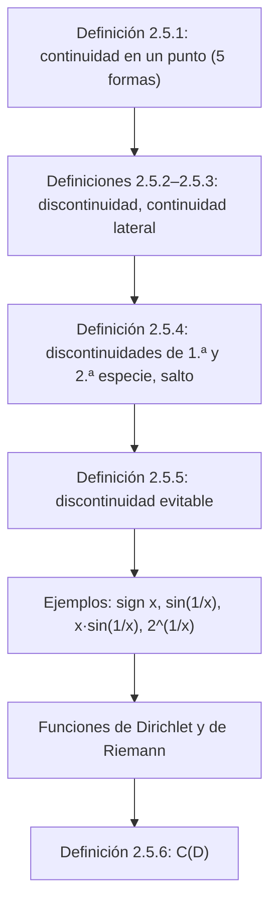

# Lección 16 — Funciones continuas: definiciones y puntos de discontinuidad

[Índice de lecciones](index.md) · [Русский](../../ru/lectures-2025-26/lecture-16.md) · [English](../../en/lectures-2025-26/lecture-16.md)

> **Fuente:** `ма25_26_лекция_16_notes.pdf` — 16 páginas: diapositivas impresas con capa de texto (páginas 1–4, 7–10, 12, 16; las páginas 10 y 12 tienen anotaciones manuscritas en color sobre los dibujos impresos) y páginas manuscritas sin capa de texto (5, 6, 11, 13–15). Las páginas manuscritas se transcribieron a partir de su imagen. Los números de página del PDF aparecen en los encabezados; las diapositivas impresas están numeradas en el PDF como «1/10»–«10/10».
>
> **Nota del editor.** La fecha de la lección se toma del pie de las diapositivas («23 de octubre de 2025»). La «cita del día» de la página 2 es la misma que en la lección 15 y no se repite aquí.

## Diapositivas impresas 1–3. Introducción

**Objetivo de la lección.** Dar una serie de definiciones sobre funciones continuas.

## Capítulo 2. Teoría de límites. §5. Funciones continuas

### Diapositiva impresa 4 (p. PDF 4). Definición de continuidad en un punto

**Definición 2.5.1.** Sea $f : D \subset \mathbb{R} \to \mathbb{R}$, $x_0 \in D$. La función $f$ se llama **continua en el punto $x_0$** si se cumple una de las siguientes afirmaciones.

1. El límite de $f$ en $x_0$ existe y es igual a $f(x_0)$. Esta definición es aplicable si $x_0$ es punto de acumulación de $D$.
2. $\forall \varepsilon > 0\ \exists \delta > 0\ \forall x \in D : |x - x_0| < \delta \Rightarrow |f(x) - f(x_0)| < \varepsilon$.
3. $\forall V(f(x_0))\ \exists V(x_0))\ f(V(x_0) \cap D) \subset V(f(x_0))$.
4. $\forall \{x_n\} : x_n \in D,\ x_n \to x_0 \Rightarrow f(x_n) \to f(x_0)$.
5. $\Delta y \xrightarrow[\Delta x \to 0]{} 0$. Aquí $\Delta x = x - x_0$ es el incremento del argumento y $\Delta y = f(x) - f(x_0)$ es el incremento de la función. Esta definición es aplicable si $x_0$ es punto de acumulación de $D$.

### Página manuscrita 5 (p. PDF 5). Observaciones sobre la definición 2.5.1

(En verde, con el dibujo de una gráfica que tiende a $+\infty$ por ambos lados de la recta vertical discontinua $x = x_0$:) $x_0$ es punto de acumulación de $D$, $x_0 \notin D$, es decir, $f(x_0)$ no está definida $\Rightarrow$ $f$ no es continua en $x_0$ (en el sentido de la definición ①).

**Observación (manuscrita).** ②, ③ y ④ significan que el número $A = f(x_0)$ es el límite de $f$ en $x_0$.

En ② se omite la condición $x \ne x_0$, pero en este lugar no importa, porque la desigualdad $|f(x) - f(x_0)| < \varepsilon$ es cierta para $x = x_0$.

Análogamente, en ③ se omite la condición $\dot V(x_0)$ y en ④ la condición $x_n \ne x_0$.

### Página manuscrita 6 (p. PDF 6). Punto aislado

**Observación (manuscrita).** Sea $x_0$ un punto aislado de $D$ $\Rightarrow$ $\exists \delta > 0 : V_\delta(x_0) \cap D = \{x_0\}$,

$$
f(V_\delta(x_0) \cap D) = \{f(x_0)\} \subset V(f(x_0)) \qquad \forall f \text{ y } \forall V(f(x_0)).
$$

Encuadrado en amarillo: **toda función es continua en un punto aislado de su dominio.**

### Diapositiva impresa 7 (p. PDF 7). Funciones discontinuas y continuidad por la izquierda y por la derecha

**Definición 2.5.2.** Sea $f : D \subset \mathbb{R} \to \mathbb{R}$, $x_0 \in \mathbb{R}$. Si la función $f$ no es continua en $x_0$, se dice que $f$ es **discontinua** (tiene una discontinuidad) en $x_0$, y $x_0$ se llama **punto de discontinuidad** de $f$.

**Definición 2.5.3.** Sea $f : D \subset \mathbb{R} \to \mathbb{R}$, $x_0 \in \mathbb{R}$. Si la restricción de $f$ al conjunto $E_1 = D \cap (-\infty, x_0]$ ($E_2 = D \cap [x_0, +\infty)$) es continua en $x_0$, se dice que la función $f$ es **continua por la izquierda (por la derecha)** en $x_0$.

> **Nota del editor.** En las definiciones 2.5.2 y 2.5.3 la diapositiva escribe $x_0 \in \mathbb{R}$ (y no $x_0 \in D$): también se habla de discontinuidad en un punto donde la función no está definida, en concordancia con la definición 2.5.5 siguiente.

### Diapositiva impresa 8 (p. PDF 8). Puntos de discontinuidad de primera y de segunda especie

**Definición 2.5.4.** Si existen los límites finitos $f(x_0^-)$ y $f(x_0^+)$, pero los tres números $f(x_0^-)$, $f(x_0^+)$, $f(x_0)$ no son todos iguales, entonces $x_0$ se llama **punto de discontinuidad de primera especie** de $f$.

La discontinuidad de primera especie también se llama **salto**. También se llama salto a la diferencia $f(x_0^+) - f(x_0^-)$, y las diferencias $f(x_0) - f(x_0^-)$ y $f(x_0^+) - f(x_0)$ se llaman saltos de $f$ por la izquierda y por la derecha en $x_0$.

En caso contrario, es decir, si al menos uno de los límites laterales en el punto de discontinuidad $x_0$ es infinito o no existe en absoluto, $x_0$ se llama **punto de discontinuidad de segunda especie** de $f$.

### Diapositiva impresa 9 (p. PDF 9). Puntos de discontinuidad evitable

**Definición 2.5.5.** Sea $f(x_0^-) = f(x_0^+) = A \in \mathbb{R}$, pero $f(x_0) \ne A$ o $f$ no está definida en $x_0$. Entonces $x_0$ se llama **punto de discontinuidad evitable** de $f$.

### Diapositiva impresa 10 con anotaciones manuscritas (p. PDF 10). Ejemplos

$f(x) = \operatorname{sign} x = \begin{cases} 1, & x > 0, \\ 0, & x = 0, \\ -1, & x < 0. \end{cases}$

Manuscrito: $\lim\limits_{x \to 0^+} f = 1 = f(0^+)$; $\lim\limits_{x \to 0^-} f = -1 = f(0^-)$. Salto $f(0^+) - f(0^-) = 2$; $f(0) - f(0^-) = f(0^+) - f(0) = 1$; ambos saltos laterales (por la derecha y por la izquierda) $= 1$. Flecha roja desde el punto $(0, 0)$: «discontinuidad de 1.ª especie».

$f(x) = \sin \dfrac{1}{x}$ (gráfica impresa con las marcas $-\dfrac{2}{\pi}$, $-\dfrac{1}{\pi}$, $\dfrac{1}{\pi}$, $\dfrac{2}{\pi}$ y las rectas discontinuas $y = \pm 1$).

### Página manuscrita 11 (p. PDF 11). Discontinuidad de segunda especie para $\sin \frac1x$

Demostremos que $0$ es un punto de discontinuidad de 2.ª especie (para $f(x) = \sin \dfrac1x$).

$x_n = \dfrac{1}{2\pi n}$, $x_n > 0$, $f(x_n) = \sin\left(\dfrac{1}{1/(2\pi n)}\right) = \sin(2\pi n) = 0 \xrightarrow[n\to\infty]{} 0$.

$\widetilde x_n = \dfrac{1}{2\pi n + \pi/2}$, $\widetilde x_n > 0$, $f(\widetilde x_n) = \sin\left(2\pi n + \dfrac{\pi}{2}\right) = 1 \xrightarrow[n\to\infty]{} 1$.

En rojo: $\Rightarrow$ no existe $\lim\limits_{x \to 0^+} \sin \dfrac1x$. $\Rightarrow$ $0$ es un punto de discontinuidad de 2.ª especie.

### Diapositiva impresa 12 con anotaciones manuscritas (p. PDF 12). Ejemplos-2

$f(x) = x \sin\left(\dfrac1x\right)$: manuscrito $\lim\limits_{x \to 0} \left(x \sin \dfrac1x\right) = 0$ $\Rightarrow$ $0$ es un punto de discontinuidad evitable.

$f(x) = 2^{1/x}$: manuscrito $\lim\limits_{x \to 0^+} 2^{1/x} = +\infty$; $\lim\limits_{x \to 0^-} 2^{1/x} = 0$; «0 es un punto de discontinuidad de 2.ª especie».

### Página manuscrita 13 (p. PDF 13). Ejemplo ⟨1⟩: la función de Dirichlet

**Ejemplos. ⟨1⟩ La función de Dirichlet**

$$
\chi(x) = \begin{cases} 1, & x \in \mathbb{Q}, \\ 0, & x \notin \mathbb{Q} \end{cases}
$$

es discontinua en todo punto, y todas las discontinuidades son de segunda especie. En efecto, para todo $x_0 \in \mathbb{R}$ se pueden elegir 2 sucesiones: de números racionales $\{x_n\}$ y de números irracionales $\{y_n\}$ tales que $x_n, y_n > 0$ (así en el manuscrito; en realidad, a la derecha de $x_0$); $x_n, y_n \to x_0$.

Por ejemplo, se puede tomar $x_n = \dfrac{[n x_0] + 1}{n}$, $y_n = x_n + \dfrac{\sqrt2}{n}$. Entonces $\chi(x_n) = 1 \to 1$, $\chi(y_n) = 0 \to 0$.

Por tanto, el límite de $\chi$ por la derecha en $x_0$ no existe. La no existencia del límite por la izquierda se demuestra análogamente.

### Páginas manuscritas 14–15 (p. PDF 14–15). Ejemplo ⟨2⟩: la función de Riemann

**⟨2⟩ La función de Riemann**

$$
\psi(x) = \begin{cases} \dfrac1q, & x = \dfrac pq \in \mathbb{Q},\ \text{fracción irreducible}, \\ 0, & x \notin \mathbb{Q} \end{cases}
$$

es continua en todos los puntos irracionales y tiene discontinuidades de primera especie en todos los puntos racionales. Basta mostrar que $\lim \psi$ en cualquier punto $x_0$ es $0$. Tomemos $\varepsilon > 0$ y elijamos $N$ tal que $\dfrac1N < \varepsilon$.

La cantidad de números racionales con denominadores menores que $N$ en el entorno reducido de radio $2$ de $x_0$ es finita.

(En verde:) Denotemos por $r$ la distancia de $x_0$ al más cercano de ellos. Entonces en el entorno reducido de radio $r$ de $x_0$ no hay números racionales con denominadores $< N$, es decir, todos los valores de $\psi$ en ese entorno reducido son $< \varepsilon$.

No es posible dibujar las gráficas de las funciones de Dirichlet y de Riemann debido al comportamiento caótico de estas funciones.

> **Nota del editor.** En el manuscrito, en un punto racional $x_0 = p/q$ el límite de $\psi$ es $0 \ne \psi(x_0) = 1/q$, por lo que la discontinuidad allí es evitable; en la página 14 se denomina discontinuidad de primera especie (la discontinuidad evitable es el caso particular en el sentido de la definición 2.5.5 cuando $f(x_0^-) = f(x_0^+)$).

### Diapositiva impresa 16 (p. PDF 16). Funciones continuas en un conjunto

**Definición 2.5.6.** Una función se llama **continua en un conjunto $D$** si es continua en cada punto de $D$.

El conjunto de funciones definidas y continuas en $D$ se denota por $C(D)$. Si $D = \langle a, b\rangle$ es un intervalo, los paréntesis se omiten habitualmente y se escribe $C\langle a, b\rangle$.

## Estructura de la lección

## Páginas de servicio

- La página 1 es la portada; la página 2 es la «cita del día» (la misma que en la lección 15); la página 3 indica el objetivo de la lección.
- Los dibujos impresos de las páginas 10 y 12 están insertados arriba como ilustraciones; sus anotaciones manuscritas en color están transcritas en el texto.
