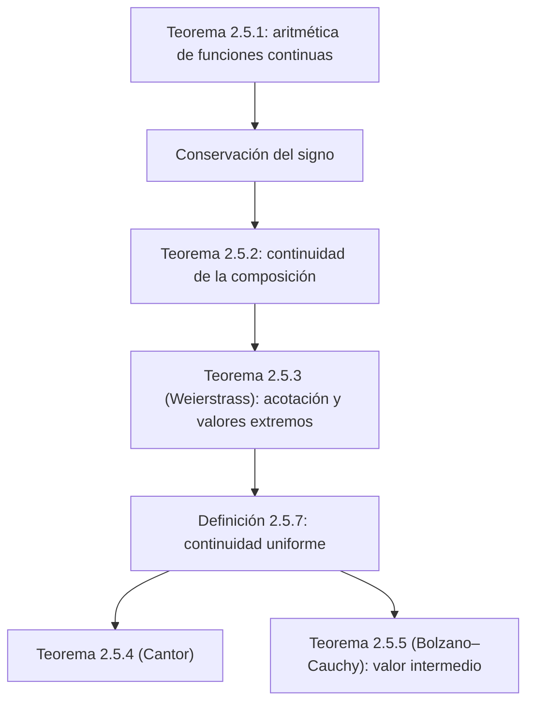

# Lecciones 17–18 — Propiedades de las funciones continuas en un intervalo cerrado

[← Lección 16](lecture-16.md) · [Índice de lecciones](index.md) · [Lecciones 19–20 →](lecture-19-20.md) · [Términos y teoremas](../term-index.md) · [Русский](../../ru/lectures-2025-26/lecture-17-18.md) · [English](../../en/lectures-2025-26/lecture-17-18.md)

> **Fuente:** `ma25_26-lectures_17-18_notes.pdf` — 22 páginas: diapositivas impresas con capa de texto (páginas 1–4, 6, 8, 11, 15, 18) y páginas manuscritas sin capa de texto (5, 7, 9, 10, 12–14, 16, 17, 19–22). Las páginas manuscritas se transcribieron a partir de su imagen. Los números de página del PDF aparecen en los encabezados; las diapositivas impresas están numeradas en el PDF como «1/9»–«9/9».
>
> **Nota del editor.** La fecha de la lección se toma del pie de las diapositivas («30 de octubre de 2025»).

## Diapositivas impresas 1–3. Introducción

**Cita del día (diapositiva 2).** Pregunta: ¿qué se obtiene si se divide la longitud de la circunferencia de un farol de calabaza entre el diámetro del farol? Respuesta: ¡el Pi de calabaza!


**Objetivo de la lección.** Demostrar una serie de afirmaciones sobre funciones continuas (operaciones aritméticas con funciones continuas, conservación del signo de una función continua, continuidad de la composición, [teorema de Weierstrass](../05-limits-continuity.md#extreme-value-theorem)). Introducir el concepto de [continuidad uniforme](#def-2-5-7) y demostrar el teorema de Cantor y el [teorema de Bolzano–Cauchy](#thm-2-5-5).

## §5. Funciones continuas (continuación)

### Diapositiva impresa 4 (p. PDF 4). Operaciones aritméticas con funciones continuas

<a id="thm-2-5-1"></a>**Teorema 2.5.1.** Sean las funciones $`f, g : D \subset \mathbb{R} \to \mathbb{R}`$ continuas en el punto $`x_0 \in D`$. Entonces las funciones $`f \pm g`$, $`fg`$, $`|f|`$ son continuas en $`x_0`$, y si $`g(x_0) \ne 0`$, también $`\dfrac{f}{g}`$ es continua en $`x_0`$.

### Página manuscrita 5 (p. PDF 5). Demostración del teorema 2.5.1

**Demostración ([teorema 2.5.1](#thm-2-5-1)).** Si $`x_0`$ es un punto aislado de $`D`$, la afirmación es trivial.

Si $`x_0`$ es [punto de acumulación](lecture-14.md#def-2-4-1) de $`D`$, entonces $`f(x) \xrightarrow[x \to x_0]{} f(x_0)`$, $`g(x) \xrightarrow[x \to x_0]{} g(x_0)`$. Pero entonces $`f(x) + g(x) \xrightarrow[x \to x_0]{} f(x_0) + g(x_0)`$, que es exactamente la continuidad de la suma de $`f`$ y $`g`$ en $`x_0`$.

Las demás operaciones son análogas. $`\blacksquare`$

### Diapositiva impresa 6 (p. PDF 6). Conservación del signo de una función continua

Si una función $`g : D \subset \mathbb{R} \to \mathbb{R}`$ es [continua en el punto](lecture-16.md#def-2-5-1) $`x_0 \in D`$ y $`g(x_0) \ne 0`$, entonces existe un entorno $`V(x_0)`$ tal que el signo de $`g(x)`$ coincide con el signo de $`g(x_0)`$ para todo $`x \in V(x_0) \cap D`$.

### Página manuscrita 7 (p. PDF 7). Justificación de la conservación del signo

Para un punto aislado $`x_0`$ esta afirmación es trivial, y para un punto de acumulación se sigue del teorema de conservación del signo de una función que tiene límite ([teorema 2.4.4](lecture-15.md#thm-2-4-4) de la lección 15).

### Diapositiva impresa 8 (p. PDF 8). Continuidad de la composición

<a id="thm-2-5-2"></a>**Teorema 2.5.2.** Sea $`f : D \subset \mathbb{R} \to \mathbb{R}`$, $`g : E \subset \mathbb{R} \to \mathbb{R}`$, $`f(D) \subset E`$, $`f`$ continua en el punto $`x_0 \in D`$ y $`g`$ continua en el punto $`f(x_0)`$. Entonces $`g \circ f`$ es continua en $`x_0`$.

### Página manuscrita 9 (p. PDF 9). Demostración del teorema 2.5.2

**Demostración ([teorema 2.5.2](#thm-2-5-2)).** Sea $`\{x_n\} : x_n \in D`$, $`x_n \xrightarrow[n \to \infty]{} x_0`$.

Denotemos $`\begin{cases} f(x_n) =: y_n \\ f(x_0) =: y_0 \end{cases} \Rightarrow y_n, y_0 \in E`$.

$`g`$ es continua en el punto $`f(x_0)`$ $`\Rightarrow`$ $`g(y_n) \xrightarrow[n \to \infty]{} g(y_0)`$. (En el manuscrito el paso «$`y_n \to y_0`$ por la continuidad de $`f`$ en $`x_0`$» no está escrito por separado.)

Ahora recordemos que $`\begin{cases} g(y_n) = g(f(x_n)) = g \circ f\,(x_n) \\ g(y_0) = g(f(x_0)) = g \circ f\,(x_0) \end{cases} \Rightarrow g \circ f\,(x_n) \xrightarrow[n \to \infty]{} g \circ f\,(x_0)`$.

Por la arbitrariedad de $`\{x_n\}`$ obtenemos la continuidad de $`g \circ f`$. $`\blacksquare`$

### Página manuscrita 10 (p. PDF 10). Observación: el límite de una composición sin continuidad

**Observación (manuscrita).** Sea $`f(x) = x \sin \dfrac1x`$, $`g(y) = |\operatorname{sign} y|`$ (en la esquina superior derecha está dibujada en rojo la gráfica de $`g`$: la recta $`y = 1`$ para $`y \ne 0`$ con un círculo vacío en $`(0, 1)`$ y el punto relleno $`(0, 0)`$).


$`f(x) \xrightarrow[x \to 0]{} 0`$, $`g(y) \xrightarrow[y \to 0]{} 1`$, pero $`\lim\limits_{x \to 0} (g \circ f) = g(f(x))`$ no existe.

1) Por qué no hay límite: $`(g \circ f)\left(\dfrac{1}{\pi n}\right) = 0 \to 0`$; $`(g \circ f)\left(\dfrac{1}{\pi n + \pi/2}\right) = 1 \to 1`$.

En rojo: este ejemplo muestra que si $`f(x) \xrightarrow[x \to a]{} A`$ y $`g(x) \xrightarrow[x \to A]{} B`$, entonces $`(g \circ f)(x) \xrightarrow[x \to a]{} B`$ puede no cumplirse.

> **Nota del editor.** Compárese con el [teorema 2.4.6](lecture-15.md#thm-2-4-6) sobre el límite de una composición (lección 15): aquí falla su condición 3, pues en todo [entorno reducido](lecture-14.md#def-2-4-2) de cero $`f`$ toma el valor $`A = 0`$.

### Diapositiva impresa 11 (p. PDF 11). Teorema de Weierstrass sobre funciones continuas

<a id="thm-2-5-3"></a>**Teorema 2.5.3.**

1. Una función continua en un intervalo cerrado es acotada.
2. Una función continua en un intervalo cerrado alcanza el valor máximo y el mínimo.

**Observación.** Ambas condiciones —la continuidad de la función y que su dominio sea un intervalo cerrado— son esenciales.

### Página manuscrita 12 (p. PDF 12). Ejemplos para la observación

**Ejemplos para la observación.**

① $`f_1(x) = x`$ es continua en $`\mathbb{R}`$, pero no es acotada en $`\mathbb{R}`$.

② $`f_2(x) = \dfrac1x`$ es continua en $`(0, 1]`$, pero no es acotada en $`(0, 1]`$.

③ $`f_1(x) = x`$ en $`[0, 1)`$: $`f_1`$ es continua en $`[0, 1)`$, acotada en $`[0, 1)`$, pero no tiene valor máximo en $`[0, 1)`$ ($`\sup\limits_{[0,1)}`$ existe, $`\max\limits_{[0,1)}`$ no).

④ $`f_3(x) = \begin{cases} \dfrac1x, & x \in (0, 1], \\ 0, & x = 0. \end{cases}`$

$`f_3`$ es discontinua en $`0`$, no es acotada y no tiene valor máximo en $`[0, 1]`$ (no hay $`\sup\limits_{[0,1]}`$ finito, y tampoco $`\max\limits_{[0,1]}`$).

### Páginas manuscritas 13–14 (p. PDF 13–14). Demostración del teorema de Weierstrass

**Demostración (teorema de Weierstrass, [teorema 2.5.3](#thm-2-5-3)).** Sea $`f \in C[a, b]`$, es decir, $`f`$ continua en $`[a, b]`$.

① Sea $`f`$ no acotada $`\Rightarrow`$ $`\forall n \in \mathbb{N}`$ existe un punto $`x_n \in [a, b]`$ con $`|f(x_n)| > n`$ $`\Rightarrow`$ obtenemos una sucesión $`\{x_n\}`$ $`\Rightarrow`$ por el [principio de Bolzano–Weierstrass](lecture-11-12.md#thm-2-3-4) existe una [subsucesión](lecture-11-12.md#def-2-3-7) $`\{x_{n_k}\}`$ con $`x_{n_k} \to c \in [a, b]`$ (por ser el intervalo cerrado).

$`\begin{cases} c \in [a, b] \\ x_{n_k} \xrightarrow[k \to \infty]{} c \\ f \in C[a, b] \end{cases} \Rightarrow`$ por la definición de continuidad $`f(x_{n_k}) \xrightarrow[k \to \infty]{} f(c)`$.

Por construcción: $`|f(x_{n_k})| > n_k \ge k`$ $`\forall k \in \mathbb{N}`$, contradicción (rayo verde).

② Demostremos, para fijar ideas, que $`f`$ alcanza el valor máximo.

$`M := \sup\limits_{x \in [a,b]} f(x)`$ $`\Rightarrow`$ por el punto ① $`f`$ es acotada en $`[a, b]`$ $`\Rightarrow`$ $`M \in \mathbb{R}`$ (en el manuscrito aquí está escrito $`\mu \in \mathbb{R}`$; se entiende $`M`$).

Sea $`M`$ no un valor de $`f`$ $`\Rightarrow`$ $`f(x) < M`$ $`\forall x \in [a, b]`$ $`\Rightarrow`$ $`\varphi(x) = \dfrac{1}{M - f(x)}`$ es continua en $`[a, b]`$ $`\Rightarrow`$ por el punto ① $`\varphi`$ es [acotada superiormente](lecture-05-06.md#def-1-3-7) en $`[a, b]`$ $`\Rightarrow`$ $`\exists \mu > 0 : \varphi(x) \le \mu`$ $`\forall x \in [a, b]`$ $`\Rightarrow`$

```math
\frac{1}{M - f(x)} \le \mu \iff M - f(x) \ge \frac1\mu \Rightarrow f(x) \le M - \frac1\mu.
```

$`\begin{cases} M := \sup\limits_{x \in [a,b]} f(x) \\ f(x) \le M - \dfrac1\mu \end{cases} \Rightarrow`$ obtenemos una contradicción con que $`M = \sup\limits_{[a,b]} f`$ es la [cota superior](../02-real-numbers.md#sec-2-2) **exacta** (el [supremo](lecture-11-12.md#def-2-3-1)). $`\blacksquare`$

### Diapositiva impresa 15 (p. PDF 15). Continuidad uniforme

La continuidad de una función $`f : D \subset \mathbb{R} \to \mathbb{R}`$ en el conjunto $`D`$ significa que $`f`$ es continua en cada punto $`\bar x \in D`$. Escribámoslo en «lenguaje $`\varepsilon`$»:

```math
\forall \bar x \in D\ \forall \varepsilon > 0\ \exists \delta > 0\ \forall \bar{\bar x} \in D : |\bar x - \bar{\bar x}| < \delta \Rightarrow |f(\bar x) - f(\bar{\bar x})| < \varepsilon.
```

En esta fórmula el número $`\delta`$ depende de $`\varepsilon`$ y también del punto $`\bar x`$. Surge la pregunta: ¿se puede, en la definición de continuidad, elegir un número $`\delta`$ que dependa solo de $`\varepsilon`$ y sirva simultáneamente para todos los puntos $`\bar x`$ de $`D`$?

<a id="def-2-5-7"></a>**Definición 2.5.7.** Una función $`f : D \subset \mathbb{R} \to \mathbb{R}`$ se llama **uniformemente continua** en el conjunto $`D`$ si

```math
\forall \varepsilon > 0\ \exists \delta = \delta(\varepsilon) > 0\ \forall \bar x, \bar{\bar x} \in D : |\bar x - \bar{\bar x}| < \delta \Rightarrow |f(\bar x) - f(\bar{\bar x})| < \varepsilon.
```

### Página manuscrita 16 (p. PDF 16). Ejemplo: $`x^2`$ en $`\mathbb{R}`$

$`f`$ uniformemente continua $`\Rightarrow`$ $`f`$ continua; el recíproco es falso (flecha $`\Leftarrow`$ tachada en rojo).

**Ejemplo.** $`f(x) = x^2`$ es continua en $`\mathbb{R}`$, pero no es uniformemente continua en $`\mathbb{R}`$.

Para demostrarlo, escribamos la negación de la definición de continuidad uniforme:

```math
\exists \varepsilon^* > 0\ \forall \delta > 0\ \exists \bar x_\delta, \bar{\bar x}_\delta \in D : |\bar x_\delta - \bar{\bar x}_\delta| < \delta,\quad |f(\bar x_\delta) - f(\bar{\bar x}_\delta)| \ge \varepsilon^*.
```

(En verde:) Pongamos $`\varepsilon^* = 1`$, tomemos $`\delta > 0`$, sea $`\bar x_\delta = \dfrac1\delta`$, $`\bar{\bar x}_\delta = \dfrac1\delta + \dfrac\delta2`$ $`\Rightarrow`$ $`|\bar x_\delta - \bar{\bar x}_\delta| = \dfrac\delta2 < \delta`$,

```math
|f(\bar x_\delta) - f(\bar{\bar x}_\delta)| = |\bar x_\delta^2 - \bar{\bar x}_\delta^2| = \left|\left(\frac1\delta\right)^2 - \left(\frac1\delta + \frac\delta2\right)^2\right| = \frac\delta2\left(\frac2\delta + \frac\delta2\right) = 1 + \frac{\delta^2}{4} > 1 = \varepsilon^*.
```

### Página manuscrita 17 (p. PDF 17). Interpretación geométrica de la continuidad uniforme

En el dibujo: la gráfica $`y = f(x)`$ (una «colina» roja) y tres rectángulos verdes iguales de anchura $`\delta(\varepsilon)`$ y altura $`\varepsilon`$ (así indicado en el manuscrito) por los que pasa la gráfica en distintos lugares: el mismo $`\delta`$ «sirve» para todos los puntos.


(En verde:) $`f(x) = \dfrac1x`$ es uniformemente continua en $`[1, +\infty)`$, pero no lo es en $`(0, 1)`$; $`f(x) = e^x`$ es uniformemente continua en $`(0, 1)`$.

### Diapositiva impresa 18 (p. PDF 18). Teoremas de Cantor y de Bolzano–Cauchy

<a id="thm-2-5-4"></a>**Teorema 2.5.4 (Cantor).** Una función continua en un intervalo cerrado es uniformemente continua.

<a id="thm-2-5-5"></a>**Teorema 2.5.5 (Bolzano–Cauchy).** Sea $`f`$ continua en $`[a, b]`$. Entonces para todo número $`C`$ entre $`f(a)`$ y $`f(b)`$ existe $`c \in (a, b)`$ tal que $`f(c) = C`$.

**Observación.** El teorema de Bolzano–Cauchy también puede formularse así: si una función continua en un intervalo toma dos valores, entonces toma todos los valores intermedios.

### Página manuscrita 19 (p. PDF 19). Demostración del teorema de Cantor

**Demostración ([teorema 2.5.4](#thm-2-5-4)).** Sea $`f \in C[a, b]`$. Supongamos que $`f`$ no es uniformemente continua $`\Rightarrow`$ $`\exists \varepsilon^* > 0`$ $`\forall n \in \mathbb{N}`$ $`\exists \bar x_n, \bar{\bar x}_n \in [a, b]`$: $`|\bar x_n - \bar{\bar x}_n| < \dfrac1n`$, $`|f(\bar x_n) - f(\bar{\bar x}_n)| > \varepsilon^*`$ (subrayado en amarillo; en la negación de la definición en la p. 16 era $`\ge \varepsilon^*`$).

$`\{\bar x_n\}`$ $`\Rightarrow`$ por el principio de selección de Bolzano–Weierstrass $`\exists \{\bar x_{n_k}\}`$: $`\bar x_{n_k} \to c \in [a, b]`$.

Pero entonces $`\bar{\bar x}_{n_k} \xrightarrow[k \to \infty]{} c`$, puesto que

```math
|\bar{\bar x}_{n_k} - c| = |\bar{\bar x}_{n_k} - \bar x_{n_k} + \bar x_{n_k} - c| \le \underbrace{|\bar{\bar x}_{n_k} - \bar x_{n_k}|}_{<\, 1/n_k} + |\bar x_{n_k} - c| < \frac{1}{n_k} + |\bar x_{n_k} - c| \to 0.
```

$`\begin{cases} f \in C[a, b] \\ \bar x_{n_k} \to c \\ \bar{\bar x}_{n_k} \to c \end{cases} \Rightarrow f(\bar x_{n_k}) - f(\bar{\bar x}_{n_k}) \xrightarrow[k \to \infty]{} 0`$ $`\Rightarrow`$ a partir de cierto índice $`|f(\bar x_{n_k}) - f(\bar{\bar x}_{n_k})| < \varepsilon^*`$, contradicción (rayo amarillo). $`\blacksquare`$

### Página manuscrita 20 (p. PDF 20). Observación sobre el teorema de Bolzano–Cauchy

Aquí es esencial tanto que la función sea continua como que esté definida en un intervalo $`[a, b]`$.

La función $`\operatorname{sign}(x) = \begin{cases} 1, & x > 0, \\ 0, & x = 0, \\ -1, & x < 0 \end{cases}`$ es discontinua en $`0`$. Toma los valores $`-1`$ y $`1`$, pero de los números entre $`-1`$ y $`1`$ solo $`0`$ es valor de la función.

La restricción de $`\operatorname{sign}`$ a $`\mathbb{R} \setminus \{0\}`$ es continua, pero no toma valores entre $`-1`$ y $`1`$.

### Páginas manuscritas 21–22 (p. PDF 21–22). Demostración del teorema de Bolzano–Cauchy

**Demostración ([teorema 2.5.5](#thm-2-5-5)).**

① Sean $`f(a)`$ y $`f(b)`$ de signos distintos: $`f(a) \cdot f(b) < 0`$. Demostremos que existe un punto $`c \in (a, b)`$ con $`f(c) = 0`$.

Sin pérdida de generalidad, $`f(a) < 0 < f(b)`$. El segundo caso es análogo.

Consideremos el punto medio de $`[a, b]`$, $`c = \dfrac{a+b}{2}`$. Si $`f\left(\dfrac{a+b}{2}\right) = 0`$, el teorema está demostrado y se puede tomar $`c = \dfrac{a+b}{2}`$.

En caso contrario, pongamos $`[a_1, b_1] = \begin{cases} \left[\dfrac{a+b}{2}, b\right], & \text{si } f\left(\dfrac{a+b}{2}\right) < 0, \\ \left[a, \dfrac{a+b}{2}\right], & \text{si } f\left(\dfrac{a+b}{2}\right) > 0. \end{cases}`$

En ambos casos $`f(a_1) < 0 < f(b_1)`$. Continuamos el proceso. Si en algún paso $`f`$ se anula en el punto medio, la demostración termina.

En caso contrario se construye una sucesión de [intervalos encajados](lecture-11-12.md#thm-2-3-1) $`\{[a_n, b_n]\}`$ con $`f(a_n) < 0 < f(b_n)`$. Además, los intervalos se contraen, pues $`b_n - a_n = \dfrac{b-a}{2^n} \to 0`$. Por el teorema de los intervalos encajados existe un único $`c \in \bigcap\limits_{n=1}^{\infty} [a_n, b_n]`$.

Además $`a_n \to c`$, $`b_n \to c`$. Por el paso al límite en la desigualdad, de $`f(a_n) < 0 < f(b_n)`$, donde $`f(a_n) \to f(c)`$ y $`f(b_n) \to f(c)`$ (flechas hacia abajo en el manuscrito), se obtiene $`f(c) \le 0 \le f(c)`$ $`\Rightarrow`$ $`f(c) = 0`$, y $`c`$ es el punto buscado.

② Demostremos el teorema en el caso general. Sea $`\varphi = f - C`$. Entonces $`\varphi \in C[a, b]`$ como diferencia de funciones continuas. $`\varphi(a) \cdot \varphi(b) < 0`$ $`\Rightarrow`$ $`\exists c : \varphi(c) = 0`$, es decir, $`f(c) = C`$. $`\blacksquare`$

> **Nota del editor.** En el manuscrito, en la última línea está escrito «$`\exists! c`$»; la unicidad de $`c`$ no se afirma en general, por lo que aquí se deja $`\exists c`$.

## Estructura de la lección



## Páginas de servicio

- La página 1 es la portada; la página 2 es la «cita del día» (la foto del farol de calabaza está insertada arriba); la página 3 indica el objetivo de la lección.
- En la demostración del [teorema 2.5.3](#thm-2-5-3), el punto ① está en la p. PDF 13 y el punto ② en la p. PDF 14.
