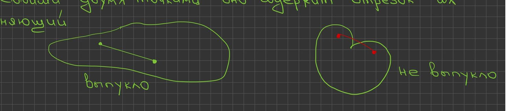
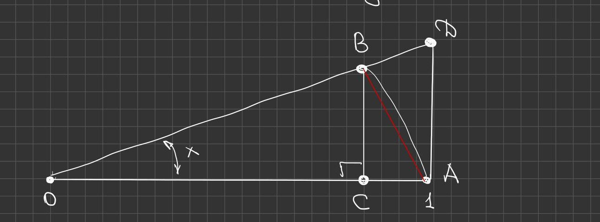
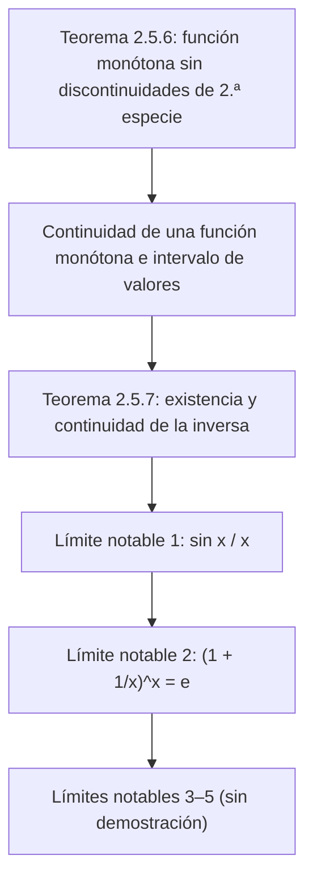

# Lecciones 19–20 — Funciones monótonas, función inversa, límites notables

[← Lecciones 17–18](lecture-17-18.md) · [Índice de lecciones](index.md) · [Lección 21 →](lecture-21.md) · [Términos y teoremas](../term-index.md) · [Русский](../../ru/lectures-2025-26/lecture-19-20.md) · [English](../../en/lectures-2025-26/lecture-19-20.md)

> **Fuente:** `ma25_26-lectures_19-20_notes.pdf` — 20 páginas: diapositivas impresas con capa de texto (páginas 1–4, 8, 11, 12, 16, 20) y páginas manuscritas sin capa de texto (5–7, 9, 10, 13–15, 17–19). Las páginas manuscritas se transcribieron a partir de su imagen. Los números de página del PDF aparecen en los encabezados; las diapositivas impresas están numeradas en el PDF como «1/9»–«9/9».
>
> **Nota del editor.** La fecha de la lección se toma del pie de las diapositivas («6 de noviembre de 2025»). Las demostraciones en las páginas manuscritas solo se dan para los límites notables 1 y 2; los límites 3–5 aparecen en las diapositivas sin demostración. La notación $`\langle a, b\rangle`$ denota un intervalo de cualquier tipo (véanse las lecciones 5–6).

## Diapositivas impresas 1–3. Introducción

**Cita del día (diapositiva 2).** «MÉTODOS TÍPICOS DE DEMOSTRACIÓN — 2»:

- *Demostración por referencia a la literatura:* «Se sigue directamente del resultado dado en [1]. [1] K. A. Koyto (ed.) Sociedad Matemática Yugoslava. Sesión II. 1925. Colección de manuscritos de ponencias fuera de sección. Pág. 17.»
- *Demostración por referencia a una página:* «La justificación está en la pág. 478 de [2]. [2] Aut Of Peiper. Teoría de numeraciones. Moscú: Counter, 1990. 396 págs.»
- *Demostración por referencia a:* «El lector interesado puede encontrar la demostración de este resultado en la página personal de L. User: Eror 404 Page not found» (se conserva la ortografía de la diapositiva).

**Objetivo de la lección.** Hablar de las propiedades de las funciones monótonas (discontinuidades y continuidad de las funciones monótonas, existencia y continuidad de la [función inversa](lecture-01-02.md#def-1-1-8)). Demostrar afirmaciones sobre los límites notables.

## §5. Funciones continuas (continuación): funciones monótonas

### Diapositiva impresa 4 (p. PDF 4). Discontinuidades y continuidad de una función monótona

<a id="thm-2-5-6"></a>**Teorema 2.5.6.** Sea $`f : \langle a, b\rangle \to \mathbb{R}`$, $`f`$ monótona. Entonces:

1. $`f`$ no puede tener [discontinuidades de segunda especie](lecture-16.md#def-2-5-4).
2. La continuidad de $`f`$ equivale a que su conjunto de valores sea un intervalo.

### Páginas manuscritas 5–7 (p. PDF 5–7). Demostración del teorema 2.5.6

**Demostración ([teorema 2.5.6](#thm-2-5-6)).** Sea, para fijar ideas, $`f`$ creciente.

① Sean $`x_0 \in (a, b\rangle`$, $`x_1 \in (a, x_0)`$ (en el manuscrito, un dibujo de la recta numérica con los puntos $`a`$, $`x_1`$ (verde), $`x_0`$ (rojo), $`b`$). Entonces $`f(x_1) \le f(x) \le f(x_0)`$ $`\forall x \in (x_1, x_0)`$, es decir, $`f`$ es creciente y [acotada superiormente](lecture-05-06.md#def-1-3-7) en $`\langle a, x_0)`$. Por el teorema del [límite de una función](lecture-14.md#def-2-4-4) monótona ([teorema 2.4.9](lecture-15.md#thm-2-4-9) de la lección 15) existe el límite finito $`f(x_0^-)`$, y por el paso al límite en la desigualdad $`f(x_1) \le f(x_0^-) \le f(x_0)`$.

Análogamente se demuestra que para todo $`x_0 \in \langle a, b)`$ existe el límite finito $`f(x_0^+)`$, con $`f(x_0) \le f(x_0^+) \le f(x_2)`$ $`\forall x_2 \in (x_0, b\rangle`$.

② Sea $`f(\langle a, b\rangle)`$ un intervalo. Demostremos que $`f`$ es continua por la izquierda en todo $`x_0 \in (a, b\rangle`$ (por reducción al absurdo).

Supongamos $`f(x_0^-) < f(x_0)`$; la existencia del límite finito por la izquierda ya se demostró en ①.

Tomemos $`y \in (f(x_0^-), f(x_0))`$ $`\Rightarrow`$ si $`a < x_1 < x_0`$, entonces $`y \in [f(x_1), f(x_0)]`$ $`\Rightarrow`$ $`y \in f(\langle a, b\rangle)`$ (subrayado).

Por otro lado, $`\begin{cases} \forall x \in \langle a, x_0) : f(x) \le f(x_0^-) < y \\ \forall x \in [x_0, b\rangle : f(x) \ge f(x_0) > y \end{cases} \Rightarrow`$ $`y`$ no es valor de $`f`$, es decir, $`y \notin f(\langle a, b\rangle)`$ (subrayado), contradicción.

$`\Rightarrow`$ $`f(x_0^-) = f(x_0)`$. Análogamente, $`f`$ es continua por la derecha en $`x_0`$. Así hemos mostrado: $`f(\langle a, b\rangle)`$ es un intervalo $`\Rightarrow`$ $`f`$ es continua.

Demostremos ahora: $`f`$ continua $`\Rightarrow`$ $`f(\langle a, b\rangle)`$ es un intervalo.

Sea $`f \in C\langle a, b\rangle`$, $`m = \inf\limits_{x \in \langle a,b\rangle} f(x)`$, $`M = \sup\limits_{x \in \langle a,b\rangle} f(x)`$ ($`m, M \in \overline{\mathbb{R}}`$) $`\Rightarrow`$ por el [teorema de Bolzano–Cauchy](lecture-17-18.md#thm-2-5-5) $`E := f(\langle a, b\rangle)`$ es convexo.

(En verde:) **Definición.** Un conjunto $`E`$ se llama **convexo** si, junto con cualesquiera dos de sus puntos, contiene el segmento que los une. (Dibujos: una «gota» convexa con un segmento interior y un «corazón» no convexo donde el segmento entre dos puntos rojos sale fuera.)



$`\Rightarrow`$ $`f(\langle a, b\rangle) = \langle m, M\rangle`$. $`\blacksquare`$

### Diapositiva impresa 8 (p. PDF 8). Existencia y continuidad de la función inversa

<a id="thm-2-5-7"></a>**Teorema 2.5.7.** Sea $`f \in C\langle a, b\rangle`$, $`f`$ estrictamente monótona, $`m = \inf\limits_{x \in \langle a,b\rangle} f(x)`$, $`M = \sup\limits_{x \in \langle a,b\rangle} f(x)`$. Entonces:

1. $`f`$ es invertible y $`f^{-1} : \langle m, M\rangle \to \langle a, b\rangle`$ es una [biyección](lecture-01-02.md#def-1-1-6).
2. $`f^{-1}`$ es estrictamente monótona en el mismo sentido que $`f`$.
3. $`f^{-1}`$ es continua en $`\langle m, M\rangle`$.

### Páginas manuscritas 9–10 (p. PDF 9–10). Demostración del teorema 2.5.7

**Demostración ([teorema 2.5.7](#thm-2-5-7)).** Sea, para fijar ideas, $`f`$ estrictamente creciente.

① Si $`\begin{cases} x_1, x_2 \in \langle a, b\rangle \\ x_1 < x_2 \end{cases} \Rightarrow f(x_1) < f(x_2)`$ $`\Rightarrow`$ existe $`f^{-1}`$.

Por el [teorema 2.5.6](#thm-2-5-6), punto 2, $`f(\langle a, b\rangle) = \langle m, M\rangle`$, y por las propiedades generales de la aplicación inversa $`f^{-1}`$ es una biyección, $`f^{-1} : \langle m, M\rangle \to \langle a, b\rangle`$.

② Mostremos que $`f^{-1}`$ es estrictamente creciente.

Si $`\begin{cases} y_1, y_2 \in \langle m, M\rangle \\ y_1 < y_2 \end{cases} \Rightarrow \begin{cases} y_1 = f(x_1), & x_1 = f^{-1}(y_1) \\ y_2 = f(x_2), & x_2 = f^{-1}(y_2) \end{cases}`$, $`x_1, x_2 \in \langle a, b\rangle`$ $`\Rightarrow`$ $`f(x_1) < f(x_2)`$.

Además $`x_1 < x_2`$, porque la posibilidad $`x_1 \ge x_2`$ queda excluida ya que $`f`$ es **estrictamente** creciente.

③ $`\begin{cases} f^{-1} \text{ es creciente en } \langle m, M\rangle \\ f^{-1}(\langle m, M\rangle) = \langle a, b\rangle \end{cases} \Rightarrow`$ por el [teorema 2.5.6](#thm-2-5-6), punto 2, $`f^{-1}`$ es continua. $`\blacksquare`$

### Diapositiva impresa 11 (p. PDF 11). Propiedades de las funciones monótonas

1. El conjunto de puntos de discontinuidad de una función monótona es a lo sumo [numerable](lecture-01-02.md#def-1-2-5).
2. Si una función definida en un intervalo es continua e invertible, entonces es estrictamente monótona y, por tanto, la función inversa es continua.
3. Existe una función invertible $`f : \mathbb{R} \to \mathbb{R}`$, continua en $`0`$, tal que $`f^{-1}`$ es discontinua en $`f(0)`$.

(En las páginas manuscritas no se dan demostraciones de estas afirmaciones.)

## §6. Límites notables y comparación de funciones

### Diapositiva impresa 12 (p. PDF 12). Primer límite notable

Se llaman límites notables a cinco igualdades usadas frecuentemente para resolver indeterminaciones.

1. $`\lim\limits_{x \to 0} \dfrac{\sin x}{x} = 1`$.

**Corolario.** $`\lim\limits_{x \to 0} \dfrac{1 - \cos x}{x^2} = \dfrac12`$, $`\lim\limits_{x \to 0} \dfrac{\operatorname{tg} x}{x} = 1`$, $`\lim\limits_{x \to 0} \dfrac{\arcsin x}{x} = 1`$, $`\lim\limits_{x \to 0} \dfrac{\operatorname{arctg} x}{x} = 1`$.

### Páginas manuscritas 13–15 (p. PDF 13–15). Demostración del primer límite notable

**Demostración.** Mostremos que si $`0 < x < \dfrac\pi2`$, entonces $`\sin x < x < \operatorname{tg} x`$.

En el dibujo: el punto $`O`$, un rayo con ángulo $`x`$ respecto al segmento $`OA`$, $`|OA| = 1`$, el punto $`B`$ sobre el rayo con la perpendicular $`BC`$ a $`OA`$ ($`C`$ es el pie) y el punto $`D`$, intersección del rayo con la vertical por $`A`$; en rojo, el segmento $`BA`$; el arco delimita el sector.



$`\triangle OAB \subset`$ sector $`OAB`$ $`\subset \triangle OAD`$,

```math
\underbrace{S_{\triangle OAB}}_{=\,\frac12 |OA|\cdot|BC|} < \underbrace{S_{\text{sector } OAB}}_{=\,\frac12 |OA|^2 x} < \underbrace{S_{\triangle OAD}}_{=\,\frac12 |OA|\cdot|AD|}.
```

$`|OA| = 1`$, $`|BC| = \sin x`$, $`\dfrac{|AD|}{|OA|} = \operatorname{tg} x`$ $`\Rightarrow`$ $`\dfrac12 \sin x < \dfrac12 x < \dfrac12 \operatorname{tg} x`$. ✓

Como $`0 < x < \dfrac\pi2`$, de $`0 < \sin x < x < \operatorname{tg} x`$ se obtiene $`1 < \dfrac{x}{\sin x} < \dfrac{1}{\cos x}`$, es decir, $`1 > \dfrac{\sin x}{x} > \cos x`$.

Comprobemos que $`\cos x \xrightarrow[x \to 0]{} 1`$: $`0 < 1 - \cos x = 2 \sin^2 \dfrac x2 < 2\left(\dfrac x2\right)^2 = \dfrac{x^2}{2} \xrightarrow[x \to 0]{} 0`$ $`\Rightarrow`$ por el [teorema del emparedado](lecture-08.md#thm-2-1-4) («de los dos policías») $`1 - \cos x \xrightarrow[x \to 0]{} 0`$.

Entonces, de $`1 > \dfrac{\sin x}{x} > \cos x`$, donde ambos extremos tienden a $`1`$ cuando $`x \to 0`$, por el teorema del emparedado $`\dfrac{\sin x}{x} \xrightarrow[x \to 0]{} 1`$. Es decir, hemos demostrado que $`\lim\limits_{x \to 0^+} \dfrac{\sin x}{x} = 1`$.

$`x < 0`$ $`\Rightarrow`$ $`\dfrac{\sin x}{x} = \dfrac{-\sin x}{-x} = \dfrac{\sin(-x)}{-x} = \dfrac{\sin y}{y} \xrightarrow[y \to 0^+]{} 1`$, $`y > 0`$ (es decir, $`y = -x`$). $`\blacksquare`$

### Diapositiva impresa 16 (p. PDF 16). Límites notables-2

2. $`\lim\limits_{x \to \infty} \left(1 + \dfrac1x\right)^x = e`$.

**Observación.** Sustituyendo $`x`$ por $`\dfrac1x`$, el segundo límite notable también puede escribirse así: $`\lim\limits_{x \to 0} (1 + x)^{1/x} = e`$.

3. $`\lim\limits_{x \to 0} \dfrac{\log_a(1 + x)}{x} = \dfrac{1}{\ln a}`$, $`a > 0`$, $`a \ne 1`$. En particular, $`\lim\limits_{x \to 0} \dfrac{\ln(1 + x)}{x} = 1`$.

### Páginas manuscritas 17–19 (p. PDF 17–19). Demostración del segundo límite notable

**Demostración: 2.** (En un recuadro, de las lecciones 11–12:) $`e = \lim\limits_{n \to \infty} \left(1 + \dfrac1n\right)^n`$.

$`f(x) = \left(1 + \dfrac1x\right)^x`$, $`f : \mathbb{R} \setminus [-1, 0] \to \mathbb{R}`$. Tomemos $`\{x_n\}`$ con $`x_n \xrightarrow[n \to \infty]{} \infty`$ y mostremos que $`f(x_n) \xrightarrow[n \to \infty]{} e`$.

① Sea primero $`x_n \in \mathbb{N}`$ $`\forall n`$. $`\forall \varepsilon > 0`$, por la definición del número $`e`$ existe $`K \in \mathbb{N}`$ tal que $`\forall k \in \mathbb{N}`$, $`k > K`$ $`\Rightarrow`$ $`|f(k) - e| < \varepsilon`$. Pero $`x_n \xrightarrow[n \to \infty]{} \infty`$ (por nuestra elección de $`\{x_n\}`$), luego a partir de cierto índice $`x_n > K`$ $`\Rightarrow`$ $`|f(x_n) - e| < \varepsilon`$.

② $`x_n \to +\infty`$ $`\Rightarrow`$ a partir de cierto índice $`x_n \ge 1`$ $`\Rightarrow`$ sin pérdida de generalidad, $`x_n \ge 1`$ $`\forall n`$. (A continuación el manuscrito escribe directamente la desigualdad $`(\ast)`$, que se obtiene de $`[x_n] \le x_n < [x_n] + 1`$ por monotonía de la base y del exponente:)

```math
\left(1 + \frac{1}{[x_n] + 1}\right)^{[x_n]} \le \left(1 + \frac{1}{x_n}\right)^{x_n} \le \left(1 + \frac{1}{[x_n]}\right)^{[x_n] + 1} \tag{$\ast$}
```

Reescribimos $`(\ast)`$ en la forma:

```math
\frac{f([x_n] + 1)}{1 + \dfrac{1}{1 + [x_n]}} \le f(x_n) \le \left(1 + \frac{1}{[x_n]}\right) \underbrace{f([x_n])}_{=\, \left(1 + \frac{1}{[x_n]}\right)^{[x_n]}} \tag{$\ast\ast$}
```

(en verde: $`f([x_n] + 1) = \left(1 + \dfrac{1}{[x_n] + 1}\right)^{[x_n] + 1}`$).

$`\{[x_n]\}`$, $`\{[x_n] + 1\}`$ son sucesiones de números naturales que tienden a $`+\infty`$ $`\Rightarrow`$ por ① $`f([x_n]) \to e`$, $`f([x_n] + 1) \to e`$.

En $`(\ast\ast)`$ el numerador del lado izquierdo tiende a $`e`$, su denominador $`1 + \dfrac{1}{1 + [x_n]} \to 1`$ (flecha roja), el factor $`\left(1 + \dfrac{1}{[x_n]}\right) \to 1`$ (flecha roja) y $`f([x_n]) \xrightarrow[n \to \infty]{} e`$ $`\Rightarrow`$ por el teorema del emparedado $`f(x_n) \to e`$ (subrayado en turquesa).

③ Sea $`x_n \xrightarrow[n \to \infty]{} -\infty`$. Entonces $`y_n := -x_n`$, $`y_n \xrightarrow[n \to \infty]{} +\infty`$, $`y_n - 1 \xrightarrow[n \to \infty]{} +\infty`$,

```math
f(x_n) = \left(1 + \frac{1}{-y_n}\right)^{-y_n} = \left(\frac{1 - y_n}{-y_n}\right)^{-y_n} = \left(\frac{y_n - 1}{y_n}\right)^{-y_n} = \left(\frac{y_n}{y_n - 1}\right)^{y_n} = \left(1 + \frac{1}{y_n - 1}\right)^{y_n} = f(y_n - 1)\left(1 + \frac{1}{y_n - 1}\right) \longrightarrow e,
```

donde $`f(y_n - 1) \xrightarrow[n \to \infty]{} e`$ (flecha verde) y el factor $`\left(1 + \dfrac{1}{y_n - 1}\right) \to 1`$ (flecha roja). $`\blacksquare`$

> **Nota del editor.** En la cadena de ③ el manuscrito escribe la fracción intermedia como $`\left(\dfrac{1 - y_n}{-y_n}\right)^{-y_n}`$; esto es lo mismo que $`\left(\dfrac{y_n - 1}{y_n}\right)^{-y_n}`$, ya que $`1 - \dfrac{1}{y_n} = \dfrac{y_n - 1}{y_n}`$.

### Diapositiva impresa 20 (p. PDF 20). Límites notables-3

4. $`\lim\limits_{x \to 0} \dfrac{(1 + x)^\alpha - 1}{x} = \alpha`$, $`\alpha \in \mathbb{R}`$.

5. $`\lim\limits_{x \to 0} \dfrac{a^x - 1}{x} = \ln a`$, $`a > 0`$. En particular, $`\lim\limits_{x \to 0} \dfrac{e^x - 1}{x} = 1`$.

## Estructura de la lección



## Páginas de servicio

- La página 1 es la portada; la página 2 es la «cita del día»; la página 3 indica el objetivo de la lección.
- La demostración del [teorema 2.5.6](#thm-2-5-6) ocupa la p. PDF 5 (punto 1), la p. 6 (punto 2, «intervalo ⇒ continuidad») y la p. 7 («continuidad ⇒ intervalo» y la definición de [convexidad](lecture-31-32.md#def-3-8-1)).
