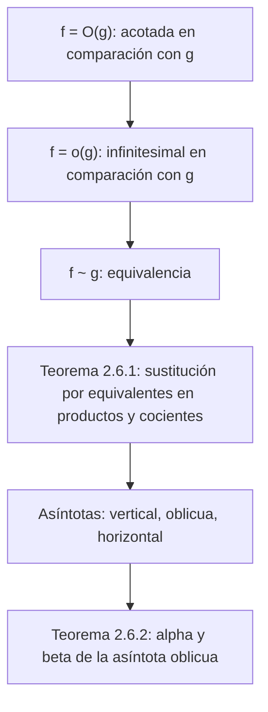

# Lección 21 — Comparación de funciones y asíntotas

[← Lecciones 19–20](lecture-19-20.md) · [Índice de lecciones](index.md) · [Lecciones 22–23 →](lecture-22-23.md) · [Términos y teoremas](../term-index.md) · [Русский](../../ru/lectures-2025-26/lecture-21.md) · [English](../../en/lectures-2025-26/lecture-21.md)

> **Fuente:** `ma25_26_lecture_21_notes.pdf` — 17 páginas: diapositivas impresas con capa de texto (páginas 1–4, 7, 8, 10, 12, 13, 15) y páginas manuscritas sin capa de texto (5, 6, 9, 11, 14, 16, 17). Las páginas manuscritas se transcribieron a partir de su imagen. Los números de página del PDF aparecen en los encabezados; las diapositivas impresas están numeradas en el PDF como «1/10»–«10/10».
>
> **Nota del editor.** La fecha de la lección se toma del pie de las diapositivas («13 de noviembre de 2025»). La «cita del día» de la página 2 es la misma que en las lecciones 22–23 («Métodos típicos de demostración — 3») y se reproduce completa en el archivo de las lecciones 22–23; aquí no se repite.

## Diapositivas impresas 1–3. Introducción

**Objetivo de la lección.** Estudiar las funciones [infinitesimales](lecture-09-10.md#def-2-2-1) y las afirmaciones relacionadas con ellas. Hablar de las [asíntotas](#thm-2-6-2).

## Capítulo 2. Teoría de límites. §6. Límites notables y comparación de funciones (continuación)

### Diapositiva impresa 4 (p. PDF 4). Funciones infinitesimales y otras

Sea $`f, g : D \subset \mathbb{R} \to \mathbb{R}`$, $`x_0`$ [punto de acumulación](lecture-14.md#def-2-4-1) de $`D`$, y supongamos que existen una función $`\varphi : D \to \mathbb{R}`$ y un entorno $`V(x_0)`$ de $`x_0`$ tales que $`f(x) = \varphi(x) g(x)`$ $`\forall x \in \dot V(x_0) \cap D`$.

1. Si $`\varphi`$ es acotada en $`\dot V(x_0) \cap D`$, se dice que $`f`$ es **acotada en comparación con $`g`$** cuando $`x \to x_0`$, y se escribe $`f(x) = O(g(x))`$, $`x \to x_0`$.
2. Si $`\varphi(x) \xrightarrow[x \to x_0]{} 0`$, se dice que $`f`$ es **infinitesimal en comparación con $`g`$** cuando $`x \to x_0`$, y se escribe $`f(x) = o(g(x))`$, $`x \to x_0`$.

### Página manuscrita 5 (p. PDF 5). Observación sobre 1 y ejemplo

**Observación sobre 1 (manuscrita).** $`f(x) = O(g(x))`$ cuando $`x \to x_0`$ si $`\begin{cases} \exists V(x_0) \cap D \\ \exists M \in \mathbb{R} \end{cases}`$ (en el manuscrito $`M`$ se denota con la letra $`\mu`$) tales que $`\left|\dfrac{f(x)}{g(x)}\right| \le M`$ $`\forall x \in \dot V(x_0) \cap D`$.

**Ejemplo.** $`x^3 - 7x^5 + 100x^{2025} = O(x^3)`$ cuando $`x \to 0`$:

```math
\frac{f(x)}{g(x)} = \frac{x^3 - 7x^5 + 100x^{2025}}{x^3} = 1 - 7x^2 + 100x^{2022} \xrightarrow[x \to 0]{} 1.
```

Pero entonces existe $`V(0)`$ con $`\left|\dfrac{f(x)}{g(x)}\right| \le 10`$ $`\forall x \in \dot V(0)`$.

(En verde:) $`x^3 - 7x^5 + 100x^{2025} = O(x^{2025})`$ cuando $`x \to +\infty`$:

```math
\frac{f(x)}{g(x)} = \frac{x^3 - 7x^5 + 100x^{2025}}{x^{2025}} = 100 + \frac{1}{x^{2022}} - \frac{7}{x^{2020}} \xrightarrow[x \to +\infty]{} 100.
```

> **Nota del editor.** En la última igualdad el manuscrito escribe $`x^{2025}`$ en el denominador del último término; lo correcto es $`x^{2020}`$ (pues $`2025 - 5 = 2020`$), como se ha corregido arriba.

### Página manuscrita 6 (p. PDF 6). Observación sobre 2 y ejemplo

**Observación sobre 2 (manuscrita).** $`f(x) = o(g(x))`$ cuando $`x \to x_0`$ si $`\lim\limits_{x \to x_0} \dfrac{f(x)}{g(x)} = 0`$.

**Ejemplo.** $`1 - \cos x = o(x)`$ cuando $`x \to 0`$:

```math
\lim_{x \to x_0} \frac{f(x)}{g(x)} = \lim_{x \to 0} \frac{1 - \cos x}{x} = \lim_{x \to 0} \frac{2\sin^2\frac x2}{x} = \lim_{x \to 0} \left(\frac{\sin\frac x2}{\frac x2}\right)^2 \cdot \frac x2 = 1 \cdot \lim_{x \to 0} \frac x2 = 0,
```

donde se usa $`\cos 2\alpha = 1 - 2\sin^2\alpha`$, es decir, $`2\sin^2\dfrac x2 = 1 - \cos x`$, y el factor $`\left(\dfrac{\sin\frac x2}{\frac x2}\right)^2 \to 1`$ cuando $`x \to 0`$ (primer límite notable; llave verde en el manuscrito).

### Diapositiva impresa 7 (p. PDF 7). Funciones infinitesimales y otras-2

3. Si $`\varphi(x) \xrightarrow[x \to x_0]{} 1`$, se dice que las funciones $`f`$ y $`g`$ son **equivalentes** o **asintóticamente iguales** cuando $`x \to x_0`$, y se escribe $`f(x) \sim g(x)`$, $`x \to x_0`$.

### Diapositiva impresa 8 (p. PDF 8). Sustitución por una equivalente al calcular límites

<a id="thm-2-6-1"></a>**Teorema 2.6.1.** Sea $`f, \widetilde f, g, \widetilde g : D \subset \mathbb{R} \to \mathbb{R}`$, $`x_0`$ punto de acumulación de $`D`$, $`f(x) \sim \widetilde f(x)`$, $`g(x) \sim \widetilde g(x)`$, $`x \to x_0`$. Entonces:

1. $`\lim\limits_{x \to x_0} f(x) g(x) = \lim\limits_{x \to x_0} \widetilde f(x) \widetilde g(x)`$.
2. Si $`x_0`$ es punto de acumulación del dominio de $`\dfrac{f}{g}`$, entonces $`\lim\limits_{x \to x_0} \dfrac{f(x)}{g(x)} = \lim\limits_{x \to x_0} \dfrac{\widetilde f(x)}{\widetilde g(x)}`$.

(En ambas afirmaciones los límites existen simultáneamente o no, y si existen, son iguales.)

### Página manuscrita 9 (p. PDF 9). Demostración del teorema 2.6.1

**Demostración ([teorema 2.6.1](#thm-2-6-1)).** Sea $`\lim\limits_{x \to x_0} \dfrac{f(x)}{g(x)} = A`$. Comprobemos que existe $`\lim\limits_{x \to x_0} \dfrac{\widetilde f(x)}{\widetilde g(x)}`$:

```math
\lim_{x \to x_0} \frac{\widetilde f(x)}{\widetilde g(x)} = \lim_{x \to x_0} \frac{\widetilde f(x)}{f(x)} \cdot \frac{f(x)}{g(x)} \cdot \frac{g(x)}{\widetilde g(x)} = \underbrace{\lim_{x \to x_0} \frac{\widetilde f(x)}{f(x)}}_{=\,1,\ \text{pues } f \sim \widetilde f} \cdot \lim_{x \to x_0} \frac{f(x)}{g(x)} \cdot \underbrace{\lim_{x \to x_0} \frac{g(x)}{\widetilde g(x)}}_{=\,1,\ \text{pues } g \sim \widetilde g} = \lim_{x \to x_0} \frac{f(x)}{g(x)} = A. \quad \blacksquare
```

(En el manuscrito la demostración se hace para el cociente; para el producto es análoga.)

### Diapositiva impresa 10 (p. PDF 10). Observaciones

Si $`g(x) \ne 0`$ en $`\dot V(x_0) \cap D`$, entonces también $`\widetilde g(x) \ne 0`$ en $`\dot{\widetilde V}(x_0) \cap D`$, y recíprocamente. Por tanto, $`x_0`$ es simultáneamente punto de acumulación, o no, de los dominios de $`\dfrac{f}{g}`$ y $`\dfrac{\widetilde f}{\widetilde g}`$.

De las hipótesis del [teorema 2.6.1](#thm-2-6-1) **no** se sigue que $`\lim\limits_{x \to x_0} (f(x) \pm g(x)) = \lim\limits_{x \to x_0} \left(\widetilde f(x) \pm \widetilde g(x)\right)`$. En otras palabras, al buscar un límite los factores en un producto y en un cociente sí pueden sustituirse por equivalentes, pero los sumandos en una suma o una diferencia, en general, no.

### Página manuscrita 11 (p. PDF 11). Ejemplo para la observación

**Ejemplo (para la observación).** $`f(x) = x + 1`$, $`\widetilde f(x) = g(x) = \widetilde g(x) = x`$, $`x_0 = +\infty`$:

$`\lim\limits_{x \to x_0} (f(x) - g(x)) = \lim\limits_{x \to +\infty} (x + 1 - x) = 1`$;

$`\lim\limits_{x \to x_0} (\widetilde f(x) - \widetilde g(x)) = \lim\limits_{x \to +\infty} (x - x) = 0`$.

Encerrado en rojo: $`1 \ne 0`$.

### Diapositiva impresa 12 (p. PDF 12). Observaciones sobre límites de la forma $`f^g`$

Para hallar límites de funciones de la forma $`f^g`$ ($`f > 0`$) suele ser conveniente la transformación $`(f(x))^{g(x)} = e^{g(x) \ln f(x)}`$.

### Diapositiva impresa 13 (p. PDF 13). Asíntotas

1. Sea $`x_0 \in \mathbb{R}`$ y $`f`$ definida al menos en $`\langle a, x_0)`$ o en $`(x_0, b\rangle`$, con valores en $`\mathbb{R}`$. La recta $`x = x_0`$ se llama **asíntota vertical** de $`f`$ si $`f(x_0^+)`$ o $`f(x_0^-)`$ es $`-\infty`$ o $`+\infty`$ (en la capa de texto de la diapositiva el símbolo $`\infty`$ aparece como «1»).
2. Sea $`\langle a, +\infty) \subset D \subset \mathbb{R}`$, $`f : D \to \mathbb{R}`$, $`\alpha, \beta \in \mathbb{R}`$. La recta $`y = \alpha x + \beta`$ se llama **asíntota oblicua** de $`f`$ cuando $`x \to +\infty`$ si $`f(x) = \alpha x + \beta + o(1)`$, $`x \to +\infty`$. Análogamente se define la asíntota oblicua cuando $`x \to -\infty`$ para una función definida al menos en $`(-\infty, b\rangle`$.
3. La **asíntota horizontal** es el caso particular de la oblicua con $`\alpha = 0`$. La recta $`y = \beta`$ es asíntota horizontal de $`f`$ cuando $`x \to \pm\infty`$ si y solo si $`f(x) \xrightarrow[x \to \pm\infty]{} \beta`$.

### Página manuscrita 14 (p. PDF 14). Dibujos de asíntotas

Tres dibujos sin etiquetas en los ejes: a la izquierda (en rojo), una asíntota vertical $`x = x_0`$ (recta amarilla) con las anotaciones $`\lim\limits_{x \to x_0^-} f(x) = f(x_0^-) = +\infty`$ y $`\lim\limits_{x \to x_0^+} f(x) = f(x_0^+) = -\infty`$; arriba a la derecha (en verde), una asíntota vertical $`x = x_0`$ hacia la que la gráfica tiende a $`+\infty`$ por ambos lados; abajo, una curva roja que se acerca a una recta oblicua verde. Abajo a la izquierda está escrito por separado: $`e^x \xrightarrow[x \to -\infty]{} 0`$ (ejemplo de la asíntota horizontal $`y = 0`$).


### Diapositiva impresa 15 (p. PDF 15). Ecuación de la asíntota oblicua

<a id="thm-2-6-2"></a>**Teorema 2.6.2.** Sea $`\langle a, +\infty) \subset D \subset \mathbb{R}`$, $`f : D \to \mathbb{R}`$, $`\alpha, \beta \in \mathbb{R}`$. La recta $`y = \alpha x + \beta`$ es asíntota de $`f`$ cuando $`x \to +\infty`$ si y solo si

```math
\alpha = \lim_{x \to +\infty} \frac{f(x)}{x}, \qquad \beta = \lim_{x \to +\infty} (f(x) - \alpha x).
```

### Página manuscrita 16 (p. PDF 16). Demostración del teorema 2.6.2

**Demostración ([teorema 2.6.2](#thm-2-6-2)).**

($`\Rightarrow`$) La recta $`y = \alpha x + \beta`$ es asíntota de $`f`$ cuando $`x \to +\infty`$ $`\Rightarrow`$ (por la definición de asíntota oblicua) $`f(x) = \alpha x + \beta + \varphi(x)`$, con $`\varphi(x) \xrightarrow[x \to +\infty]{} 0`$.

Por tanto, $`\dfrac{f(x)}{x} - \alpha = \dfrac{\beta + \varphi(x)}{x} \xrightarrow[x \to +\infty]{} 0`$, es decir, $`\dfrac{f(x)}{x} \xrightarrow[x \to +\infty]{} \alpha`$; y $`f(x) - \alpha x = \beta + \varphi(x) \xrightarrow[x \to +\infty]{} \beta`$.

($`\Leftarrow`$) $`\begin{cases} \lim\limits_{x \to +\infty} \dfrac{f(x)}{x} = \alpha \\ \lim\limits_{x \to +\infty} (f(x) - \alpha x) = \beta \end{cases} \Rightarrow`$ pongamos $`\varphi(x) := f(x) - \alpha x - \beta`$ $`\Rightarrow`$ $`\varphi(x) \xrightarrow[x \to +\infty]{} 0`$ $`\Rightarrow`$ $`f(x) = \alpha x + \beta + \varphi(x)`$, con $`\varphi(x) \xrightarrow[x \to +\infty]{} 0`$ $`\Rightarrow`$ por definición $`y = \alpha x + \beta`$ es asíntota de $`f`$. $`\blacksquare`$

(En el manuscrito los coeficientes de la asíntota se escriben con las letras latinas $`a`$, $`b`$ en lugar de $`\alpha`$, $`\beta`$ de la diapositiva impresa; aquí se conserva la notación de la diapositiva.)

### Página manuscrita 17 (p. PDF 17). Observación sobre desarrollos asintóticos

**Observación (manuscrita).** Caso particular de desarrollos asintóticos: $`f(x) = f(x_0) + A(x - x_0) + o(x - x_0)`$, $`x \to x_0`$. Del estudio de tales desarrollos asintóticos se ocupa el cálculo [diferencial](lecture-24-25-26.md#def-3-3-1) (véanse las lecciones 22–23).

## Estructura de la lección



## Páginas de servicio

- La página 1 es la portada; la página 2 es la «cita del día» (la misma que en las lecciones 22–23); la página 3 indica el objetivo de la lección.
