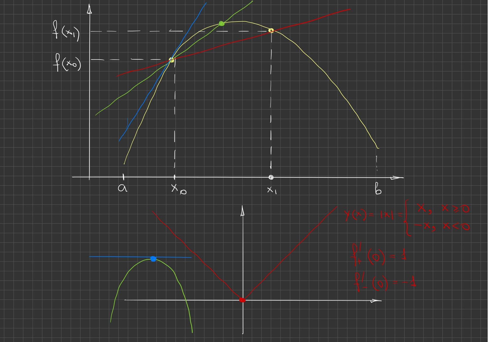
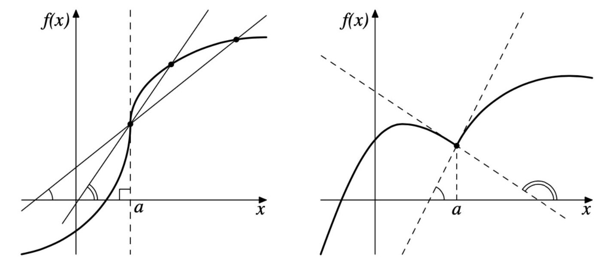
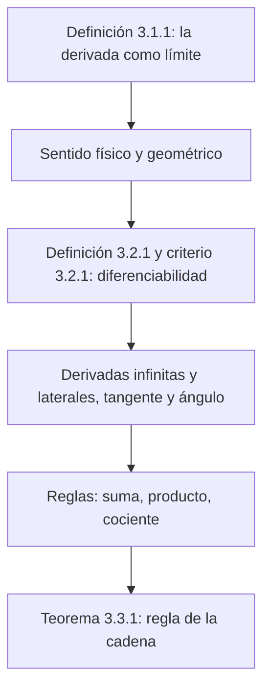

# Lecciones 22–23 — Derivada, diferenciabilidad y reglas de derivación

[Índice de lecciones](index.md) · [Русский](../../ru/lectures-2025-26/lecture-22-23.md) · [English](../../en/lectures-2025-26/lecture-22-23.md)

> **Fuente:** `ma25_26_lectures_22-23_notes.pdf` — 27 páginas: diapositivas impresas con capa de texto (páginas 1–5, 7–9, 12–14, 16, 19–21, 24, 25) y páginas manuscritas sin capa de texto (6, 10, 11, 15, 17, 18, 22, 23, 26, 27). Las páginas manuscritas se transcribieron a partir de su imagen. Los números de página del PDF aparecen en los encabezados; las diapositivas impresas están numeradas en el PDF como «1/17»–«17/17».
>
> **Nota del editor.** La fecha de la lección se toma del pie de las diapositivas («13 de noviembre de 2025»). La notación $\langle a, b\rangle$ denota un intervalo de cualquier tipo.

## Diapositivas impresas 1–4. Introducción

**Cita del día (diapositiva 2).** «MÉTODOS TÍPICOS DE DEMOSTRACIÓN — 3»:

- *Demostración por arrullo:* «La justificación detallada se dará en el capítulo 7 tras desarrollar la teoría correspondiente… Capítulo 7: por sencillez supongamos que $z = 0$ (el caso general se trata en el Apéndice 2)… Apéndice 2: La demostración formal queda fuera del alcance de esta monografía…»
- *Demostración de los antiguos hindúes:* un dibujo y la inscripción «¡MIRA!»
- *Demostración al estilo de Terence Tao* (en la diapositiva: «en la fuerza»): «Teorema 3.3.8. Demostración: véase el ejercicio 3.4.2. Ejercicio 3.4.2: Demuestre el teorema 3.3.8.»

**Objetivo de la lección.** Definir la derivada y su sentido mecánico y geométrico. Estudiar la diferenciabilidad y sus criterios. Introducir las derivadas infinitas y laterales. Considerar la tangente como límite de secantes. Estudiar las reglas de derivación, incluida la derivación de la composición.

**Capítulo 3. Cálculo diferencial de funciones de una variable real** (diapositiva de título 4).

## Capítulo 3, §1. La derivada

### Diapositiva impresa 5 (p. PDF 5). Definición de la derivada

**Definición 3.1.1.** Sea $f : \langle a, b\rangle \to \mathbb{R}$, $x_0 \in \langle a, b\rangle$.

$$
f'(x_0) = \lim_{h \to 0} \frac{f(x_0 + h) - f(x_0)}{h}, \qquad x_0 + h \in \langle a, b\rangle.
$$

$f'(x_0)$ se llama **derivada** de la función $f$ en el punto $x_0$.

### Página manuscrita 6 (p. PDF 6). Sentido físico y geométrico de la derivada

**Sentido físico de la derivada.** $f = f(t)$, $t_0$, $t_0 + h$ $\Rightarrow$ $\dfrac{f(t_0 + h) - f(t_0)}{h}$ es la velocidad media de cambio de la función $f$ en $[t_0, t_0 + h]$; $h \to 0$ $\Rightarrow$ $v_{\text{med}} \to v_{\text{inst}}(t_0)$.

| $f(t)$ | $f'(t)$ |
|---|---|
| ① camino recorrido | ① velocidad |
| ② velocidad | ② aceleración |
| ③ trabajo | ③ potencia |
| ④ temperatura | ④ conductividad térmica (así en el manuscrito) |
| ⑤ impulso (cantidad de movimiento) | ⑤ fuerza |

**Sentido geométrico de la derivada** (abajo en la página, en amarillo): en el dibujo, la curva roja $y = f(x)$ y la recta $y = mx + n$, tangente a la gráfica de $f$ en el punto $x_0$ $\Rightarrow$ $m = f'(x_0)$.

## Capítulo 3, §2. Diferenciabilidad de una función

### Diapositiva impresa 7 (p. PDF 7). Definición de diferenciabilidad

**Definición 3.2.1.** Sea $f : \langle a, b\rangle \to \mathbb{R}$, $x_0 \in \langle a, b\rangle$. La función $f$ se llama **diferenciable en el punto $x_0$** si existe un número $k$ tal que

$$
f(x) = f(x_0) + k(x - x_0) + o(x - x_0), \qquad (x \to x_0).
$$

### Diapositiva impresa 8 (p. PDF 8). Criterio de diferenciabilidad en un punto

**Teorema 3.2.1.** Supongamos que $f : \langle a, b\rangle \to \mathbb{R}$, $x_0 \in \langle a, b\rangle$, $k \in \mathbb{R}$. Entonces las siguientes afirmaciones son equivalentes:

1. $f$ es diferenciable en $x_0$ y $f'(x_0) = k$.
2. El límite $\lim\limits_{x \to x_0} \dfrac{f(x) - f(x_0)}{x - x_0}$ existe y es igual a $k$.
3. Existe una función $F : \langle a, b\rangle \to \mathbb{R}$, continua en $x_0$, con $F(x_0) = k$ y $f(x) - f(x_0) = F(x)(x - x_0)$ para $x \in \langle a, b\rangle$.

### Diapositiva impresa 9 (p. PDF 9). Observaciones sobre las caracterizaciones de la diferenciabilidad

La afirmación 2 es conveniente porque da un método para calcular la derivada. Además, la representación de la derivada como límite permite definir las derivadas infinitas y las derivadas laterales.

La afirmación 3, que da una expresión explícita del incremento de la función mediante el incremento del argumento, se usará para deducir las reglas de derivación.

Las caracterizaciones de la diferenciabilidad de las afirmaciones 2 y 3 no pueden trasladarse al caso de funciones de varias variables, mientras que la definición 3.2.1 sí tiene un análogo multidimensional. Por eso no usamos la afirmación 2 como definición de diferenciabilidad, aunque para fines prácticos sea más conveniente.

### Páginas manuscritas 10–11 (p. PDF 10–11). Demostración del teorema 3.2.1

**Demostración (teorema 3.2.1).** Esquema en el manuscrito: ① $\Rightarrow$ ② $\Rightarrow$ ③ $\Rightarrow$ ①.

① $\Rightarrow$ ②: ① significa que $f(x) - f(x_0) = k(x - x_0) + o(x - x_0)$ cuando $x \to x_0$, de donde $\dfrac{f(x) - f(x_0)}{x - x_0} = k + \dfrac{o(x - x_0)}{x - x_0} \xrightarrow[x \to x_0]{} k$, donde el término encerrado en verde tiende a $0$ cuando $x \to x_0$ por la definición de infinitesimal en comparación con $(x - x_0)$.

② $\Rightarrow$ ③: pongamos $F(x) = \begin{cases} \dfrac{f(x) - f(x_0)}{x - x_0}, & x \ne x_0, \\ k, & x = x_0. \end{cases}$ Por ②, $\lim\limits_{x \to x_0} \dfrac{f(x) - f(x_0)}{x - x_0} = k = F(x_0)$, es decir, $\lim\limits_{x \to x_0} F(x) = F(x_0)$, es decir, $F$ es continua en $x_0$, y

$$
F(x)(x - x_0) = \begin{cases} f(x) - f(x_0), & x \ne x_0, \\ k(x - x_0), & x = x_0 \end{cases} = f(x) - f(x_0) \quad \forall x \in \langle a, b\rangle.
$$

③ $\Rightarrow$ ①: por ③, $f(x) - f(x_0) = F(x) \cdot (x - x_0)$ $\Rightarrow$

$$
f(x) = f(x_0) + F(x) \cdot (x - x_0) \pm k(x - x_0) = f(x_0) + k(x - x_0) + \underbrace{(F(x) - k)(x - x_0)}_{o(x - x_0)},
$$

(en amarillo:) $F$ es continua en $x_0$ $\Rightarrow$ $F(x) \xrightarrow[x \to x_0]{} F(x_0) = k$, y obtenemos ①. $\blacksquare$

> **Nota del editor.** En el manuscrito (p. PDF 11), en la igualdad para $F(x)(x - x_0)$ el segundo miembro está escrito como «$f(x - x_0)$», y bajo la llave $o(x - x_0)$ figura $O(x - x_0)$; arriba se dan las expresiones correctas $f(x) - f(x_0)$ y $o(x - x_0)$.

### Diapositiva impresa 12 (p. PDF 12). Cociente incremental

La fracción $\dfrac{f(x) - f(x_0)}{x - x_0}$ se llama **cociente incremental** (razón de incrementos). Tiene el siguiente sentido físico. Si $f$ describe la dependencia de la coordenada de un punto material en movimiento respecto del tiempo, el cociente incremental da la velocidad media del punto en el intervalo de tiempo entre los instantes $x_0$ y $x$. Entonces $f'(x_0)$ puede entenderse como la velocidad instantánea en el instante $x_0$.

### Diapositiva impresa 13 (p. PDF 13). Derivadas infinitas y laterales

1. **Derivadas infinitas.** Diremos que $f'(x_0) = \pm\infty$ si $\lim\limits_{x \to x_0} \dfrac{f(x) - f(x_0)}{x - x_0} = \pm\infty$. Análogamente se define la igualdad $f'(x_0) = \infty$. Obsérvese que si $f$ tiene derivada infinita en $x_0$, entonces **no** es diferenciable en ese punto.
2. **Derivadas laterales.** Denotemos $f'_{\pm}(x_0) = \lim\limits_{x \to x_0^{\pm}} \dfrac{f(x) - f(x_0)}{x - x_0}$. Si $f'_-(x_0)$ y $f'_+(x_0)$ existen, se llaman respectivamente derivadas **por la izquierda** y **por la derecha** de $f$ en $x_0$. La diferenciabilidad de $f$ en $x_0 \in (a, b)$ significa que $f'_-(x_0)$ y $f'_+(x_0)$ son finitas e iguales. Su valor común en ese caso es $f'(x_0)$.

### Diapositiva impresa 14 (p. PDF 14). La tangente como límite de secantes

Sea $x_1 \in \langle a, b\rangle$. Consideremos la recta que pasa por los puntos $(x_0, f(x_0))$ y $(x_1, f(x_1))$ (la llamaremos **secante**). Viene dada por la ecuación $y = f(x_0) + k(x_1)(x - x_0)$, donde $k(x_1) = \dfrac{f(x_1) - f(x_0)}{x_1 - x_0}$.

Si $f$ es diferenciable en $x_0$, entonces $\lim\limits_{x_1 \to x_0} k(x_1) = f'(x_0)$. Por tanto, cuando $x_1 \to x_0$ la secante, girando alrededor del punto $(x_0, f(x_0))$, se acerca a la recta $y = f(x_0) + f'(x_0)(x - x_0)$, es decir, a la **tangente**.

En el caso $f'(x_0) = \pm\infty$ el ángulo de inclinación de la secante tiende a $\dfrac\pi2$ por la derecha o por la izquierda, respectivamente, y ella misma tiende a la posición vertical.

### Página manuscrita 15 (p. PDF 15). Dibujos: secantes, tangente, ángulo

Dibujo superior: una curva-gráfica amarilla en $[a, b]$, los puntos $(x_0, f(x_0))$ y $(x_1, f(x_1))$ (con trazos discontinuos a los ejes), secantes roja y verde por estos puntos y la tangente azul en $x_0$. Abajo a la izquierda: una «colina» verde con la tangente horizontal azul en el vértice (punto azul). Abajo a la derecha (en rojo): la gráfica $f(x) = |x| = \begin{cases} x, & x \ge 0, \\ -x, & x < 0 \end{cases}$ (en el manuscrito la función se denota $Y(x)$) con las anotaciones $f'_+(0) = 1$, $f'_-(0) = -1$.

### Diapositiva impresa 16 (p. PDF 16). La tangente como límite de secantes-2

Finalmente, si $f'_-(x_0)$ y $f'_+(x_0)$ existen y son distintas, la posición límite de la secante depende de por qué lado se acerque $x_1$ a $x_0$ (por la izquierda o por la derecha). En este caso la gráfica de $f$ tiene un **ángulo** (punto anguloso).

En el dibujo impreso de la diapositiva (el punto se denota $a$ en lugar de $x_0$): a la izquierda, secantes y la recta vertical discontinua $x = a$ con un ángulo recto (caso de derivada infinita); a la derecha, una gráfica con un ángulo en $a$ y dos posiciones límite discontinuas de la secante con los ángulos de inclinación marcados.

### Páginas manuscritas 17–18 (p. PDF 17–18). Ejemplos de cálculo de la derivada por la definición

**Ejemplos.**

① $f(x) = x^2$, $f : \mathbb{R} \to \mathbb{R}$:

$$
\lim_{x \to a} \frac{f(x) - f(a)}{x - a} = \lim_{x \to a} \frac{x^2 - a^2}{x - a} = \lim_{x \to a} \frac{(x - a)(x + a)}{x - a} = \lim_{x \to a} (x + a) = 2a \Rightarrow f'(a) = 2a
$$

(el factor $(x - a)$ está tachado en rojo en el manuscrito). $\Rightarrow$ $f(x) = x^2$ es diferenciable en todo punto $a \in \mathbb{R}$ y $f'(a) = 2a$.

② $f(x) = \sqrt[3]{x}$, $f : \mathbb{R} \to \mathbb{R}$:

$$
\lim_{x \to 0} \frac{f(x) - f(0)}{x - 0} = \lim_{x \to 0} \frac{x^{1/3}}{x} = \lim_{x \to 0} x^{-2/3} = +\infty
$$

$\Rightarrow$ $f(x) = \sqrt[3]{x}$ no es diferenciable en $0$, pero $f'(0) = +\infty$.

③ $f(x) = \begin{cases} x^2 \sin\dfrac1x, & x \ne 0, \\ 0, & x = 0: \end{cases}$

$$
\lim_{x \to 0} \frac{f(x) - f(0)}{x - 0} = \lim_{x \to 0} \frac{f(x)}{x} = \lim_{x \to 0} \frac{x^2 \sin\frac1x}{x} = \lim_{x \to 0} x \cdot \sin\frac1x = 0,
$$

donde $x$ es un infinitesimal (en amarillo) y $\sin\dfrac1x$ es una función acotada, pues $|\sin t| \le 1$ $\forall t \in \mathbb{R}$ (en verde). $\Rightarrow$ $f$ es diferenciable en $0$ y $f'(0) = 0$.

④ $f(x) = \begin{cases} x \sin\dfrac1x, & x \ne 0, \\ 0, & x = 0: \end{cases}$

$$
\lim_{x \to 0} \frac{f(x) - f(0)}{x - 0} = \lim_{x \to 0} \frac{x \sin\frac1x}{x} = \lim_{x \to 0} \sin\frac1x \text{ — el límite no existe.}
$$

$f(x)$ no tiene en $0$ ni siquiera derivadas laterales.

### Diapositiva impresa 19 (p. PDF 19). Observaciones: diferenciabilidad y continuidad

1. Si $f$ es diferenciable en $x_0$, entonces es continua en $x_0$. En efecto, $f(x) - f(x_0) = f'(x_0)(x - x_0) + o(x - x_0) \to 0$ ($x \to x_0$).
2. La observación 1 no puede invertirse. Más aún, vale un hecho más fuerte, establecido por primera vez por Weierstrass: existe una función continua en $\mathbb{R}$ no diferenciable en ningún punto.

## Capítulo 3, §3. Reglas de derivación

### Diapositiva impresa 20 (p. PDF 20). Introducción a las reglas de derivación

La derivada de una función diferenciable puede hallarse calculando el límite de su cociente incremental. Este método da, en principio, la posibilidad de derivar una función, pero es incómodo en la práctica. A continuación estableceremos la relación de la derivación con otras operaciones con funciones: composiciones y operaciones aritméticas.

### Diapositiva impresa 21 (p. PDF 21). Reglas de derivación

1. $f$ es diferenciable en $x$, $\lambda \in \mathbb{R}$. Entonces $g(x) = \lambda f(x)$ es diferenciable en $x$ y $g'(x) = \lambda f'(x)$.
2. $f$ y $g$ son diferenciables en $x$. Entonces $f \pm g$ y $fg$ son diferenciables en el mismo punto y $(f \pm g)'(x) = f'(x) \pm g'(x)$, $(fg)'(x) = f'(x) g(x) + f(x) g'(x)$.
3. $f$ y $g$ son diferenciables en $x$, $g(x) \ne 0$. Entonces $\dfrac{f}{g}$ es diferenciable en el mismo punto y $\left(\dfrac{f}{g}\right)'(x) = \dfrac{f'(x) g(x) - f(x) g'(x)}{(g(x))^2}$.

### Páginas manuscritas 22–23 (p. PDF 22–23). Demostración de las reglas del producto y del cociente

**Demostración: ②** (producto; en amarillo se suma y se resta $f(x_0) g(x)$ en el numerador):

$$
\lim_{x \to x_0} \frac{f(x) g(x) - f(x_0) g(x_0) \mp f(x_0) g(x)}{x - x_0} = \lim_{x \to x_0} \frac{f(x) g(x) - f(x_0) g(x)}{x - x_0} + \lim_{x \to x_0} \frac{f(x_0) g(x) - f(x_0) g(x_0)}{x - x_0}
$$

$$
= \lim_{x \to x_0} \frac{f(x) - f(x_0)}{x - x_0} \cdot g(x) + \lim_{x \to x_0} f(x_0) \cdot \frac{g(x) - g(x_0)}{x - x_0} = \lim_{x \to x_0} \frac{f(x) - f(x_0)}{x - x_0} \cdot \lim_{x \to x_0} g(x) + \lim_{x \to x_0} f(x_0) \cdot \lim_{x \to x_0} \frac{g(x) - g(x_0)}{x - x_0},
$$

donde (anotaciones del manuscrito): el primer límite $= f'(x_0)$, pues $f$ es diferenciable en $x_0$ (recuadro rojo); $\lim\limits_{x \to x_0} g(x) = g(x_0)$, pues $g$ es diferenciable en $x_0$ $\Rightarrow$ $g$ es continua en $x_0$ $\Rightarrow$ y para una función continua $\lim\limits_{x \to x_0} g(x) = g(x_0)$ (óvalo verde); $\lim\limits_{x \to x_0} f(x_0) = f(x_0)$, pues $f(x_0) = \mathrm{const}$ (óvalo amarillo); el último límite $= g'(x_0)$, pues $g$ es diferenciable en $x_0$ (recuadro rojo).

Así, $(f \cdot g)'(x_0) = \lim\limits_{x \to x_0} \dfrac{f(x) g(x) - f(x_0) g(x_0)}{x - x_0} = f'(x_0) g(x_0) + f(x_0) g'(x_0)$. ✓

③ (cociente):

$$
\lim_{x \to x_0} \frac{\left(\frac{f}{g}\right)(x) - \left(\frac{f}{g}\right)(x_0)}{x - x_0} = \lim_{x \to x_0} \frac{f(x) g(x_0) - f(x_0) g(x)}{(x - x_0) g(x) g(x_0)} = \frac{\lim\limits_{x \to x_0} \dfrac{f(x) g(x_0) - f(x_0) g(x)}{x - x_0}}{\lim\limits_{x \to x_0} g(x) g(x_0)} = \frac{f'(x_0) g(x_0) - f(x_0) g'(x_0)}{g^2(x_0)}. \quad \checkmark
$$

Aquí el denominador: $\lim\limits_{x \to x_0} g(x) \cdot g(x_0) = g(x_0) g(x_0) = g^2(x_0)$ (recuadro verde), y el numerador (en amarillo y azul al final de la página): sumando y restando $f(x_0) g(x_0)$ (en rosa),

$$
\lim_{x \to x_0} \frac{f(x) g(x_0) - f(x_0) g(x) \mp f(x_0) g(x_0)}{x - x_0} = \underbrace{\lim_{x \to x_0} \frac{f(x) g(x_0) - f(x_0) g(x_0)}{x - x_0}}_{=\, f'(x_0) \cdot g(x_0)} - \underbrace{\lim_{x \to x_0} \frac{f(x_0) g(x) - f(x_0) g(x_0)}{x - x_0}}_{=\, f(x_0) \cdot g'(x_0)}.
$$

(En el manuscrito se tratan el producto y el cociente; la suma/diferencia y el producto por una constante son análogos.)

### Diapositiva impresa 24 (p. PDF 24). Derivación de la composición

**Teorema 3.3.1.** Sea $f : \langle A, B\rangle \to \langle C, D\rangle$, $g : \langle C, D\rangle \to \mathbb{R}$, $a \in \langle A, B\rangle$. Si $f$ es diferenciable en $a$ y $g$ es diferenciable en $f(a)$, entonces $g \circ f$ es diferenciable en $a$ y $(g \circ f)'(a) = g'(f(a)) \cdot f'(a)$.

### Diapositiva impresa 25 (p. PDF 25). Observaciones: la regla de la cadena

1. Para funciones lineales $f$ y $g$ la afirmación del teorema 3.3.1 es obvia, puesto que su composición vuelve a ser una función lineal cuyo coeficiente angular es el producto de los coeficientes angulares de $f$ y $g$, es decir, de sus derivadas.
2. La regla de derivación de la composición se generaliza fácilmente a varias funciones: la derivada de la composición es el producto de las derivadas de todas las funciones en los puntos correspondientes. Por ejemplo, para tres funciones la fórmula es $(h \circ g \circ f)'(a) = h'((g \circ f)(a)) \cdot g'(f(a)) \cdot f'(a)$. Por eso el teorema 3.3.1 también se llama **regla de la cadena**.

### Páginas manuscritas 26–27 (p. PDF 26–27). Caso lineal y demostración del teorema 3.3.1

(Parte superior de la página 26, ilustración de la observación 1:) $f(x) = mx + n$, $g(y) = \alpha y + \beta$; $(g \circ f)(x) = g(f(x)) = \alpha(mx + n) + \beta = \alpha m x + \alpha n + \beta$; $(g \circ f)'(x) = \alpha \cdot m = \underbrace{g'(f(x))}_{= \alpha} \cdot \underbrace{f'(x)}_{= m}$. ✓

**Demostración (teorema 3.3.1).** Usemos la tercera afirmación del criterio de diferenciabilidad (teorema 3.2.1).

$f$ es diferenciable en $a$ $\iff$ $\exists F : \langle A, B\rangle \to \mathbb{R}$: $F$ es continua en $a$, $F(a) = f'(a)$, $f(x) - f(a) = F(x) \cdot (x - a)$ $\forall x \in \langle A, B\rangle$.

$g$ es diferenciable en $f(a)$ $\iff$ $\exists G : \langle C, D\rangle \to \mathbb{R}$: $G$ es continua en el punto $b = f(a)$, $G(b) = g'(b)$, $g(y) - g(b) = G(y) \cdot (y - b)$ $\forall y \in \langle C, D\rangle$.

Entonces, con $y = f(x)$:

$$
(g \circ f)(x) - (g \circ f)(a) = g(f(x)) - g(f(a)) = G(f(x)) \cdot (f(x) - f(a)) = \underbrace{G(f(x)) \cdot F(x)}_{=\, H(x)} \cdot (x - a).
$$

$\begin{cases} F \text{ es continua en } a \\ G \text{ es continua en } f(a) \end{cases} \Rightarrow$ $H$ es continua en $a$.

Así, tenemos una $H : \langle A, B\rangle \to \mathbb{R}$ tal que $H$ es continua en $a$, $(g \circ f)(x) - (g \circ f)(a) = H(x) \cdot (x - a)$ y

$$
H(a) = \underbrace{G(f(a))}_{g'(f(a))} \cdot \underbrace{F(a)}_{f'(a)} = g'(f(a)) \cdot f'(a).
$$

Por otro lado, $H(a) = (g \circ f)'(a)$. $\blacksquare$

## Estructura de la lección

## Páginas de servicio

- La página 1 es la portada; la página 2 es la «cita del día»; la página 3 indica el objetivo de la lección; la página 4 es la diapositiva de título del capítulo 3.
- La demostración del teorema 3.2.1: p. PDF 10 (① ⇒ ② y ② ⇒ ③) y p. 11 (③ ⇒ ①).
