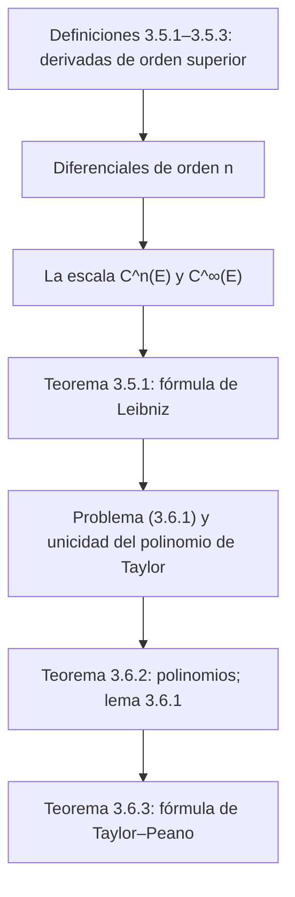

# Lecciones 27–28 — Derivadas de orden superior y fórmula de Taylor

[← Lecciones 24–26](lecture-24-25-26.md) · [Índice de lecciones](index.md) · [Lecciones 29–30 →](lecture-29-30.md) · [Términos y teoremas](../term-index.md) · [Русский](../../ru/lectures-2025-26/lecture-27-28.md) · [English](../../en/lectures-2025-26/lecture-27-28.md)

> **Fuente:** `ma25_26-lectures_27-28_notes.pdf` — 31 páginas: diapositivas impresas con capa de texto (páginas 1–12, 14, 16–18, 21–23, 26, 29, 31) y páginas manuscritas sin capa de texto (13, 15, 19, 20, 24, 25, 27, 28, 30). Las páginas manuscritas se transcribieron a partir de su imagen. Los números de página del PDF aparecen en los encabezados; las diapositivas impresas están numeradas en el PDF como «1/22»–«22/22».
>
> **Nota del editor.** La fecha de la lección se toma del pie de las diapositivas («4 de diciembre de 2025»).

## Diapositivas impresas 1–3. Introducción

**Cita del día (diapositiva 2).** «— ¿Cómo sabré que él [~~mi director científico~~ el dragón] me ha elegido? — Intentará matarte». (Avatar). En la diapositiva, «mi director científico» está tachado; debajo de la cita hay una foto de un dragón con gafas ante un portátil y un fotograma con un ikran de «Avatar».


**Objetivo de la lección.** Introducir el concepto de [derivada](lecture-22-23.md#def-3-1-1) de orden arbitrario. Estudiar la [fórmula de Taylor](#thm-3-6-3).

## Capítulo 3, §5. Derivadas de orden superior

### Diapositiva impresa 4 (p. PDF 4). El conjunto de diferenciabilidad

Hasta ahora hemos hablado de la primera derivada de una función. Introduzcamos ahora el concepto de derivada de orden arbitrario.

Sea $`E \subset \mathbb{R}`$, $`f : E \to \mathbb{R}`$, $`a \in \mathbb{R}`$ y supongamos que se cumple la condición

```math
\exists \delta > 0 : (a - \delta, a + \delta) \cap E \text{ es un intervalo no degenerado} \tag{5.1}
```

<a id="def-3-5-1"></a>**Definición 3.5.1.** Definamos $`E_1`$ como el conjunto de los puntos de $`E`$ que satisfacen la condición (5.1) y en los que la función $`f`$ es diferenciable. Llamaremos a $`E_1`$ el conjunto de diferenciabilidad de $`f`$, y a la función $`x \mapsto f'(x)`$, definida en $`E_1`$, la derivada de $`f`$.

### Diapositiva impresa 5 (p. PDF 5). La segunda derivada de $`f`$

Denotemos por $`E_2`$ el conjunto de todos los puntos $`a \in E_1`$ tales que

1. $`\exists \delta > 0 : E_1 \cap (a - \delta, a + \delta) = E \cap (a - \delta, a + \delta)`$;
2. La función $`f'`$ es [diferenciable](lecture-22-23.md#def-3-2-1) en el punto $`a`$.

<a id="def-3-5-2"></a>**Definición 3.5.2.** Sea $`a \in E_2`$. El número $`(f')'(a)`$ se llama segunda derivada de $`f`$ en el punto $`a`$ y se denota $`f''(a)`$; la función $`f`$ se dice dos veces diferenciable en el punto $`a`$. La función $`f''`$, definida en $`E_2`$ por $`x \mapsto f''(x)`$, se llama segunda derivada de $`f`$.

Otras notaciones en la diapositiva: $`f^{(2)}(a)`$, $`\dfrac{d^2 f}{dx^2}(a)`$, $`D^2 f(a)`$.

### Diapositiva impresa 6 (p. PDF 6). La $`n`$-ésima derivada de $`f`$

Supongamos que ya hemos definido las funciones $`f^{(2)}, \ldots, f^{(n-1)}`$, definidas respectivamente en $`E_2, \ldots, E_{n-1}`$. Denotemos por $`E_n`$ el conjunto de todos los puntos $`a \in E_{n-1}`$ tales que

1. $`\exists \delta > 0 : E_{n-1} \cap (a - \delta, a + \delta) = E \cap (a - \delta, a + \delta)`$;
2. La función $`f^{(n-1)}`$ es diferenciable en el punto $`a`$.

<a id="def-3-5-3"></a>**Definición 3.5.3.** Sea $`a \in E_n`$. El número $`(f^{(n-1)})'(a)`$ se llama $`n`$-ésima derivada de $`f`$ en el punto $`a`$ y se denota $`f^{(n)}(a)`$; la función $`f`$ se dice $`n`$ veces diferenciable en el punto $`a`$. La función $`f^{(n)}`$, definida en $`E_n`$ por $`x \mapsto f^{(n)}(x)`$, se llama $`n`$-ésima derivada de $`f`$.

Convenios: $`f^{(0)} = f`$, $`E_0 = E`$.

### Diapositiva impresa 7 (p. PDF 7). Derivadas laterales de orden superior

Para $`a \in E`$ y $`n \in \mathbb{N}`$ definimos las [derivadas laterales](../06-derivatives.md#sec-6-1) de orden $`n`$ como

```math
f^{(n)}_+(a) = \left(f\big|_{[a, +\infty) \cap E}\right)^{(n)}(a), \qquad f^{(n)}_-(a) = \left(f\big|_{(-\infty, a] \cap E}\right)^{(n)}(a).
```

Obsérvese que para $`n = 1`$ obtenemos la definición de derivadas laterales introducida anteriormente.

### Diapositiva impresa 8 (p. PDF 8). Diferenciales de orden $`n`$ de la función $`f`$

Sea $`h \in \mathbb{R}`$. Denotemos $`g_1(x) = d_x f(h) = f'(x) dh`$, $`x \in E_1`$ (en las diapositivas la notación $`dh`$ se emplea para el incremento $`h`$).

<a id="def-3-5-4"></a>**Definición 3.5.4.** Para $`a \in E_2`$ pongamos

```math
d^2_a f(h) = d_a g_1(g) = g_1'(a) dh = \big(f'(a) dh\big)' dh = f''(a)(dh)^2.
```

Entonces $`d^2_a f(h)`$ se llama **segunda diferencial de $`f`$ en el punto $`a`$ sobre el incremento $`h`$**.

> **Nota del editor.** En la escritura $`d_a g_1(g)`$ de la diapositiva parece haber una errata: el argumento debería ser el incremento $`h`$ (cf. la [definición 3.5.5](#def-3-5-5) siguiente, donde aparece $`d_a g_{n-1}(h)`$).

Supongamos que $`d^2_a f, \ldots, d^{(n-1)}_a f`$ ya están definidas. Pongamos $`g_{n-1}(x) = d^{n-1}_x f(h)`$, $`x \in E_{n-1}`$.

<a id="def-3-5-5"></a>**Definición 3.5.5.** Para $`a \in E_n`$ el número $`d_a g_{n-1}(h)`$ se llama **$`n`$-ésima diferencial de $`f`$ en el punto $`a`$ sobre el incremento $`h`$** y se denota $`d^n_a f(h)`$.

### Diapositiva impresa 9 (p. PDF 9). Diferenciales de orden $`n`$: resumen

Por [inducción](../01-logic-sets-functions.md#example-induction) hemos definido la [diferencial](lecture-24-25-26.md#def-3-3-1) de una función $`f`$ de cualquier orden $`n`$. Para $`n = 1`$ escribiremos simplemente $`d_a f`$ en lugar de $`d^1_a f`$. Obsérvese que

```math
d^n_a f(h) = f^{(n)}(a) h^n \qquad \forall n \in \mathbb{N} \text{ y } a \in E_n.
```

### Diapositiva impresa 10 (p. PDF 10). Diferenciabilidad $`n`$ veces de una función en un conjunto

<a id="def-3-5-6"></a>**Definición 3.5.6.** Sea $`F \subset E`$. La función $`f`$ se dice $`n`$ veces diferenciable en $`F`$ si es $`n`$ veces diferenciable en todo punto de $`F`$ (es decir, $`F \subset E_n`$). Si además $`f^{(n)}`$ es continua en $`F`$, entonces $`f`$ se dice $`n`$ veces continuamente diferenciable en $`F`$.

### Diapositiva impresa 11 (p. PDF 11). La escala de funciones continuamente diferenciables $`C^k`$

<a id="def-3-5-7"></a>**Definición 3.5.7.** Sea $`n \in \mathbb{N} \cup \{0\} =: \mathbb{N}_0`$, sea $`E \subset \mathbb{R}`$. Denotemos por $`C^n(E)`$ el conjunto de las funciones definidas y $`n`$ veces continuamente diferenciables en $`E`$.

Para $`n = 0`$ la clase $`C^n(E)`$ es el conjunto de las funciones continuas en $`E`$. En este caso, en lugar de $`C^0(E)`$ escribiremos simplemente $`C(E)`$. Además, pongamos

```math
C^{\infty}(E) = \bigcap_{n=0}^{\infty} C^n(E).
```

Esta clase está formada por las funciones que tienen derivadas de todos los órdenes en $`E`$.

### Diapositiva impresa 12 (p. PDF 12). La escala $`C^k`$: observaciones

Las clases $`C^n`$ disminuyen al crecer $`n`$, es decir,

```math
C(E) \supset C^1(E) \supset \cdots \supset C^n(E) \supset C^{n+1}(E) \supset \cdots \supset C^{\infty}(E).
```

**Observaciones.**

1. Todas las inclusiones son estrictas.
2. La clase de las funciones derivables en $`E`$ es estrictamente más amplia que la clase de las funciones [continuamente diferenciables](../15-multivariable-differentiation.md#sec-15-1) en $`E`$.

### Página manuscrita 13 (p. PDF 13). Ejemplos para las observaciones

**Ejemplo (manuscrito).**

1 (enmarcado) $`f_n(x) = x^{n + 1/3}`$:

$`f_n'(x) = \left(n + \tfrac13\right) x^{n + 1/3 - 1} = \left(n + \tfrac13\right) x^{n - 2/3}`$;

$`f_n''(x) = \left(n + \tfrac13\right)\left(n - \tfrac23\right) x^{n - 2/3 - 1} = \left(n + \tfrac13\right)\left(n - \tfrac23\right) x^{n - 5/3}`$; …

$`f_n^{(n)}(x) = \left(n + \tfrac13\right)\left(n - \tfrac23\right) \cdots \dfrac43 \sqrt[3]{x}`$ está definida y es continua en $`\mathbb{R}`$, pero no es diferenciable en $`0`$.

$`\Rightarrow`$ $`f_n \in C^n(\mathbb{R})`$, pero $`f_n \notin C^{n+1}(\mathbb{R})`$ y con más razón $`f \notin C^{\infty}(\mathbb{R})`$ (así en la pizarra; se refiere a $`f_n`$).

2 (enmarcado) $`f(x) = \begin{cases} x^2 \sin\dfrac1x, & x \ne 0, \\ 0, & x = 0, \end{cases}`$ $`f`$ es diferenciable en $`\mathbb{R}`$,

$`f'(x) = \begin{cases} 2x \sin\dfrac1x - \cos\dfrac1x, & x \ne 0, \\ 0, & x = 0, \end{cases}`$ ¡$`f'(x)`$ es discontinua en el punto $`0`$, porque no tiene límite allí!

### Diapositiva impresa 13 (p. PDF 14). Derivadas superiores y operaciones aritméticas

<a id="thm-3-5-1"></a>**Teorema 3.5.1.** Sea $`E \subset \mathbb{R}`$, $`a \in E`$, $`n \in \mathbb{N}`$. Si $`f`$ y $`g`$ son $`n`$ veces diferenciables en el punto $`a`$, entonces se cumplen las siguientes afirmaciones:

1. Para cualesquiera $`\alpha, \beta \in \mathbb{R}`$ la función $`\alpha f + \beta g`$ es $`n`$ veces diferenciable en el punto $`a`$ y $`(\alpha f + \beta g)^{(n)}(a) = \alpha f^{(n)}(a) + \beta g^{(n)}(a)`$.
2. La función $`fg`$ es $`n`$ veces diferenciable en el punto $`a`$ y

```math
(fg)^{(n)}(a) = \sum_{k=0}^{n} C^k_n f^{(k)}(a) g^{(n-k)}(a)
```

(fórmula de Leibniz).

### Página manuscrita 15 (p. PDF 15). Observación: la fórmula de Leibniz para $`n = 1`$

**Observación (manuscrita).** ($`n = 1`$ en un círculo)

```math
(f \cdot g)^{(1)}(a) = \sum_{k=0}^{1} C^k_1 f^{(k)}(a) g^{(1-k)}(a),
```

donde el miembro izquierdo está anotado como $`(f \cdot g)'(a)`$ (subrayado en turquesa):

```math
= C^0_1 f^{(0)}(a) g^{(1)}(a) + C^1_1 f^{(1)}(a) g^{(0)}(a) = \frac{1!}{0! \, 1!} f(a) g'(a) + \frac{1!}{1! \, 0!} f'(a) g(a) = f(a) g'(a) + f'(a) g(a)
```

(subrayado en turquesa): la regla habitual de derivación del producto.

## Capítulo 3, §6. Fórmula de Taylor

### Diapositiva impresa 14 (p. PDF 16). Motivación

En ciertas situaciones, el estudio del comportamiento de una función puede reducirse al estudio de un polinomio que «aproxima bien» dicha función. Señalemos las ventajas de este enfoque.

1. El cálculo de los valores de los polinomios requiere solo las operaciones de suma y multiplicación. Por tanto, aproximar una función mediante polinomios proporciona un modo cómodo (en la diapositiva, con una errata: «удобныый») de calcular aproximadamente sus valores.
2. Analizar el comportamiento de los polinomios de primer o segundo grado no es difícil, ya que sus gráficas se construyen fácilmente. Si tales polinomios aproximan suficientemente bien una función en un entorno de algún punto, podremos obtener información sobre ciertas propiedades locales de esa función.

### Diapositiva impresa 15 (p. PDF 17). Formalización del problema

Sea $`E \subset \mathbb{R}`$, $`a \in E`$ un [punto límite](lecture-14.md#def-2-4-1) del conjunto $`E`$, $`f : E \to \mathbb{R}`$, $`n \in \mathbb{Z}_+`$. Hay que construir un polinomio

```math
p(x) = \sum_{k=0}^{n} c_k (x - a)^k
```

de grado no superior a $`n`$ tal que

```math
p(a) = f(a) \quad \text{y} \quad f(x) = p(x) + o\big((x - a)^n\big) \quad (x \mapsto a). \tag{3.6.1}
```

### Diapositiva impresa 16 (p. PDF 18). Unicidad del polinomio $`p`$

<a id="thm-3-6-1"></a>**Teorema 3.6.1.** Si existe un polinomio $`p`$ que satisface la condición (3.6.1), entonces es único.

### Páginas manuscritas 19–20 (pp. PDF 19–20). Demostración del teorema 3.6.1

**Demostración ([teorema 3.6.1](#thm-3-6-1)).** Sea $`p(x) = \sum\limits_{k=0}^{n} c_k (x - a)^k`$, $`p(a) = f(a)`$, $`f(x) = p(x) + o\big((x - a)^n\big)`$. Supongamos que existe $`q(x) = \sum\limits_{k=0}^{n} b_k (x - a)^k`$, $`q(a) = f(a)`$, $`f(x) = q(x) + o\big((x - a)^n\big)`$.

Entonces $`r(x) := p(x) - q(x) = \sum\limits_{k=0}^{n} r_k (x - a)^k`$, donde $`r_k := c_k - b_k`$, y $`r(x) = o\big((x - a)^n\big)`$ cuando $`x \mapsto a`$.

Supongamos que $`r(x) \not\equiv 0`$, es decir, no todos los $`r_k = 0`$ $`\Rightarrow`$ (p. 20) $`r(x) = r_m (x - a)^m + \ldots + r_n (x - a)^n`$, donde $`m \in \mathbb{Z}_+`$ y $`r_m \ne 0`$ (el primer coeficiente no nulo). Entonces

```math
\sum_{k=m}^{n} r_k (x - a)^{k - m} = \frac{r(x)}{(x - a)^m} = \frac{o\big((x - a)^n\big)}{(x - a)^m} = o\big((x - a)^{n - m}\big) \quad \text{cuando } x \mapsto a
```

(la última igualdad, en verde en la p. 19). Pero el miembro izquierdo tiende a $`r_m \ne 0`$ cuando $`x \mapsto a`$, y el derecho, a $`0`$: contradicción (rayo). Al final de la p. 20 hay un cálculo auxiliar: $`\dfrac{\sum\limits_{k=0}^{n} r_k (x - a)^k}{(x - a)^m} = \dfrac{\sum\limits_{k=m}^{n} r_k (x - a)^k}{(x - a)^m} = \sum\limits_{k=m}^{n} r_k (x - a)^{k - m}`$. $`\blacksquare`$

### Diapositiva impresa 17 (p. PDF 21). El polinomio de Taylor

<a id="def-3-6-1"></a>**Definición 3.6.1.** El polinomio $`p`$ de grado no superior a $`n`$ que satisface la condición (3.6.1) se llama polinomio de Taylor de la función $`f`$ de orden $`n`$ en el punto $`a`$ y se denota $`T_{a,n} f`$.

### Diapositiva impresa 18 (p. PDF 22). Fórmula de Taylor para polinomios

Sea $`a \in \mathbb{R}`$, $`n \in \mathbb{N}`$. Consideremos primero el caso en que la función es un polinomio de grado no superior a $`n`$. Denotémoslo por $`p`$ y escribámoslo en la forma $`p(x) = \sum\limits_{k=0}^{n} c_k (x - a)^k`$, donde $`c_0, \ldots, c_n \in \mathbb{R}`$. Es claro que $`c_0 = p(a)`$. ¿Cómo expresar los demás coeficientes $`c_k`$ en términos de $`p`$?

### Diapositiva impresa 19 (p. PDF 23). Fórmula de Taylor para polinomios — 2

<a id="thm-3-6-2"></a>**Teorema 3.6.2.** Sea $`n \in \mathbb{Z}_+`$, $`p`$ un polinomio de grado no superior a $`n`$. Entonces, para cualesquiera $`a, x \in \mathbb{R}`$,

```math
p(x) = \sum_{k=0}^{n} \frac{p^{(k)}(a)}{k!} (x - a)^k.
```

### Páginas manuscritas 24–25 (pp. PDF 24–25). Demostración del teorema 3.6.2

**Demostración ([teorema 3.6.2](#thm-3-6-2)).** Mostremos primero que

```math
\left. \big((x - a)^k\big)^{(m)} \right|_{x = a} = \begin{cases} 0, & \text{si } m \ne k, \\ m!, & \text{si } m = k. \end{cases}
```

(En amarillo:) **Recordatorio:** $`\big[(x - a)^3\big]' = 3(x - a)^2`$, $`\big[(x - a)^3\big]'' = \big[3(x - a)^2\big]' = 3 \cdot 2 \cdot (x - a)`$, $`\big[(x - a)^3\big]''' = 3 \cdot 2 \cdot 1`$.

① $`m \le k`$: $`\left. \big((x - a)^k\big)^{(m)} \right|_{x = a} = \left. k \cdot (k - 1) \cdot \ldots \cdot (k - m + 1) (x - a)^{k - m} \right|_{x = a} = \begin{cases} 0, & m < k, \\ k! = m!, & \text{para } m = k. \end{cases}`$

② $`m > k`$ $`\Rightarrow`$ $`\big((x - a)^k\big)^{(m)} = 0`$ $`\forall x \in \mathbb{R}`$, pues $`\big((x - a)^k\big)^{(k)} = \mathrm{const}`$.

$`p(x) = \sum\limits_{k=0}^{n} c_k (x - a)^k`$ $`\Rightarrow`$ $`p^{(m)}(a) = \sum\limits_{k=0}^{n} c_k \left. \big((x - a)^k\big)^{(m)} \right|_{x = a} = c_m \cdot m!`$ $`\forall m = 1, 2, \ldots, n`$ ($`p^{(m)}(a)`$ y $`c_m \cdot m!`$ subrayados en turquesa).

**Ilustración (p. 25).** $`n > 4`$:

$`p^{(4)}(x) = c_0^{(4)} + c_1 \left. \big[(x - a)\big]^{(4)} \right|_{x = a} + c_2 \left. \big[(x - a)^2\big]^{(4)} \right|_{x = a} + c_3 \left. \big[(x - a)^3\big]^{(4)} \right|_{x = a} + c_4 \left. \big[(x - a)^4\big]^{(4)} \right|_{x = a} + c_5 \ldots`$,

donde en rosa están destacados los paréntesis iguales a $`0`$ («$`= 0`$»), y bajo el cuarto término está escrito $`4 \cdot 3 \cdot 2 \cdot 1`$.

$`\Rightarrow`$ $`p^{(m)}(a) = c_m \cdot m!`$ $`\Rightarrow`$ $`c_m = \dfrac{p^{(m)}(a)}{m!}`$.

(En verde:) Así, $`T_{a,n} p(x) = p(x) = \sum\limits_{k=0}^{n} \dfrac{p^{(k)}(a)}{k!} (x - a)^k`$. $`\blacksquare`$

### Diapositiva impresa 20 (p. PDF 26). Una propiedad de las funciones $`n`$ veces diferenciables

<a id="lem-3-6-1"></a>**Lema 3.6.1.** Sea $`E \subset \mathbb{R}`$, $`a \in E`$, $`g : E \to \mathbb{R}`$, $`n \in \mathbb{N}`$. Supongamos que la función $`g`$ es $`n`$ veces diferenciable en el punto $`a`$ y

```math
g(a) = g'(a) = \cdots = g^{(n)}(a) = 0.
```

Entonces $`g(x) = o\big((x - a)^n\big)`$ cuando $`x \mapsto a`$.

### Páginas manuscritas 27–28 (pp. PDF 27–28). Demostración del lema 3.6.1

**Demostración ([lema 3.6.1](#lem-3-6-1)):** inducción sobre $`n`$.

**Base:** $`n = 1`$ (enmarcado) $`\Rightarrow`$ $`g`$ es diferenciable en el punto $`a`$ $`\Rightarrow`$ por la definición de diferenciabilidad $`\Rightarrow`$ $`g(x) = g(a) + g'(a)(x - a) + o(x - a)`$ cuando $`x \mapsto a`$, donde $`g(a) = 0`$ y $`g'(a) = 0`$ por hipótesis del lema (llaves amarillas) $`\Rightarrow`$ $`g(x) = o(x - a)`$ cuando $`x \mapsto a`$ ✓.

**Hipótesis de inducción:** $`g(x) = o\big((x - a)^n\big)`$.

**Paso de inducción:** $`n \mapsto n + 1`$ $`\Rightarrow`$ es decir, suponemos que $`g(x)`$ es $`(n + 1)`$ veces diferenciable en el punto $`a`$ y que $`g(a) = g'(a) = \ldots = g^{(n)}(a) = g^{(n+1)}(a) = 0`$ $`\Rightarrow`$ (en amarillo) aplicamos la hipótesis de inducción a la función $`g'`$, donde $`g'(a) = \ldots = (g')^{(n)}(a) = 0`$ $`\Rightarrow`$ (p. 28) $`g'(x) = o\big((x - a)^n\big)`$ cuando $`x \mapsto a`$ (subrayado en turquesa).

(En amarillo:) $`\exists \sigma > 0`$ tal que $`E \cap (a - \sigma, a + \sigma)`$ es un intervalo y la función $`g'`$ es $`n`$ veces diferenciable en él. Por la definición de «$`o`$» $`\Rightarrow`$ $`\exists \delta \in (0, \sigma)`$ tal que $`|g'(x)| \le \varepsilon |x - a|^n`$ para $`x \in E`$, $`|x - a| < \delta`$.

Sea $`x \in E`$, $`|x - a| < \delta`$ $`\Rightarrow`$ $`\exists \theta \in (0, 1)`$ tal que $`g(x) = g(x) - g(a) = g'(a + \theta(x - a))(x - a)`$ ([fórmula de los incrementos finitos](lecture-24-25-26.md#thm-3-4-3)).

(En rojo:) Obsérvese que $`|a + \theta(x - a) - a| = \theta |x - a| < \theta \delta < \delta`$ $`\Rightarrow`$ $`|g'(a + \theta(x - a))| \le \varepsilon \big(\theta |x - a|\big)^n \le \varepsilon |x - a|^n`$.

Entonces

```math
|g(x)| = |g(x) - g(a)| = |g'(a + \theta(x - a))| \cdot |x - a| \le \varepsilon |x - a|^n \cdot |x - a| = \varepsilon |x - a|^{n + 1} \Rightarrow g(x) = o\big((x - a)^{n + 1}\big) \quad \text{cuando } x \mapsto a. \qquad \blacksquare
```

> **Nota del editor.** En la última cadena de la pizarra figura $`|g(x) - g(0)|`$ en lugar de $`|g(x) - g(a)|`$; arriba está corregido. La cantidad $`\varepsilon > 0`$ en la definición de «$`o`$» es arbitraria; en la pizarra el [cuantificador](../01-logic-sets-functions.md#sec-1-1) $`\forall \varepsilon > 0`$ no está escrito por separado.

### Diapositiva impresa 21 (p. PDF 29). Fórmula de Taylor–Peano

<a id="thm-3-6-3"></a>**Teorema 3.6.3.** Sea $`E \subset \mathbb{R}`$, $`a \in E`$, $`f : E \to \mathbb{R}`$, $`n \in \mathbb{N}`$. Supongamos que $`f`$ es $`n`$ veces diferenciable en el punto $`a`$. Entonces

```math
f(x) = \sum_{k=0}^{n} \frac{f^{(k)}(a)}{k!} (x - a)^k + o\big((x - a)^n\big), \qquad (x \mapsto a). \tag{3.6.2}
```

### Página manuscrita 30 (p. PDF 30). Demostración del teorema 3.6.3

**Demostración ([teorema 3.6.3](#thm-3-6-3)).** Pongamos $`p(x) = \sum\limits_{k=0}^{n} \dfrac{f^{(k)}(a)}{k!} (x - a)^k`$ (subrayado en turquesa).

Por el [teorema 3.6.2](#thm-3-6-2), $`p(x)`$ también es igual a $`\sum\limits_{k=0}^{n} \dfrac{p^{(k)}(a)}{k!} (x - a)^k`$ (subrayado en turquesa).

Igualando los coeficientes de estos polinomios en $`(x - a)^k`$: $`k = 0`$: $`p^{(0)}(a) = f^{(0)}(a)`$; $`k = 1`$: $`p'(a) = f'(a)`$; … $`\Rightarrow`$ $`p^{(k)}(a) = f^{(k)}(a)`$ $`\forall k = 0, 1, \ldots, n`$.

Pongamos $`g(x) = f(x) - p(x)`$ $`\Rightarrow`$ $`g(a) = g'(a) = \ldots = g^{(n)}(a) = 0`$ $`\Rightarrow`$ por el [lema 3.6.1](#lem-3-6-1), $`g(x) = o\big((x - a)^n\big)`$ cuando $`x \mapsto a`$, es decir,

```math
f(x) = p(x) + o\big((x - a)^n\big) = \sum_{k=0}^{n} \frac{f^{(k)}(a)}{k!} (x - a)^k + o\big((x - a)^n\big) \quad \text{cuando } x \mapsto a. \qquad \blacksquare
```

### Diapositiva impresa 22 (p. PDF 31). Observaciones

1. Si $`a = 0`$, la igualdad obtenida (3.6.2) se llama también [fórmula de Maclaurin](../07-taylor-convexity.md#sec-7-3).
2. La fórmula de Taylor–Peano no proporciona una estimación del error (el resto en la fórmula de Taylor)

```math
R_{a,n} f(x) = f(x) - \sum_{k=0}^{n} \frac{f^{(k)}(a)}{k!} (x - a)^k
```

de tal aproximación para un $`x`$ concreto, lo que la hace inadecuada para los cálculos aproximados.

## Estructura de la lección



## Páginas auxiliares

- P. 1 — portada; p. 2 — cita del día (fotos insertadas arriba); p. 3 — objetivo de la lección.
- Demostración del [teorema 3.6.2](#thm-3-6-2): p. 24 (parte principal) y p. 25 (ilustración para $`n > 4`$).
