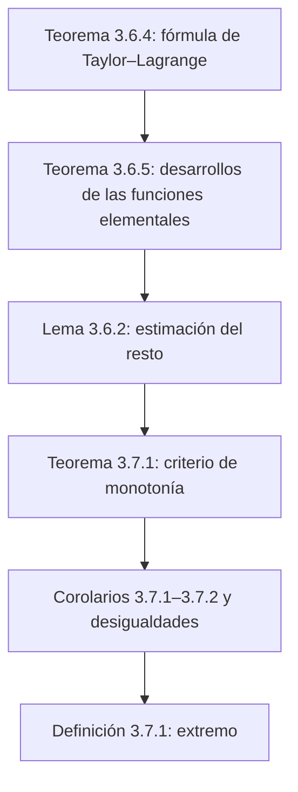

# Lecciones 29–30 — Fórmula de Taylor–Lagrange, monotonía y extremos de funciones

[← Lecciones 27–28](lecture-27-28.md) · [Índice de lecciones](index.md) · [Lecciones 31–32 →](lecture-31-32.md) · [Términos y teoremas](../term-index.md) · [Русский](../../ru/lectures-2025-26/lecture-29-30.md) · [English](../../en/lectures-2025-26/lecture-29-30.md)

> **Fuente:** `ma25_26-lectures_29-30_notes.pdf` — 29 páginas: diapositivas impresas con capa de texto (páginas 1–5, 9–12, 14, 17–19, 22, 24, 27–29) y páginas manuscritas sin capa de texto (6–8, 13, 15, 16, 20, 21, 23, 25, 26). Las páginas manuscritas se transcribieron a partir de su imagen. En los encabezados se indican el número de la diapositiva impresa (18 en total) y el número de página del PDF.
>
> **Nota del editor.** La fecha de la lección se toma del pie de las diapositivas («11 de diciembre de 2025»). El término resto: $`R_{a,n}f(x) = f(x) - \sum\limits_{k=0}^{n} \dfrac{f^{(k)}(a)}{k!} (x - a)^k`$ (véase la observación 2 en las lecciones 27–28).

## Diapositivas impresas 1–3 (pp. PDF 1–3). Introducción

**Cita del día (diapositiva 2).** Foto del Gato de Cheshire con una inscripción dentro de la imagen: «La vida aquí es interesante, pero estresante. Por eso somos alegres, pero malvados. 😊»


**Objetivo de la lección (diapositiva 3).**

- Continuaremos el estudio de la [fórmula de Taylor](lecture-27-28.md#thm-3-6-3) (fórmula de Taylor–Lagrange y estimación del resto).
- Hallaremos los desarrollos (en la diapositiva, con una errata) de Taylor–Peano para las funciones elementales.
- Estudiaremos las propiedades geométricas de las funciones: monotonía y extremos.

## Capítulo 3, §6. Fórmula de Taylor (continuación)

### Diapositiva impresa 4 (p. PDF 4). Fórmula de Taylor–Lagrange

Sea $`a, x \in \mathbb{R}`$, $`a \ne x`$. Denotemos por $`\Delta_{a,x}`$ el segmento cerrado de extremos $`a`$ y $`x`$, y por $`\widetilde{\Delta}_{a,x}`$, el intervalo abierto de extremos $`a`$ y $`x`$.

<a id="thm-3-6-4"></a>**Teorema 3.6.4.** Sea $`n \in \mathbb{Z}_+`$, y sea la función $`f`$ $`n + 1`$ veces derivable en $`\langle A, B\rangle`$, con $`a, x \in \langle A, B\rangle`$. Entonces existe un punto $`c \in \widetilde{\Delta}_{a,x}`$ tal que

```math
f(x) = \sum_{k=0}^{n} \frac{f^{(k)}(a)}{k!} (x - a)^k + \frac{f^{(n+1)}(c)}{(n+1)!} (x - a)^{n+1}.
```

### Diapositiva impresa 5 (p. PDF 5). Observaciones

- La afirmación del [teorema 3.6.4](#thm-3-6-4) puede reescribirse así: $`\exists \theta \in (0, 1)`$ tal que

```math
f(x) = \sum_{k=0}^{n} \frac{f^{(k)}(a)}{k!} (x - a)^k + \frac{f^{(n+1)}(a + \theta(x - a))}{(n+1)!} (x - a)^{n+1}.
```

- Las hipótesis del [teorema 3.6.4](#thm-3-6-4) pueden debilitarse. Bastaría suponer que $`f \in C^n(\Delta_{a,x})`$ y que $`f^{(n)}`$ es [derivable](lecture-22-23.md#def-3-2-1) en $`\widetilde{\Delta}_{a,x}`$.
- El [teorema 3.6.3](lecture-27-28.md#thm-3-6-3) se seguirá de la fórmula de Taylor–Lagrange si en su enunciado se impone a la función la siguiente condición más fuerte: $`\exists \delta > 0`$ tal que $`f`$ es $`n`$ veces derivable en $`E \cap (a - \delta, a + \delta)`$ y $`f^{(n)}`$ es [continua en el punto](lecture-16.md#def-2-5-1) $`a`$.

### Páginas manuscritas (pp. PDF 6–8). Demostración del teorema 3.6.4

**Demostración ([teorema 3.6.4](#thm-3-6-4)).** Para $`t \in \Delta_{a,x}`$ pongamos

```math
\varphi(t) = (x - t)^{n+1}, \qquad F(t) = R_{t,n}f(x) = f(x) - f(t) - \sum_{k=1}^{n} \frac{f^{(k)}(t)}{k!} (x - t)^k.
```

Entonces, para $`t \in \widetilde{\Delta}_{a,x}`$,

```math
\begin{aligned}
F'(t) &= -f'(t) - \sum_{k=1}^{n} \left( \frac{f^{(k+1)}(t)}{k!} (x - t)^k - \frac{f^{(k)}(t)}{k!} k (x - t)^{k-1} \right) \\
&= -f'(t) + \sum_{k=1}^{n} \frac{f^{(k)}(t)}{(k-1)!} (x - t)^{k-1} - \sum_{k=1}^{n} \frac{f^{(k+1)}(t)}{k!} (x - t)^k.
\end{aligned}
```

Reindexando la primera suma mediante el cambio $`m = k - 1`$ (anotado en rosa), obtenemos

```math
F'(t) = -f'(t) + \sum_{m=0}^{n-1} \frac{f^{(m+1)}(t)}{m!} (x - t)^m - \sum_{k=1}^{n} \frac{f^{(k+1)}(t)}{k!} (x - t)^k,
```

donde bajo las sumas están escritos los primeros términos: $`\dfrac{f^{(1)}(t)}{1} (x - t)^0 + \dfrac{f''(t)}{1} (x - t) + \ldots`$ y $`\dfrac{f''(t)}{1} (x - t) + \dfrac{f'''(t)}{2!} (x - t)^2 + \ldots`$; los términos coincidentes están tachados en rojo. En total todo se cancela salvo los términos extremos:

```math
F'(t) = -f'(t) + f'(t) - \frac{f^{(n+1)}(t)}{n!} (x - t)^n = -\frac{f^{(n+1)}(t)}{n!} (x - t)^n.
```

Obsérvese que $`F(x) = 0`$ (y $`\varphi(x) = 0`$, $`\varphi(a) = (x - a)^{n+1}`$) $`\Rightarrow`$ por el teorema de Cauchy $`\exists c \in \widetilde{\Delta}_{a,x}`$ tal que

```math
\frac{F(a)}{(x - a)^{n+1}} = \frac{F(a) - F(x)}{\varphi(a) - \varphi(x)} = \frac{F'(c)}{\varphi'(c)} \Rightarrow \frac{F(a)}{(x - a)^{n+1}} = \frac{-\dfrac{f^{(n+1)}(c)}{n!} (x - c)^n}{-(n+1) (x - c)^n} = \frac{f^{(n+1)}(c)}{n! \, (n+1)} = \frac{f^{(n+1)}(c)}{(n+1)!},
```

donde (cálculo en la misma página) $`\varphi(t) = (x - t)^{n+1}`$ $`\Rightarrow`$ $`\varphi'(t) = (n+1)(x - t)^n (-1)`$ $`\Rightarrow`$ $`\varphi'(c) = -(n+1)(x - c)^n`$, y los factores $`(x - c)^n`$ están tachados en rojo. Por tanto,

```math
F(a) = \frac{f^{(n+1)}(c)}{(n+1)!} (x - a)^{n+1}.
```

Por otra parte, $`F(t) = f(x) - f(t) - \sum\limits_{k=1}^{n} \dfrac{f^{(k)}(t)}{k!} (x - t)^k`$ $`\Rightarrow`$ $`F(a) = f(x) - f(a) - \sum\limits_{k=1}^{n} \dfrac{f^{(k)}(a)}{k!} (x - a)^k`$. Comparando, obtenemos (p. PDF 8)

```math
f(x) = f(a) + \sum_{k=1}^{n} \frac{f^{(k)}(a)}{k!} (x - a)^k + \frac{f^{(n+1)}(c)}{(n+1)!} (x - a)^{n+1}. \qquad \blacksquare
```

### Diapositivas impresas 6–8 (pp. PDF 9–11). Desarrollos de Taylor–Peano de las funciones elementales

<a id="thm-3-6-5"></a>**Teorema 3.6.5.** Sea $`n \in \mathbb{Z}_+`$. Cuando $`x \mapsto 0`$ se cumplen las siguientes afirmaciones:

1. $`e^x = \sum\limits_{k=0}^{n} \dfrac{x^k}{k!} + o(x^n) = 1 + \dfrac{x}{1!} + \dfrac{x^2}{2!} + \cdots + \dfrac{x^n}{n!} + o(x^n)`$.
2. $`\sin x = \sum\limits_{k=0}^{n} \dfrac{(-1)^k x^{2k+1}}{(2k+1)!} + o\big(x^{2n+2}\big) = x - \dfrac{x^3}{3!} + \dfrac{x^5}{5!} - \cdots + (-1)^n \dfrac{x^{2n+1}}{(2n+1)!} + o\big(x^{2n+2}\big)`$.
3. $`\cos x = \sum\limits_{k=0}^{n} \dfrac{(-1)^k x^{2k}}{(2k)!} + o\big(x^{2n+1}\big) = 1 - \dfrac{x^2}{2!} + \dfrac{x^4}{4!} - \cdots + (-1)^n \dfrac{x^{2n}}{(2n)!} + o\big(x^{2n+1}\big)`$.
4. $`\ln(1 + x) = \sum\limits_{k=1}^{n} \dfrac{(-1)^{k+1} x^k}{k} + o(x^n) = x - \dfrac{x^2}{2} + \dfrac{x^3}{3} - \cdots + (-1)^{n+1} \dfrac{x^n}{n} + o(x^n)`$.
5. Sea $`\alpha \in \mathbb{R}`$. Pongamos $`C^k_{\alpha} = \dfrac{\alpha(\alpha - 1) \cdots (\alpha - k + 1)}{k!}`$ para $`k \in \mathbb{Z}_+`$. Entonces

```math
(1 + x)^{\alpha} = \sum_{k=0}^{n} C^k_{\alpha} x^k + o(x^n) = 1 + \frac{\alpha}{1!} x + \frac{\alpha(\alpha - 1)}{2!} x^2 + \cdots + \frac{\alpha(\alpha - 1) \cdots (\alpha - n + 1)}{n!} x^n + o(x^n).
```

### Diapositiva impresa 9 (p. PDF 12). Observaciones

- Si $`\alpha \in \mathbb{Z}_+`$ y $`\alpha > k`$, entonces $`C^k_{\alpha}`$ es un coeficiente binomial, lo cual justifica la notación elegida. Las cantidades $`C^k_{\alpha}`$ están definidas para todo $`\alpha \in \mathbb{R}`$ y se llaman coeficientes binomiales generalizados.
- Para $`\alpha \in \mathbb{N}`$ la función $`f(x) = (1 + x)^{\alpha}`$ es un polinomio de grado $`\alpha`$, por lo que $`f \equiv T_{0,\alpha} f`$. En virtud de la observación anterior, esta identidad no es otra cosa que el binomio de Newton. Por eso la fórmula de Taylor–Peano para $`(1 + x)^{\alpha}`$ se llama desarrollo binomial.

### Página manuscrita (p. PDF 13). Demostración de los apartados 1–2 del teorema 3.6.5

**Demostración.**

① $`f(x) = e^x`$: $`f^{(k)}(x) = e^x`$ y $`f^{(k)}(0) = e^0 = 1`$ $`\forall k \in \mathbb{N}`$, $`\forall x \in \mathbb{R}`$ $`\Rightarrow`$ $`T_{0,n} f(x) = \sum\limits_{k=0}^{n} \dfrac{x^k}{k!}`$.

② Sea $`f(x) = \sin x`$. Demostremos primero que $`f^{(m)}(x) = \sin\left(x + \dfrac{\pi m}{2}\right)`$ $`\forall m \in \mathbb{Z}_+`$ (por [inducción](../01-logic-sets-functions.md#example-induction)). Entonces

```math
f^{(m)}(0) = \sin\left(\frac{\pi m}{2}\right) = \begin{cases} 0, & m = 2k, \\ (-1)^k, & m = 2k + 1. \end{cases} \qquad \blacksquare
```

### Diapositiva impresa 10 (p. PDF 14). Estimación del resto en la fórmula de Taylor

<a id="lem-3-6-2"></a>**Lema 3.6.2.** Sea la función $`f`$ tal que satisface las hipótesis del teorema 3.6.4. Supongamos que existe un número $`M > 0`$ tal que $`|f^{(n+1)}(t)| \le M`$ para todo $`t \in \widetilde{\Delta}_{a,x}`$. Entonces

```math
\left| R_{a,n}f(x) \right| \le \frac{M |x - a|^{n+1}}{(n+1)!}.
```

### Página manuscrita (p. PDF 15). Demostración del lema 3.6.2

**Demostración ([lema 3.6.2](#lem-3-6-2)).** Por la fórmula de Taylor–Lagrange, $`R_{a,n}f(x) = \dfrac{f^{(n+1)}(c)}{(n+1)!} (x - a)^{n+1}`$ para algún $`c \in \widetilde{\Delta}_{a,x}`$. Entonces

```math
\left| R_{a,n}f(x) \right| = \left| \frac{f^{(n+1)}(c)}{(n+1)!} (x - a)^{n+1} \right| = \frac{|f^{(n+1)}(c)|}{(n+1)!} |x - a|^{n+1} \le \frac{M}{(n+1)!} |x - a|^{n+1},
```

donde (en verde) por hipótesis $`|f^{(n+1)}(c)| \le M`$. $`\blacksquare`$

### Página manuscrita (p. PDF 16). Ejemplos de estimación del resto

**Ejemplos.** Sea $`n \in \mathbb{Z}_+`$ y $`x \in \mathbb{R}`$.

① $`f(t) = e^t`$ $`\Rightarrow`$ $`\left| R_{0,n}f(x) \right| \le \dfrac{e^{\max\{x, 0\}} \cdot |x|^{n+1}}{(n+1)!}`$, ya que $`\sup\limits_{t \in \widetilde{\Delta}_{0,x}} \left| f^{(n+1)}(t) \right| = \sup\limits_{t \in \widetilde{\Delta}_{0,x}} e^t = e^{\max\{x, 0\}}`$ (rodeado en verde).

② Si $`f(t) = \sin t`$ $`\Rightarrow`$ $`\left| f^{(n+1)}(t) \right| = \left| \cos\left(t + \dfrac{\pi n}{2}\right) \right| \le 1`$ $`\forall t \in \mathbb{R}`$ $`\Rightarrow`$ $`\left| R_{0,n}f(x) \right| \le \dfrac{|x|^{n+1}}{(n+1)!}`$.

## Capítulo 3, §7. Monotonía y extremos de funciones

### Diapositiva impresa 11 (p. PDF 17). §7. Monotonía y extremos de funciones

Una aplicación importante del cálculo [diferencial](lecture-24-25-26.md#def-3-3-1) es el estudio de las funciones y la construcción de sus gráficas. Primero analizaremos los conceptos de monotonía y de extremo de una función, estrechamente relacionados con la primera [derivada](lecture-22-23.md#def-3-1-1).

### Diapositiva impresa 12 (p. PDF 18). Condiciones de monotonía de una función en un intervalo

<a id="thm-3-7-1"></a>**Teorema 3.7.1.** Sea la función $`f`$ continua en $`\langle A, B\rangle`$ y derivable en $`(A, B)`$. Se cumplen las siguientes afirmaciones:

1. La función $`f`$ es creciente en $`\langle A, B\rangle`$ si y solo si $`f'(x) \ge 0`$ para todo $`x \in (A, B)`$.
2. Si $`f'(x) > 0`$ para todo $`x \in (A, B)`$, entonces $`f`$ es estrictamente creciente en $`\langle A, B\rangle`$.

### Diapositiva impresa 13 (p. PDF 19). Observaciones

1. La primera afirmación del [teorema 3.7.1](#thm-3-7-1) se llama criterio de crecimiento de $`f`$ en $`\langle A, B\rangle`$. La segunda afirmación proporciona solo una condición suficiente de crecimiento estricto en $`\langle A, B\rangle`$. No es necesaria.
2. Cambiando en el enunciado del teorema los signos de las desigualdades por los contrarios, obtenemos, respectivamente, el criterio de decrecimiento y una condición suficiente de decrecimiento estricto de $`f`$ en $`\langle A, B\rangle`$. Para demostrarlos basta aplicar el [teorema 3.7.1](#thm-3-7-1) a la función $`(-f)`$.

### Páginas manuscritas (pp. PDF 20–21). Demostración del teorema 3.7.1

**Demostración ([teorema 3.7.1](#thm-3-7-1)), afirmación 1.**

*Necesidad* ($`\Rightarrow`$; en la pizarra, una «Н» en un círculo). Sea $`x, a \in (A, B)`$, $`x \ne a`$.

Si $`x > a`$ $`\Rightarrow`$ $`f(x) \ge f(a)`$ [porque $`f \nearrow`$, en verde] $`\Rightarrow`$ $`\dfrac{f(x) - f(a)}{x - a} \ge 0`$.

Si $`x < a`$ $`\Rightarrow`$ $`f(x) \le f(a)`$ $`\Rightarrow`$ $`\dfrac{f(x) - f(a)}{x - a} \ge 0`$.

Por tanto $`f'(a) = \lim\limits_{x \mapsto a} \dfrac{f(x) - f(a)}{x - a} \ge 0`$ $`\forall a \in (A, B)`$.

*Suficiencia* ($`\Leftarrow`$; en la pizarra, una «Д» en un círculo y «Afirm. 1 + Afirm. 2» enmarcado). A la derecha, en rosa, el esquema: ① $`f'(x) \ge 0`$ $`\forall x \in (A, B)`$ $`\Rightarrow`$ $`f \nearrow`$; ② $`f'(x) > 0`$ $`\forall x \in (A, B)`$ $`\Rightarrow`$ $`f`$ estrictamente $`\nearrow`$.

Sea $`a, b \in \langle A, B\rangle`$, $`b > a`$ (subrayado en turquesa). Utilicemos la [fórmula de los incrementos finitos](lecture-24-25-26.md#thm-3-4-3): $`\exists c \in (a, b)`$: $`f(b) - f(a) = f'(c)(b - a)`$.

(P. PDF 21.) **Afirm. 1** $`\Rightarrow`$ sabemos que $`f'(c) \ge 0`$ y $`b - a > 0`$ (elegimos $`b > a`$) $`\Rightarrow`$ $`f(b) - f(a) = \underbrace{f'(c)}_{\ge 0} \cdot \underbrace{(b - a)}_{> 0} \ge 0`$ $`\Rightarrow`$ $`f(b) \ge f(a)`$ (subrayado en turquesa) $`\Rightarrow`$ $`f \nearrow`$ en $`\langle A, B\rangle`$.

**Afirm. 2** $`\Rightarrow`$ sabemos que $`f'(c) > 0`$ y $`b - a > 0`$ $`\Rightarrow`$ $`f(b) - f(a) = \underbrace{f'(c)}_{> 0} \underbrace{(b - a)}_{> 0} > 0`$ $`\Rightarrow`$ $`f(b) > f(a)`$ (subrayado en turquesa) $`\Rightarrow`$ $`f`$ es estrictamente creciente en $`\langle A, B\rangle`$. $`\blacksquare`$

### Diapositiva impresa 14 (p. PDF 22). Criterio de constancia de una función

<a id="cor-3-7-1"></a>**Corolario 3.7.1.** Sea la función $`f`$ continua en $`\langle A, B\rangle`$ y derivable en $`(A, B)`$. Entonces las siguientes afirmaciones son equivalentes:

1. $`f`$ es constante en $`\langle A, B\rangle`$.
2. $`f'(x) = 0`$ para todo $`x \in (A, B)`$.

### Página manuscrita (p. PDF 23). Demostración del corolario 3.7.1

**Demostración ([corolario 3.7.1](#cor-3-7-1)).** ¡① $`\Rightarrow`$ ② es evidente!

② $`\Rightarrow`$ ①: Sea $`f'(x) = 0`$ $`\forall x \in (A, B)`$. Podemos decir que $`f'(x) \ge 0`$ $`\forall x \in (A, B)`$ (en verde) $`\Rightarrow`$ por el [teorema 3.7.1](#thm-3-7-1), $`f \nearrow`$ en $`\langle A, B\rangle`$ $`\Rightarrow`$ $`\left. \begin{aligned} x_1, x_2 &\in \langle A, B\rangle \\ x_1 &< x_2 \end{aligned} \right\} \Rightarrow f(x_1) \le f(x_2)`$.

Pero también podemos decir que $`f'(x) \le 0`$ $`\forall x \in (A, B)`$ (en amarillo verdoso) $`\Rightarrow`$ $`f \searrow`$ en $`\langle A, B\rangle`$ $`\Rightarrow`$ $`\left. \begin{aligned} x_1, x_2 &\in \langle A, B\rangle \\ x_1 &< x_2 \end{aligned} \right\} \Rightarrow f(x_1) \ge f(x_2)`$.

Así, tenemos

```math
\left. \begin{aligned} x_1, x_2 \in \langle A, B\rangle \\ x_1 < x_2 \end{aligned} \right\} \Rightarrow \left\{ \begin{aligned} f(x_1) &\le f(x_2) \\ f(x_1) &\ge f(x_2) \end{aligned} \right\} \Rightarrow f(x_1) = f(x_2). \qquad \blacksquare
```

### Diapositiva impresa 15 (p. PDF 24). Sobre la comparación de funciones en un segmento

<a id="cor-3-7-2"></a>**Corolario 3.7.2.** Sean las funciones $`f`$ y $`g`$ continuas en $`[A, B]`$ y derivables en $`(A, B)`$. Si $`f(A) = g(A)`$ y $`f'(x) > g'(x)`$ para todo $`x \in (A, B)`$, entonces $`f(x) > g(x)`$ para todo $`x \in (A, B]`$.

### Página manuscrita (p. PDF 25). Demostración del corolario 3.7.2 y ejercicio

**Demostración ([corolario 3.7.2](#cor-3-7-2)).** Sea $`h = f - g`$ $`\Rightarrow`$ $`h'(x) > 0`$ $`\forall x \in (A, B)`$ $`\Rightarrow`$ por la afirm. 2 del [teorema 3.7.1](#thm-3-7-1), $`h`$ es estrictamente creciente en $`[A, B]`$ $`\Rightarrow`$ para todo $`x \in (A, B)`$ tenemos $`h(x) > h(A) = 0`$ $`\Rightarrow`$ para todo $`x \in (A, B)`$, $`f(x) > g(x)`$. $`\blacksquare`$

**Ej.** Formular la afirmación si $`f(B) = g(B)`$.

El [corolario 3.7.2](#cor-3-7-2) es útil para demostrar desigualdades.

### Página manuscrita (p. PDF 26). Ejemplos: demostración de desigualdades

**Ejemplos.**

1 (enmarcado) $`\cos x > 1 - \dfrac{x^2}{2}`$ $`\forall x > 0`$. Pongamos $`f(x) = \cos x`$, $`g(x) = 1 - \dfrac{x^2}{2}`$. Entonces $`f'(x) - g'(x) = -\sin x - \left(-\dfrac{2x}{2}\right) = x - \sin x > 0`$ para $`x > 0`$, y $`f(0) = g(0) = 1`$; aplicamos el [corolario 3.7.2](#cor-3-7-2).

2 (enmarcado) $`\sin x > x - \dfrac{x^3}{6}`$ $`\forall x > 0`$. Pongamos $`f(x) = \sin x`$, $`g(x) = x - \dfrac{x^3}{6}`$. Entonces $`f'(x) - g'(x) = \cos x - 1 + \dfrac{x^2}{2} > 0`$ $`\forall x > 0`$ (con una llave verde: «en virtud del ejemplo 1»); aplicamos el [corolario 3.7.2](#cor-3-7-2).

### Diapositiva impresa 16 (p. PDF 27). Extremo de una función

<a id="def-3-7-1"></a>**Definición 3.7.1.** Supongamos que $`E \subset \mathbb{R}`$, $`f : E \to \mathbb{R}`$, $`a \in E`$.

1. Supongamos que existe $`\delta > 0`$ tal que para todo $`x \in (a - \delta, a + \delta) \cap E`$ se cumple la desigualdad $`f(x) \ge f(a)`$. Entonces $`a`$ se llama punto de mínimo de $`f`$. Si, por el contrario, $`f(x) \le f(a)`$ para todo $`x \in (a - \delta, a + \delta) \cap E`$, entonces $`a`$ se llama punto de máximo de $`f`$.
2. Supongamos que existe $`\delta > 0`$ tal que para todo $`x \in (a - \delta, a + \delta) \cap E \setminus \{a\}`$ se cumple la desigualdad $`f(x) > f(a)`$. Entonces $`a`$ se llama punto de mínimo estricto de $`f`$. Si, por el contrario, $`f(x) < f(a)`$ para todo $`x \in (a - \delta, a + \delta) \cap E \setminus \{a\}`$, entonces $`a`$ se llama punto de máximo estricto de $`f`$.
3. Si $`a`$ es un punto de mínimo o de máximo de la función $`f`$, entonces $`a`$ se llama punto de extremo de $`f`$.

### Diapositiva impresa 17 (p. PDF 28). Observaciones

- No debe pensarse que en un punto de mínimo se alcanza el valor mínimo de la función. Este será mínimo solo localmente, es decir, en cierto entorno del punto de mínimo. Una observación análoga vale para los puntos de máximo.
- En la [definición 3.7.1](#def-3-7-1) no se impuso ninguna restricción a la función $`f`$. En lo sucesivo supondremos normalmente que $`f`$ es derivable en el punto $`a`$.
- Como el concepto de extremo es local, podemos limitarnos a considerar funciones definidas en un intervalo.

### Diapositiva impresa 18 (p. PDF 29). El problema de hallar los puntos de extremo

La resolución de este problema se lleva a cabo en dos etapas.

1. Con ayuda de una condición necesaria de extremo descartamos los puntos en los que el extremo es ciertamente imposible.
2. Los puntos restantes se investigan con ayuda de una condición suficiente de extremo.

## Estructura de la lección



## Páginas auxiliares

- P. PDF 1 — portada; p. 2 — cita del día (foto insertada arriba); p. 3 — objetivo de la lección.
- La demostración del [teorema 3.6.4](#thm-3-6-4) ocupa las pp. 6–8; la del [teorema 3.7.1](#thm-3-7-1), las pp. 20–21.
