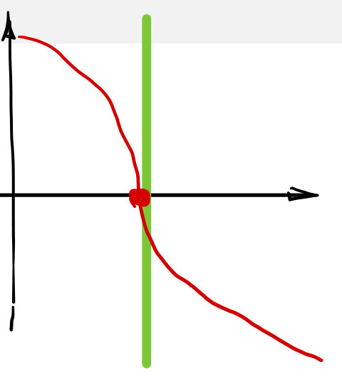
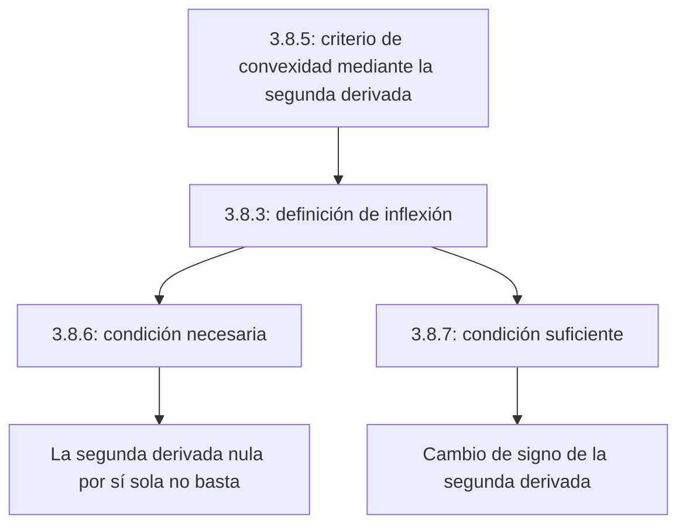

# Lección 35 — Segunda derivada, convexidad y puntos de inflexión

[Índice de lecciones](index.md) · [Русский](../../ru/lectures-2025-26/lecture-35.md) · [English](../../en/lectures-2025-26/lecture-35.md)

> **Fuente:** `ma25_26_lecture_35_notes.pdf` — 8 páginas, 7 diapositivas impresas y una página manuscrita (p. PDF 5). También se transcriben las anotaciones de las diapositivas 5–6. Fecha: 19 de febrero de 2026.
>
> **Semestre 2: lecciones 33–64; el semestre 1 terminó con la lección 32. La duplicación comienza en la lección 33.** Este material ya existe en la [carpeta rusa `ru/lectures/`](../../ru/lectures/index.md), en [§3.8 «Convexidad»](../../ru/lectures/01-convexity-3-8.md), y en la [«Lección 35» archivada](../../../source/MathInMind/МАТАН_Л/Лекция%2035.md). Aquí se conserva una versión ilustrada completa e independiente del nuevo PDF.
>
> **Notación.** $I=\langle A,B\rangle$, $\overline{\mathbb R}=\mathbb R\cup\{-\infty,+\infty\}$. La barra sobre $\mathbb R$ en la definición de inflexión y en el teorema 3.8.7 se ha comprobado en la imagen: se admite derivada infinita, aunque la capa de texto pierde la barra.

## Diapositivas impresas 1–3 (pp. PDF 1–3). Introducción

**Cita del día:** «¡Mañana, hoy se convertirá en ayer!»

**Objetivo:** «Terminar de pelear con las funciones convexas» — criterios de convexidad y puntos de inflexión.

## Capítulo 3, §8. Funciones convexas — final

### Diapositiva impresa 4 (p. PDF 4). Criterio mediante la segunda derivada

**Teorema 3.8.5.** Sea $f:I\to\mathbb R$ continua en $I$ y dos veces diferenciable en $(A,B)$.

1. La función $f$ es convexa en $I$ si y solo si

$$
f''(x)\ge0\qquad\text{para todo }x\in(A,B).
$$

2. Si $f''(x)>0$ para todo $x\in(A,B)$, entonces $f$ es estrictamente convexa en $I$.

> **Nota del editor.** La afirmación 1 usa $\ge0$, mientras que la afirmación 2 usa $>0$. El texto extraído del PDF no distingue estos signos de forma fiable. El recíproco de la afirmación 2 es falso: una función estrictamente convexa puede tener segunda derivada nula en puntos aislados.

### Página manuscrita (p. PDF 5). Demostración del teorema 3.8.5

Por el teorema 3.8.4 y el criterio de monotonía,

$$
f\text{ es convexa en }I
\quad\Longleftrightarrow\quad
f'\text{ es no decreciente en }(A,B)
\quad\Longleftrightarrow\quad
f''(x)\ge0\quad(x\in(A,B)).
$$

Si $f''(x)>0$ en todo $(A,B)$, el criterio de monotonía hace que $f'$ sea estrictamente creciente. El teorema 3.8.4 da entonces la convexidad estricta de $f$. $\blacksquare$

### Diapositiva impresa 5 (p. PDF 6). Punto de inflexión

**Definición 3.8.3.** Sean $f:I\to\mathbb R$, $a\in(A,B)$ y supongamos:

1. Existe $\delta>0$ tal que $(a-\delta,a+\delta)\subset(A,B)$, y $f$ tiene distinto carácter de convexidad en $(a-\delta,a]$ y $[a,a+\delta)$: convexa en un intervalo y cóncava en el otro.
2. La función $f$ es continua en $a$.
3. Existe la derivada $f'(a)\in\overline{\mathbb R}$.

Entonces $a$ se llama **punto de inflexión** de $f$.

> **Explicación editorial.** «Distinto carácter» significa un cambio real de convexidad; una función afín no tiene inflexión en cada punto por ser simultáneamente convexa y cóncava. El dibujo muestra por qué se admiten derivadas infinitas. Por ejemplo, $f(x)=-\sqrt[3]{x-a}$ es continua y cambia su carácter de convexidad en $a$, donde su derivada es $-\infty$; esta fórmula es un ejemplo editorial, no una fórmula indicada en la figura.

### Diapositiva impresa 6 (p. PDF 7). Condición necesaria de inflexión

**Teorema 3.8.6.** Sean $f:I\to\mathbb R$, $a\in(A,B)$ y $f$ dos veces diferenciable en $a$. Si $a$ es un punto de inflexión, entonces

$$
f''(a)=0.
$$

¡Esta condición **no es suficiente**!

**Contraejemplo manuscrito en la diapositiva:** $f(x)=x^4$ es estrictamente convexa en $\mathbb R$, $f''(x)=12x^2$, $f''(0)=0$, pero cero no es un punto de inflexión. El mismo ejemplo muestra por qué la convexidad estricta no implica $f''>0$ en todas partes.

### Diapositiva impresa 7 (p. PDF 8). Condición suficiente de inflexión

**Teorema 3.8.7.** Sean $f:I\to\mathbb R$, $a\in(A,B)$ y supongamos que $f$ es continua en $a$ y tiene allí derivada en $\overline{\mathbb R}$. Supongamos que existe $\delta>0$ tal que $f$ es dos veces diferenciable en $(a-\delta,a)\cup(a,a+\delta)\subset I$, y se cumple una de las condiciones:

1. $f''>0$ en $(a-\delta,a)$ y $f''<0$ en $(a,a+\delta)$;
2. $f''<0$ en $(a-\delta,a)$ y $f''>0$ en $(a,a+\delta)$.

Entonces $a$ es un punto de inflexión de $f$.

### Suplemento editorial. Relación entre las dos condiciones

El PDF no contiene demostraciones separadas de los teoremas 3.8.6–3.8.7; las explicaciones siguientes son editoriales, no páginas manuscritas adicionales.

- Para el teorema 3.8.6, un cambio de convexidad significa un cambio en el sentido de monotonía de $f'$. Si existe la derivada finita $f''(a)$, $f'$ tiene un extremo local en $a$; el teorema de Fermat da $(f')'(a)=f''(a)=0$.
- Para el teorema 3.8.7, los signos de $f''$ dan distintos caracteres de convexidad por el teorema 3.8.5. La continuidad permite añadir $a$ a ambos intervalos laterales. Junto con la existencia de la derivada, esto da la definición 3.8.3.
- Por ejemplo, $f(x)=x^3$ tiene $f''(x)=6x$: el signo cambia en cero, luego cero es un punto de inflexión. Para $x^4$ el signo no cambia y no hay inflexión.

## Estructura de la lección

---

Anteriores: [lecciones 33–34](lecture-33-34.md) · Siguiente: [lección 36 — primitivas](lecture-36.md) · Sección duplicada: [§3.8 en `ru/lectures/`](../../ru/lectures/01-convexity-3-8.md).
