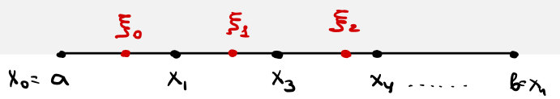
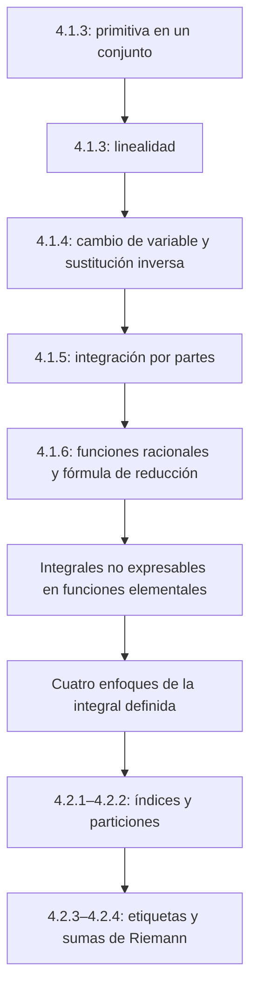

# Lecciones 37–38 — Métodos de integración e inicio de la integral de Riemann

[Índice de lecciones](index.md) · [Русский](../../ru/lectures-2025-26/lecture-37-38.md) · [English](../../en/lectures-2025-26/lecture-37-38.md)

> **Fuente:** `ma25_26-lectures_37-38_notes.pdf` — 38 páginas, 21 diapositivas impresas. Páginas manuscritas: 6, 8, 10, 12–13, 15–16, 19–21, 26–27, 29–32, 35. También se transcriben las anotaciones sobre las diapositivas; las figuras se extraen de sus páginas correspondientes, no se redibujan. Fecha: 26 de febrero de 2026.
>
> **Semestre 2: lecciones 33–64; el semestre 1 terminó con la lección 32. Existe material duplicado a partir de la lección 33** en la [carpeta rusa `ru/lectures/`](../../ru/lectures/index.md). Esta lección se solapa con [§4.1 «Primitivas»](../../ru/lectures/02-antiderivatives-4-1.md) y [§4.2 «Integral de Riemann»](../../ru/lectures/03-riemann-integral-4-2.md); también se conserva la [«Lección 37-38» archivada](../../../source/MathInMind/МАТАН_Л/Лекция%2037-38.md). A continuación se ofrece una versión ilustrada completa e independiente del nuevo PDF, incluidos todos los cálculos manuscritos.
>
> **Convenciones.** $I=\langle A,B\rangle$, $J=\langle C,D\rangle$ son intervalos. Las integrales indefinidas denotan familias de primitivas; los cálculos con representantes elegidos se realizan salvo una constante aditiva arbitraria. El corolario sin número del teorema 4.1.4 no recibe un número nuevo.

## Diapositivas impresas 1–3 (pp. PDF 1–3). Introducción

**Cita del día:** «Que el queso te caiga solo en la pasta» — un «deseo italiano», según indica la diapositiva.

**Objetivos:** primitiva en un conjunto; cambio de variable e integración por partes; funciones racionales; integrales no elementales; sumas de Riemann.

## Capítulo 4, §1. Primitivas e integral indefinida — continuación

### Diapositiva impresa 4 (p. PDF 4). Primitiva en un conjunto

**Definición 4.1.3.** Sean $E\subset\mathbb R$, $f:E\to\mathbb R$. Si $F$ es diferenciable en $E$ y

$$
F'(x)=f(x)\qquad(x\in E),
$$

entonces $F$ es una primitiva de $f$ en el conjunto $E$.

> **Explicación editorial.** Se usa la convención del curso para derivadas en el dominio (en particular, en sus puntos de acumulación). La afirmación «todas las primitivas difieren en una constante» se demostró para un **intervalo**, no para un conjunto desconectado arbitrario. Por ejemplo, para $f=0$ en $(-\infty,0)\cup(0,+\infty)$ se pueden elegir dos constantes independientes en las dos componentes.

### Diapositiva impresa 5 y página manuscrita (pp. PDF 5–6). Integración de funciones elementales

La derivada de una función elemental, donde existe, vuelve a ser elemental. La operación inversa no tiene esta propiedad.

Ejemplo de la p. 6:

$$
\int e^{-x^2}\,dx.
$$

Si $f$ tiene una primitiva elemental, su integral se llama **expresable en funciones elementales** (ruso «берущийся»); en caso contrario es **no elemental** («неберущийся»).

Observaciones manuscritas:

1. No todas las integrales de funciones elementales son elementales.
2. No hay una receta universal que produzca una primitiva elemental para cualquier integrando.

> **Nota del editor.** «No elemental» no significa «sin primitiva»: la función continua $e^{-x^2}$ tiene una por el teorema 4.1.2. Se trata de la ausencia de una **expresión elemental**; la observación sobre la receta no niega la existencia de algoritmos para clases particulares de funciones.

### Diapositiva impresa 6 (p. PDF 7). Linealidad

**Teorema 4.1.3.** Supongamos que $f,g:I\to\mathbb R$ tienen primitivas en $I$. Para cualesquiera $\alpha,\beta\in\mathbb R\setminus\{0\}$,

$$
\int\bigl(\alpha f(x)+\beta g(x)\bigr)\,dx
=\alpha\int f(x)\,dx+\beta\int g(x)\,dx.
$$

### Página manuscrita (p. PDF 8). Demostración del teorema 4.1.3

Sean $F,G$ primitivas de $f,g$ en $I$. El miembro derecho es el conjunto

$$
\{\alpha F(x)+\beta G(x)+c:\ c\in\mathbb R\}.
$$

Como

$$
\bigl(\alpha F(x)+\beta G(x)+c\bigr)'
=\alpha F'(x)+\beta G'(x)
=\alpha f(x)+\beta g(x),
$$

el teorema 4.1.1 lo identifica con toda la familia de primitivas de la suma. $\blacksquare$

> **Nota del editor.** Se conservan las restricciones sobre los coeficientes de la diapositiva: multiplicar un **conjunto** de primitivas por cero hace perder la constante arbitraria; véase la [lección 36](lecture-36.md).

### Diapositiva impresa 7 (p. PDF 9). Cambio de variable

**Teorema 4.1.4.** Sean $f:I\to\mathbb R$, $F$ una primitiva de $f$ en $I$ y $\varphi:J\to I$ diferenciable en $J$. Entonces

$$
\int f(\varphi(x))\varphi'(x)\,dx=F(\varphi(x))+c.
$$

### Página manuscrita (p. PDF 10). Demostración y notación diferencial

Por la regla de la cadena,

$$
\bigl(F(\varphi(x))+c\bigr)'
=F'(\varphi(x))\varphi'(x)
=f(\varphi(x))\varphi'(x).
$$

El teorema 4.1.1 describe todas las primitivas. $\blacksquare$

**Observación.** Tomando $y=\varphi(x)$, $dy=\varphi'(x)\,dx$, se obtiene el cambio formal

$$
\int f(\varphi(x))\varphi'(x)\,dx
=\int f(y)\,dy=F(y)+c=F(\varphi(x))+c.
$$

### Diapositiva impresa 8 (p. PDF 11). Corolario de la sustitución inversa

**Corolario (sin número en la fuente).** Bajo las hipótesis del teorema 4.1.4, supongamos que $\varphi$ tiene inversa $\psi:I\to J$. Si $G$ es una primitiva de $(f\circ\varphi)\varphi'$ en $J$, entonces

$$
\int f(x)\,dx=G(\psi(x))+c.
$$

### Páginas manuscritas (pp. PDF 12–13). Demostración del corolario

Sea $F$ una primitiva de $f$ en $I$. Entonces $F\circ\varphi$ y $G$ son dos primitivas de $(f\circ\varphi)\varphi'$ en $J$. Por el teorema 4.1.1,

$$
F(\varphi(y))-G(y)=\mathrm{const},\qquad y\in J.
$$

Sustituimos $y=\psi(x)$:

$$
F(\varphi(\psi(x)))-G(\psi(x))
=F(x)-G(\psi(x))=\mathrm{const}.
$$

Así, $G\circ\psi$ es una primitiva de $f$. $\blacksquare$

> **Explicación editorial.** No hace falta demostrar por separado la diferenciabilidad de la inversa $\psi$: $G\circ\psi$ ya coincide con la función diferenciable $F$ salvo una constante.

### Diapositiva impresa 9 (p. PDF 14). Segunda forma del cambio de variable

Tomando $x=\varphi(y)$, tenemos $dx=\varphi'(y)\,dy$. Por tanto,

$$
\int f(x)\,dx
=\int f(\varphi(y))\varphi'(y)\,dy
=G(y)+c=G(\psi(x))+c.
$$

### Páginas manuscritas (pp. PDF 15–16). Ejemplos de sustitución

**1. Integral de la cotangente.** En un intervalo donde $\sin x\ne0$,

$$
\begin{aligned}
\int\cot x\,dx
&=\int\frac{\cos x}{\sin x}\,dx
=\int\frac{d(\sin x)}{\sin x}\\
&=\int\frac{dy}{y}
=\ln|y|+c=\ln|\sin x|+c,
\qquad y=\sin x.
\end{aligned}
$$

**2. Integral con una raíz cuadrada.** Sea $y=\sqrt x$, $x=y^2$, $dx=2y\,dy$ (para $x>0$):

$$
\begin{aligned}
\int\frac{dx}{1+\sqrt x}
&=\int\frac{2y}{1+y}\,dy
=2\int\left(1-\frac1{1+y}\right)\,dy\\
&=2\int dy-2\int\frac{d(y+1)}{y+1}\\
&=2y-2\ln|y+1|+c\\
&=2\sqrt x-\ln\bigl((\sqrt x+1)^2\bigr)+c.
\end{aligned}
$$

**Esquema manuscrito independiente en la p. 16.** Al pie de la página se dibuja la inclusión de clases de regularidad; no forma parte del cálculo de la integral:

$$
C^\infty\subset\cdots\subset C^2\subset C^1\subset C,\qquad C=C^0.
$$

### Diapositiva impresa 10 (p. PDF 17). Integración por partes

**Teorema 4.1.5.** Si $f,g\in C^1(I)$, entonces

$$
\int f(x)g'(x)\,dx
=f(x)g(x)-\int g(x)f'(x)\,dx. \tag{4.1.1}
$$

### Diapositiva impresa 11 (p. PDF 18). Observaciones

1. El miembro derecho de (4.1.1) es el conjunto

$$
\{f(x)g(x)-H(x)+c:\ c\in\mathbb R\},
$$

donde $H$ es una primitiva de $g f'$.

2. Los integrandos son continuos y tienen primitivas por el teorema 4.1.2.
3. En notación diferencial,

$$
\int f\,dg=fg-\int g\,df.
$$

### Página manuscrita (p. PDF 19). Demostración del teorema 4.1.5

Sea $H'=g f'$. Entonces

$$
\begin{aligned}
(fg-H+c)'
&=(fg)'-H'\\
&=f'g+fg'-gf'=fg'.
\end{aligned}
$$

Por el teorema 4.1.1, la familia $\{fg-H+c\}$ coincide con $\int fg'\,dx$. $\blacksquare$

### Páginas manuscritas (pp. PDF 20–21). Ejemplo: integral de sin² x

$$
\begin{aligned}
\int\sin^2x\,dx
&=-\int\sin x\,(\cos x)'\,dx\\
&=-\sin x\cos x+\int\cos^2x\,dx\\
&=-\sin x\cos x+\int(1-\sin^2x)\,dx.
\end{aligned}
$$

Escribimos $I=\int\sin^2x\,dx$ y obtenemos

$$
I=-\sin x\cos x+\int1\,dx-I,
\qquad 2I=-\sin x\cos x+x+c.
$$

Así,

$$
\int\sin^2x\,dx=\frac x2-\frac{\sin x\cos x}{2}+c.
$$

> **Nota del editor.** Al pasar $I$ de un miembro al otro se eligen representantes de las primitivas y después se absorben las constantes en $c$. No se trata de una cancelación literal de conjuntos en la aritmética de Minkowski.

### Diapositivas impresas 12–13 (pp. PDF 22–23). ¿Qué integrales son elementales?

Para varias clases de funciones elementales se ha demostrado la existencia de primitivas elementales y se han desarrollado métodos de cálculo.

Explicación manuscrita: una **función racional** es un cociente de dos polinomios.

**Teorema 4.1.6.** Toda función racional tiene una primitiva elemental.

> **Explicación editorial.** La primitiva se considera en un intervalo que no contenga polos de la función racional. Las constantes en distintas componentes del dominio son independientes.

### Diapositiva impresa 14 (p. PDF 24). Fracciones simples

Hay dos tipos de fracciones simples:

$$
\frac{a}{(x+p)^n},\qquad n\in\mathbb N,\quad a,p\in\mathbb R;
$$

$$
\frac{ax+b}{(x^2+px+q)^n},\qquad
n\in\mathbb N,\quad a,b,p,q\in\mathbb R,\quad p^2<4q.
$$

Un resultado algebraico expresa toda función racional como un polinomio más un número finito de estas fracciones. Los polinomios y las fracciones del primer tipo se integran con la tabla usual; el segundo tipo necesita un algoritmo.

> **Recordatorio editorial de las fórmulas de tabla.** Para $n=1$, la primera fracción da $a\ln|x+p|+c$; para $n>1$, da $\dfrac{a}{1-n}(x+p)^{1-n}+c$. Estas fórmulas se aplican fuera de $x=-p$.

### Diapositiva impresa 15 y páginas manuscritas (pp. PDF 25–27). Algoritmo para el segundo tipo

**Paso 1: completar el cuadrado.** Si $p\ne0$, sustituimos $y=x+p/2$. Entonces (cálculos de la p. 26),

$$
x=y-\frac p2,\qquad
ax+b=ay+\widetilde b,\quad \widetilde b=b-\frac{ap}{2},
$$

$$
x^2+px+q
=\left(y-\frac p2\right)^2+p\left(y-\frac p2\right)+q
=y^2+\widetilde q,\qquad
\widetilde q=q-\frac{p^2}{4}>0.
$$

Así, basta tratar el caso $p=0$:

$$
\int\frac{ax+b}{(x^2+q)^n}\,dx
=a\int\frac{x\,dx}{(x^2+q)^n}
+b\int\frac{dx}{(x^2+q)^n}.
$$

**Paso 2: numerador $x$.** Sea $y=x^2+q$, $dy=2x\,dx$:

$$
\int\frac{x\,dx}{(x^2+q)^n}
=\frac12\int y^{-n}\,dy
=\frac{(x^2+q)^{1-n}}{2(1-n)}+c,\qquad n>1.
$$

> **Aclaración editorial.** La p. manuscrita 26 da la última fórmula sin excluir $n=1$. Para $n=1$, el resultado es $\tfrac12\ln|x^2+q|+c$, no una expresión con denominador cero. La p. 27 repite la misma sustitución como $\tfrac12\int d\varphi(x)/(\varphi(x))^n$ con $\varphi(x)=x^2+q$.

### Diapositiva impresa 16 (p. PDF 28). Fórmula de reducción

**Pasos 3–4.** Sean $q\in\mathbb R\setminus\{0\}$ e

$$
I_n=\int\frac{dx}{(x^2+q)^n},\qquad n\in\mathbb N.
$$

Entonces

$$
2nq I_{n+1}=(2n-1)I_n+\frac{x}{(x^2+q)^n}.
$$

Aplicar la reducción $n-1$ veces reduce $I_n$ a la integral tabulada $I_1$.

> **Verificación editorial de la fórmula.** $\dfrac d{dx}\left(\dfrac{x}{(x^2+q)^n}\right)=\dfrac{2nq}{(x^2+q)^{n+1}}-\dfrac{2n-1}{(x^2+q)^n}$. Al integrar se obtiene la fórmula salvo una constante. Para una fracción cuadrática irreducible, completar el cuadrado da $q>0$, e $I_1=\dfrac1{\sqrt q}\arctan\dfrac{x}{\sqrt q}+c$. Si $q<0$, escribimos $q=-a^2$, $a>0$; la integral base es $\dfrac1{2a}\ln\left|\dfrac{x-a}{x+a}\right|+c$ en intervalos sin polos.

### Página manuscrita (p. PDF 29). Desarrollo de la reducción

Para $n\ge2$,

$$
I_n=\frac1{2(n-1)q}
\left[(2n-3)I_{n-1}+\frac{x}{(x^2+q)^{n-1}}\right].
$$

Para $n\ge3$, el paso siguiente es

$$
I_n=\frac1{2(n-1)q}
\left[
\frac{2n-3}{2(n-2)q}
\left((2n-5)I_{n-2}+\frac{x}{(x^2+q)^{n-2}}\right)
+\frac{x}{(x^2+q)^{n-1}}
\right].
$$

Al continuar se obtiene una combinación lineal de $I_1$ y expresiones racionales $x/(x^2+q)^m$, $1\le m\le n-1$.

### Páginas manuscritas (pp. PDF 30–32). Ejemplo completo de integral racional

Calculamos

$$
\int\frac{2x\,dx}{(x^2+2x+2)^2}.
$$

**1.** Sean $y=x+1$, $x=y-1$, $dx=dy$, $x^2+2x+2=y^2+1$. Entonces

$$
\int\frac{2x\,dx}{(x^2+2x+2)^2}
=2\int\frac{y\,dy}{(y^2+1)^2}
-2\int\frac{dy}{(y^2+1)^2}.
$$

**2.** En la primera integral sustituimos $z=y^2+1$, $dz=2y\,dy$:

$$
2\int\frac{y\,dy}{(y^2+1)^2}
=\int\frac{dz}{z^2}
=-\frac1z+c
=-\frac1{x^2+2x+2}+c.
$$

**3–4.** Aplicamos la fórmula de reducción a la segunda con $n=1$, $q=1$:

$$
2\int\frac{dy}{(y^2+1)^2}
=\int\frac{dy}{y^2+1}+\frac{y}{y^2+1}
=\arctan y+\frac{y}{y^2+1}+c.
$$

Volviendo a $x$ y restando, obtenemos

$$
\begin{aligned}
\int\frac{2x\,dx}{(x^2+2x+2)^2}
&=-\frac1{x^2+2x+2}-\arctan(x+1)
-\frac{x+1}{x^2+2x+2}+c\\
&=-\arctan(x+1)-\frac{x+2}{x^2+2x+2}+c.
\end{aligned}
$$

### Diapositiva impresa 17 (p. PDF 33). Otras integrales elementales

Otras clases suelen reducirse a funciones racionales mediante sustituciones adecuadas.

### Diapositiva impresa 18 (p. PDF 34). Integrales no elementales

La diapositiva enumera:

1. Integral seno: $\displaystyle\int\frac{\sin x}{x}\,dx$.
2. Integral coseno: $\displaystyle\int\frac{\cos x}{x}\,dx$.
3. Integral logarítmica: $\displaystyle\int\frac{dx}{\ln x}$.
4. Integral exponencial: $\displaystyle\int\frac{e^x}{x}\,dx$.
5. Integrales de Fresnel: $\displaystyle\int\sin(x^2)\,dx$, $\displaystyle\int\cos(x^2)\,dx$.
6. Integral de probabilidad: $\displaystyle\int e^{-x^2}\,dx$.

Demostrar que no son elementales requiere técnicas algebraicas fuera del alcance del curso.

> **Nota del editor.** Las fórmulas se consideran en intervalos donde los integrandos estén definidos y sean continuos; por ejemplo, $1/\ln x$ requiere $x>0$, $x\ne1$. El punto 5 contiene $\sin(x^2)$ y $\cos(x^2)$, **no** $\sin^2x$ y $\cos^2x$: la integral de $\sin^2x$ se calculó en las pp. 20–21.

### Página manuscrita (p. PDF 35). Cuatro enfoques de la integral definida

El esquema se titula «Definición de la integral de una función continua en un segmento».

1. **Geométrico:** la integral de una función no negativa es el área de su subgráfica. Hay que construir antes una teoría del área, lo que resulta laborioso.
2. **Geométrico modificado:** aproximar esa área mediante sumas de áreas de rectángulos; esto conduce a la integral de Riemann.
3. **Axiomático:** reformular las propiedades del área como axiomas de la integral.
4. **Analítico:** la integral es la diferencia de los valores de una primitiva en los extremos del segmento.

Para los dos últimos enfoques, el esquema señala que la existencia de la integral sigue sin demostrarse. Es una motivación de la construcción posterior, no una demostración de existencia para una función arbitraria.

## Capítulo 4, §2. Integral definida de Riemann y funciones integrables

### Diapositiva impresa 19 (p. PDF 36). Particiones y su malla

**Definición 4.2.1.** Denotamos el conjunto de enteros de $[p,q]$ por

$$
[p:q]=[p,q]\cap\mathbb Z.
$$

**Definición 4.2.2.** Sea $[a,b]$ un segmento no degenerado. Una colección

$$
\tau=\{x_k\}_{k=0}^{n},\qquad
a=x_0<x_1<\cdots<x_n=b,
$$

es una **partición** de $[a,b]$. Sea

$$
\Delta x_k=x_{k+1}-x_k\qquad(k\in[0:n-1]).
$$

La cantidad

$$
\lambda=\lambda_\tau=\max_{0\le k\le n-1}\Delta x_k
$$

es la **malla de la partición** (llamada «rango» en la fuente rusa).

> **Corrección editorial.** El boceto manuscrito llama $\Delta x_3=x_3-x_2$ a la longitud de $[x_2,x_3]$. Bajo la convención impresa $\Delta x_k=x_{k+1}-x_k$, se trata de **$\Delta x_2$**. La imagen se conserva como en el PDF; las fórmulas siguen la definición impresa.

### Diapositiva impresa 20 (p. PDF 37). Etiquetas y sumas de Riemann

**Definición 4.2.3.** Una colección

$$
\xi=\{\xi_k\}_{k=0}^{n-1},\qquad
\xi_k\in[x_k,x_{k+1}]\quad(k\in[0:n-1]),
$$

es un **etiquetado de la partición**. El par $(\tau,\xi)$ se llama **partición etiquetada**.

> **Nota del editor.** Este boceto manuscrito etiqueta los puntos después de $x_1$ como $x_3,x_4$, omitiendo el índice $2$. Ilustra la elección de un punto por subintervalo; la definición anterior da la indexación coherente. Las etiquetas pueden coincidir con los extremos de los subintervalos.

**Definición 4.2.4.** Para $f:[a,b]\to\mathbb R$, las sumas

$$
\sigma=\sigma_\tau(f,\xi)
=\sum_{k=0}^{n-1}f(\xi_k)\Delta x_k
$$

se llaman **sumas integrales**, o **sumas de Riemann**, correspondientes a la partición etiquetada $(\tau,\xi)$.

### Diapositiva impresa 21 (p. PDF 38). Geometría de una suma de Riemann

Para $f$ no negativa, cada sumando es el área de un rectángulo con base $[x_k,x_{k+1}]$ y altura $f(\xi_k)$; la suma aproxima el área de la subgráfica.

> **Explicación editorial.** Si $f$ toma valores negativos, las contribuciones llevan signo. Este PDF introduce solo particiones, etiquetas y sumas; todavía no define la integral misma como un límite común cuando $\lambda_\tau\to0$. No se debe atribuir esa definición a la última diapositiva.

## Estructura de la lección

---

Anterior: [lección 36](lecture-36.md) · Siguientes: [lecciones 39–40](lecture-39-40.md) · Continuación del tema en la carpeta duplicada: [§4.2 «Integral de Riemann»](../../ru/lectures/03-riemann-integral-4-2.md).
