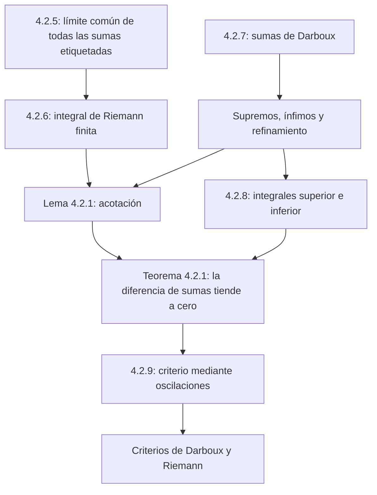

# Lecciones 39–40 — Integral de Riemann y sumas de Darboux

[Índice de lecciones](index.md) · [Русский](../../ru/lectures-2025-26/lecture-39-40.md) · [English](../../en/lectures-2025-26/lecture-39-40.md)

> **Fuente:** `ma25_26-lectures_39-40_notes.pdf` — 31 páginas, 13 diapositivas impresas. Páginas manuscritas: 5, 7, 10–11, 13–21, 25–27, 29, 31. Se incluyen las anotaciones sobre las diapositivas. Fecha: 5 de marzo de 2026. Las ilustraciones son recortes del propio PDF comprobados individualmente, no dibujos nuevos.
>
> **Semestre 2: lecciones 33–64; el semestre 1 terminó con la lección 32. Existe material duplicado a partir de la lección 33** en la [carpeta rusa `ru/lectures/`](../../ru/lectures/index.md). Esta lección se solapa con [§4.2 «Integral de Riemann»](../../ru/lectures/03-riemann-integral-4-2.md); se conserva la [«Lección 39-40 1» archivada](../../../source/MathInMind/МАТАН_Л/Лекция%2039-40%201.md). A continuación se ofrece una transcripción ilustrada completa e independiente de la nueva fuente, no un enlace que sustituya los apuntes.
>
> **Convenciones.** $a<b$, $\tau=\{x_k\}_{k=0}^{n}$, $a=x_0<\cdots<x_n=b$, $\Delta x_k=x_{k+1}-x_k>0$, $\lambda_\tau=\max_k\Delta x_k$, $\xi_k\in[x_k,x_{k+1}]$. Las particiones y sus etiquetas se definieron en las [lecciones 37–38](lecture-37-38.md). Al principio no se supone acotación: las sumas superiores pueden valer $+\infty$, y las inferiores $-\infty$. La integral de Riemann de esta lección siempre es un **número real finito**.

## Diapositivas impresas 1–3 (pp. PDF 1–3). Introducción

La **«cita del día»** es una imagen del «árbol de Navidad de Riemann» y del «árbol de Navidad de Lebesgue»: franjas verticales y horizontales. Es una ilustración humorística, no una definición de la integral de Lebesgue.

**Objetivos:** límite de sumas de Riemann; integral de Riemann; sumas de Darboux y sus propiedades; acotación de las funciones integrables; integrales superior e inferior de Darboux; oscilaciones; criterios de integrabilidad. Los objetivos también mencionan la integrabilidad de funciones continuas y monótonas; los teoremas y sus demostraciones aparecen en el [PDF siguiente, lecciones 41–42](lecture-41-42.md).

## Capítulo 4, §2. Integral de Riemann

### Diapositiva impresa 4 (p. PDF 4). Límite de sumas de Riemann

**Definición 4.2.5.** Sea $f:[a,b]\to\mathbb R$. El número $I\in\mathbb R$ es el límite de las sumas de Riemann cuando la norma de la partición tiende a cero si

$$
\forall\varepsilon>0\ \exists\delta>0\ \forall\tau:
\lambda_\tau<\delta\ \forall\xi\qquad
|\sigma_\tau(f,\xi)-I|<\varepsilon.
$$

Notación:

$$
I=\lim_{\lambda_\tau\to0}\sigma_\tau(f,\xi)
=\lim_{\lambda\to0}\sigma.
$$

El mismo número debe aproximar las sumas para **todas** las particiones suficientemente finas y **todas** sus elecciones de etiquetas.

### Página manuscrita (p. PDF 5). Formulación secuencial

1. La definición puede expresarse mediante sucesiones: para **toda** sucesión de particiones etiquetadas $\{(\tau^j,\xi^j)\}$,

$$
\lambda_{\tau^j}\xrightarrow[j\to\infty]{}0
\quad\Longrightarrow\quad
\sigma_{\tau^j}(f,\xi^j)\xrightarrow[j\to\infty]{}I.
$$

2. No es el límite ordinario de una función de la única variable «norma»: la suma depende de toda la partición etiquetada, no solo de su norma. Distintas particiones y etiquetas con la misma norma pueden dar sumas diferentes.

### Diapositiva impresa 5 y página manuscrita (pp. PDF 6–7). Integral de Riemann

**Definición 4.2.6.** Si el límite de las sumas existe y vale $I\in\mathbb R$, la función $f$ es **integrable según Riemann** en $[a,b]$, y el número $I$ es su **integral de Riemann**, o **integral definida**:

$$
I=\int_a^b f
=\int_a^b f(x)\,dx
=\int_a^b f(r)\,dr.
$$

La anotación manuscrita de la p. 6 recuerda:

$$
\sigma_\tau(f,\xi)=\sum_{k=0}^{n-1}f(\xi_k)\Delta x_k,
\qquad I=\lim_{\lambda_\tau\to0}\sigma_\tau(f,\xi).
$$

La notación $\mathcal R[a,b]$ designa el conjunto de funciones integrables según Riemann. Los números $a,b$ son los límites de integración; $f$ es el integrando. La letra de la variable de integración no afecta al número obtenido.

### Diapositiva impresa 6 (p. PDF 8). Tres preguntas

La integral es, por tanto, un límite de sumas de Riemann. Surgen tres preguntas:

1. ¿Qué funciones son integrables?
2. ¿Qué propiedades tiene la integral?
3. ¿Cómo se calcula una integral?

A continuación se aborda la primera pregunta.

### Diapositiva impresa 7 y páginas manuscritas (pp. PDF 9–11). Sumas de Darboux

**Definición 4.2.7.** Para $f:[a,b]\to\mathbb R$ y una partición $\tau$, pongamos

$$
M_k=\sup_{x\in[x_k,x_{k+1}]}f(x),\qquad
m_k=\inf_{x\in[x_k,x_{k+1}]}f(x),\qquad k=0,\ldots,n-1.
$$

Las **sumas superior e inferior de Darboux** son

$$
S_\tau(f)=\sum_{k=0}^{n-1}M_k\Delta x_k,\qquad
s_\tau(f)=\sum_{k=0}^{n-1}m_k\Delta x_k.
$$

> **Explicación editorial de la figura.** Las alturas del dibujo se numeran desde 1, mientras que los subintervalos de la definición se indexan desde 0. Las fórmulas siguen la indexación de la definición.

Si $f$ es continua en $[a,b]$, el teorema de Weierstrass proporciona puntos $\widetilde\xi_k,\widehat\xi_k$ en cada subintervalo tales que

$$
M_k=\max_{[x_k,x_{k+1}]}f=f(\widetilde\xi_k),\qquad
m_k=\min_{[x_k,x_{k+1}]}f=f(\widehat\xi_k).
$$

**Observación manuscrita:** en general, el supremo y el ínfimo no tienen por qué ser valores de la función. Por eso las sumas de Darboux **pueden no ser sumas de Riemann** para ninguna elección de etiquetas. Son más sencillas porque no dependen de las etiquetas.

### Diapositiva impresa 8 (p. PDF 12). Cuatro propiedades de las sumas de Darboux

1. Para cualquier partición:

$$
f\text{ está acotada superiormente}\ \Longleftrightarrow\ S_\tau(f)<+\infty,
\qquad
f\text{ está acotada inferiormente}\ \Longleftrightarrow\ s_\tau(f)>-\infty.
$$

2. Para una partición fija, las cotas exactas sobre todas las etiquetas son

$$
S_\tau(f)=\sup_\xi\sigma_\tau(f,\xi),\qquad
s_\tau(f)=\inf_\xi\sigma_\tau(f,\xi).
$$

3. Añadir puntos a la partición no aumenta la suma superior ni disminuye la inferior. Si $T\supset\tau$, entonces

$$
s_\tau(f)\le s_T(f)\le S_T(f)\le S_\tau(f).
$$

4. Cualquier suma inferior es menor o igual que **cualquier** suma superior, incluso para particiones diferentes:

$$
s_{\tau_1}(f)\le S_{\tau_2}(f).
$$

### Páginas manuscritas (pp. PDF 13–14). Demostración de la propiedad 1

Supongamos $f(x)\le M$ en $[a,b]$. Entonces $M_k\le M$, de modo que

$$
S_\tau(f)\le\sum_{k=0}^{n-1}M\Delta x_k=M(b-a)<+\infty.
$$

Recíprocamente, si $f$ no está acotada superiormente, tampoco lo está en alguno de los finitos subintervalos. Para ese índice $\nu$, tenemos $M_\nu=+\infty$ y, por tanto, $S_\tau(f)=+\infty$. El argumento análogo para el ínfimo, o la aplicación del resultado a $-f$, da la segunda equivalencia. $\blacksquare$

### Páginas manuscritas (pp. PDF 15–18). Demostración de la propiedad 2

Para toda elección de etiquetas, $f(\xi_k)\le M_k$, luego

$$
\sigma_\tau(f,\xi)
=\sum_{k=0}^{n-1}f(\xi_k)\Delta x_k
\le\sum_{k=0}^{n-1}M_k\Delta x_k=S_\tau(f).
$$

Veamos que es la **menor** cota superior. Si $f$ está acotada superiormente, la definición de supremo permite elegir, para cada $\varepsilon>0$, etiquetas $\xi^*$ con

$$
f(\xi_k^*)>M_k-\frac{\varepsilon}{b-a}.
$$

Multiplicando por las longitudes positivas y sumando, obtenemos

$$
\begin{aligned}
\sigma_\tau(f,\xi^*)
&>\sum_{k=0}^{n-1}\left(M_k-\frac{\varepsilon}{b-a}\right)\Delta x_k\\
&=S_\tau(f)-\frac{\varepsilon}{b-a}\sum_{k=0}^{n-1}\Delta x_k
=S_\tau(f)-\varepsilon.
\end{aligned}
$$

Si $f$ no está acotada superiormente, elegimos un subintervalo $[x_\nu,x_{\nu+1}]$ en el que no lo esté, y puntos arbitrarios $\xi_k^*$ para $k\ne\nu$.

Para todo $A>0$, la etiqueta restante puede elegirse de forma que

$$
f(\xi_\nu^*)>
\frac{A-\sum_{k\ne\nu}f(\xi_k^*)\Delta x_k}{\Delta x_\nu}.
$$

Entonces $\sigma_\tau(f,\xi^*)>A$, así que el supremo de todas las sumas es $+\infty=S_\tau(f)$. El ínfimo se trata de forma análoga invirtiendo las desigualdades. $\blacksquare$

### Páginas manuscritas (pp. PDF 19–21). Demostraciones de las propiedades 3–4

**3. Refinamiento.** Basta añadir un punto $c\in(x_\nu,x_{\nu+1})$; añadir un número finito de puntos consiste en repetir este paso.

Sean $M',M''$ los supremos en los dos subintervalos nuevos. Entonces $M',M''\le M_\nu$. Para sumas superiores finitas, el cálculo manuscrito es

$$
\begin{aligned}
S_\tau-S_T
&=M_\nu(x_{\nu+1}-x_\nu)-M'(c-x_\nu)-M''(x_{\nu+1}-c)\\
&\ge M_\nu\bigl[(x_{\nu+1}-x_\nu)-(c-x_\nu)-(x_{\nu+1}-c)\bigr]=0.
\end{aligned}
$$

> **Explicación editorial.** Si la función no está acotada superiormente, ambas sumas superiores son infinitas por la propiedad 1: la comparación sigue siendo válida, pero no se resta infinito de infinito. El caso de las sumas inferiores es análogo. Esto precisa cuándo es legítima la resta del manuscrito.

En las sumas inferiores, los ínfimos nuevos son mayores o iguales que el anterior, por lo que $s_T\ge s_\tau$.

**4. Particiones diferentes.** Si las particiones coinciden, la afirmación se deduce de $m_k\le M_k$. En general, ponemos $T=\tau_1\cup\tau_2$ y aplicamos la propiedad 3:

$$
s_{\tau_1}\le s_T\le S_T\le S_{\tau_2}.
$$

Por tanto, $s_{\tau_1}\le S_{\tau_2}$. $\blacksquare$

### Diapositiva impresa 9 (p. PDF 22). Acotación de una función integrable

**Lema 4.2.1.** Una función integrable en un intervalo cerrado está acotada en él.

**Demostración manuscrita.** Supongamos lo contrario; por ejemplo, que no esté acotada superiormente. Para cualquier partición, las propiedades 1–2 dan

$$
\sup_\xi\sigma_\tau(f,\xi)=S_\tau(f)=+\infty.
$$

Así, para cualquier supuesto límite $I\in\mathbb R$ y una partición arbitrariamente fina, existen etiquetas con $\sigma_\tau(f,\xi)>I+1$. No se cumple la definición de límite. La falta de acotación inferior se trata de modo análogo. $\blacksquare$

### Diapositiva impresa 10 (p. PDF 23). Integrales de Darboux

**Definición 4.2.8.** Las cantidades

$$
I^*=\inf_\tau S_\tau(f),\qquad
I_*=\sup_\tau s_\tau(f)
$$

son las **integrales superior e inferior de Darboux**.

Observaciones manuscritas:

1. La propiedad 4 implica $I_*\le I^*$.
2. Como en las sumas de Darboux, la falta de acotación superior o inferior se relaciona con los infinitos correspondientes:

$$
f\text{ no está acotada superiormente}\ \Longleftrightarrow\ I^*=+\infty,
\qquad
f\text{ no está acotada inferiormente}\ \Longleftrightarrow\ I_*=-\infty.
$$

Si $f$ está acotada, ambas cantidades son finitas.

### Diapositiva impresa 11 (p. PDF 24). Criterio de integrabilidad

**Teorema 4.2.1.** Para $f:[a,b]\to\mathbb R$,

$$
f\in\mathcal R[a,b]
\quad\Longleftrightarrow\quad
\lim_{\lambda_\tau\to0}\bigl(S_\tau(f)-s_\tau(f)\bigr)=0.
$$

Es decir,

$$
\forall\varepsilon>0\ \exists\delta>0\ \forall\tau:
\lambda_\tau<\delta\quad\Longrightarrow\quad
S_\tau(f)-s_\tau(f)<\varepsilon.
$$

**Corolario (sin número).** Para una función integrable,

$$
\lim_{\lambda_\tau\to0}S_\tau(f)
=\lim_{\lambda_\tau\to0}s_\tau(f)
=\int_a^b f.
$$

### Páginas manuscritas (pp. PDF 25–27). Demostración del teorema 4.2.1

**Necesidad.** Sea $I=\int_a^b f$. Dado $\varepsilon>0$, elegimos $\delta>0$ mediante la definición de límite, de forma que, si $\lambda_\tau<\delta$, toda elección de etiquetas satisfaga

$$
I-\frac{\varepsilon}{3}<\sigma_\tau(f,\xi)<I+\frac{\varepsilon}{3}.
$$

Tomando el ínfimo y el supremo respecto a las etiquetas, resulta

$$
I-\frac{\varepsilon}{3}\le s_\tau\le S_\tau\le I+\frac{\varepsilon}{3},
\qquad
0\le S_\tau-s_\tau\le\frac{2\varepsilon}{3}<\varepsilon.
$$

**Suficiencia.** Supongamos que la diferencia de las sumas tiende a cero. Entonces es finita para alguna partición suficientemente fina. Ambas sumas de esa partición son, por tanto, finitas; la propiedad 1 implica la acotación de $f$ y, en consecuencia, la finitud de todas las sumas y de ambas integrales de Darboux.

> **Explicación editorial.** Esto desarrolla el primer paso del manuscrito: «todas las sumas son finitas». Bajo una flecha de la p. 26 se escribe por error que la norma tiende a infinito; aquí, como en todo el criterio, debe ser $\lambda_\tau\to0$.

Para cualquier partición,

$$
s_\tau\le I_*\le I^*\le S_\tau,
\qquad
0\le I^*-I_*\le S_\tau-s_\tau.
$$

El miembro derecho tiende a cero, luego $I^*=I_*=:I$. Junto con $s_\tau\le\sigma_\tau(f,\xi)\le S_\tau$, esto da

$$
|\sigma_\tau(f,\xi)-I|\le S_\tau-s_\tau.
$$

Dado $\varepsilon>0$, elegimos $\delta>0$ de la condición del criterio. La estimación vale para toda partición con $\lambda_\tau<\delta$ y toda elección de etiquetas: el límite de las sumas es $I$. $\blacksquare$

**Conclusión destacada en el manuscrito:** para cualquier función integrable y cualquier partición,

$$
s_\tau(f)\le\int_a^b f\le S_\tau(f).
$$

### Diapositiva impresa 12 y página manuscrita (pp. PDF 28–29). Oscilación y corolario

**Definición 4.2.9.** En un conjunto no vacío $D\subset\mathbb R$, la oscilación de $f:D\to\mathbb R$ es

$$
\omega(f)_D=\sup_{x,y\in D}\bigl(f(x)-f(y)\bigr)
=\sup_{x\in D}f(x)-\inf_{y\in D}f(y).
$$

La anotación de la diapositiva equipara los términos rusos «колебание» y «осцилляция» (oscilación).

$$
\omega_k(f)=\omega(f)_{[x_k,x_{k+1}]}=M_k-m_k,
\qquad
S_\tau(f)-s_\tau(f)=\sum_{k=0}^{n-1}\omega_k(f)\Delta x_k.
$$

Por tanto, el teorema 4.2.1 puede escribirse así:

$$
f\in\mathcal R[a,b]
\quad\Longleftrightarrow\quad
\lim_{\lambda_\tau\to0}\sum_{k=0}^{n-1}\omega_k(f)\Delta x_k=0.
$$

**Demostración manuscrita del corolario de la diapositiva 11.** Para $I=\int_a^b f$, ya se demostró $s_\tau\le I\le S_\tau$. Por ello,

$$
0\le S_\tau-I\le S_\tau-s_\tau,
\qquad
0\le I-s_\tau\le S_\tau-s_\tau.
$$

Ambos miembros derechos tienden a cero, lo que demuestra la convergencia de ambas sumas a la integral. $\blacksquare$

### Diapositiva impresa 13 y página manuscrita (pp. PDF 30–31). Otras dos formas del criterio

**Observación 1.** Las integrales superior e inferior de Darboux son los límites de sus sumas respectivas:

$$
\lim_{\lambda_\tau\to0}S_\tau(f)=I^*,\qquad
\lim_{\lambda_\tau\to0}s_\tau(f)=I_*.
$$

Para una función arbitraria, estos límites pueden ser cantidades reales extendidas.

**Criterio de Darboux.** La función $f$ es integrable según Riemann si y solo si está **acotada** en $[a,b]$ y

$$
I^*=I_*.
$$

**Criterio de Riemann.** La función $f$ es integrable según Riemann si y solo si

$$
\forall\varepsilon>0\ \exists\tau\qquad
S_\tau(f)-s_\tau(f)<\varepsilon.
$$

**Explicación manuscrita de la p. 31:** para la suficiencia, el último criterio es más cómodo que el teorema 4.2.1: para cada tolerancia basta encontrar **una** partición adecuada. No hace falta comprobar directamente la desigualdad para todas las particiones suficientemente finas. Los nombres de los dos criterios siguen la fuente; aquí no se proporcionan sus demostraciones separadas.

> **Nota del editor.** La acotación del criterio de Darboux no puede sustituirse por la mera igualdad de las integrales extendidas: la igualdad de cantidades infinitas no proporciona una integral de Riemann finita. En el criterio de Riemann, la finitud de una sola diferencia de sumas ya asegura la acotación por la propiedad 1.

## Estructura de la lección

---

Anteriores: [lecciones 37–38](lecture-37-38.md) · Siguientes: [lecciones 41–42](lecture-41-42.md) · [Procedencia de las ilustraciones](../../assets/lectures-2025-26/provenance-39-44.md).
