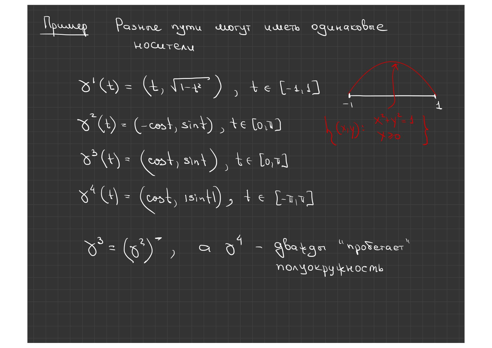
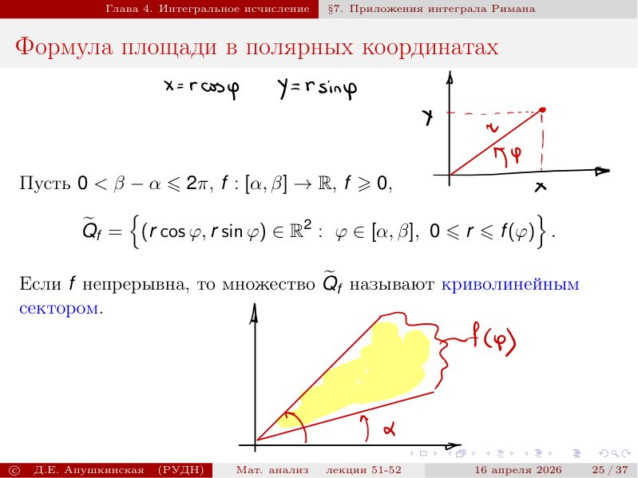

# Lecciones 51–52 — área, volumen, caminos y aplicaciones de la integral

[← Lecciones 49–50](lecture-49-50.md) · [Índice de lecciones](index.md) · [Lección 53 →](lecture-53.md) · [Términos y teoremas](../term-index.md) · [Русский](../../ru/lectures-2025-26/lecture-51-52.md) · [English](../../en/lectures-2025-26/lecture-51-52.md)


> **Fuente y cobertura.** `ma25_26-lectures_51-52_notes.pdf.txt`: 40 páginas PDF, 37 diapositivas impresas, fecha 16 de abril de 2026. Se contabilizan todas las páginas; las páginas PDF 9, 17 y 27 son manuscritas. Se incluyen las anotaciones manuscritas en las diapositivas 5, 14–16, 21, 24, 28, 32 y 39. Esta transcripción se basa solo en el PDF adjunto; no se consultó la carpeta de fuentes y no se indican nombres ni enlaces del archivo.

> **Duplicación del semestre 2.** Esta transcripción autónoma de las lecciones 51–52 coincide temáticamente con [§4.6](../../ru/lectures/07-measure-paths-4-6.md) y [§4.7](../../ru/lectures/08-integral-applications-4-7.md) del registro; véase también el [registro del semestre 2](../../ru/lectures/index.md). El semestre 2 abarca las lecciones 33–64.

## Diapositiva impresa 1 (pp. PDF 1) — Portada

«Análisis matemático», lecciones 51–52; D. E. Apushkinskaya, Universidad RUDN; 16 de abril de 2026.

## Diapositiva impresa 2 (pp. PDF 2) — Cita del día

«Al final, todo saldrá bien. Si todavía no está bien, significa que aún no es el final». Paulo Coelho.

## Diapositiva impresa 3 (pp. PDF 3) — Objetivos

Longitud, área y volumen; caminos, sus propiedades y longitud; aplicaciones geométricas de la [integral de Riemann](lecture-39-40.md#def-4-2-6).

## Diapositiva impresa 4 (pp. PDF 4) — Capítulo 4, §6. Longitud, área y volumen

Se introducen las magnitudes geométricas necesarias para las aplicaciones de la integral que siguen.

## Diapositiva impresa 5 (pp. PDF 5) — Área y movimientos rígidos

<a id="def-4-6-1"></a>**Definición 4.6.1.**

La [distancia euclídea](lecture-54.md#def-5-1-1) en $`\mathbb R^n`$ se expresa mediante la fórmula siguiente. Un movimiento conserva la distancia entre cualquier par de puntos.


```math
\|A-B\|=\sqrt{\sum_{i=1}^{n}(A_i-B_i)^2}
```

## Diapositiva impresa 6 (pp. PDF 6) — Axiomas del área

<a id="def-4-6-2"></a>**Definición 4.6.2.**

El área se define sobre una clase de figuras cuadrables: aditividad finita para figuras disjuntas, normalización en rectángulos e invariancia por movimientos.


```math
S(P_1\cup P_2)=S(P_1)+S(P_2)
```


```math
S([0,a]\times[0,b])=ab
```


```math
S(U(P))=S(P)
```

## Diapositiva impresa 7 (pp. PDF 7) — Límites de la definición del área

No se define formalmente la clase de figuras cuadrables; aquí se aceptan como hechos geométricos la existencia y unicidad del área.

## Diapositiva impresa 8 (pp. PDF 8) — Otras propiedades del área

El área es monótona; un subconjunto de un segmento tiene área nula; la aditividad se mantiene si la intersección tiene área cero, por ejemplo si es un segmento.


```math
P_1\subset P\Longrightarrow S(P_1)\le S(P)
```


```math
P\subset\text{ a line segment}\Longrightarrow S(P)=0
```


```math
S(P_1\cup P_2)=S(P_1)+S(P_2)
```

## Página manuscrita (pp. PDF 9) — Propiedades del área: esbozos de demostración

La página manuscrita ofrece tres demostraciones breves. La monotonía se obtiene comparando rectángulos interiores y exteriores. Si un conjunto cabe en rectángulos de área arbitrariamente pequeña, su área es cero. Si la intersección tiene área nula, quitar la parte común no cambia el área y se obtiene la aditividad reforzada.

## Diapositiva impresa 9 (pp. PDF 10) — Volumen

<a id="def-4-6-3"></a>**Definición 4.6.3.**

El volumen de los cuerpos cubables de $`\mathbb R^3`$ satisface aditividad, normalización en paralelepípedos rectangulares e invariancia por movimientos.


```math
V(T_1\cup T_2)=V(T_1)+V(T_2)
```


```math
V([0,a]\times[0,b]\times[0,c])=abc
```


```math
V(U(T))=V(T)
```

## Diapositiva impresa 10 (pp. PDF 11) — Existencia del volumen

Como en el caso de las figuras cuadrables, no se define formalmente la cubabilidad; se acepta la existencia del volumen sin demostración.

## Diapositiva impresa 11 (pp. PDF 12) — Otras propiedades del volumen

El volumen es monótono, un cuerpo contenido en un rectángulo plano tiene volumen cero y las intersecciones de volumen nulo no afectan la aditividad.


```math
T_1\subset T\Longrightarrow V(T_1)\le V(T)
```


```math
V(T)=0
```


```math
V(T_1\cup T_2)=V(T_1)+V(T_2)
```

## Diapositiva impresa 12 (pp. PDF 13) — Cilindro recto y sección

<a id="def-4-6-4"></a>**Definición 4.6.4.** <a id="def-4-6-5"></a>**Definición 4.6.5.**

Para $`P\subset\mathbb R^2`$ y $`h>0`$, el cilindro recto $`P\times[0,h]`$ tiene volumen $`S(P)h`$. La sección de un cuerpo por el plano de primera coordenada $`x`$ se denota $`T(x)`$.


```math
Q=P\times[0,h],\qquad V(Q)=S(P)h
```


```math
T(x)=\{(y,z)\in\mathbb R^2:(x,y,z)\in T\}
```

## Diapositiva impresa 13 (pp. PDF 14) — Camino

<a id="def-4-6-6"></a>**Definición 4.6.6.**

Un camino en $`\mathbb R^m`$ es una aplicación continua de $`[a,b]`$: $`\gamma=(\gamma_1,\ldots,\gamma_m)`$. Los puntos $`\gamma(a)`$ y $`\gamma(b)`$ son el origen y el extremo.


```math
\gamma:[a,b]\to\mathbb R^m,\qquad \gamma=(\gamma_1,\ldots,\gamma_m)
```

## Diapositiva impresa 14 (pp. PDF 15) — Propiedades de los caminos

La imagen $`\gamma([a,b])`$ es su soporte; es cerrado si coinciden los extremos y simple si no se autointerseca salvo, quizá, en los extremos. La suavidad es coordenada a coordenada; un camino a trozos suave es suave en cada intervalo de una [partición](lecture-37-38.md#def-4-2-2).


```math
\gamma(a)=\gamma(b)
```


```math
\gamma(t_1)=\gamma(t_2)\Longrightarrow t_1=t_2\text{ or }\{t_1,t_2\}=\{a,b\}
```

## Diapositiva impresa 15 (pp. PDF 16) — Camino inverso y equivalencia

<a id="def-4-6-7"></a>**Definición 4.6.7.**

El camino inverso recorre la misma curva en dirección opuesta. Dos caminos son equivalentes mediante una reparametrización estrictamente creciente; la clase es una curva y sus representantes, parametrizaciones.


```math
\gamma^-(t)=\gamma(a+b-t)
```


```math
\gamma=\widetilde\gamma\circ u
```

## Página manuscrita (pp. PDF 17) — Caminos distintos con el mismo soporte

Se presentan cuatro parametrizaciones de la semicircunferencia superior. Cambian las fórmulas y los intervalos del parámetro, pero no el soporte geométrico. Invertir el camino cambia el sentido, no el soporte.




## Diapositiva impresa 16 (pp. PDF 18) — Poligonal inscrita

<a id="def-4-6-8"></a>**Definición 4.6.8.**

Para una partición $`a=t_0<\cdots<t_n=b`$, la poligonal inscrita une puntos sucesivos $`\gamma(t_k)`$; su longitud es la suma de las longitudes de los segmentos.


```math
\ell_\tau=\sum_{k=0}^{n-1}\|\gamma(t_{k+1})-\gamma(t_k)\|
```

## Diapositiva impresa 17 (pp. PDF 19) — Longitud y rectificabilidad

<a id="def-4-6-9"></a>**Definición 4.6.9.** <a id="def-4-6-10"></a>**Definición 4.6.10.**

La [longitud de un camino](lecture-53.md#thm-4-7-1) es el [supremo](lecture-11-12.md#def-2-3-1) de las longitudes de todas las poligonales inscritas; el camino es rectificable si este supremo es finito.


```math
s_\gamma=\sup_\tau\ell_\tau
```


```math
s_\gamma<+\infty
```

## Diapositiva impresa 18 (pp. PDF 20) — Capítulo 4, §7. Aplicaciones de la integral de Riemann

Una magnitud geométrica se acota mediante sumas inferiores y superiores especiales; su límite común se expresa como una integral.

## Diapositiva impresa 19 (pp. PDF 21) — Subgráfico

<a id="def-4-7-1"></a>**Definición 4.7.1.**

Para $`f\ge0`$, la región bajo la gráfica en $`[a,b]`$ se define a continuación. Si $`f`$ es continua, se llama trapecio curvilíneo.


```math
Q_f=\{(x,y)\in\mathbb R^2:x\in[a,b],\ 0\le y\le f(x)\}
```

## Diapositiva impresa 20 (pp. PDF 22) — Área bajo una gráfica: sumas de Darboux

En una partición se toman el [ínfimo](lecture-11-12.md#def-2-3-2) y el supremo de $`f`$ en cada subintervalo. Al multiplicarlos por las longitudes se obtienen las sumas inferior y superior.


```math
m_k=\inf_{x\in[x_k,x_{k+1}]}f(x),\qquad M_k=\sup_{x\in[x_k,x_{k+1}]}f(x)
```


```math
s_\tau=\sum_{k=0}^{n-1}m_k\Delta x_k,\qquad S_\tau=\sum_{k=0}^{n-1}M_k\Delta x_k
```

## Diapositiva impresa 21 (pp. PDF 23) — Interpretación geométrica de las sumas

La suma inferior es el área de rectángulos contenidos en el subgráfico; la superior es el área de rectángulos que lo cubren.

## Diapositiva impresa 22 (pp. PDF 24) — Área bajo una gráfica

El área queda entre las sumas inferior y superior. Si $`f`$ es integrable de Riemann, ambas [sumas de Darboux](lecture-39-40.md#def-4-2-8) convergen a la misma integral.


```math
s_\tau\le S(Q_f)\le S_\tau
```


```math
\sup_\tau s_\tau=\inf_\tau S_\tau=\int_a^b f(x)\,dx
```


```math
S(Q_f)=\int_a^b f(x)\,dx
```

## Diapositiva impresa 23 (pp. PDF 25) — Signo y área

Para una función no negativa, el área bajo la gráfica es la integral; para una no positiva, es la integral de $`-f`$. El área entre la gráfica y el eje es la integral de $`|f|`$.


```math
S(Q_f)=\int_a^b|f(x)|\,dx
```

## Diapositiva impresa 24 (pp. PDF 26) — Área entre dos gráficas

Si las funciones integrables cumplen $`f\le g`$, el área entre sus gráficas es la integral de la diferencia $`g-f`$.


```math
S=\int_a^b(g(x)-f(x))\,dx
```

## Página manuscrita (pp. PDF 27) — Área entre gráficas: demostración

Sea $`c=\inf_{x\in[a,b]}f(x)`$. Entonces $`f-c\ge0`$ y $`g-c\ge0`$. El área entre las gráficas es el área bajo $`g-c`$ menos el área bajo $`f-c`$; la constante $`c`$ se cancela y queda la integral de $`g-f`$.

## Diapositiva impresa 25 (pp. PDF 28) — Área en coordenadas polares

Un sector curvilíneo viene dado por $`0\le r\le f(\varphi)`$ y $`\varphi\in[\alpha,\beta]`$, con $`f\ge0`$; las anotaciones escriben $`x=r\cos\varphi`$, $`y=r\sin\varphi`$.


```math
x=r\cos\varphi,\qquad y=r\sin\varphi
```


```math
\widetilde Q_f=\{(r\cos\varphi,r\sin\varphi):\varphi\in[\alpha,\beta],\ 0\le r\le f(\varphi)\}
```




## Diapositiva impresa 26 (pp. PDF 29) — Sumas polares de sectores

En una partición angular, los radios mínimo y máximo determinan sectores circulares inscritos y circunscritos; cada sector tiene área igual a la mitad del radio al cuadrado por su ángulo.


```math
s_\tau=\frac12\sum_{k=0}^{n-1}m_k^2\Delta\varphi_k,\qquad S_\tau=\frac12\sum_{k=0}^{n-1}M_k^2\Delta\varphi_k
```

## Diapositiva impresa 27 (pp. PDF 30) — Límite de las sumas polares

Las sumas de áreas de sectores quedan acotadas y son sumas de Darboux para $`f^2/2`$.

## Diapositiva impresa 28 (pp. PDF 31) — Área en coordenadas polares

Al pasar a la integral se obtiene la fórmula del área de un sector curvilíneo.


```math
S(\widetilde Q_f)=\frac12\int_\alpha^\beta f^2(\varphi)\,d\varphi
```

## Diapositiva impresa 29 (pp. PDF 32) — Volumen mediante áreas de secciones

El cuerpo está sobre un intervalo finito; sus secciones son cuadrables, de área $`S(x)`$, y secciones extremas encajadas acotan las intermedias en cada intervalo pequeño. Se supone que $`S`$ es continua.


```math
S(x)=\operatorname{area}(T(x))
```


```math
S\in C[a,b]
```


## Diapositiva impresa 30 (pp. PDF 33) — Secciones inferiores y superiores

En cada subintervalo se eligen secciones de área mínima y máxima; la monotonía del área proporciona el ínfimo y el supremo de $`S`$.


```math
m_k=\inf_{x\in[x_k,x_{k+1}]}S(x),\qquad M_k=\sup_{x\in[x_k,x_{k+1}]}S(x)
```

## Diapositiva impresa 31 (pp. PDF 34) — Cilindros construidos sobre secciones

Las secciones de menor y mayor área definen cilindros inferior y superior sobre cada intervalo de la partición.


```math
q_k=[x_k,x_{k+1}]\times T(\xi_k^*),\qquad Q_k=[x_k,x_{k+1}]\times T(\xi_k^{**})
```

## Diapositiva impresa 32 (pp. PDF 35) — Capas del cuerpo

Cada capa queda entre los cilindros correspondientes; la unión de los inferiores está dentro del cuerpo y este está dentro de la unión de los superiores.


```math
q_k\subset T_k\subset Q_k
```


```math
w_\tau=\sum_{k=0}^{n-1}m_k\Delta x_k,\qquad W_\tau=\sum_{k=0}^{n-1}M_k\Delta x_k
```

## Diapositiva impresa 33 (pp. PDF 36) — Sumas de volúmenes de cilindros

La aditividad convierte los volúmenes de las uniones en sumas de áreas de bases por longitudes de intervalos.


```math
V\left(\bigcup_{k=0}^{n-1}q_k\right)=w_\tau,\qquad V\left(\bigcup_{k=0}^{n-1}Q_k\right)=W_\tau
```

## Diapositiva impresa 34 (pp. PDF 37) — Volumen como integral del área seccional

El volumen queda entre las sumas de Darboux de la función de áreas seccionales; si $`S`$ es integrable, ambas cotas convergen a la misma integral.


```math
w_\tau\le V(T)\le W_\tau
```


```math
V(T)=\int_a^b S(x)\,dx
```

## Diapositiva impresa 35 (pp. PDF 38) — Sólidos de revolución

La rotación del subgráfico de $`f\ge0`$ alrededor del eje $`OX`$ se describe mediante $`y^2+z^2\le f^2(x)`$.


```math
T_f=\{(x,y,z)\in\mathbb R^3:x\in[a,b],\ y^2+z^2\le f^2(x)\}
```

## Diapositiva impresa 36 (pp. PDF 39) — Volumen de revolución alrededor de $`OX`$

Cada sección es un disco de radio $`f(x)`$ y área $`\pi f^2(x)`$; se aplica la fórmula del volumen por secciones.


```math
S(x)=\pi f^2(x)
```


```math
V(T_f)=\pi\int_a^b f^2(x)\,dx
```

## Diapositiva impresa 37 (pp. PDF 40) — Fórmulas adicionales de sólidos de revolución

Para girar alrededor de $`OY`$ se usa el método de capas cilíndricas; un sector polar da otra fórmula. En conjuntos no acotados, las integrales correspondientes son impropias.


```math
V(T_f^\prime)=2\pi\int_a^b xf(x)\,dx
```


```math
V(\widetilde T_f)=\frac{2\pi}{3}\int_\alpha^\beta f^3(\varphi)\cos\varphi\,d\varphi
```


---

[← Lecciones 49–50](lecture-49-50.md) · [Índice de lecciones](index.md) · [Lección 53 →](lecture-53.md) · [Términos y teoremas](../term-index.md) · [Русский](../../ru/lectures-2025-26/lecture-51-52.md) · [English](../../en/lectures-2025-26/lecture-51-52.md)

