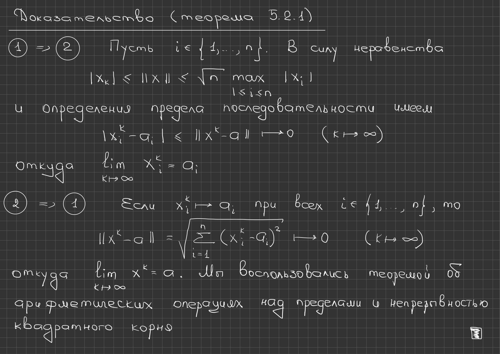

# Lección 54 — funciones de varias variables y sucesiones vectoriales

[Índice de lecciones](index.md) · [Русский](../../ru/lectures-2025-26/lecture-54.md) · [English](../../en/lectures-2025-26/lecture-54.md) · [Anterior: 53](lecture-53.md)

> **Fuente y cobertura.** `ма25_26_лекция_54_notes.pdf.txt`: 25 páginas PDF, 21 diapositivas impresas y 4 páginas manuscritas; fecha 23 de abril de 2026. Se incluyen las páginas manuscritas 8, 19, 21 y 24, además de las anotaciones. Se utilizó solo el PDF del chat; no se consultó la carpeta de fuentes.

> **Duplicación del semestre 2.** Esta lección coincide temáticamente con [§5.1](../../ru/lectures/09-rn-foundations-5-1.md) y [§5.2](../../ru/lectures/10-vector-sequences-5-2.md); véase también el [registro](../../ru/lectures/index.md). El semestre 2 abarca las lecciones 33–64.

## Diapositiva impresa 1 (pp. PDF 1) — Portada

«Análisis matemático», lección 54; 23 de abril de 2026.

## Diapositiva impresa 2 (pp. PDF 2) — Juego Estudiante–Docente

Diapositiva impresa con matrices de pagos; las cuatro parejas de estrategias ilustran los posibles resultados.

## Diapositiva impresa 3 (pp. PDF 3) — Objetivo

Introducir funciones de varias variables, la norma euclídea y límites de sucesiones en $\mathbb R^n$; extender propiedades básicas de límites.

## Diapositiva impresa 4 (pp. PDF 4) — Capítulo 5. Funciones de varias variables

Diapositiva inicial del capítulo sobre funciones de varias variables.

## Diapositiva impresa 5 (pp. PDF 5) — Definiciones básicas

Se consideran aplicaciones $f:E\subset\mathbb R^n\to\mathbb R^m$. Si $m=1$, es una función de $n$ variables reales; las coordenadas usan subíndices.

$$
f:E\subset\mathbb R^n\to\mathbb R^m
$$

$$
x=(x_1,\ldots,x_n)
$$

## Diapositiva impresa 6 (pp. PDF 6) — Norma euclídea

**Definición 5.1.1.** La norma euclídea de un vector es la raíz cuadrada de la suma de los cuadrados de sus coordenadas. Para $n=1$ es el valor absoluto; para $n=2,3$ es la longitud usual.

$$
\|x\|=\sqrt{\sum_{k=1}^{n}x_k^2}
$$

## Diapositiva impresa 7 (pp. PDF 7) — Axiomas de la norma

La norma es no negativa y solo se anula en el cero; es homogénea respecto de la multiplicación escalar y satisface la desigualdad triangular.

$$
\|x\|\ge0
$$

$$
\|\lambda x\|=|\lambda|\,\|x\|
$$

$$
\|x+y\|\le\|x\|+\|y\|
$$

## Página manuscrita (pp. PDF 8) — Norma euclídea: propiedades manuscritas

Cauchy–Schwarz se deduce de la no negatividad del polinomio cuadrático $\|x-ty\|^2$. La definición da $|x_k|\le\|x\|$ y una cota superior mediante el mayor módulo de las coordenadas; la dimensión se escribe $n$.

## Diapositiva impresa 8 (pp. PDF 9) — Otras propiedades de la norma

La desigualdad triangular inversa acota la diferencia de normas por la norma de la diferencia. Cauchy–Schwarz acota el producto escalar; cada coordenada no supera la norma euclídea.

$$
\|x-y\|\ge|\|x\|-\|y\||
$$

$$
|x\cdot y|\le\|x\|\,\|y\|
$$

## Diapositiva impresa 9 (pp. PDF 10) — Entornos en $\mathbb R^n$

El análisis de varias variables utiliza análogos de los entornos y entornos perforados de la recta real. Las notas manuscritas aclaran los símbolos del infinito.

## Diapositiva impresa 10 (pp. PDF 11) — Entornos y punto del infinito

**Definición 5.1.2.** El entorno de un punto es una bola abierta de radio $\delta$ en la norma euclídea; el entorno perforado excluye el punto. El entorno del punto del infinito consta de vectores cuya norma supera $\delta$.

$$
V_\delta(a)=\{x\in\mathbb R^n:\|x-a\|<\delta\}
$$

$$
\dot V_\delta(a)=V_\delta(a)\setminus\{a\}
$$

$$
V_\delta(\infty)=\{x\in\mathbb R^n:\|x\|>\delta\}
$$

## Diapositiva impresa 11 (pp. PDF 12) — Geometría de los entornos

En $\mathbb R$, $\mathbb R^2$ y $\mathbb R^3$ son, respectivamente, un intervalo, un disco y una bola. Una nota indica que para $n\ge2$, $+\infty$ y $-\infty$ no se distinguen en el espacio multidimensional.

$$
V_\delta(a)=(a-\delta,a+\delta)
$$

## Diapositiva impresa 12 (pp. PDF 13) — Intersección de entornos

La intersección de dos entornos de un mismo punto es otro entorno; para puntos finitos distintos se pueden elegir entornos disjuntos.

$$
V_{\delta_1}(a)\cap V_{\delta_2}(a)=V_{\min(\delta_1,\delta_2)}(a)
$$

## Diapositiva impresa 13 (pp. PDF 14) — Operaciones con vectores

La suma y la multiplicación escalar se hacen coordenada a coordenada; el producto escalar es la suma de los productos de las coordenadas correspondientes.

$$
x+y=(x_1+y_1,\ldots,x_n+y_n)
$$

$$
\lambda x=(\lambda x_1,\ldots,\lambda x_n)
$$

$$
x\cdot y=\sum_{i=1}^{n}x_iy_i
$$

## Diapositiva impresa 14 (pp. PDF 15) — Operaciones con aplicaciones

Las operaciones vectoriales se extienden punto a punto a aplicaciones con valores en $\mathbb R^m$; el producto escalar de aplicaciones suma los productos de sus componentes.

$$
(f\cdot g)(x)=\sum_{k=1}^{m}f_k(x)g_k(x)
$$

## Diapositiva impresa 15 (pp. PDF 16) — §2. Límite de sucesiones vectoriales

**Definición 5.2.1.** Una sucesión vectorial converge a $a$ si, para todo $\varepsilon>0$, todos los términos suficientemente avanzados pertenecen al entorno de radio $\varepsilon$ de $a$.

$$
\forall\varepsilon>0\ \exists N\ \forall k>N:\ x_k\in V_\varepsilon(a)
$$

$$
\lim_{k\to\infty}x_k=a
$$

## Diapositiva impresa 16 (pp. PDF 17) — Definiciones equivalentes de límite

La convergencia a un vector finito equivale a que la norma de la diferencia tienda a cero; una norma que tiende a infinito define el límite $\infty$.

$$
\|x_k-a\|<\varepsilon
$$

$$
\lim_{k\to\infty}\|x_k-a\|=0
$$

$$
\lim_{k\to\infty}\|x_k\|=+\infty
$$

## Diapositiva impresa 17 (pp. PDF 18) — Unicidad del límite

**Lema 5.2.1.** Si una sucesión tiene límites $a$ y $b$, entonces $a=b$. La convergencia a $a$ también implica que las normas convergen a $\|a\|$ por la desigualdad triangular inversa.

$$
|\|x_k\|-\|a\||\le\|x_k-a\|
$$

## Página manuscrita (pp. PDF 19) — Unicidad del límite: demostración

Supongamos que $a\ne b$. Se eligen entornos disjuntos de $a$ y $b$. Si una sucesión converge a ambos, todos sus términos suficientemente avanzados deben pertenecer a la intersección, que es vacía. Esta contradicción prueba la unicidad.

## Diapositiva impresa 18 (pp. PDF 20) — Convergencia coordenada a coordenada

**Teorema 5.2.1.** Una sucesión en $\mathbb R^n$ converge si y solo si cada sucesión coordenada converge a la coordenada correspondiente del vector límite.

$$
|x_i^k-a_i|\le\|x^k-a\|
$$

## Página manuscrita (pp. PDF 21) — Convergencia coordenada: demostración

Si $\|x^k-a\|\to0$, entonces $|x_i^k-a_i|\le\|x^k-a\|\to0$ para cada coordenada. Recíprocamente, si convergen las $n$ coordenadas, para un $\varepsilon$ dado se elige un índice común tras el cual cada error es menor que $\varepsilon/\sqrt n$; el error euclídeo es entonces menor que $\varepsilon$.

## Diapositiva impresa 19 (pp. PDF 22) — Un vector puede divergir aunque sus coordenadas no tengan límite

Un ejemplo alterna direcciones mientras crece su longitud: la norma tiende a infinito aunque las sucesiones coordenadas no tengan por qué converger.

$$
x_k=\left(k\cos\frac{\pi k}{2},k\sin\frac{\pi k}{2}\right)
$$

$$
\|x_k\|=k\to+\infty
$$

## Diapositiva impresa 20 (pp. PDF 23) — Aritmética de límites

**Teorema 5.2.2.** El límite de una suma es la suma de los límites; si $\lambda_k\to\lambda$, multiplicar una sucesión vectorial por la sucesión escalar da el límite esperado; el límite del producto escalar es el producto escalar de los límites.

$$
\lim_{k\to\infty}(x_k+y_k)=a+b
$$

$$
\lim_{k\to\infty}\lambda_kx_k=\lambda a
$$

$$
\lim_{k\to\infty}x_k\cdot y_k=a\cdot b
$$

## Página manuscrita (pp. PDF 24) — Ley de la suma: demostración

Para cada $i$, las sucesiones escalares de coordenadas convergen, luego $x_i^k+y_i^k\to a_i+b_i$. El teorema 5.2.1 implica entonces $x^k+y^k\to a+b$ en $\mathbb R^n$.

## Diapositiva impresa 21 (pp. PDF 25) — Linealidad del límite de una sucesión

Al combinar la ley de la suma y la multiplicación escalar se obtiene la linealidad del límite de una sucesión vectorial.

$$
\lim_{k\to\infty}(\lambda x_k+\mu y_k)=\lambda a+\mu b
$$

---

[Índice de lecciones](index.md) · [Русский](../../ru/lectures-2025-26/lecture-54.md) · [English](../../en/lectures-2025-26/lecture-54.md) · [Anterior: 53](lecture-53.md)
