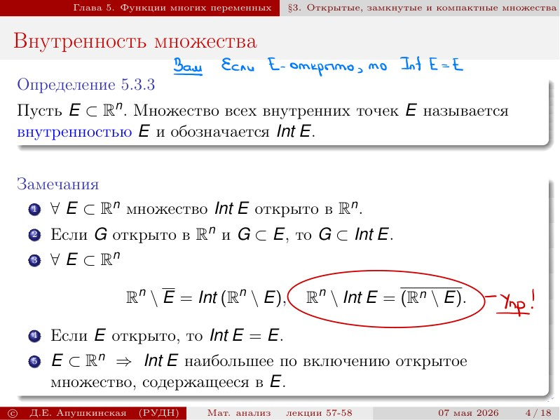
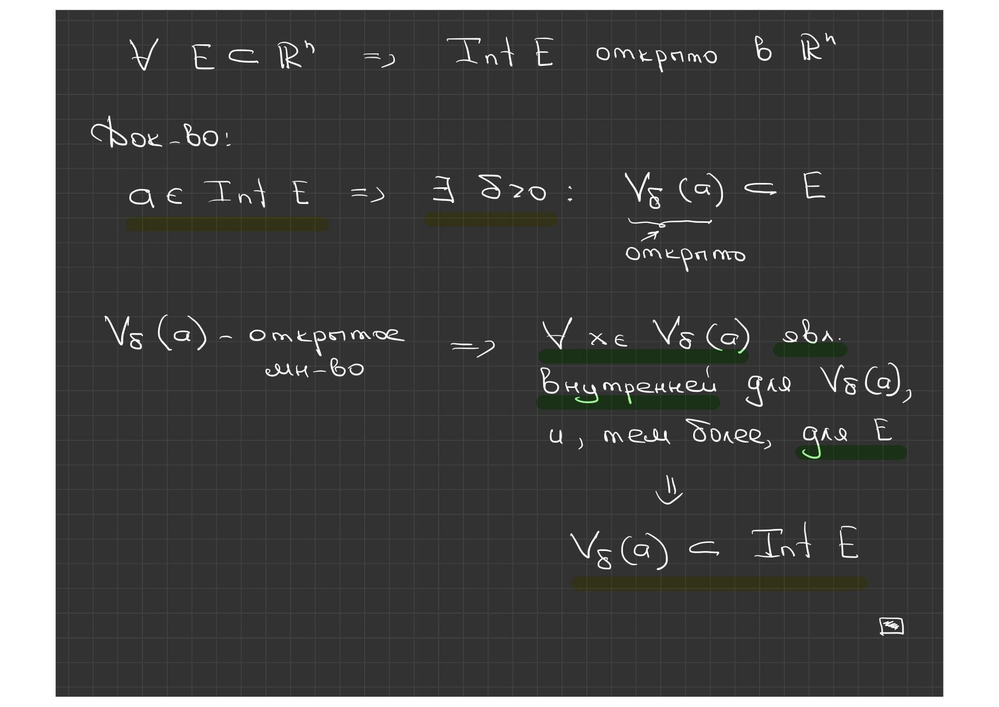
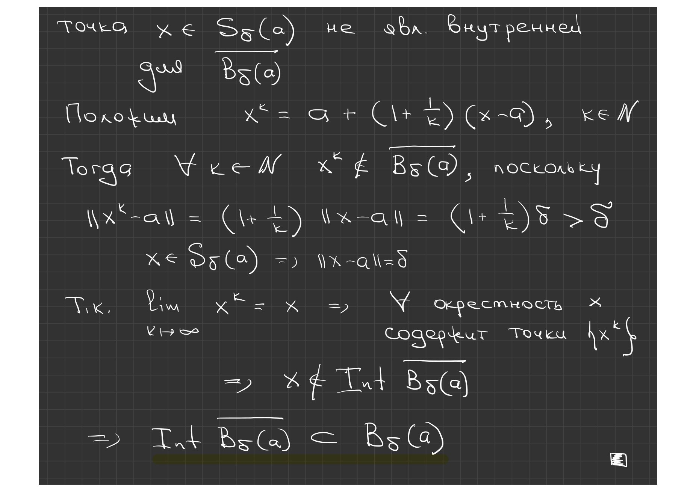
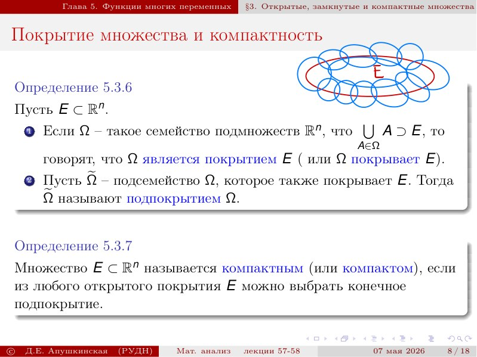
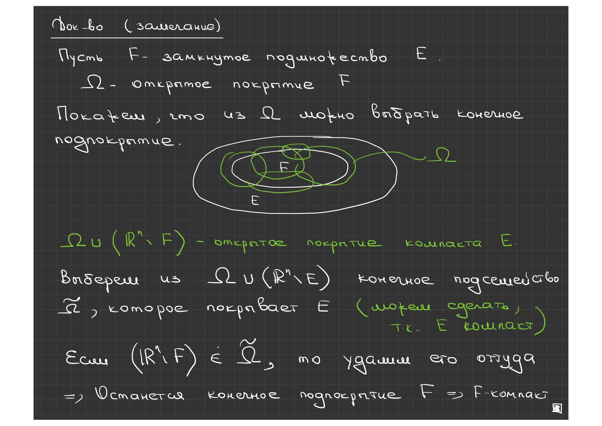
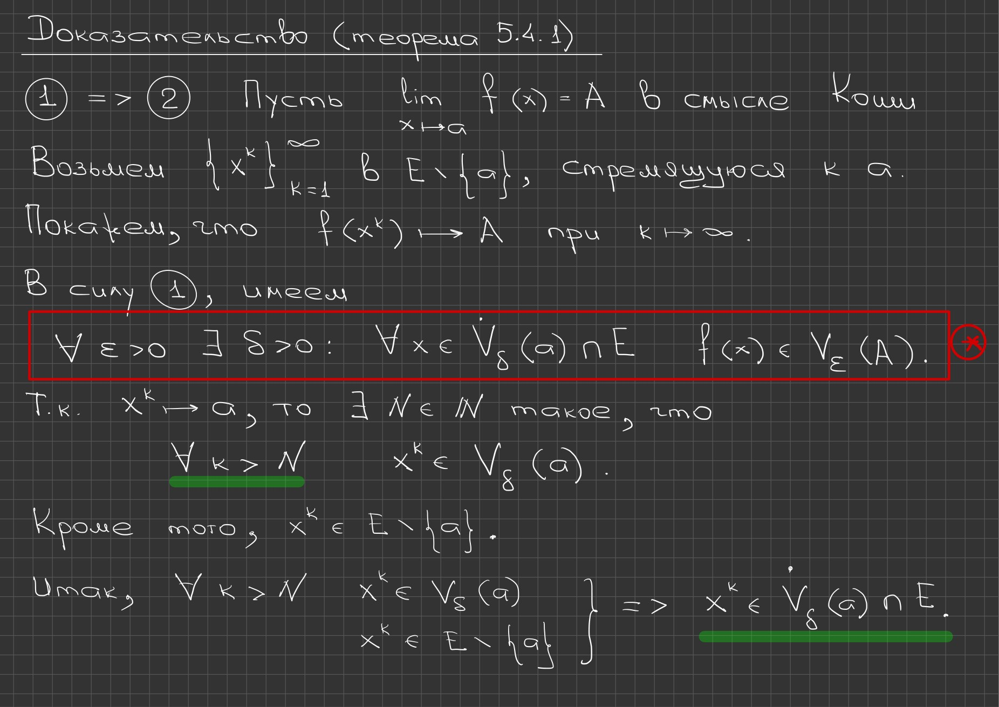
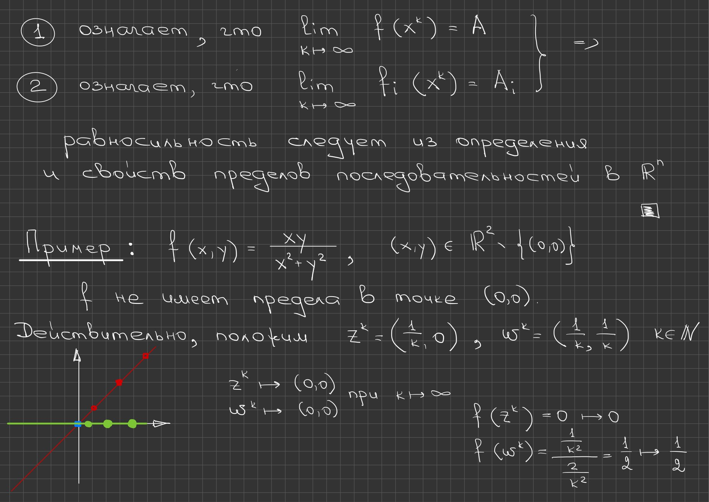

# Lecciones 57–58 — interior, frontera, compacidad y límite de una aplicación

[← Lecciones 55–56](lecture-55-56.md) · [Índice de lecciones](index.md) · [Lecciones 59–60 →](lecture-59-60.md) · [Términos y teoremas](../term-index.md) · [Русский](../../ru/lectures-2025-26/lecture-57-58.md) · [English](../../en/lectures-2025-26/lecture-57-58.md)


> **Fuente y cobertura.** `ma25_26-lectures_57-58_notes.pdf.txt`: 37 páginas del PDF, 18 diapositivas impresas y 19 páginas manuscritas; fecha 7 de mayo de 2026. Las diapositivas impresas 1–4 ocupan las páginas 1–4 del PDF; después, la diapositiva 5 está en la página 7, la 6 en la 10, la 7 en la 13, la 8 en la 14, la 9 en la 15, la 10 en la 17, la 11 en la 22, la 12 en la 23, la 13 en la 24, la 14 en la 25, la 15 en la 29, la 16 en la 32, la 17 en la 33 y la 18 en la 35. Se incluyen las páginas manuscritas del PDF 5, 6, 8, 9, 11, 12, 16, 18, 19, 20, 21, 26, 27, 28, 30, 31, 34, 36 y 37. Las anotaciones manuscritas sobre las diapositivas 4, 5 y 11 se atribuyen a sus diapositivas. Solo se utilizó el PDF entregado en el chat; no se consultó la carpeta de origen, por lo que no se indican nombres de archivo ni enlaces de archivo.

> **Duplicación del semestre 2.** La lección se solapa temáticamente con [§5.3](../../ru/lectures/11-topology-rn-5-3.md) y [§5.4](../../ru/lectures/12-mapping-limits-5-4.md); véase también el [registro](../../ru/lectures/index.md). El semestre 2 abarca las lecciones 33–64.

## Diapositiva impresa 1 (pp. PDF 1) — Diapositiva de título

«Análisis matemático», lecciones 57–58; D. E. Apushkinskaya, Universidad RUDN; 7 de mayo de 2026.

## Diapositiva impresa 2 (pp. PDF 2) — Cita del día

«Tres manzanas cambiaron nuestro mundo: la primera tentó a Eva, la segunda despertó a Newton y la tercera llamó la atención de Steve Jobs». Bajo la cita la diapositiva muestra la portada del libro «Tres manzanas que cambiaron el mundo» con retratos de Newton, Eva y Jobs; es una ilustración decorativa y no material matemático.

## Diapositiva impresa 3 (pp. PDF 3) — Objetivo de la lección

Continúa la descripción en $`\mathbb R^n`$ de análogos razonables de los intervalos abiertos y cerrados y de los conjuntos [compactos](#def-5-3-7). Se introduce la noción de límite de una aplicación de varias variables y se demuestran para tales aplicaciones análogos de algunas afirmaciones unidimensionales.

<a id="def-5-3-3"></a>
## Diapositiva impresa 4 (pp. PDF 4) — El interior de un conjunto — definición 5.3.3

**Definición 5.3.3.** Sea $`E\subset\mathbb R^n`$. El conjunto de todos los puntos interiores de $`E`$ se llama interior de $`E`$ y se denota $`\operatorname{Int}E`$.

**Observaciones.** 1) Para todo $`E\subset\mathbb R^n`$ el conjunto $`\operatorname{Int}E`$ es abierto en $`\mathbb R^n`$. 2) Si $`G`$ es abierto en $`\mathbb R^n`$ y $`G\subset E`$, entonces $`G\subset\operatorname{Int}E`$. 3) Para todo $`E\subset\mathbb R^n`$,

```math
\mathbb R^n\setminus\overline E=\operatorname{Int}\left(\mathbb R^n\setminus E\right),
```

```math
\mathbb R^n\setminus\operatorname{Int}E=\overline{\left(\mathbb R^n\setminus E\right)}.
```

4) Si $`E`$ es abierto, entonces $`\operatorname{Int}E=E`$. 5) Si $`E\subset\mathbb R^n`$, entonces $`\operatorname{Int}E`$ es el mayor [conjunto abierto](lecture-55-56.md#def-5-3-1) contenido en $`E`$ respecto de la inclusión.



> **Marcas en la diapositiva.** La observación 3 lleva la marca «¡ej!» — se propone demostrar las igualdades. Abajo, a mano: «Si $`E`$ es abierto, entonces $`\operatorname{Int}E=E`$» — es la observación 4, escrita al margen. En la capa de texto del PDF las barras superiores de la observación 3 se pierden en parte; aquí se restauran a partir de la imagen.

## Página manuscrita (pp. PDF 5) — Observación 1: $`\operatorname{Int}E`$ es abierto

Afirmación: $`\forall E\subset\mathbb R^n\Rightarrow\operatorname{Int}E`$ es abierto en $`\mathbb R^n`$.

Demostración. Sea $`a\in\operatorname{Int}E`$; entonces, por la definición de punto interior, $`\exists\delta>0`$: $`V_\delta(a)\subset E`$. El conjunto $`V_\delta(a)`$ es abierto, por lo que $`\forall x\in V_\delta(a)`$ es punto interior de $`V_\delta(a)`$ y, con mayor razón, de $`E`$. En consecuencia $`V_\delta(a)\subset\operatorname{Int}E`$; así pues, cada punto de $`\operatorname{Int}E`$ tiene un entorno contenido en $`\operatorname{Int}E`$, es decir, $`\operatorname{Int}E`$ es abierto.

```math
a\in\operatorname{Int}E\ \Longrightarrow\ \exists\delta>0:\ V_\delta(a)\subset E
```

```math
V_\delta(a)\subset\operatorname{Int}E
```



## Página manuscrita (pp. PDF 6) — Observación 2: $`G\subset\operatorname{Int}E`$

Afirmación: si $`G`$ es abierto en $`\mathbb R^n`$ y $`G\subset E`$, entonces $`G\subset\operatorname{Int}E`$.

Demostración. Sea $`a\in G`$; como $`G`$ es abierto, $`a`$ es punto interior de $`G`$. Puesto que $`G\subset E`$, el punto $`a`$ también es interior para $`E`$. Por tanto $`a\in\operatorname{Int}E`$, es decir, $`G\subset\operatorname{Int}E`$.

```math
\left.\begin{aligned} a&\in G\\ G&\text{ — abierto}\end{aligned}\right\}\Longrightarrow a\ \text{es punto interior de } G
```

```math
a\in\operatorname{Int}E
```

<a id="def-5-3-4"></a>
## Diapositiva impresa 5 (pp. PDF 7) — La frontera de un conjunto — definición 5.3.4

**Definición 5.3.4.** Sea $`E\subset\mathbb R^n`$. El conjunto $`E\setminus\operatorname{Int}E`$ se llama frontera de $`E`$ y se denota $`\partial E`$.

**Observación.** La frontera $`\partial E`$ de cualquier conjunto $`E\subset\mathbb R^n`$ es cerrada.

**Ejemplo.** Sean $`a\in\mathbb R^n`$, $`\delta>0`$. Entonces se cumplen las afirmaciones siguientes. 1) $`\operatorname{Int}B_\delta(a)=B_\delta(a)`$. 2) $`\partial\left(\overline{B_\delta(a)}\right)=\partial B_\delta(a)=S_\delta(a)`$.

```math
\partial E:=E\setminus\operatorname{Int}E
```

Notas manuscritas en la diapositiva: junto a la observación, «la diferencia de un cerrado y un abierto»; junto al ejemplo, «1) $`B_\delta(a)`$ es un conjunto abierto».

## Página manuscrita (pp. PDF 8) — Primera parte del ejemplo: $`\operatorname{Int}\overline{B_\delta(a)}=B_\delta(a)`$

Hay que demostrar que $`\operatorname{Int}\overline{B_\delta(a)}=B_\delta(a)`$. Recordemos las notaciones:

```math
B_\delta(a)=\{x\in\mathbb R^n:\ \|x-a\|<\delta\},
```

```math
\overline{B_\delta(a)}=\{x\in\mathbb R^n:\ \|x-a\|\le\delta\},
```

```math
S_\delta(a)=\{x\in\mathbb R^n:\ \|x-a\|=\delta\}.
```

El conjunto $`B_\delta(a)`$ es abierto, por tanto $`B_\delta(a)\subset\operatorname{Int}\overline{B_\delta(a)}`$. Comprobemos la inclusión inversa. Como $`\overline{B_\delta(a)}\setminus B_\delta(a)=S_\delta(a)`$, basta probar que ningún punto de la esfera $`S_\delta(a)`$ es interior para $`\overline{B_\delta(a)}`$.

```math
B_\delta(a)\subset\operatorname{Int}\overline{B_\delta(a)}
```

## Página manuscrita (pp. PDF 9) — Los puntos de la esfera no son interiores

Sea $`x\in S_\delta(a)`$; pongamos

```math
x^k=a+\left(1+\frac1k\right)(x-a),\qquad k\in\mathbb N.
```

Entonces $`\forall k\in\mathbb N`$ el punto $`x^k\notin\overline{B_\delta(a)}`$, ya que

```math
\|x^k-a\|=\left(1+\frac1k\right)\|x-a\|=\left(1+\frac1k\right)\delta>\delta,
```

pues $`x\in S_\delta(a)\Rightarrow\|x-a\|=\delta`$. Además, $`\lim_{k\to\infty}x^k=x`$, por lo que todo entorno del punto $`x`$ contiene puntos de $`\{x^k\}`$, es decir, $`x\notin\operatorname{Int}\overline{B_\delta(a)}`$. En consecuencia,

```math
\operatorname{Int}\overline{B_\delta(a)}\subset B_\delta(a).
```



## Diapositiva impresa 6 (pp. PDF 10) — Subconjuntos abiertos y cerrados

<a id="def-5-3-5"></a>**Definición 5.3.5.** Sean $`E\subset\mathbb R^n`$, $`F\subset E`$. 1) El punto $`a\in F`$ se llama interior para $`F`$ en $`E`$ si tiene un entorno $`(V_\delta(a)\cap E)\subset F`$. 2) El conjunto $`F`$ se llama abierto en $`E`$ si cada uno de sus puntos es interior para $`F`$ en $`E`$. 3) El conjunto $`F`$ se llama cerrado en $`E`$ si su complementario $`E\setminus F`$ es abierto en $`E`$.

<a id="thm-5-3-4"></a>**Teorema 5.3.4.** Sea $`F\subset E\subset\mathbb R^n`$. Entonces son equivalentes las afirmaciones siguientes. 1) El conjunto $`F`$ es abierto en $`E`$. 2) Existe un conjunto $`G`$ abierto en $`\mathbb R^n`$ para el cual $`F=E\cap G`$.

```math
\left(V_\delta(a)\cap E\right)\subset F
```

```math
F=E\cap G
```

## Página manuscrita (pp. PDF 11) — Demostración del teorema 5.3.4: 1) ⇒ 2)

Sea $`F`$ abierto en $`E`$. Entonces $`\forall a\in F`$ el punto $`a`$ es interior para $`F`$ en $`E`$, es decir,

```math
\exists\delta_a>0:\ \left(V_{\delta_a}(a)\cap E\right)\subset F.
```

Pongamos

```math
G=\bigcup_{a\in F}V_{\delta_a}(a).
```

El conjunto $`G`$ es abierto en $`\mathbb R^n`$ por ser una unión de bolas abiertas. Además,

```math
G\cap E=\bigcup_{a\in F}\left(V_{\delta_a}(a)\cap E\right)\subset F,
```

y la inclusión $`F\subset G\cap E`$ es obvia, ya que $`F\subset G`$ y $`F\subset E`$. En consecuencia $`F=E\cap G`$ — más exactamente, $`F=G\cap E`$.

```math
G\cap E=\bigcup_{a\in F}\left(V_{\delta_a}(a)\cap E\right)\subset F
```

## Página manuscrita (pp. PDF 12) — Demostración del teorema 5.3.4: 2) ⇒ 1)

Sea $`F=E\cap G`$, donde $`G`$ es abierto en $`\mathbb R^n`$. Comprobemos que $`F`$ es abierto en $`E`$. Sea $`a\in F=E\cap G`$; como $`G`$ es abierto, $`\exists\delta>0`$: $`V_\delta(a)\subset G`$. Entonces

```math
V_\delta(a)\cap E\subset G\cap E=F,
```

es decir, $`a`$ es punto interior para $`F`$ en $`E`$. Por tanto $`F`$ es abierto en $`E`$.

```math
V_\delta(a)\cap E\subset G\cap E=F
```

## Diapositiva impresa 7 (pp. PDF 13) — Observaciones sobre el teorema 5.3.4

1) Sea $`F\subset E\subset\mathbb R^n`$. Si $`E`$ es abierto en $`\mathbb R^n`$, entonces, por los [teoremas 5.3.2](lecture-55-56.md#thm-5-3-2) y [5.3.4](#thm-5-3-4), la apertura del conjunto $`F`$ en $`E`$ es equivalente a su apertura en $`\mathbb R^n`$. Para un $`E`$ arbitrario esto ya no es así: por ejemplo, el conjunto $`(0,1)\cap\mathbb Q`$ es abierto en $`\mathbb Q`$, pero no en $`\mathbb R`$. 2) Una afirmación análoga al [teorema 5.3.4](#thm-5-3-4) es válida también para [conjuntos cerrados](lecture-55-56.md#thm-5-3-1) en $`E`$.

```math
(0,1)\cap\mathbb Q
```

## Diapositiva impresa 8 (pp. PDF 14) — Recubrimientos de un conjunto y compacidad

<a id="def-5-3-6"></a>**Definición 5.3.6.** Sea $`E\subset\mathbb R^n`$. 1) Si $`\Omega`$ es una familia de subconjuntos de $`\mathbb R^n`$ tal que $`\bigcup_{A\in\Omega}A\supset E`$, se dice que $`\Omega`$ es un recubrimiento de $`E`$ (o que $`\Omega`$ recubre $`E`$). 2) Sea $`\tilde\Omega`$ una subfamilia de $`\Omega`$ que también recubre $`E`$. Entonces $`\tilde\Omega`$ se llama subrecubrimiento de $`\Omega`$.

<a id="def-5-3-7"></a>**Definición 5.3.7.** El conjunto $`E\subset\mathbb R^n`$ se llama compacto si de todo recubrimiento abierto de $`E`$ se puede extraer un subrecubrimiento finito.



```math
\bigcup_{A\in\Omega}A\supset E
```

## Diapositiva impresa 9 (pp. PDF 15) — Observaciones sobre los conjuntos compactos

1) Si el conjunto $`E\subset\mathbb R^n`$ es compacto, entonces todo subconjunto cerrado de $`E`$ también es compacto. 2) Todo cubo cerrado $`K\subset\mathbb R^n`$ es compacto.

## Página manuscrita (pp. PDF 16) — Demostración de la observación 1

Sea $`F`$ un subconjunto cerrado del compacto $`E`$ y sea $`\Omega`$ un recubrimiento abierto de $`F`$. Probemos que de $`\Omega`$ se puede extraer un subrecubrimiento finito. La familia

```math
\Omega\cup\left\{\mathbb R^n\setminus F\right\}
```

es un recubrimiento abierto del compacto $`E`$: los conjuntos de $`\Omega`$ y el conjunto $`\mathbb R^n\setminus F`$ son abiertos, y los puntos de $`E\setminus F`$ quedan cubiertos por el último. Extraigamos de este recubrimiento una subfamilia finita $`\tilde\Omega`$ que recubre $`E`$ — esto puede hacerse, ya que $`E`$ es compacto. Si $`\mathbb R^n\setminus F`$ pertenece a $`\tilde\Omega`$, lo eliminamos; los conjuntos restantes recubren $`F`$. Así pues, de $`\Omega`$ se ha extraído un subrecubrimiento finito de $`F`$, es decir, $`F`$ es compacto.

```math
\Omega\cup\left\{\mathbb R^n\setminus F\right\},\qquad \tilde\Omega
```

> **Discrepancia en el manuscrito.** En la primera línea el conjunto añadido está escrito correctamente como $`\mathbb R^n\setminus F`$, mientras que al elegir la subfamilia finita aparece como $`\Omega\cup\left\{\mathbb R^n\setminus E\right\}`$. La segunda escritura es incorrecta: el complementario $`\mathbb R^n\setminus E`$ no recubre $`E`$ y no ayuda a aplicar la compacidad de $`E`$; más abajo se usa $`\mathbb R^n\setminus F`$. La discrepancia se señala, pero no se corrige en el texto manuscrito transcrito.



## Diapositiva impresa 10 (pp. PDF 17) — Criterio de compacidad en $`\mathbb R^n`$

<a id="thm-5-3-5"></a>**Teorema 5.3.5.** Sea $`E\subset\mathbb R^n`$. Entonces son equivalentes las afirmaciones siguientes. 1) $`E`$ es compacto. 2) $`E`$ es cerrado y acotado. 3) De toda sucesión de elementos de $`E`$ se puede extraer una subsucesión convergente cuyo límite también pertenece a $`E`$.

**Observación.** La implicación 2) ⇒ 1) se suele llamar [teorema de Heine–Borel](#thm-5-3-5).

## Página manuscrita (pp. PDF 18) — Demostración del teorema 5.3.5: 1) ⇒ 3)

El esquema de la demostración es 1) ⇒ 3) ⇒ 2) ⇒ 1). Sea $`E`$ compacto y sea $`\{x^k\}_{k=1}^{\infty}`$ una sucesión en $`E`$. Entonces, por el principio de selección de [Bolzano–Weierstrass](lecture-11-12.md#thm-2-3-4), $`\exists\{x^{k_\ell}\}`$ tal que $`x^{k_\ell}\to a`$ y $`a\in\mathbb R^n`$. Comprobemos que $`a\in E`$. Supongamos $`a\notin E`$; consideremos la familia

```math
\Omega=\left\{\mathbb R^n\setminus\overline{V_\varepsilon(a)}\right\}_{\varepsilon>0},
```

formada por conjuntos abiertos. En virtud de la ley de de Morgan,

```math
\bigcup_{A\in\Omega}A=\mathbb R^n\setminus\bigcap_{\varepsilon>0}\overline{V_\varepsilon(a)}=\mathbb R^n\setminus\{a\}\supset E,
```

por lo tanto $`\Omega`$ es un recubrimiento abierto de $`E`$.

```math
\bigcup_{A\in\Omega}A=\mathbb R^n\setminus\bigcap_{\varepsilon>0}\overline{V_\varepsilon(a)}=\mathbb R^n\setminus\{a\}\supset E
```

## Página manuscrita (pp. PDF 19) — Final de 1) ⇒ 3): contradicción con la compacidad

Así pues, $`\Omega`$ recubre $`E`$. Sea ahora $`\tilde\Omega`$ una subfamilia finita arbitraria de $`\Omega`$. Entonces $`\exists m\in\mathbb N`$ y $`\varepsilon_1,\ldots,\varepsilon_m>0`$ tales que

```math
\tilde\Omega=\left\{\mathbb R^n\setminus\overline{V_{\varepsilon_k}(a)}\right\}_{k=1}^{m},
```

en consecuencia

```math
V(a):=\bigcap_{k=1}^{m}V_{\varepsilon_k}(a)
```

es un entorno del punto $`a`$. Obsérvese que

```math
\bigcup_{A\in\tilde\Omega}A=\mathbb R^n\setminus\bigcap_{k=1}^{m}\overline{V_{\varepsilon_k}(a)}\subset\mathbb R^n\setminus V(a).
```

Pero $`x^{k_\ell}\to a`$, es decir, para $`\ell`$ suficientemente grandes se tiene $`x^{k_\ell}\in E\cap V(a)`$. Por tanto $`\tilde\Omega`$ no recubre $`E`$, lo que contradice la compacidad de $`E`$. En consecuencia $`a\in E`$.

```math
\bigcup_{A\in\tilde\Omega}A=\mathbb R^n\setminus\bigcap_{k=1}^{m}\overline{V_{\varepsilon_k}(a)}\subset\mathbb R^n\setminus V(a)
```

## Página manuscrita (pp. PDF 20) — Demostración del teorema 5.3.5: 3) ⇒ 2)

Comprobemos que $`E`$ es cerrado. Sea $`\{x^k\}`$ una sucesión, $`x^k\in E`$, $`x^k\to a\in\mathbb R^n`$. Por la condición 3) $`\exists\{x^{k_\ell}\}`$ tal que $`x^{k_\ell}\to b`$, $`b\in E`$. Pero como $`\{x^{k_\ell}\}`$ es una [subsucesión](lecture-11-12.md#def-2-3-7) de $`\{x^k\}`$, se tiene $`a=b\in E`$; por tanto $`E`$ es cerrado.

Comprobemos que $`E`$ es acotado. Supongamos que $`E`$ no es acotado; entonces $`\forall k\in\mathbb N`$ $`\exists x^k\in E`$: $`\|x^k\|\ge k`$. La sucesión $`\{x^k\}`$ es tal que $`x^k\to\infty`$. Pero entonces para toda subsucesión $`\{x^{k_\ell}\}`$ se tiene $`x^{k_\ell}\to\infty`$, lo que contradice la condición 3). En consecuencia $`E`$ es acotado.

**Aclaración editorial.** En el manuscrito ambas flechas que llevan a una contradicción están marcadas con $`\not\Rightarrow`$; en el texto se expresan con las palabras «lo que contradice».

## Página manuscrita (pp. PDF 21) — Demostración del teorema 5.3.5: 2) ⇒ 1)

Sea $`E`$ cerrado y acotado en $`\mathbb R^n`$. De la acotación se sigue que $`\exists c>0`$:

```math
E\subset[-c,c]\times[-c,c]\times\ldots\times[-c,c]=[-c,c]^n,
```

es decir, $`E`$ está contenido en un cubo cerrado de $`\mathbb R^n`$. El cubo $`[-c,c]^n`$ es compacto en $`\mathbb R^n`$, y $`E`$ es un subconjunto cerrado de $`[-c,c]^n`$; por la observación 1 el conjunto $`E`$ es compacto.

```math
E\subset[-c,c]\times[-c,c]\times\ldots\times[-c,c]=[-c,c]^n
```

> **Nota editorial.** En el manuscrito la inclusión está escrita con el signo de igualdad: «$`E=[-c,c]^n`$». Para un $`E`$ acotado arbitrario esto es falso; el sentido de la línea es la inclusión $`E\subset[-c,c]^n`$, que es la que usa la demostración. La igualdad manuscrita se señala aquí como discrepancia y no se reproduce en las fórmulas.

## Diapositiva impresa 11 (pp. PDF 22) — §4. Límite de una aplicación de varias variables

Se consideran aplicaciones de la forma

```math
f:E\subset\mathbb R^n\to\mathbb R^m,\qquad m,n\in\mathbb N.
```

Tales aplicaciones se llaman aplicaciones de varias variables. Si $`m=1`$, entonces $`f`$ se llama función de varias variables. Si $`n=1`$, entonces $`f`$ se llama función vectorial.

Notas manuscritas: $`f:E\subset\mathbb R^n\to\mathbb R`$ y $`f:E\subset\mathbb R^n\to\mathbb R^m`$.

```math
f:E\subset\mathbb R^n\to\mathbb R^m,\qquad m,n\in\mathbb N
```

## Diapositiva impresa 12 (pp. PDF 23) — Límite de una aplicación en el sentido de Cauchy

<a id="def-5-4-1"></a>**Definición 5.4.1.** Sean $`E\subset\mathbb R^n`$, $`f:E\to\mathbb R^m`$, sea el punto $`a\in\mathbb R^n`$ de acumulación para $`E`$ y sea $`A\in\mathbb R^m`$. Se dice que $`\lim_{x\to a}f(x)=A`$ (o $`f(x)\to A`$ cuando $`x\to a`$) en el sentido de Cauchy si

```math
\forall\varepsilon>0\ \ \exists\delta>0\ \ \forall x\in\dot B_\delta(a)\cap E:\ \ f(x)\in B_\varepsilon(A).
```

**Observación.** Si $`a\in\mathbb R^n`$ y $`A\in\mathbb R^m`$, la relación $`\lim_{x\to a}f(x)=A`$ significa que

```math
\forall\varepsilon>0\ \ \exists\delta>0\ \ \forall x\in E:\ \ 0<\|x-a\|<\delta\ \Rightarrow\ \|f(x)-A\|<\varepsilon,
```

y para $`a=\infty`$ y $`A=\infty`$ es equivalente a

```math
\forall\varepsilon>0\ \ \exists\delta>0\ \ \forall x\in E:\ \ \|x\|>\delta\ \Rightarrow\ \|f(x)\|>\varepsilon.
```

> **Error tipográfico en la fuente.** En la definición principal la diapositiva imprime $`f(x)\in B_\varepsilon(a)`$, aunque la imagen es el punto $`A\in\mathbb R^m`$; según la imagen de la página y el sentido debe ser $`f(x)\in B_\varepsilon(A)`$. En la exposición se usa $`B_\varepsilon(A)`$ y el error tipográfico se registra aquí.

## Diapositiva impresa 13 (pp. PDF 24) — Límite de una aplicación en el sentido de Heine

<a id="def-5-4-2"></a>**Definición 5.4.2.** Sean $`E\subset\mathbb R^n`$, $`f:E\to\mathbb R^m`$, sea el punto $`a\in\mathbb R^n`$ de acumulación para $`E`$ y sea $`A\in\mathbb R^m`$. Se dice que $`\lim_{x\to a}f(x)=A`$ (o $`f(x)\to A`$ cuando $`x\to a`$) en el sentido de Heine si para toda sucesión $`\{x^k\}_{k=1}^{\infty}\subset E\setminus\{a\}`$ que tiende a $`a`$ se cumple la condición

```math
\lim_{k\to\infty}f(x^k)=A.
```

## Diapositiva impresa 14 (pp. PDF 25) — Equivalencia de las dos definiciones de límite

<a id="thm-5-4-1"></a>**Teorema 5.4.1.** Sean $`E\subset\mathbb R^n`$, $`f:E\to\mathbb R^m`$, sea el punto $`a\in\mathbb R^n`$ de acumulación para $`E`$ y sea $`A\in\mathbb R^m`$. Entonces son equivalentes las afirmaciones siguientes. 1) $`\lim_{x\to a}f(x)=A`$ en el sentido de Cauchy. 2) $`\lim_{x\to a}f(x)=A`$ en el sentido de Heine.

## Página manuscrita (pp. PDF 26) — Demostración del teorema 5.4.1: 1) ⇒ 2)

Sea $`\lim_{x\to a}f(x)=A`$ en el sentido de Cauchy. Tomemos $`\{x^k\}_{k=1}^{\infty}`$ en $`E\setminus\{a\}`$ que tiende a $`a`$. Probemos que $`f(x^k)\to A`$ cuando $`k\to\infty`$.

En virtud de 1) tenemos la afirmación ❋:

```math
\forall\varepsilon>0\ \ \exists\delta>0:\ \ \forall x\in\dot V_\delta(a)\cap E\ \ f(x)\in V_\varepsilon(A).
```

Como $`x^k\to a`$, $`\exists N\in\mathbb N`$ tal que $`\forall k>N`$

```math
x^k\in V_\delta(a).
```

Además, $`x^k\in E\setminus\{a\}`$. Así pues,

```math
\left.\begin{aligned} x^k&\in V_\delta(a)\\ x^k&\in E\setminus\{a\}\end{aligned}\right\}\Longrightarrow x^k\in\dot V_\delta(a)\cap E.
```



## Página manuscrita (pp. PDF 27) — Final de 1) ⇒ 2) y comienzo de 2) ⇒ 1)

Por ello, en virtud de ❋,

```math
f(x^k)\in V_\varepsilon(A)\qquad\forall k>N.
```

Así pues, $`f(x^k)\to A`$ cuando $`k\to\infty`$, es decir, $`\lim_{x\to a}f(x)=A`$ también en el sentido de Heine.

Sea ahora $`\lim_{x\to a}f(x)=A`$ en el sentido de Heine. Demostremos que el límite de $`f`$ en el sentido de Cauchy también existe y es igual a $`A`$. Supongamos lo contrario, es decir, la afirmación ❋❋:

```math
\exists\varepsilon>0\ \ \forall\delta>0\ \ \exists x\in\dot V_\delta(a)\cap E:\ \ f(x)\notin V_\varepsilon(A).
```

Pongamos

```math
F:=\{x\in E\setminus\{a\}:\ f(x)\notin V_\varepsilon(A)\}.
```

La condición ❋❋ significa que $`\dot V_\delta(a)\cap F\ne\varnothing`$ para $`\forall\delta>0`$, es decir, $`a`$ es punto de acumulación de $`F`$.

```math
F:=\{x\in E\setminus\{a\}:\ f(x)\notin V_\varepsilon(A)\}
```

## Página manuscrita (pp. PDF 28) — Final de 2) ⇒ 1)

Por el [teorema 5.2.6](lecture-55-56.md#thm-5-2-6) $`\exists\{x^k\}_{k=1}^{\infty}\subset F`$ (y, por tanto, en $`E\setminus\{a\}`$) que tiende a $`a`$. Entonces, por la [definición 5.4.2](#def-5-4-2),

```math
\lim_{k\to\infty}f(x^k)=A,
```

lo que es imposible, ya que $`f(x^k)\notin V_\varepsilon(A)`$ para $`\forall k\in\mathbb N`$. La contradicción obtenida completa la demostración.

```math
\lim_{k\to\infty}f(x^k)=A,\qquad f(x^k)\notin V_\varepsilon(A)
```

## Diapositiva impresa 15 (pp. PDF 29) — Unicidad del límite; el límite y el límite por coordenadas

**Corolario.** Si $`A,B\in\mathbb R^m`$, $`f(x)\to A`$ y $`f(x)\to B`$ cuando $`x\to a`$, entonces $`A=B`$.

**Corolario.** Sea $`A\in\mathbb R^m`$ en las condiciones del [teorema 5.4.1](#thm-5-4-1). Entonces son equivalentes las afirmaciones siguientes. 1) $`\lim_{x\to a}f(x)=A`$. 2) $`\forall i\in\{1,\ldots,m\}`$ se cumple la igualdad $`\lim_{x\to a}f_i(x)=A_i`$.

## Página manuscrita (pp. PDF 30) — Demostraciones de los corolarios

**Corolario 1.** Sea $`\{x^k\}_{k=1}^{\infty}`$ una sucesión en $`E\setminus\{a\}`$ tal que $`x^k\to a`$ cuando $`k\to\infty`$. Entonces

```math
\left.\begin{aligned} \lim_{k\to\infty}f(x^k)&=A\\ \lim_{k\to\infty}f(x^k)&=B\end{aligned}\right\}\Longrightarrow A=B
```

en virtud de la unicidad del [límite de una sucesión](lecture-08.md#def-2-1-2).

**Corolario 2.** Sea $`\{x^k\}_{k=1}^{\infty}`$ una sucesión en $`E\setminus\{a\}`$ tal que $`x^k\to a`$ cuando $`k\to\infty`$. Para $`f:E\subset\mathbb R^n\to\mathbb R^m`$ escribamos el vector y su imagen por coordenadas:

```math
x=\begin{pmatrix}x_1\\x_2\\\vdots\\x_n\end{pmatrix},\qquad f(x)=\begin{pmatrix}f_1(x)\\f_2(x)\\\vdots\\f_m(x)\end{pmatrix},\qquad A=\begin{pmatrix}A_1\\A_2\\\vdots\\A_m\end{pmatrix}.
```

## Página manuscrita (pp. PDF 31) — Final del corolario 2 y un ejemplo

La afirmación 1) significa que $`\lim_{k\to\infty}f(x^k)=A`$; la afirmación 2) significa que $`\lim_{k\to\infty}f_i(x^k)=A_i`$. La equivalencia se sigue de la definición y de las propiedades de los límites de sucesiones en $`\mathbb R^n`$.

**Ejemplo.** Sea

```math
f(x,y)=\frac{xy}{x^2+y^2},\qquad (x,y)\in\mathbb R^2\setminus\{(0,0)\}.
```

La aplicación $`f`$ no tiene límite en el punto $`(0,0)`$. En efecto, pongamos

```math
z^k=\left(\frac1k,0\right),\qquad \omega^k=\left(\frac1k,\frac1k\right),\qquad k\in\mathbb N.
```

Entonces $`z^k\to(0,0)`$ y $`\omega^k\to(0,0)`$ cuando $`k\to\infty`$, pero

```math
f(z^k)=0\to0,
```

```math
f(\omega^k)=\frac{\frac1{k^2}}{\frac2{k^2}}=\frac12\to\frac12,
```

es decir, los límites a lo largo de sucesiones distintas son diferentes. En la figura a la derecha del texto se muestran dos trayectorias de aproximación al origen: los puntos $`z^k`$ están en el eje $`Ox`$ (verdes) y los puntos $`\omega^k`$ en la recta $`y=x`$ (rojos).



## Diapositiva impresa 16 (pp. PDF 32) — El límite y las operaciones aritméticas

<a id="thm-5-4-2"></a>**Teorema 5.4.2.** Sean $`E\subset\mathbb R^n`$, $`a\in\mathbb R^n`$ un punto de acumulación para $`E`$ y $`f,g:E\to\mathbb R^m`$. Supongamos que $`f`$, $`g`$ tienen en el punto $`a`$ límites $`A`$, $`B\in\mathbb R^m`$ respectivamente. Entonces se cumplen las afirmaciones siguientes. 1) $`\lim_{x\to a}(f(x)+g(x))=A+B`$. 2) Si $`\lambda:E\to\mathbb R`$, $`\alpha\in\mathbb R`$, $`\lim_{x\to a}\lambda(x)=\alpha`$, entonces $`\lim_{x\to a}\lambda(x)f(x)=\alpha A`$. 3) $`\lim_{x\to a}f(x)\cdot g(x)=A\cdot B`$. 4) Si $`m=1`$ y $`B\ne0`$, entonces $`\lim_{x\to a}\frac{f(x)}{g(x)}=\frac AB`$.

```math
\lim_{x\to a}(f(x)+g(x))=A+B
```

```math
\lim_{x\to a}\lambda(x)f(x)=\alpha A
```

```math
\lim_{x\to a}f(x)\cdot g(x)=A\cdot B,\qquad \lim_{x\to a}\frac{f(x)}{g(x)}=\frac AB
```

## Diapositiva impresa 17 (pp. PDF 33) — Límite de una composición

<a id="thm-5-4-3"></a>**Teorema 5.4.3.** Sean $`E\subset\mathbb R^n`$, $`F\subset\mathbb R^m`$, y sean $`a\in\mathbb R^n`$ y $`b\in F`$ puntos de acumulación de $`E`$ y $`F`$ respectivamente. Si $`f:E\to F`$, $`g:F\to\mathbb R^s`$, $`\lim_{x\to a}f(x)=b`$, $`\lim_{x\to b}g(x)=g(b)`$, entonces

```math
\lim_{x\to a}(g\circ f)(x)=g(b).
```

## Página manuscrita (pp. PDF 34) — Demostración del teorema 5.4.3

Sea $`\varepsilon>0`$. Entonces se cumple la afirmación ▲:

```math
\exists\delta>0\ \text{tal que}\ g(y)\in V_\varepsilon(g(b))\ \ \forall y\in V_\delta(b)\cap F.
```

En efecto, para $`y\ne b`$ esta inclusión se sigue de la definición del límite de $`g`$ ($`\lim_{y\to b}g(y)=g(b)`$), y para $`y=b`$ es obvia. Elijamos ahora un $`\delta>0`$ tal que

```math
f(x)\in V_\delta(b)\qquad\forall x\in\dot V_\delta(a)\cap E;
```

esto puede hacerse, ya que $`\lim_{x\to a}f(x)=b`$. Sustituyendo $`y=f(x)`$ en ▲, obtenemos

```math
g(f(x))\in V_\varepsilon(g(b))\qquad\forall x\in\dot V_\delta(a)\cap E.
```

Así pues,

```math
\lim_{x\to a}(g\circ f)(x)=g(b).
```

```math
g(f(x))\in V_\varepsilon(g(b))\qquad\forall x\in\dot V_\delta(a)\cap E
```

> **Notación del manuscrito.** En la última fórmula se usa la misma letra $`\delta`$ tanto para el entorno del argumento como para el radio que proviene de la definición del límite de $`g`$; en el manuscrito esta coincidencia de letras no se comenta. La fórmula se reproduce tal como está escrita en la pizarra.

## Diapositiva impresa 18 (pp. PDF 35) — Criterio de Bolzano–Cauchy para aplicaciones

<a id="thm-5-4-4"></a>**Teorema 5.4.4.** Sean $`E\subset\mathbb R^n`$, $`a\in\mathbb R^n`$ un punto de acumulación para $`E`$ y $`f:E\to\mathbb R^m`$. Entonces son equivalentes las afirmaciones siguientes. 1) La aplicación $`f`$ tiene límite en $`\mathbb R^m`$. 2) $`\forall\varepsilon>0`$ $`\exists V(a)`$: $`\forall x,y\in\dot V(a)\cap E`$ se cumple $`\|f(x)-f(y)\|<\varepsilon`$.

**Observación.** La afirmación 2) se llama propiedad de Cauchy de $`f`$ en el punto $`a`$.

```math
\forall\varepsilon>0\ \ \exists V(a)\ \ \forall x,y\in\dot V(a)\cap E:\ \ \|f(x)-f(y)\|<\varepsilon
```

## Página manuscrita (pp. PDF 36) — Demostración del teorema 5.4.4: 1) ⇒ 2) y comienzo de 2) ⇒ 1)

Sea $`\lim_{x\to a}f(x)=A`$. Entonces $`\forall\varepsilon>0`$ $`\exists V(a)`$ tal que

```math
\|f(x)-A\|<\frac{\varepsilon}{2}\qquad\forall x\in\dot V(a)\cap E.
```

Entonces para todos $`x,y\in\dot V(a)\cap E`$

```math
\|f(x)-f(y)\|=\|f(x)-A+A-f(y)\|\le\|f(x)-A\|+\|f(y)-A\|<\frac{\varepsilon}{2}+\frac{\varepsilon}{2}=\varepsilon.
```

Recíprocamente, sea $`\forall\varepsilon>0`$ $`\exists V(a)`$ tal que

```math
\forall x,y\in\dot V(a)\cap E\qquad\|f(x)-f(y)\|<\varepsilon.
```

Sea $`\{x^k\}_{k=1}^{\infty}`$ una sucesión en $`E\setminus\{a\}`$ tal que $`x^k\to a`$ cuando $`k\to\infty`$. Entonces $`\exists N\in\mathbb N`$: $`\forall k>N`$ se tiene $`x^k\in V(a)`$ y $`\|f(x^k)-f(x^m)\|<\varepsilon`$ para todos $`k,m>N`$.

```math
\|f(x)-f(y)\|=\|f(x)-A+A-f(y)\|\le\|f(x)-A\|+\|f(y)-A\|<\frac{\varepsilon}{2}+\frac{\varepsilon}{2}=\varepsilon
```

## Página manuscrita (pp. PDF 37) — Final de la demostración del teorema 5.4.4

Por tanto la sucesión $`\{f(x^k)\}`$ es de Cauchy, así que $`\{f(x^k)\}`$ tiene límite en $`\mathbb R^m`$ y, en consecuencia, la aplicación $`f`$ tiene límite en el punto $`a`$.

```math
\{f(x^k)\}\ \text{es de Cauchy}\ \Longrightarrow\ \{f(x^k)\}\ \text{tiene límite en}\ \mathbb R^m
```

---

[← Lecciones 55–56](lecture-55-56.md) · [Índice de lecciones](index.md) · [Lecciones 59–60 →](lecture-59-60.md) · [Términos y teoremas](../term-index.md) · [Русский](../../ru/lectures-2025-26/lecture-57-58.md) · [English](../../en/lectures-2025-26/lecture-57-58.md)
