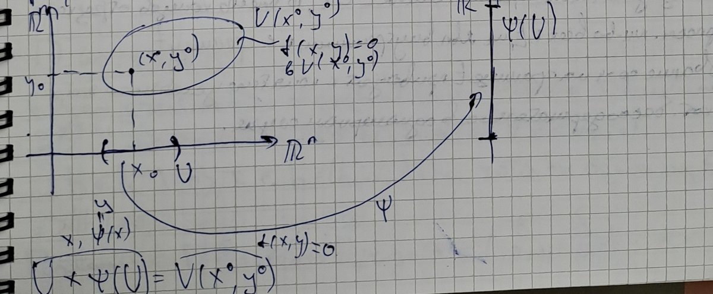

# Lecciones 65–66 — fórmula de Taylor para aplicaciones de varias variables, aplicaciones implícitas, condición necesaria de extremo

[← Lecciones 63–64](lecture-63-64.md) · [Índice de lecciones](index.md) · [Lecciones 67–68 →](lecture-67-68.md) · [Términos y teoremas](../term-index.md) · [Русский](../../ru/lectures-2025-26/lecture-65-66.md) · [English](../../en/lectures-2025-26/lecture-65-66.md)

> **Fuente y numeración.** Los apuntes se copiaron de un cuaderno manuscrito (págs. p001–p011; el texto bruto de las páginas está en [`ocr/raw/`](../../../ocr/raw/p001.md)) y se cotejaron con los escaneos de esas páginas. La fecha en el recuadro de la pág. p001 es «3 de septiembre». El plan de la clase anotado en el cuaderno: existencia y unicidad del polinomio de Taylor multivariado; fórmulas de Taylor–Peano y de Taylor–Lagrange; la [función implícita](../16-implicit-functions-extrema.md#sec-16-3); extremos. La mitad inferior de la pág. p005 (la afirmación (∗) y su demostración) falta en la transcripción de la página y se transcribió a partir del escaneo. La demostración del [teorema 6.7.1](#thm-6-7-1) comienza en la pág. p011 y termina al principio de las [lecciones 67–68](lecture-67-68.md). La numeración de definiciones y teoremas es la del profesor (cotejada con las diapositivas del curso 2024/25). Los lapsus de los apuntes se corrigen y se marcan con bloques «Corrección de la fuente»; los pasajes perdidos se restauran y se marcan con bloques «Restaurado»; las etiquetas corresponden a [`ocr/RESOLVED.md`](../../../ocr/RESOLVED.md). Los lugares que aún hay que cotejar con el cuaderno se enumeran en [`ocr/ISSUES.md`](../../../ocr/ISSUES.md).

## §6.5. Fórmula de Taylor

<a id="p001"></a>

Sean $`f:E\subset\mathbb R^n\to\mathbb R^m`$, $`a`$ un [punto interior](lecture-57-58.md#def-5-3-3) de $`E`$, $`s\in\mathbb Z_+`$. Queremos construir un polinomio $`p:\mathbb R^n\to\mathbb R^m`$ de grado a lo sumo $`s`$ tal que
```math
p(a)=f(a),\qquad f(x)=p(x)+o(\|x-a\|^s)\quad(x\to a).\qquad(6.5.1)
```
Aquí $`\|x-a\|=\sqrt{(x_1-a_1)^2+(x_2-a_2)^2+\ldots+(x_n-a_n)^2}`$ es la [norma euclídea](lecture-54.md#def-5-1-1).

**Observación.** Recordemos las nociones necesarias para escribir polinomios en varias variables.

- Todo vector $`\alpha=(\alpha_1,\ldots,\alpha_n)\in\mathbb Z_+^n`$ se llama multiíndice de dimensión $`n`$. El orden de un multiíndice $`\alpha`$ es el número $`|\alpha|=\alpha_1+\ldots+\alpha_n`$.
- Sean $`M`$ un conjunto finito de multiíndices de dimensión $`n`$ y $`\{C_\alpha\}_{\alpha\in M}`$ una familia de elementos de $`\mathbb R^m`$. Entonces la aplicación
```math
p(x)=\sum_{\alpha\in M}C_\alpha x^\alpha=\sum_{\alpha\in M}C_\alpha x_1^{\alpha_1}x_2^{\alpha_2}\cdots x_n^{\alpha_n}\qquad(x\in\mathbb R^n)
```
se llama polinomio en $`n`$ variables con valores en $`\mathbb R^m`$.

**Ejemplo.** Sean $`n=3`$, $`m=1`$, $`s=3`$, $`x=(x_1,x_2,x_3)\in\mathbb R^3`$, y sea $`p:\mathbb R^3\to\mathbb R`$ un polinomio de grado a lo sumo $`3`$:
```math
p(x)=p(x_1,x_2,x_3)=C_{I}x_1^3+C_{II}x_2x_3+C_{III}x_1^2x_2+C_{IV}x_1x_2x_3 .
```
Aquí $`M=\{(3,0,0),(0,1,1),(2,1,0),(1,1,1)\}`$; los órdenes de estos multiíndices son $`3`$, $`2`$, $`3`$, $`3`$ respectivamente, y $`\{C_\alpha\}_{\alpha\in M}=\{C_I,C_{II},C_{III},C_{IV}\}`$, donde todos los $`C_i\in\mathbb R`$. Si se toma $`M_1=M\cup\{(2,1,1)\}`$, el orden máximo de un multiíndice pasa a ser $`4`$: para $`C_V\ne0`$ el polinomio $`p_1(x)=C_Vx_1^2x_2x_3+p(x)`$ tiene grado $`4`$.

<a id="p002"></a>

### El polinomio de Taylor

**Observación.** Si $`p\ne0`$, el grado del polinomio $`p`$ es el número
```math
\deg p=\max\{|\alpha|:\ \alpha\in M,\ C_\alpha\ne0\}.
```
En caso contrario ponemos el grado de $`p`$ igual a $`-\infty`$.

<a id="def-6-5-1"></a>**Definición 6.5.1.** Sean $`E\subset\mathbb R^n`$, $`a`$ un punto interior de $`E`$, $`f:E\to\mathbb R^m`$, $`s\in\mathbb Z_+`$. Un polinomio $`p:\mathbb R^n\to\mathbb R^m`$ de grado a lo sumo $`s`$ que satisface la condición (6.5.1) se llama polinomio de Taylor de $`f`$ de orden $`s`$ en el punto $`a`$ y se denota $`T_{a,s}f`$.

**Observación.** Si el polinomio de Taylor existe, es único.

**Demostración.** Supongamos que existen polinomios $`p`$ y $`q`$, $`\deg p\le s`$, $`\deg q\le s`$, tales que cuando $`x\to a`$
```math
p(a)=f(a),\quad f(x)=p(x)+o(\|x-a\|^s);\qquad q(a)=f(a),\quad f(x)=q(x)+o(\|x-a\|^s).
```
Pongamos $`r:=p-q`$; hay que probar que $`r\equiv0`$. Sin pérdida de generalidad $`a=0`$ (la traslación $`x\mapsto x-a`$ lleva polinomios de grado a lo sumo $`s`$ a polinomios de grado a lo sumo $`s`$). Restando las relaciones obtenemos $`0=r(x)+o(\|x\|^s)`$, es decir, $`r(x)=o(\|x\|^s)`$ cuando $`x\to0`$. Por tanto, $`r(x)=\alpha(x)\,\|x\|^s`$, donde $`\alpha(x)\to0`$ cuando $`x\to0`$.

Un polinomio $`\hat p`$ se llama homogéneo de grado $`k`$ si todos sus monomios tienen orden $`k`$; entonces $`\hat p(tx)=t^k\hat p(x)`$ para todos $`t\in\mathbb R`$, $`x\in\mathbb R^n`$. Agrupando los monomios de $`r`$ por órdenes escribimos $`r(x)=\sum_{k=0}^{s}r_k(x)`$, donde $`r_k`$ es un polinomio homogéneo de grado $`k`$ con valores en $`\mathbb R^m`$. Entonces, para $`t\in\mathbb R`$, $`x\in\mathbb R^n`$
```math
\sum_{k=0}^{s}r_k(x)\,t^k=\sum_{k=0}^{s}r_k(tx)=r(tx)=\alpha(tx)\,\|tx\|^s=|t|^s\,\alpha(tx)\,\|x\|^s .
```
Fijemos $`x`$. A la izquierda hay un polinomio vectorial en $`t`$ de grado a lo sumo $`s`$, y el miembro derecho es $`o(|t|^s)`$ cuando $`t\to0`$; por tanto, cada función coordenada de este polinomio es $`o(t^s)`$ cuando $`t\to0`$. Pero un polinomio escalar $`c_0+c_1t+\ldots+c_st^s`$ igual a $`o(t^s)`$ es idénticamente nulo: si $`c_j`$ fuera su primer coeficiente no nulo, al dividir por $`t^j`$ se obtendría $`c_j+O(t)=o(t^{s-j})\to0`$, es decir, $`c_j=0`$. En consecuencia, $`r_k(x)=0`$ para todos $`k\in\{0,1,\ldots,s\}`$ y todos $`x`$, es decir, $`r\equiv0`$. $`\square`$

<a id="p003"></a>

### Existencia del polinomio de Taylor

- Para $`s=0`$ la relación (6.5.1) equivale a la continuidad de $`f`$ en el punto $`a`$: un polinomio de grado $`0`$ es la constante $`p\equiv f(a)`$, y $`f(x)=p(x)+o(\|x-a\|^0)=p(x)+o(1)`$.
- Para $`s=1`$ la relación (6.5.1) equivale a la diferenciabilidad de $`f`$ en el punto $`a`$: $`f(x)=p(x)+o(\|x-a\|)`$.
- El caso $`s\ge2`$ es más difícil de estudiar.
- Para funciones de una variable se sabe que la existencia de $`T_{a,s}f`$ se deduce de la diferenciabilidad $`s`$ veces de $`f`$ en el punto $`a`$. Un resultado análogo vale en el caso multivariado ([teorema 6.5.1](#thm-6-5-1)).

> **Corrección de la fuente** (T516). En la transcripción de la página el último punto está escrito al revés: «la existencia de $`T_{a,s}f`$ implica la diferenciabilidad $`s`$ veces». En el cuaderno (y en la diapositiva del curso 2024/25) dice «se deduce de». El recíproco es falso para $`s\ge2`$: para $`f(x)=x^3\sin\frac1x`$, $`f(0)=0`$, tenemos $`f(x)=o(x^2)`$, es decir, $`T_{0,2}f=0`$ existe, pero $`f''(0)`$ no existe.

<a id="lem-6-5-1"></a>**Lema 6.5.1.** Sean $`E\subset\mathbb R^n`$, $`a`$ un punto interior de $`E`$, $`s\in\mathbb N`$, la aplicación $`f:E\to\mathbb R^m`$ diferenciable $`s`$ veces en el punto $`a`$, y supongamos que $`f`$ y todas sus derivadas parciales de orden a lo sumo $`s`$ se anulan en el punto $`a`$. Entonces $`f(a+h)=o(\|h\|^s)`$ cuando $`h\to0`$.

> **Corrección de la fuente** (M511). En la transcripción de la página la hipótesis del lema dice «$`f`$ es diferenciable en el punto $`a`$», sin las palabras «$`s`$ veces». En el cuaderno (y en la diapositiva del curso 2024/25) dice «diferenciable $`s`$ veces». Esta condición es esencial: se usa en el paso de [inducción](../01-logic-sets-functions.md#example-induction), y con la mera diferenciabilidad el lema falla ya para $`s=2`$. Por ejemplo, para la función $`f(x,y)=\frac{x^2y^2}{x^2+y^2}`$, $`f(0,0)=0`$, todas las [derivadas parciales](lecture-61-62.md#def-6-1-5) de orden a lo sumo $`2`$ se anulan en el punto $`(0,0)`$ y $`f`$ es diferenciable en ese punto, pero $`f(t,t)=\frac{t^2}{2}\ne o(t^2)`$.

**Demostración.** Basta comprobar la afirmación para las funciones coordenadas $`f_1,\ldots,f_m`$: las hipótesis del lema se cumplen para cada una de ellas, y $`\|f(a+h)\|\le\sum_{i=1}^{m}|f_i(a+h)|`$, de modo que $`f_i(a+h)=o(\|h\|^s)`$ para todo $`i`$ implica $`f(a+h)=o(\|h\|^s)`$. Por tanto, podemos suponer $`m=1`$.

Razonamos por inducción sobre $`s`$.

*Base:* $`s=1`$. Como $`f`$ es diferenciable en el punto $`a`$, y $`f(a)=0`$ y $`\frac{\partial f}{\partial x_k}(a)=0`$ por hipótesis,
```math
f(a+h)=f(a)+\sum_{k=1}^{n}\frac{\partial f}{\partial x_k}(a)h_k+o(\|h\|)=o(\|h\|)\qquad(h\to0).
```

*Hipótesis de inducción:* la afirmación es cierta para cierto $`s`$.

*Paso de inducción* $`s\mapsto s+1`$. Sea $`f`$ diferenciable $`s+1`$ veces en el punto $`a`$ y supongamos que todas sus derivadas parciales de orden a lo sumo $`s+1`$ se anulan en el punto $`a`$. Entonces todas las derivadas parciales de primer orden de $`f`$ están definidas en cierto entorno del punto $`a`$ y son diferenciables $`s`$ veces en el punto $`a`$, y todas sus derivadas parciales de orden a lo sumo $`s`$ se anulan en el punto $`a`$. Apliquemos la hipótesis de inducción a las derivadas parciales de primer orden de $`f`$:
```math
\frac{\partial f}{\partial x_k}(a+h)=o(\|h\|^s)\qquad(h\to0)
```
para todo $`k\in\{1,\ldots,n\}`$. Aplicando la definición del símbolo $`o`$ con $`\frac{\varepsilon}{n}`$ en lugar de $`\varepsilon`$ y tomando el menor de los $`n`$ números $`\delta`$ obtenidos, resulta: para todo $`\varepsilon>0`$ existe $`\delta>0`$ tal que $`V_\delta(a)\subset E`$ y para todos $`k\in\{1,\ldots,n\}`$ y todos $`h\in V_\delta(0)`$
```math
\left|\frac{\partial f}{\partial x_k}(a+h)\right|\le\frac{\varepsilon}{n}\|h\|^s .
```
Sea $`h\in V_\delta(0)`$. Por el [lema 6.3.1](lecture-63-64.md#lem-6-3-1) (sobre los incrementos por coordenadas) existen $`c^1,\ldots,c^n\in V_\delta(a)`$, con $`\|c^k-a\|\le\|h\|`$, tales que

<a id="p004"></a>

```math
f(a+h)=f(a+h)-f(a)=\sum_{k=1}^{n}\frac{\partial f}{\partial x_k}(c^k)h_k
```
(aquí $`f(a)=0`$ por hipótesis).

> **Corrección de la fuente** (T512). En los apuntes aquí se remite al «[lema 6.4.1](lecture-63-64.md#lem-6-4-1)». La representación del incremento mediante derivadas parciales en puntos intermedios es el [lema 6.3.1](lecture-63-64.md#lem-6-3-1) sobre los incrementos por coordenadas (lecciones 63–64); el [lema 6.4.1](lecture-63-64.md#lem-6-4-1) trata de la diferenciabilidad de las derivadas de orden inferior. La estimación $`\|c^k-a\|\le\|h\|`$ no se menciona en los apuntes, pero se usa más abajo; se ve en la demostración del [lema 6.3.1](lecture-63-64.md#lem-6-3-1): $`c^k-a=(h_1,\ldots,h_{k-1},\theta_kh_k,0,\ldots,0)`$, $`\theta_k\in(0,1)`$.

Entonces, como $`\|c^k-a\|\le\|h\|`$ y $`|h_k|\le\|h\|`$,
```math
|f(a+h)|=\left|\sum_{k=1}^{n}\frac{\partial f}{\partial x_k}(c^k)h_k\right|\le\sum_{k=1}^{n}\left|\frac{\partial f}{\partial x_k}(c^k)\right||h_k|\le\sum_{k=1}^{n}\frac{\varepsilon}{n}\|h\|^s\,\|h\|=\varepsilon\|h\|^{s+1}.
```
Como $`\varepsilon>0`$ es arbitrario, $`f(a+h)=o(\|h\|^{s+1})`$ cuando $`h\to0`$. $`\square`$

### Fórmula de Taylor–Peano

<a id="thm-6-5-1"></a>**Teorema 6.5.1 (fórmula de Taylor–Peano).** Sean $`E\subset\mathbb R^n`$, $`a`$ un punto interior de $`E`$, $`s\in\mathbb Z_+`$, y la aplicación $`f:E\to\mathbb R^m`$ diferenciable $`s`$ veces en el punto $`a`$. Entonces se cumple la igualdad
```math
f(x)=\sum_{|\alpha|\le s}\frac{1}{\alpha!}\frac{\partial^\alpha f}{\partial x^\alpha}(a)(x-a)^\alpha+o(\|x-a\|^s)\qquad(x\to a).
```
En otras palabras, el polinomio de Taylor de $`f`$ de orden $`s`$ en el punto $`a`$ existe y viene dado por
```math
T_{a,s}f(x)=\sum_{|\alpha|\le s}\frac{1}{\alpha!}\frac{\partial^\alpha f}{\partial x^\alpha}(a)(x-a)^\alpha .
```
La suma se extiende a todos los multiíndices de orden a lo sumo $`s`$.

> **Corrección de la fuente** (M515). En los apuntes (y en la diapositiva del curso 2024/25) $`s\in\mathbb Z_+`$, pero una aplicación «diferenciable $`0`$ veces» no está definida (la [definición 6.4.2](lecture-63-64.md#def-6-4-2) se da para $`s\in\mathbb N`$), y sin una condición adicional la afirmación es falsa para $`s=0`$. Para $`s=0`$ la hipótesis del teorema debe entenderse como continuidad de $`f`$ en el punto $`a`$: entonces la fórmula $`f(x)=f(a)+o(1)`$ es precisamente la continuidad (el primer punto de arriba). La demostración siguiente se refiere a $`s\in\mathbb N`$.

Notación:
```math
\frac{\partial^\alpha f}{\partial x^\alpha}(a)=\frac{\partial^{|\alpha|}f}{\partial x_1^{\alpha_1}\partial x_2^{\alpha_2}\cdots\partial x_n^{\alpha_n}}(a),\qquad\alpha=(\alpha_1,\alpha_2,\ldots,\alpha_n)
```
(si $`\alpha_k=0`$, no se deriva respecto de la variable $`x_k`$), y además
```math
\alpha!=\alpha_1!\,\alpha_2!\cdots\alpha_n!,\qquad|\alpha|=\alpha_1+\alpha_2+\ldots+\alpha_n,\qquad(x-a)^\alpha=(x_1-a_1)^{\alpha_1}\cdots(x_n-a_n)^{\alpha_n}.
```

> **Corrección de la fuente** (A021). En los apuntes: «$`\frac{1}{\alpha!}=\frac{1}{|\alpha|!}=\frac{1}{1\cdot2\cdots|\alpha|}`$». Corregido a $`\alpha!=\alpha_1!\,\alpha_2!\cdots\alpha_n!`$: así se define el factorial de un multiíndice en las lecciones 63–64 ([teorema 6.4.2](lecture-63-64.md#thm-6-4-2)), y solo con esta definición la fórmula de Taylor es correcta. Por ejemplo, para $`f(x_1,x_2)=x_1x_2`$, $`a=0`$, $`\alpha=(1,1)`$ el término $`\frac{1}{\alpha!}\frac{\partial^2f}{\partial x_1\partial x_2}(0)\,x_1x_2`$ es igual a $`x_1x_2=f(x)`$, mientras que con el factor $`\frac{1}{|\alpha|!}=\frac12`$ se obtendría $`\frac12x_1x_2\ne f(x)`$.

**Ejemplo.** Sean $`n=4`$, $`\alpha=(0,2,3,1)`$, $`|\alpha|=6`$. Entonces
```math
\frac{\partial^{(0,2,3,1)}f}{\partial x^{(0,2,3,1)}}=\frac{\partial^0}{\partial x_1^0}\,\frac{\partial^2}{\partial x_2^2}\,\frac{\partial^3}{\partial x_3^3}\,\frac{\partial^1}{\partial x_4^1}\,f=\frac{\partial^6f}{\partial x_2^2\,\partial x_3^3\,\partial x_4}
```
(no se deriva respecto de $`x_1`$). Para una función $`u`$ de dos variables la matriz de las segundas derivadas (la [matriz hessiana](../15-multivariable-differentiation.md#sec-15-4)) es
```math
D^2u=\begin{pmatrix}\dfrac{\partial^2u}{\partial x_1^2}&\dfrac{\partial^2u}{\partial x_1\partial x_2}\\[2mm]\dfrac{\partial^2u}{\partial x_2\partial x_1}&\dfrac{\partial^2u}{\partial x_2^2}\end{pmatrix}.
```

**Demostración del [teorema 6.5.1](#thm-6-5-1).** Pongamos
```math
p(x)=\sum_{|\alpha|\le s}\frac{1}{\alpha!}\frac{\partial^\alpha f}{\partial x^\alpha}(a)(x-a)^\alpha,\qquad F:=f-p .
```
Para multiíndices $`\alpha,\beta`$ la derivada $`\frac{\partial^\alpha}{\partial x^\alpha}(x-a)^\beta`$ en el punto $`a`$ vale $`\alpha!`$ si $`\beta=\alpha`$ y cero si $`\beta\ne\alpha`$; por tanto, $`\frac{\partial^\alpha p}{\partial x^\alpha}(a)=\frac{\partial^\alpha f}{\partial x^\alpha}(a)`$. Así, si $`\alpha`$ es un multiíndice de orden a lo sumo $`s`$, entonces
```math
\frac{\partial^\alpha F}{\partial x^\alpha}(a)=\frac{\partial^\alpha f}{\partial x^\alpha}(a)-\frac{\partial^\alpha p}{\partial x^\alpha}(a)=0 .
```
La aplicación $`F`$ es diferenciable $`s`$ veces en el punto $`a`$ ($`p`$ es un polinomio), y para una aplicación diferenciable $`s`$ veces en el punto $`a`$ las derivadas parciales de orden a lo sumo $`s`$ en el punto $`a`$ no dependen del orden de derivación (corolario del [teorema 6.4.1](lecture-63-64.md#thm-6-4-1)). Por tanto, todas las derivadas parciales de $`F`$ de orden a lo sumo $`s`$ se anulan en el punto $`a`$. Aplicamos a $`F`$ el [lema 6.5.1](#lem-6-5-1) con $`h=x-a`$ y obtenemos
```math
F(x)=f(x)-p(x)=F\bigl(a+(x-a)\bigr)=o(\|x-a\|^s)\qquad(x\to a).
```
Esta es la afirmación del teorema. $`\square`$

<a id="p005"></a>

**Observación.**

- La aplicación $`R_{a,s}f=f-T_{a,s}f`$ se llama resto de la fórmula de Taylor.
- Así, la afirmación del [teorema 6.5.1](#thm-6-5-1) puede escribirse como $`R_{a,s}f(x)=o(\|x-a\|^s)`$ $`(x\to a)`$.
- El polinomio de Taylor puede expresarse mediante diferenciales de orden superior (por el [teorema 6.4.2](lecture-63-64.md#thm-6-4-2)):
```math
T_{a,s}f(x)=\sum_{k=0}^{s}\frac{d_a^kf(x-a)}{k!}.
```
- Si la aplicación $`f`$ es un polinomio de grado a lo sumo $`s`$, entonces $`R_{a,s}f\equiv0`$ ($`f`$ mismo satisface la condición (6.5.1) y, por unicidad, $`T_{a,s}f=f`$), es decir,
```math
f(x)=\sum_{|\alpha|\le s}\frac{1}{\alpha!}\frac{\partial^\alpha f}{\partial x^\alpha}(a)(x-a)^\alpha .
```

> **Corrección de la fuente** (T022). En el segundo punto los apuntes dicen «$`R_{a,s}f(x)=O(\|x-a\|^s)`$». Corregido a $`o(\|x-a\|^s)`$: el [teorema 6.5.1](#thm-6-5-1) afirma que el resto es un [infinitésimo](lecture-09-10.md#def-2-2-1) de orden superior a $`\|x-a\|^s`$; la estimación $`O(\|x-a\|^s)`$ es más débil (en la diapositiva del curso 2024/25 también aparece $`o`$).

### Fórmula de Taylor–Lagrange para funciones

Pongamos
```math
\Delta_{a,b}=\{a+t(b-a):\ t\in[0,1]\},\qquad\hat{\Delta}_{a,b}=\Delta_{a,b}\setminus\{a,b\}
```
— el segmento de extremos $`a`$, $`b`$ y el mismo segmento sin sus extremos.

<a id="thm-6-5-2"></a>**Teorema 6.5.2 (fórmula de Taylor–Lagrange).** Sean el conjunto $`E`$ abierto en $`\mathbb R^n`$, $`s\in\mathbb Z_+`$, la función $`f:E\to\mathbb R`$ diferenciable $`s+1`$ veces en $`E`$, y los puntos $`a,x\in E`$ tales que $`a\ne x`$ y $`\Delta_{a,x}\subset E`$. Entonces existe $`c\in\hat{\Delta}_{a,x}`$ tal que
```math
f(x)=\sum_{k=0}^{s}\frac{d_a^kf(x-a)}{k!}+\frac{d_c^{s+1}f(x-a)}{(s+1)!}.
```
Aquí $`d_c^{s+1}f(x-a)`$ es la diferencial de orden $`s+1`$ en el punto $`c`$ evaluada en el incremento $`h=x-a`$ ([definición 6.4.3](lecture-63-64.md#def-6-4-3)).

> **Corrección de la fuente** (T023). En los apuntes, antes de la condición $`s\in\mathbb Z_+`$ figura otra inclusión para $`s`$ (en la transcripción: «$`s\in\mathbb N`$»), y los puntos $`a`$, $`x`$ no se introducen. Se mantiene $`s\in\mathbb Z_+`$ (como en la diapositiva del curso 2024/25) y se añade $`a,x\in E`$ (como en el [teorema 6.5.4](#thm-6-5-4)).

**Demostración.** Pongamos $`h:=x-a`$ y $`F(t)=f(a+th)`$, $`t\in[0,1]`$. Entonces $`F(t)=d^0_{a+th}f(h)`$.

> **Restaurado** (a partir del escaneo del cuaderno, pág. p005: la mitad inferior de la página falta en la transcripción; la misma demostración figura en las diapositivas del curso 2024/25, FS p41; S513). Mostremos que para todo $`t\in[0,1]`$
> ```math
> F^{(k)}(t)=d^k_{a+th}f(h)\qquad\forall k\in\{0,1,\ldots,s+1\}.\qquad(*)
> ```
> Razonamos por inducción sobre $`k`$. La base $`k=0`$ es evidente.
>
> Hipótesis de inducción: sea $`k\in\{1,\ldots,s+1\}`$ y supongamos probada la igualdad (∗) para $`k-1`$. Paso de inducción $`k-1\mapsto k`$. Observemos que:
>
> 1. la aplicación $`y\mapsto d^{k-1}_yf(h)`$ es diferenciable en $`E`$ (sus coeficientes son las derivadas parciales de $`f`$ de orden $`k-1\le s`$, y $`f`$ es diferenciable $`s+1`$ veces en $`E`$);
> 2. la función vectorial $`\varphi(t)=a+th`$ es diferenciable respecto de $`t`$, y $`d_t\varphi(dt)=h\,dt`$ para todos $`t\in[0,1]`$ y todos $`dt\in\mathbb R`$.
>
> Por la hipótesis de inducción $`F^{(k-1)}(t)=d^{k-1}_{a+th}f(h)=\bigl(d^{k-1}f(h)\bigr)\circ\varphi(t)`$. Por el teorema de derivación de la composición, $`F^{(k-1)}`$ es diferenciable en $`[0,1]`$, y para todo $`t\in[0,1]`$
> ```math
> F^{(k)}(t)=d_tF^{(k-1)}(1)=d_{\varphi(t)}\bigl(d^{k-1}f(h)\bigr)\bigl(d_t\varphi(1)\bigr)=d_{a+th}\bigl(d^{k-1}f(h)\bigr)(h)=d^k_{a+th}f(h)
> ```
> (la última igualdad es la [definición 6.4.3](lecture-63-64.md#def-6-4-3)). Con esto (∗) queda probada.

> **Corrección de la fuente** (T514). En el cuaderno (∗) se enuncia y se demuestra para $`k\in\{0,1,\ldots,s\}`$, pero más abajo se usa para $`k=s+1`$. El paso de inducción también funciona para $`k=s+1`$, ya que $`f`$ es diferenciable $`s+1`$ veces; por eso el rango se amplía hasta $`k\in\{0,1,\ldots,s+1\}`$.

<a id="p006"></a>

Ahora, teniendo (∗), podemos decir que $`F`$ es diferenciable $`s+1`$ veces en $`[0,1]`$ y $`F^{(k)}(t)=d^k_{a+th}f(h)`$. Apliquemos a $`F`$ la fórmula de Taylor de una variable con resto en forma de Lagrange: existe $`\theta\in(0,1)`$ tal que
```math
F(1)=\sum_{k=0}^{s}\frac{F^{(k)}(0)}{k!}(1-0)^k+\frac{F^{(s+1)}(\theta)}{(s+1)!}(1-0)^{s+1}.
```
Aquí $`F(1)=f(a+h)=f(x)`$ y
```math
\sum_{k=0}^{s}\frac{F^{(k)}(0)}{k!}(1-0)^k=\sum_{k=0}^{s}\frac{d_a^kf(x-a)}{k!},\qquad\frac{F^{(s+1)}(\theta)}{(s+1)!}(1-0)^{s+1}=\frac{d_{a+\theta h}^{s+1}f(x-a)}{(s+1)!}.
```
En consecuencia,
```math
f(x)=\sum_{k=0}^{s}\frac{d_a^kf(x-a)}{k!}+\frac{d_{a+\theta h}^{s+1}f(x-a)}{(s+1)!}.
```
Basta poner $`c=a+\theta h`$; como $`\theta\in(0,1)`$, el punto $`c`$ está en $`\hat{\Delta}_{a,x}`$. $`\square`$

**Corolario.** En las hipótesis del [teorema 6.5.2](#thm-6-5-2) se cumple la estimación
```math
|R_{a,s}f(x)|\le\sup_{c\in\hat{\Delta}_{a,x}}\frac{|d_c^{s+1}f(x-a)|}{(s+1)!}.
```

### Teorema del valor medio

<a id="thm-6-5-3"></a>**Teorema 6.5.3 (del valor medio).** Sean el conjunto $`E`$ abierto en $`\mathbb R^n`$, la función $`f:E\to\mathbb R`$ diferenciable en $`E`$, $`a,b\in E`$, con $`a\ne b`$ y $`\Delta_{a,b}\subset E`$. Entonces existe $`c\in\hat{\Delta}_{a,b}`$ tal que
```math
f(b)-f(a)=d_cf(b-a).
```
Es el caso particular del [teorema 6.5.2](#thm-6-5-2) correspondiente a $`s=0`$.

**Ejemplo.** Para aplicaciones (con valores en $`\mathbb R^m`$, $`m\ge2`$) fallan tanto el [teorema 6.5.2](#thm-6-5-2) como el [teorema 6.5.3](#thm-6-5-3). Sea la función vectorial $`f:\mathbb R\to\mathbb R^2`$ dada por $`f(x)=(\cos x,\sin x)`$, $`x\in\mathbb R`$. Entonces la aplicación $`f`$ es diferenciable en $`\mathbb R`$ y $`f'(x)=(-\sin x,\cos x)`$ para todo $`x\in\mathbb R`$.

> **Restaurado** (según los apuntes de 2022, M3S p15; en el cuaderno el ejemplo se interrumpe en la fórmula para $`f'`$). Pongamos $`a=0`$, $`b=2\pi`$. Entonces $`f(b)-f(a)=(0,0)`$, pero para todo $`c\in(a,b)`$
> ```math
> \|d_cf(b-a)\|=\|f'(c)\|\,(b-a)=2\pi\sqrt{\sin^2c+\cos^2c}=2\pi\ne0 .
> ```
> Por tanto, la igualdad $`f(b)-f(a)=d_cf(b-a)`$ no se cumple para ningún punto $`c\in\hat{\Delta}_{a,b}`$: el [teorema 6.5.3](#thm-6-5-3), y con él el [teorema 6.5.2](#thm-6-5-2) (para $`s=0`$), falla para aplicaciones.

<a id="p007"></a>

### Fórmula de Taylor–Lagrange para aplicaciones

> **Restaurado** (según las diapositivas del curso 2024/25, FS p42). Aunque el [teorema 6.5.2](#thm-6-5-2) falla para aplicaciones, el corolario que se deduce de él sigue siendo válido para aplicaciones si en su enunciado se sustituyen los valores absolutos por normas. Esta es la versión general de la fórmula de Taylor–Lagrange.

<a id="thm-6-5-4"></a>**Teorema 6.5.4 (fórmula de Taylor–Lagrange para aplicaciones).** Sean el conjunto $`E`$ abierto en $`\mathbb R^n`$, $`s\in\mathbb Z_+`$, la aplicación $`f:E\to\mathbb R^m`$ diferenciable $`s+1`$ veces en $`E`$, $`a,x\in E`$, con $`a\ne x`$ y $`\Delta_{a,x}\subset E`$. Entonces
```math
\left\|f(x)-\sum_{k=0}^{s}\frac{d_a^kf(x-a)}{k!}\right\|\le\frac{1}{(s+1)!}\sup_{c\in\hat{\Delta}_{a,x}}\left\|d_c^{s+1}f(x-a)\right\|.\qquad(6.5.2)
```

> **Restaurado** (según la demostración estándar, cf. Zorich; en el cuaderno no hay demostración).
>
> **Demostración.** Denotemos $`v=f(x)-\sum_{k=0}^{s}\frac{d_a^kf(x-a)}{k!}`$. Si $`v=0`$, no hay nada que probar. En otro caso pongamos $`e=\frac{v}{\|v\|}`$ y consideremos la función $`g(y)=\langle f(y),e\rangle`$, $`y\in E`$. Es una combinación lineal de las funciones coordenadas $`f`$, por lo que es diferenciable $`s+1`$ veces en $`E`$ y $`d^k_yg(h)=\langle d^k_yf(h),e\rangle`$ para todo $`k\le s+1`$. Por el [teorema 6.5.2](#thm-6-5-2) existe $`c\in\hat{\Delta}_{a,x}`$ tal que
> ```math
> \|v\|=\langle v,e\rangle=g(x)-\sum_{k=0}^{s}\frac{d_a^kg(x-a)}{k!}=\frac{d_c^{s+1}g(x-a)}{(s+1)!}=\frac{\langle d_c^{s+1}f(x-a),e\rangle}{(s+1)!}\le\frac{\|d_c^{s+1}f(x-a)\|}{(s+1)!}
> ```
> (lo último es la [desigualdad de Cauchy–Bunyakovsky](lecture-47-48.md#thm-4-4-6), $`\|e\|=1`$). Queda sustituir el miembro derecho por su [supremo](lecture-11-12.md#def-2-3-1) sobre $`c\in\hat{\Delta}_{a,x}`$. $`\square`$

### Estimación del resto en la fórmula de Taylor

En las hipótesis del [teorema 6.5.4](#thm-6-5-4) no está claro si el miembro derecho de (6.5.2) es finito. La respuesta es afirmativa para aplicaciones de clase $`C^{s+1}(E,\mathbb R^m)`$.

<a id="thm-6-5-5"></a>**Teorema 6.5.5 (estimación del resto).** Sean el conjunto $`E`$ abierto en $`\mathbb R^n`$, $`s\in\mathbb Z_+`$, $`f\in C^{s+1}(E,\mathbb R^m)`$, $`a,x\in E`$, con $`a\ne x`$ y $`\Delta_{a,x}\subset E`$. Pongamos
```math
M=\max_{\alpha\in M_{s+1}}\ \sup_{c\in\hat{\Delta}_{a,x}}\left\|\frac{\partial^\alpha f}{\partial x^\alpha}(c)\right\|,
```
donde $`M_{s+1}`$ es el conjunto de los multiíndices de dimensión $`n`$ y orden $`s+1`$. Entonces $`M<+\infty`$ y se cumple la desigualdad
```math
\|R_{a,s}f(x)\|\le\frac{M}{(s+1)!}\bigl(\sqrt n\,\|x-a\|\bigr)^{s+1}.
```

> **Restaurado** (según la demostración estándar; en el cuaderno no hay demostración).
>
> **Demostración.** Cada derivada $`\frac{\partial^\alpha f}{\partial x^\alpha}`$, $`|\alpha|=s+1`$, es continua en $`E`$ y, por tanto, acotada en el segmento [compacto](lecture-57-58.md#def-5-3-7) $`\Delta_{a,x}\subset E`$, y el conjunto $`M_{s+1}`$ es finito; así, $`M<+\infty`$. Sean $`c\in\hat{\Delta}_{a,x}`$, $`h=x-a`$. Por el [teorema 6.4.2](lecture-63-64.md#thm-6-4-2)
> ```math
> d_c^{s+1}f(h)=\sum_{i_1,\ldots,i_{s+1}=1}^{n}\frac{\partial^{s+1}f}{\partial x_{i_1}\cdots\partial x_{i_{s+1}}}(c)\,h_{i_1}\cdots h_{i_{s+1}},
> ```
> y cada una de estas derivadas parciales coincide con $`\frac{\partial^\alpha f}{\partial x^\alpha}(c)`$ para un $`\alpha\in M_{s+1}`$ adecuado (para $`f\in C^{s+1}`$ el orden de derivación no importa), de modo que su norma es a lo sumo $`M`$. Por tanto, usando la desigualdad $`|h_1|+\ldots+|h_n|\le\sqrt n\,\|h\|`$ (Cauchy–Bunyakovsky),
> ```math
> \|d_c^{s+1}f(h)\|\le M\sum_{i_1,\ldots,i_{s+1}=1}^{n}|h_{i_1}|\cdots|h_{i_{s+1}}|=M\bigl(|h_1|+\ldots+|h_n|\bigr)^{s+1}\le M\bigl(\sqrt n\,\|h\|\bigr)^{s+1}.
> ```
> Como $`f\in C^{s+1}(E,\mathbb R^m)`$ es diferenciable $`s+1`$ veces en $`E`$, se aplica el [teorema 6.5.4](#thm-6-5-4), y de (6.5.2) se obtiene la estimación requerida. $`\square`$

## §6.6. Aplicaciones implícitas

Sea dada $`f:E\subset\mathbb R^2\to\mathbb R`$. Consideremos la ecuación en las variables $`x`$ y $`y`$
```math
f(x,y)=0,\qquad(x,y)\in E.\qquad(6.6.1)
```
La ecuación (6.6.1) establece una dependencia entre $`x`$ y $`y`$ que se llama implícita. Supongamos que de (6.6.1) se puede despejar de manera única una variable en función de la otra (por ejemplo, $`y`$ en función de $`x`$). Entonces el conjunto de soluciones de (6.6.1) es la gráfica de cierta función $`\varphi`$, es decir, tiene la forma
```math
\{(x,y)\in E:\ y=\varphi(x)\}.
```
Tal función $`\varphi`$ se llama función implícita generada por la ecuación (6.6.1).

**Ejemplo.** La ecuación $`x^2+y^2=1`$ no define $`y`$ como función de $`x`$ en todo el plano: para $`|x|<1`$ la satisfacen dos valores $`y`$. Pero en el semiplano $`y>0`$ equivale a $`y=\sqrt{1-x^2}`$, y en el semiplano $`y<0`$, a $`y=-\sqrt{1-x^2}`$; en cada semiplano el conjunto de soluciones es la gráfica de una función $`y=\varphi(x)`$.

<a id="p008"></a>

- La cuestión de la existencia de una función implícita es muy difícil.
- En muchas aplicaciones basta considerar (6.6.1) no en todo el conjunto $`E`$, sino solo en un entorno de algún punto del conjunto $`E`$.
- Si cerca de cada punto $`E`$ la ecuación (6.6.1) genera una función implícita, la ecuación se llama localmente resoluble, y la función implícita misma se llama local.
- Para estudiar la resolubilidad local conviene usar las herramientas del cálculo diferencial.

Sean $`a=(x^0,y^0)`$ un punto interior del conjunto $`E`$, $`f(x^0,y^0)=0`$ y $`f`$ diferenciable en el punto $`a`$. Si $`f(x,y)=0`$ y el punto $`(x,y)`$ está suficientemente cerca de $`a`$, puede escribirse
```math
0=f(x,y)-f(x^0,y^0)\approx\frac{\partial f}{\partial x}(a)(x-x^0)+\frac{\partial f}{\partial y}(a)(y-y^0).
```
Consideremos la ecuación lineal
```math
\frac{\partial f}{\partial x}(a)(x-x^0)+\frac{\partial f}{\partial y}(a)(y-y^0)=0 .
```
De ella se puede despejar de manera única $`y`$ en función de $`x`$ si $`\frac{\partial f}{\partial y}(a)\ne0`$, y $`x`$ en función de $`y`$ si $`\frac{\partial f}{\partial x}(a)\ne0`$. Por tanto, una condición suficiente de resolubilidad única de (6.6.1) cerca de $`a`$ es la relación $`\operatorname{grad}f(a)\ne(0,0)`$ (es una conclusión al nivel de la aproximación lineal; el enunciado exacto para $`f`$ de clase $`C^s`$ es el [teorema 6.6.1](#thm-6-6-1) de más abajo).

### El problema de la función implícita

Generalicemos ahora el planteamiento del problema de la función implícita. Sean $`m,n\in\mathbb N`$, $`f:E\subset\mathbb R^{n+m}\to\mathbb R^m`$. Consideremos el sistema de ecuaciones
```math
\begin{cases}f_1(x_1,\ldots,x_n,y_1,\ldots,y_m)=0,\\ \ldots\ldots\ldots\ldots\ldots\ldots\\ f_m(x_1,\ldots,x_n,y_1,\ldots,y_m)=0.\end{cases}\qquad(6.6.2)
```
Escribiremos los elementos de $`\mathbb R^{n+m}`$ en la forma $`(x,y)`$, donde $`x\in\mathbb R^n`$, $`y\in\mathbb R^m`$. Entonces el sistema (6.6.2) equivale a una ecuación vectorial en dos variables vectoriales:
```math
f(x,y)=0,\qquad(x,y)\in E.\qquad(6.6.3)
```

### Resolubilidad local de (6.6.3) respecto de y

Sean $`a=(x^0,y^0)`$ un punto interior del conjunto $`E`$ que satisface (6.6.3) y la aplicación $`f`$ diferenciable en el punto $`a`$. Observemos que para todo vector $`(dx,dy)\in\mathbb R^n\times\mathbb R^m`$

<a id="p009"></a>

```math
d_af(dx,dy)=\sum_{i=1}^{n}\frac{\partial f}{\partial x_i}(a)\,dx_i+\sum_{j=1}^{m}\frac{\partial f}{\partial y_j}(a)\,dy_j=f'_x(a)\,dx+f'_y(a)\,dy,\qquad(6.6.4)
```
donde
```math
f'_x(a)=\left(\frac{\partial f_k}{\partial x_i}(a)\right),\qquad f'_y(a)=\left(\frac{\partial f_k}{\partial y_j}(a)\right)
```
son matrices de tamaños $`m\times n`$ y $`m\times m`$ (el número de fila $`k`$ es el número de la función coordenada $`f_k`$, el número de columna es el número de la variable). Si $`(x,y)`$ es una solución de la ecuación (6.6.3) suficientemente cercana a $`a`$, entonces
```math
0=f(x,y)-f(x^0,y^0)\approx d_af(x-x^0,y-y^0).
```
Esto conduce al sistema lineal
```math
f'_x(a)(x-x^0)+f'_y(a)(y-y^0)=0 .
```
Este sistema es resoluble respecto de $`y`$ si la matriz $`f'_y(a)`$ es invertible: $`y=y^0-[f'_y(a)]^{-1}f'_x(a)(x-x^0)`$. Resulta que, bajo esta condición, la ecuación (6.6.3) también es resoluble de manera única respecto de $`y`$ cerca del punto $`a`$.

### Teorema de la aplicación implícita

<a id="thm-6-6-1"></a>**Teorema 6.6.1 (de la aplicación implícita).** Sean el conjunto $`E`$ abierto en $`\mathbb R^{n+m}`$, $`(x^0,y^0)\in E`$, $`s\in\mathbb N`$, $`f\in C^s(E,\mathbb R^m)`$, con $`f(x^0,y^0)=0`$ y $`\det f'_y(x^0,y^0)\ne0`$. Entonces existen un entorno $`V(x^0,y^0)`$, un conjunto $`U`$ abierto en $`\mathbb R^n`$ que contiene a $`x^0`$, y una aplicación $`\psi\in C^s(U,\mathbb R^m)`$ tales que
```math
\{(x,y)\in V(x^0,y^0):\ f(x,y)=0\}=\{(x,\psi(x)):\ x\in U\}.
```
Así, cerca de $`(x^0,y^0)`$ el conjunto de soluciones de (6.6.3) es la gráfica de la aplicación $`\psi`$, que tiene la misma clase de regularidad que $`f`$.



*Figura de los apuntes (pág. p009): en horizontal, $`\mathbb R^n`$; en vertical, $`\mathbb R^m`$; en el entorno $`V(x^0,y^0)`$ el conjunto $`\{f(x,y)=0\}`$ coincide con la gráfica de $`y=\psi(x)`$ sobre el conjunto $`U\ni x^0`$; una flecha aparte $`\psi`$ muestra la aplicación $`U`$ en $`\psi(U)\subset\mathbb R^m`$. Pie de la figura: «$`U\times\psi(U)=V(x^0,y^0)`$».*

> **Corrección de la fuente** (G038). El pie «$`U\times\psi(U)=V(x^0,y^0)`$» es impreciso: el conjunto $`\psi(U)`$ no tiene por qué ser abierto (por ejemplo, para $`\psi`$ constante es un solo punto), así que $`U\times\psi(U)`$ no es, en general, un entorno. El entorno del [teorema 6.6.1](#thm-6-6-1) puede elegirse de la forma $`V(x^0,y^0)=U\times W`$, donde $`W`$ es un entorno del punto $`y^0`$; entonces $`\psi(U)\subset W`$.

<a id="p010"></a>

<a id="def-6-6-1"></a>**Definición 6.6.1.** La aplicación $`\psi`$ introducida en el teorema 6.6.1 se llama aplicación implícita generada por la ecuación $`f(x,y)=0`$ en un entorno del punto $`(x^0,y^0)`$.

**Observación.** Supongamos que, en la notación del [teorema 6.6.1](#thm-6-6-1), la aplicación $`f:E\to\mathbb R^m`$ es diferenciable en $`V(x^0,y^0)`$ y
```math
g(x)=f(x,\psi(x))\qquad(x\in U).
```
Entonces se cumple la fórmula (derivación de la composición)
```math
g'(x)=f'_x(x,\psi(x))+f'_y(x,\psi(x))\,\psi'(x).
```

> **Restaurado** (corolario estándar del [teorema 6.6.1](#thm-6-6-1), cf. Zorich; en el cuaderno no hay fórmula para $`\psi'`$). Como $`f(x,\psi(x))=0`$ para todo $`x\in U`$, la función $`g`$ es idénticamente nula en $`U`$, de donde $`g'(x)=0`$:
> ```math
> f'_x(x,\psi(x))+f'_y(x,\psi(x))\,\psi'(x)=0\qquad(x\in U).
> ```
> La matriz $`f'_y(x^0,y^0)`$ es invertible, y $`f'_y`$ y $`\psi`$ son continuas; por tanto, $`\det f'_y(x,\psi(x))\ne0`$ para todo $`x\in U`$ suficientemente cercano a $`x^0`$, y para tales $`x`$
> ```math
> \psi'(x)=-\bigl[f'_y(x,\psi(x))\bigr]^{-1}f'_x(x,\psi(x)).
> ```
> En particular, $`\psi'(x^0)=-[f'_y(x^0,y^0)]^{-1}f'_x(x^0,y^0)`$; para $`n=m=1`$ es la fórmula $`\psi'(x)=-\frac{\partial f}{\partial x}(x,\psi(x))\Big/\frac{\partial f}{\partial y}(x,\psi(x))`$.

## §6.7. Extremos de funciones de varias variables

Para estudiar los extremos de una función de una variable:

1. mediante la condición necesaria se descartan los puntos en los que no puede haber extremo;
2. después, para cada uno de los puntos restantes, la condición suficiente comprueba si hay extremo y de qué tipo.

El mismo esquema funciona para funciones de varias variables.

Otro problema importante es hallar los valores máximo y mínimo de una función definida en un conjunto compacto de $`\mathbb R^n`$. Para hallar el extremo (los valores máximo y mínimo) de una función en un segmento se comparan sus valores en los puntos críticos y en los extremos del segmento. Si la función está definida en un conjunto compacto $`E\subset\mathbb R^n`$, en lugar de los extremos del segmento hay que considerar el conjunto de todos los puntos de $`E`$ que no son interiores, es decir, la frontera de $`E`$. El estudio de la función en la frontera de $`E`$ conduce a la noción de [extremo condicionado](../16-implicit-functions-extrema.md#sec-16-4), que carece de contenido en el caso unidimensional (la frontera de un segmento consta de dos puntos).

<a id="p011"></a>

### Extremo de una función

<a id="def-6-7-1"></a>**Definición 6.7.1.** Supongamos que $`E\subset\mathbb R^n`$, $`a\in E`$, $`f:E\to\mathbb R`$.

- Si existe un entorno $`V(a)`$ del punto $`a`$ tal que $`f(x)\ge f(a)`$ para todo $`x\in V(a)\cap E`$, entonces $`a`$ se llama punto de mínimo de $`f`$.
- Si para algún entorno $`V(a)`$ se cumple $`f(x)\le f(a)`$ para todo $`x\in V(a)\cap E`$, entonces $`a`$ se llama punto de máximo de $`f`$.
- Si existe un entorno $`V(a)`$ del punto $`a`$ tal que $`f(x)>f(a)`$ para todo $`x\in\mathring{V}(a)\cap E`$ ($`\mathring{V}(a)`$ es un [entorno reducido](lecture-14.md#def-2-4-2)), entonces $`a`$ se llama punto de mínimo estricto de $`f`$.
- Si para algún entorno $`V(a)`$ se cumple $`f(x)<f(a)`$ para todo $`x\in\mathring{V}(a)\cap E`$, entonces $`a`$ se llama punto de máximo estricto de $`f`$.
- Si $`a`$ es un punto de mínimo o de máximo de $`f`$, se llama punto de extremo de $`f`$.

### Condición necesaria de extremo de una función de varias variables

<a id="thm-6-7-1"></a>**Teorema 6.7.1 (condición necesaria de extremo).** Sean $`E\subset\mathbb R^n`$, $`a`$ un punto interior de $`E`$ y la función $`f:E\to\mathbb R`$ diferenciable en el punto $`a`$. Si $`a`$ es un punto de extremo de $`f`$, entonces $`d_af=0`$.

**Observación.** La afirmación del teorema significa que $`\operatorname{grad}f(a)=0`$ o, con más detalle,
```math
\frac{\partial f}{\partial x_k}(a)=0\qquad\forall k\in\{1,\ldots,n\}.
```
Tal punto $`a`$ se llama punto estacionario de la función $`f`$.

**Demostración.** Para fijar ideas, sea $`a`$ un punto de mínimo de $`f`$ (para un máximo basta sustituir $`f`$ por $`-f`$). Entonces existe $`\delta>0`$ tal que $`V_\delta(a)\subset E`$ y $`f(x)\ge f(a)`$ para todo $`x\in V_\delta(a)`$. Sea $`h\in\mathbb R^n\setminus\{0\}`$, es decir, $`h=(h_1,\ldots,h_n)`$ y al menos una de las coordenadas $`h_i\ne0`$; entonces $`\|h\|\ne0`$. Pongamos
```math
F(t)=f(a+th),\qquad t\in\left(-\frac{\delta}{\|h\|},\frac{\delta}{\|h\|}\right).
```
*El final de la demostración está en las [lecciones 67–68](lecture-67-68.md).*

## Referencias cruzadas

- Tema en el curso: [capítulo 15 «Diferenciación de aplicaciones de varias variables»](../15-multivariable-differentiation.md), [capítulo 16 «Funciones inversas e implícitas; extremos»](../16-implicit-functions-extrema.md); la fórmula de Taylor en una variable — [capítulo 7 «Teoremas del valor medio, fórmula de Taylor y convexidad»](../07-taylor-convexity.md).
- Hechos usados de las [lecciones 63–64](lecture-63-64.md): el [lema 6.3.1](lecture-63-64.md#lem-6-3-1) sobre los incrementos por coordenadas, la [definición 6.4.2](lecture-63-64.md#def-6-4-2) ([aplicación diferenciable](lecture-59-60.md#def-6-1-2) $`s`$ veces), el [teorema 6.4.1](lecture-63-64.md#thm-6-4-1) sobre la igualdad de las [derivadas mixtas](lecture-63-64.md#thm-6-4-1), la [definición 6.4.3](lecture-63-64.md#def-6-4-3) y el [teorema 6.4.2](lecture-63-64.md#thm-6-4-2) (diferenciales de orden superior, multiíndices); el registro temático del semestre 2: [§6.3](../../ru/lectures/16-continuous-differentiability-6-3.md), [§6.4](../../ru/lectures/17-higher-derivatives-6-4.md).
- Continuación: el final de la demostración del [teorema 6.7.1](#thm-6-7-1), las condiciones suficientes de extremo, el extremo condicionado y el comienzo del capítulo 7 «[Series numéricas](../04-numeric-series.md#sec-4-1)» — [lecciones 67–68](lecture-67-68.md).

---

[← Lecciones 63–64](lecture-63-64.md) · [Índice de lecciones](index.md) · [Lecciones 67–68 →](lecture-67-68.md) · [Términos y teoremas](../term-index.md) · [Русский](../../ru/lectures-2025-26/lecture-65-66.md) · [English](../../en/lectures-2025-26/lecture-65-66.md)
