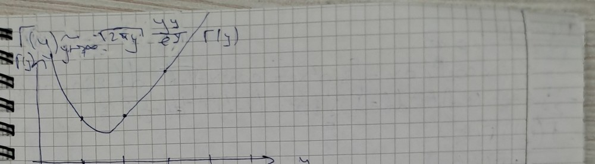
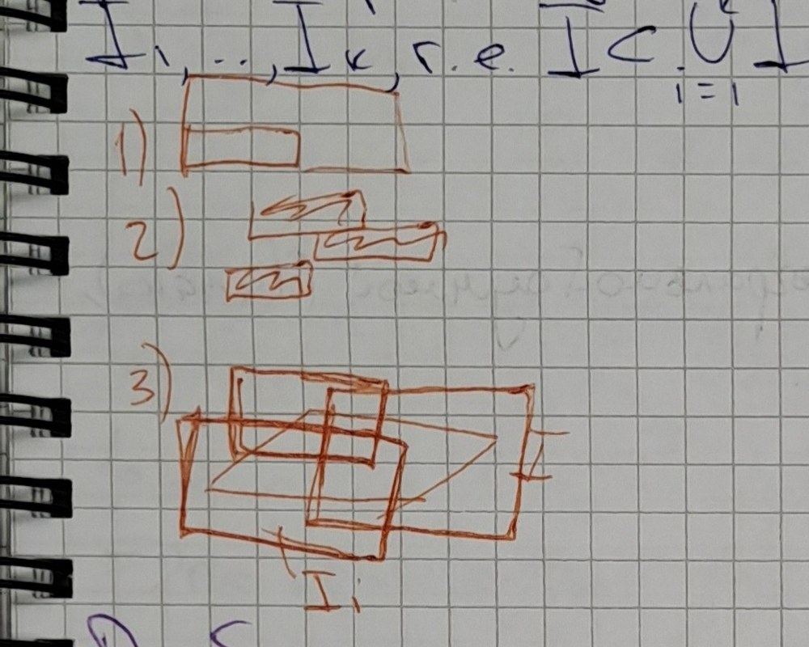

# Lecciones 79–80 — funciones gamma y beta, integral de Riemann sobre un paralelepípedo n-dimensional

[← Lecciones 77–78](lecture-77-78.md) · [Índice de lecciones](index.md) · [Lecciones 81–82 →](lecture-81-82.md) · [Términos y teoremas](../term-index.md) · [Русский](../../ru/lectures-2025-26/lecture-79-80.md) · [English](../../en/lectures-2025-26/lecture-79-80.md)

> **Fuente y numeración.** Los apuntes se copiaron de un cuaderno manuscrito (págs. p067–p073; el texto bruto de las páginas está en [`ocr/raw/`](../../../ocr/raw/p067.md)). En la parte superior de la pág. p067 figura en un recuadro la fecha «22 de octubre»; debajo, en rojo, empieza la anotación «Lecciones …» con el plan: función gamma; [integral de Riemann](lecture-39-40.md#def-4-2-6) sobre un paralelepípedo $`n`$-dimensional; integral de Riemann sobre un conjunto; un punto más, ilegible en la transcripción («desig-des de iden-des de integración»; quizá «desigualdades e identidades de la integración», es decir, propiedades de la integral). El número de la clase en el título del plan no se lee; por el orden del cuaderno son las lecciones 79–80, en las que se tratan los dos primeros puntos del plan (la integral sobre un conjunto está en las lecciones 81–82). La numeración de definiciones y teoremas es la del profesor; los enunciados de la [definición 9.3.1](#def-9-3-1), de las propiedades de la función gamma, de las [definiciones 10.1.1](#def-10-1-1)–[10.1.7](#def-10-1-7) y del [teorema 10.1.1](#thm-10-1-1) se cotejaron con las diapositivas del curso 2024/25 (FS p88–p91). En los apuntes no figuran la demostración de la fórmula de complementos (propiedad ⑨; se deja sin demostración) ni la definición de la finura de una [partición](lecture-37-38.md#def-4-2-2) (restaurada); la fórmula de Stirling (⑧) se deduce en los apuntes de forma heurística (se ha añadido una justificación); la deducción de la relación entre las [funciones beta](../25-parameter-integrals.md#sec-9-3) y gamma está escrita de forma deformada y se restaura según la anotación de la lección de 2024/25 (FS p89) y cursos estándar (Fichtenholz, t. II, cap. XIV; Zorich, t. II, cap. XVII). Se insertan figuras: la gráfica de la función gamma (pág. p070) y tres figuras pequeñas sobre las propiedades de la medida de un paralelepípedo (pág. p072); las demás figuras del margen se describen con palabras. Los lapsus de los apuntes se corrigen y se marcan con bloques «Corrección de la fuente»; los pasajes perdidos se restauran y se marcan con bloques «Restaurado»; las etiquetas corresponden a [`ocr/RESOLVED.md`](../../../ocr/RESOLVED.md). Los lugares que aún hay que cotejar con el cuaderno se enumeran en [`ocr/ISSUES.md`](../../../ocr/ISSUES.md).

## §9.3. La función gamma

<a id="p067"></a>

<a id="def-9-3-1"></a>**Definición 9.3.1.** La función gamma (en el punto $`y`$) es la función dada por la fórmula
```math
\Gamma(y)=\int_0^{\infty}x^{y-1}e^{-x}\,dx\qquad(y>0).
```

Comprobemos que la integral converge para todo $`y>0`$. Es impropia: para $`y<1`$ el integrando no está acotado cerca de $`x=0`$ y, además, el [límite superior](lecture-13.md#def-2-3-9) es infinito. Dividámosla en dos integrales (en los apuntes el punto de división se denota $`a`$; tomamos $`a=1`$):
```math
\int_0^{\infty}e^{-x}x^{y-1}\,dx=\int_0^{1}e^{-x}x^{y-1}\,dx+\int_1^{\infty}e^{-x}x^{y-1}\,dx .
```
La integral converge si convergen ambos sumandos.

*Convergencia en $`x\to0+`$.* Como $`e^{-x}\to1`$, para $`x\to0+`$ se tiene $`x^{y-1}e^{-x}\sim x^{y-1}=\dfrac1{x^{1-y}}`$. La integral $`\int_0^1\dfrac{dx}{x^{1-y}}`$ converge si y solo si $`1-y<1`$, es decir, $`y>0`$. Por el criterio de comparación la integral $`\int_0^1e^{-x}x^{y-1}\,dx`$ converge para $`y>0`$ (para $`y\le0`$ diverge).

> **Corrección de la fuente** (M326, A327). En los apuntes: «$`x^{y-1}e^{-x}\sim x^{y-1}=x^{\frac1{y-2}}\Rightarrow1-y<1\Rightarrow y>0`$» y «$`\int_0^\infty e^{-x}v^{y-1}\,dx`$ — converge por el criterio de comparación para $`y>0`$». La anotación «$`x^{\frac1{y-2}}`$» es un lapsus: $`x^{y-1}=\frac1{x^{1-y}}`$, y es el exponente $`1-y`$ el que se compara con uno. En la última línea «$`v`$» es $`x`$, y el límite superior no es $`\infty`$, sino el punto de división ($`a`$ en los apuntes, $`1`$ aquí): la convergencia en el infinito se estudia aparte.

*Convergencia en $`x\to+\infty`$.* Si $`y\in(0,1]`$, para $`x\ge1`$ se tiene $`x^{y-1}\le1`$, por lo que $`0<x^{y-1}e^{-x}\le e^{-x}`$, y la integral $`\int_1^\infty e^{-x}x^{y-1}\,dx`$ converge por el criterio de comparación, ya que $`\int_1^\infty e^{-x}\,dx<\infty`$. Si $`y>1`$, entonces
```math
\frac{x^{y-1}e^{-x}}{1/x^2}=\frac{x^{y+1}}{e^x}\to0\qquad(x\to+\infty),
```
es decir, $`x^{y-1}e^{-x}=o\!\left(\dfrac1{x^2}\right)`$, y la integral $`\int_1^\infty\dfrac{dx}{x^2}`$ converge; por tanto, también converge $`\int_1^\infty e^{-x}x^{y-1}\,dx`$. (La estimación $`o(1/x^2)`$ vale para cualquier $`y`$.) Así, $`\Gamma(y)`$ está definida para todo $`y>0`$.

> **Corrección de la fuente** (S328, A329, M330). En los apuntes: una nota roja en el margen «si $`y\in(0,1)`$, entonces $`e^{-x}\cdot x^{y-1}\to0`$», luego «$`x\to\infty`$: $`e^{-x}\cdot x^{y-1}=o\left(\frac1{x^2}\right)`$ para $`y>1`$» y «$`\frac{x^{y-1}e^{-x}}{1/x^2}=\frac{x^{y+1}}{e^x}\to0\Rightarrow\int_a^\infty e^{-x}x^{y-1}\,dx\to0`$». La nota del margen se lee como el análisis del caso $`y\in(0,1)`$ para $`x\to\infty`$, y la línea con $`o(1/x^2)`$, como el del caso $`y>1`$; para $`y\in(0,1)`$ no basta que el integrando tienda a cero para que haya convergencia, por lo que se indica la mayorante $`e^{-x}`$. La conclusión «$`\int_a^\infty e^{-x}x^{y-1}\,dx\to0`$» no es una conclusión sobre la convergencia: de la estimación $`o(1/x^2)`$ se deduce por el criterio de comparación que la integral converge (es decir, es un número finito).

**Propiedades.** La función gamma tiene las propiedades siguientes.

① $`\Gamma(1)=1`$.

② $`\Gamma\!\left(\tfrac12\right)=\sqrt\pi`$.

③ $`\Gamma(y+1)=y\,\Gamma(y)`$ para $`y>0`$.

④ $`\Gamma(n+1)=n\,\Gamma(n)=\ldots=n!`$ para $`n\in\mathbb N`$.

⑤ $`\Gamma\!\left(n+\tfrac12\right)=\dfrac{(2n-1)!!}{2^n}\sqrt\pi=\dfrac{(2n)!}{4^n\,n!}\sqrt\pi`$ para $`n\in\mathbb N`$.

> **Corrección de la fuente** (T331). En los apuntes: «$`\Gamma\left(n+\frac12\right)=\frac{(2n-1)!!}{2^n}\sqrt\pi=\frac{(2n-1)!}{2^n}\sqrt\pi`$». La segunda igualdad es falsa: para $`n=2`$ se tiene $`\frac{3!}{2^2}\sqrt\pi=\frac32\sqrt\pi`$, mientras que $`\Gamma\left(\frac52\right)=\frac34\sqrt\pi`$. Lo correcto es $`(2n-1)!!=\frac{(2n)!}{2^nn!}`$, de donde $`\Gamma\left(n+\frac12\right)=\frac{(2n)!}{4^nn!}\sqrt\pi`$.

⑥ $`\Gamma'(y)=\displaystyle\int_0^{\infty}x^{y-1}e^{-x}\ln x\,dx`$ para $`y>0`$ (la función gamma es [derivable](lecture-22-23.md#def-3-2-1), y la [derivada](lecture-22-23.md#def-3-1-1) puede calcularse bajo el signo integral).

<a id="p068"></a>

⑦ $`\Gamma''(y)=\displaystyle\int_0^{\infty}x^{y-1}e^{-x}\ln^2x\,dx>0`$; en particular, $`\Gamma`$ es convexa en $`(0,+\infty)`$.

⑧ $`\Gamma(y+1)\sim\sqrt{2\pi y}\,\dfrac{y^y}{e^y}`$ cuando $`y\to+\infty`$ (fórmula de Stirling); para $`y=n\in\mathbb N`$, cuando $`\Gamma(n+1)=n!`$, esto da $`n!\sim\sqrt{2\pi n}\,\dfrac{n^n}{e^n}`$.

⑨ $`\Gamma(y)\,\Gamma(1-y)=\dfrac{\pi}{\sin(\pi y)}`$ para $`0<y<1`$ (fórmula de complementos). La demostración no se dio en los apuntes.

⑩ $`\dfrac{\Gamma(y)}{b^y}=\displaystyle\int_0^{\infty}u^{y-1}e^{-ub}\,du`$ para $`y>0`$, $`b>0`$ (fórmula de Euler).

### Demostraciones de las propiedades

> **Corrección de la fuente** (T333). En los apuntes el bloque de demostraciones se abre con el título «Dem. (prop. 6)»; a continuación se demuestran por orden las propiedades ①–⑥ (luego ⑦, ⑧ y ⑩; ⑨ no se demuestra). El título se lee como «Dem. (props. 1–6)», y las demostraciones de abajo se agrupan por contenido.

**Demostración de las propiedades ①–⑤.**

① $`\Gamma(1)=\int_0^{+\infty}e^{-x}x^{0}\,dx=\int_0^{+\infty}e^{-x}\,dx=-e^{-x}\Big|_0^{+\infty}=1`$.

② $`\Gamma\left(\tfrac12\right)=\int_0^{+\infty}e^{-x}x^{-1/2}\,dx=\int_0^{+\infty}\dfrac{e^{-x}}{\sqrt x}\,dx`$. Con el cambio $`x=t^2`$ ($`dx=2t\,dt`$, $`\sqrt x=t`$) obtenemos
```math
\Gamma\left(\tfrac12\right)=\int_0^{\infty}e^{-t^2}\,\frac{2t\,dt}{t}=2\int_0^{\infty}e^{-t^2}\,dt=\sqrt\pi ,
```
ya que $`\int_0^\infty e^{-t^2}\,dt=\frac{\sqrt\pi}{2}`$ (la integral de Euler–Poisson; en los apuntes se toma como conocida, y en la observación tras el ejemplo de más abajo se da una deducción independiente de la igualdad $`\Gamma\left(\frac12\right)=\sqrt\pi`$).

③ Para $`y>0`$ integramos por partes:
```math
\Gamma(y+1)=\int_0^{\infty}x^{y}e^{-x}\,dx=-\int_0^{\infty}x^y\,d\bigl(e^{-x}\bigr)=-x^ye^{-x}\Big|_0^{\infty}+y\int_0^{\infty}x^{y-1}e^{-x}\,dx=y\,\Gamma(y),
```
ya que $`x^ye^{-x}\to0`$ tanto para $`x\to+\infty`$ como para $`x\to0+`$ (aquí $`y>0`$).

④ Sustituyendo sucesivamente $`y=n,\,n-1,\ldots,1`$ en ③ y usando ①, obtenemos $`\Gamma(n+1)=n\,\Gamma(n)=n(n-1)\,\Gamma(n-1)=\ldots=n!\,\Gamma(1)=n!`$. Es una consecuencia de ③.

⑤ De ② y ③: $`\Gamma\left(\tfrac32\right)=\tfrac12\Gamma\left(\tfrac12\right)=\tfrac12\sqrt\pi`$, $`\ \Gamma\left(\tfrac52\right)=\tfrac32\Gamma\left(\tfrac32\right)=\tfrac32\cdot\tfrac12\sqrt\pi`$. En general, aplicando ③ $`n`$ veces, para $`n\in\mathbb N`$ obtenemos
```math
\Gamma\left(n+\tfrac12\right)=\left(n-\tfrac12\right)\left(n-\tfrac32\right)\cdots\tfrac12\,\Gamma\left(\tfrac12\right)=\frac{(2n-1)(2n-3)\cdots1}{2^n}\sqrt\pi=\frac{(2n-1)!!}{2^n}\sqrt\pi .
```
Como $`(2n-1)!!=\dfrac{(2n)!}{(2n)!!}=\dfrac{(2n)!}{2^nn!}`$, esto es igual a $`\dfrac{(2n)!}{4^nn!}\sqrt\pi`$. $`\square`$

**Demostración de las propiedades ⑥ y ⑦.** Derivando formalmente $`\Gamma(y)=\int_0^{\infty}x^{y-1}e^{-x}\,dx`$ respecto del parámetro $`y`$ bajo el signo integral y observando que $`\frac{\partial}{\partial y}x^{y-1}=x^{y-1}\ln x`$, obtendríamos ⑥. Justifiquemos este paso, es decir, comprobemos las hipótesis del [teorema 9.2.2](lecture-77-78.md#thm-9-2-2) de derivación de una [integral impropia](lecture-47-48.md#def-4-5-2) respecto de un parámetro. La integral tiene dos singularidades ($`x=0`$ y $`x=+\infty`$), por lo que, como antes, la escribimos como $`\int_0^1+\int_1^\infty`$ y aplicamos el [teorema 9.2.2](lecture-77-78.md#thm-9-2-2) a cada sumando (una singularidad en el extremo inferior se trata de forma análoga; véase la observación sobre singularidades en las lecciones 77–78).

Fijemos números $`0<\delta<C<\infty`$ y supongamos $`y\in[\delta,C]`$: todo punto $`y_0>0`$ está dentro de un segmento así (por ejemplo, para $`\delta=y_0/2`$, $`C=2y_0`$), y la derivabilidad es una propiedad local. Las funciones $`f(x,y)=x^{y-1}e^{-x}`$ y $`f'_y(x,y)=x^{y-1}e^{-x}\ln x`$ son continuas para $`x>0`$, $`y\in[\delta,C]`$, y la integral de $`f`$ converge para cada tal $`y`$. Queda comprobar la [convergencia uniforme](../10-function-sequences-series.md#sec-10-1) de la integral $`\int_0^{\infty}x^{y-1}e^{-x}\ln x\,dx`$ en $`[\delta,C]`$; lo hacemos con el [criterio de Weierstrass](../10-function-sequences-series.md#weierstrass-m-test).

① *Entorno de cero, $`x\in(0,1]`$.* Como $`y\ge\delta`$, se tiene $`y-\frac\delta2\ge\frac\delta2>0`$, de donde $`x^{y-\delta/2}\le x^{\delta/2}`$ para $`x\in(0,1]`$; además, $`e^{-x}\le1`$. Por tanto,
```math
\bigl|x^{y-1}e^{-x}\ln x\bigr|\le x^{\frac\delta2-1}\,\bigl|x^{y-\frac\delta2}\ln x\bigr|\le x^{\frac\delta2-1}\cdot x^{\frac\delta2}\,|\ln x| .
```
Por el límite notable $`x^p\ln x\to0`$ cuando $`x\to0+`$, para todo $`p>0`$ la función $`x^{\delta/2}|\ln x|`$ está acotada en $`(0,1]`$; más precisamente, $`x^{\delta/2}|\ln x|\le\frac{2}{e\delta}`$ (el máximo de la función $`x^p\ln\frac1x`$ en $`(0,1]`$ vale $`\frac1{ep}`$ y se alcanza en $`x=e^{-1/p}`$).

<a id="p069"></a>

En consecuencia, $`\bigl|x^{y-1}e^{-x}\ln x\bigr|\le\frac{2}{e\delta}\,x^{\frac\delta2-1}`$ para todos $`x\in(0,1]`$, $`y\in[\delta,C]`$, y la integral $`\int_0^1x^{\frac\delta2-1}\,dx=\frac2\delta`$ converge. Hemos hallado una mayorante convergente que no depende de $`y`$; por el criterio de Weierstrass la integral $`\int_0^1x^{y-1}e^{-x}\ln x\,dx`$ converge uniformemente en $`[\delta,C]`$.

> **Corrección de la fuente** (S336, U337, T338, M339, S340, M535). En los apuntes: «Volviendo a 0», «Comprobemos que $`\exists\forall\delta(y)`$, en el que o la integral conv. uniformemente. Tomamos la partición $`\delta>0`$ tal que $`\delta\le y`$», «$`x^{y-1}=x^{\delta-1}x^{y-\delta}`$», «$`y=\delta+\delta`$», «$`\left|x^{y-1}e^{-x}\ln x\right|\le x^{\delta/2-1}\left|x^{y-\delta/2}\ln x\right|`$», «② $`x^{\delta/2-1}\ln x`$» y «$`\int_0^\infty x^{\delta/2-1}\,dx<+\infty`$». Según la anotación de la lección de 2024/25 (FS p88), estas líneas se leen así: «① Cerca de cero. Comprobemos que existe un entorno $`V_\delta(y)`$ en el que la integral converge uniformemente; se toma un $`\delta>0`$ arbitrario, $`\delta\le y`$; $`y=\delta+(y-\delta)`$». La descomposición $`x^{y-1}=x^{\delta-1}x^{y-\delta}`$ deja en la mayorante $`x^{\delta-1}|\ln x|`$ un logaritmo sin neutralizar (para $`y=\delta`$ el factor $`x^{y-\delta}=1`$ no lo anula); para que la mayorante sea una potencia, parte del exponente se dedica a neutralizar $`\ln x`$: por eso en la estimación figura $`\delta/2`$ (así en los apuntes), y «②» es el signo de la siguiente desigualdad de la cadena ($`x^{y-\delta/2}\le x^{\delta/2}`$ y la acotación de $`x^{\delta/2}\ln x`$). En lugar del entorno $`V_\delta(y)`$ conviene tomar el segmento $`[\delta,C]`$. Por último, la integral de la mayorante se escribe como $`\int_0^\infty x^{\delta/2-1}\,dx<+\infty`$: en el infinito diverge (el exponente $`\frac\delta2-1>-1`$), y solo hace falta la integral cerca de cero, $`\int_0^1x^{\delta/2-1}\,dx<\infty`$ (en la anotación de 2024/25, $`\int_0^a`$).

② *Entorno del infinito, $`x\ge1`$.* Como $`y\le C`$ y $`x\ge1`$, se tiene $`x^{y-1}\le x^{C-1}`$; además, $`\ln x\ge0`$. Por tanto,
```math
\bigl|x^{y-1}e^{-x}\ln x\bigr|\le x^{C-1}e^{-x}\ln x=:g(x),\qquad y\in[\delta,C],\ x\ge1 .
```
La función $`g`$ no depende de $`y`$, y $`x^2g(x)=\dfrac{x^{C+1}\ln x}{e^x}\to0`$ cuando $`x\to+\infty`$, es decir, $`g(x)=o\!\left(\frac1{x^2}\right)`$; por tanto, la integral $`\int_1^\infty g(x)\,dx`$ converge. Por el criterio de Weierstrass la integral $`\int_1^\infty x^{y-1}e^{-x}\ln x\,dx`$ converge uniformemente en $`[\delta,C]`$.

> **Corrección de la fuente** (M536). En los apuntes (punto «en un entorno de $`\infty`$, $`y\le C`$»): «$`\left|x^{y-1}e^{-x}\ln x\right|\le x^{C-1}e^{-x}\ln x\to0\Rightarrow`$ acotación $`\Rightarrow`$ mayorante absoluta $`\Rightarrow`$ crit. de Weierstrass». La acotación de la mayorante no basta para su integrabilidad en $`[1,\infty)`$ (por ejemplo, $`g\equiv1`$ está acotada pero no es integrable); $`g`$ debe decrecer lo bastante deprisa. Es justo lo que se muestra arriba: $`g(x)=o\left(x^{-2}\right)`$.

Así, la integral $`\int_0^\infty x^{y-1}e^{-x}\ln x\,dx`$ converge uniformemente en $`[\delta,C]`$. Se cumplen las hipótesis del [teorema 9.2.2](lecture-77-78.md#thm-9-2-2) (continuidad de $`f`$ y $`f'_y`$, convergencia uniforme de la integral de $`f'_y`$, convergencia de la integral de $`f`$), por lo que $`\Gamma`$ es derivable en $`[\delta,C]`$ y $`\Gamma'(y)=\int_0^\infty x^{y-1}e^{-x}\ln x\,dx`$. Como $`\delta`$ y $`C`$ son arbitrarios, esto vale para todo $`y>0`$: la propiedad ⑥ queda demostrada.

La propiedad ⑦ se obtiene repitiendo este razonamiento para la integral de ⑥ (converge para cada $`y>0`$). La derivada de su integrando respecto de $`y`$ es $`x^{y-1}e^{-x}\ln^2x`$ y es continua para $`x>0`$; su integral converge uniformemente en $`[\delta,C]`$ por el criterio de Weierstrass: para $`x\in(0,1]`$
```math
x^{y-1}e^{-x}\ln^2x\le x^{\frac\delta2-1}\cdot x^{\frac\delta2}\ln^2x\le\frac{16}{e^2\delta^2}\,x^{\frac\delta2-1}
```
(el máximo de $`x^p\ln^2x`$ en $`(0,1]`$ vale $`\frac4{e^2p^2}`$, $`p=\frac\delta2`$), y para $`x\ge1`$ esta función no supera $`x^{C-1}e^{-x}\ln^2x=o\left(x^{-2}\right)`$. Por el [teorema 9.2.2](lecture-77-78.md#thm-9-2-2)
```math
\Gamma''(y)=\bigl(\Gamma'(y)\bigr)'_y=\left(\int_0^{\infty}x^{y-1}e^{-x}\ln x\,dx\right)'_y=\int_0^{\infty}x^{y-1}e^{-x}\ln^2x\,dx .
```
El integrando es no negativo y positivo para $`x\ne1`$, por lo que $`\Gamma''(y)>0`$ para todo $`y>0`$, es decir, $`\Gamma`$ es estrictamente convexa. $`\square`$

> **Corrección de la fuente** (T341, T342). En los apuntes: «$`(\Gamma'(y))'_y=\left(\int_0^\infty e^{-x}x^{y-1}\,dx\right)'_y=\int_0^\infty e^{-x}\frac{d}{dy}\left(x^{y-1}\right)dx=\int_0^\infty e^{-x}x^{y-1}\ln x\,dx`$» y «③ $`\Gamma'(y)>0\Rightarrow\Gamma(y)`$ es convexa. Se demuestra a partir de ⑥ repitiendo la demostración de ⑥». En la primera cadena la segunda expresión tiene $`\Gamma`$ en lugar de $`\Gamma'`$, y como resultado falta el cuadrado: la segunda derivada se obtiene derivando la integral de ⑥, $`\frac{\partial}{\partial y}\bigl(x^{y-1}\ln x\bigr)=x^{y-1}\ln^2x`$. En la segunda anotación se refiere a la propiedad ⑦ ($`\Gamma''>0`$), y no a ③; la [convexidad](lecture-31-32.md#def-3-8-1) se deduce precisamente de $`\Gamma''>0`$, mientras que la condición $`\Gamma'>0`$ es falsa (la función $`\Gamma`$ decrece para $`y<1{,}46\ldots`$) y significaría crecimiento, no convexidad.

**Deducción de la propiedad ⑧ (heurística).** Para $`y=n\in\mathbb N`$ se tiene $`\Gamma(n+1)=n!`$, y la propiedad ⑧ se convierte en la fórmula de Stirling $`n!\sim\sqrt{2\pi n}\,n^ne^{-n}`$, es decir, $`\dfrac{n!}{\sqrt{2\pi n}\,n^ne^{-n}}\to1`$. Deduzcamos ⑧ por el método de Laplace. Con el cambio $`x=yt`$ ($`dx=y\,dt`$) obtenemos
```math
\Gamma(y+1)=\int_0^{\infty}x^{y}e^{-x}\,dx=y^{y+1}\int_0^{\infty}t^{y}e^{-yt}\,dt .
```
Pongamos $`\varphi(t)=\ln t-t+1`$; entonces $`t^ye^{-yt}=e^{y(\ln t-t)}=e^{-y}e^{y\varphi(t)}`$ y
```math
\Gamma(y+1)=y^{y+1}e^{-y}\int_0^{\infty}e^{y\varphi(t)}\,dt .
```
Para $`y`$ grande la contribución principal a la integral la dan los valores de $`t`$ cercanos al punto de máximo $`\varphi`$. Hallamos: $`\varphi'(t)=\frac1t-1=0`$ solo para $`t=1`$, $`\varphi(1)=\ln1-1+1=0`$ (de modo que $`e^{\varphi(1)}=1`$), $`\varphi''(t)=-\frac1{t^2}<0`$; por tanto, $`t=1`$ es un punto de máximo de la función $`\varphi`$ en $`(0,\infty)`$ (global, ya que $`\varphi`$ es cóncava). Desarrollemos $`\varphi`$ por la [fórmula de Taylor](lecture-27-28.md#thm-3-6-3) en un entorno del punto de máximo:
```math
\varphi(t)=\varphi(1)+\varphi'(1)(t-1)+\tfrac12\varphi''(1)(t-1)^2+o\bigl((t-1)^2\bigr)=-\tfrac12(t-1)^2+o\bigl((t-1)^2\bigr),\qquad t\to1 .
```
Despreciando el resto y sustituyendo $`(0,\infty)`$ por toda la recta (la parte añadida es exponencialmente pequeña), obtenemos por Gauss
```math
\int_0^{\infty}e^{y\varphi(t)}\,dt\approx\int_{-\infty}^{+\infty}e^{-\frac y2(t-1)^2}\,dt=\sqrt{\frac{2\pi}{y}},
```
de donde
```math
\Gamma(y+1)\sim y^{y+1}e^{-y}\sqrt{\frac{2\pi}{y}}=\sqrt{2\pi y}\,\frac{y^y}{e^y}.
```

> **Corrección de la fuente** (U343, A344, M345, M533, T346, U347). En los apuntes: «⑧ para $`y\in\mathbb N`$ $`\Gamma(n+1)=n!`$ y $`\frac{n!\sqrt{2\pi n}}{n^ne^{-n}}`$», «$`[\varphi(t):=\ln t-t+1]`$», «$`\varphi'(t)=\frac1t-1`$, $`\varphi'(1)=0\Rightarrow\varphi=1-\frac1t-1=0\Rightarrow e^\varphi=1`$ es el único candidato a punto crítico», «$`\varphi''(t)=-\frac1{t^2}>0\Rightarrow t=1`$ es máx», «$`\varphi(t)=\varphi(1)+\varphi'(1)(t-1)+\frac12\varphi''(1)(t-1)^2+O((t-1)^2)=-\frac12/(t-1)^2+O((t-1)^2)`$» y «$`e^{y\varphi}dx=\int_0^\infty e^{-y\frac12(t-1)^2}\,dt=\sqrt{\frac{2\pi}{y}}`$ (se obtuvo por Gauss)». Corregido: 1) la fórmula de Stirling es $`\frac{n!}{\sqrt{2\pi n}\,n^ne^{-n}}\to1`$ (así en la anotación de 2024/25, FS p89: «$`n!\sim\sqrt{2\pi n}\,\frac{n^n}{e^n}`$»); 2) $`\varphi(t)=\ln t-t+1`$: es con este sumando $`+1`$ con el que se obtienen $`\varphi(1)=0`$ y $`e^{\varphi(1)}=1`$; la línea «$`\varphi=1-\frac1t-1=0`$» es un lapsus, lo correcto es $`\varphi(1)=\ln1-1+1=0`$, y la unicidad del punto crítico significa: $`\varphi'(t)=0\iff t=1`$; 3) el signo de la segunda derivada: $`\varphi''(t)=-\frac1{t^2}<0`$; es la negatividad de $`\varphi''`$ la que da un máximo (la anotación «$`>0`$» correspondería a un mínimo); 4) el resto de la fórmula de Taylor con resto de Peano es $`o\left((t-1)^2\right)`$, y no $`O\left((t-1)^2\right)`$ (de lo contrario el resto no puede separarse del término principal), y el término principal es $`-\frac12(t-1)^2`$ (el signo «/» de los apuntes es un lapsus); 5) en la última línea falta $`\int_0^\infty`$ delante de $`e^{y\varphi}`$, figura $`dx`$ en lugar de $`dt`$, y la igualdad es aproximada: se ha despreciado el resto y la integral sobre $`(0,\infty)`$ se ha sustituido por la integral sobre toda la recta.

> **Restaurado** (justificación de la deducción de ⑧, según la demostración estándar del método de Laplace; en los apuntes no se justifica el paso «despreciar el resto»). Probemos que $`\sqrt y\int_0^\infty e^{y\varphi(t)}\,dt\to\sqrt{2\pi}`$ cuando $`y\to+\infty`$; entonces $`\Gamma(y+1)=y^{y+1}e^{-y}\int_0^\infty e^{y\varphi}\,dt\sim y^{y+1}e^{-y}\sqrt{2\pi/y}`$, es decir, ⑧. Sea $`\varepsilon\in(0,1)`$. La función $`\varphi''(s)=-s^{-2}`$ es continua y $`\varphi''(1)=-1`$, por lo que existe $`\eta\in(0,1)`$ tal que $`-(1+\varepsilon)\le\varphi''(s)\le-(1-\varepsilon)`$ para $`|s-1|\le\eta`$. Como $`\varphi(1)=\varphi'(1)=0`$, por la fórmula de Taylor con resto de Lagrange $`\varphi(t)=\frac12\varphi''(s)(t-1)^2`$ para cierto $`s`$ entre $`1`$ y $`t`$; en consecuencia,
> ```math
> -\tfrac{1+\varepsilon}{2}(t-1)^2\le\varphi(t)\le-\tfrac{1-\varepsilon}{2}(t-1)^2,\qquad|t-1|\le\eta .
> ```
> De aquí
> ```math
> \int_{|t-1|\le\eta}e^{y\varphi(t)}\,dt\le\int_{-\infty}^{+\infty}e^{-\frac{y(1-\varepsilon)}{2}(t-1)^2}\,dt=\sqrt{\frac{2\pi}{y(1-\varepsilon)}},
> ```
> ```math
> \int_{|t-1|\le\eta}e^{y\varphi(t)}\,dt\ge\int_{|t-1|\le\eta}e^{-\frac{y(1+\varepsilon)}{2}(t-1)^2}\,dt=\sqrt{\frac{2\pi}{y(1+\varepsilon)}}\,\bigl(1-r(y)\bigr),
> ```
> donde $`r(y)=\frac{2}{\sqrt\pi}\int_{\eta\sqrt{y(1+\varepsilon)/2}}^{\infty}e^{-u^2}\,du\to0`$ cuando $`y\to+\infty`$ (la cola de la integral de Gauss). Fuera del segmento $`|t-1|\le\eta`$ usamos la concavidad de $`\varphi`$: $`\varphi(1)=0`$, $`\varphi(1\pm\eta)<0`$ (el máximo en el punto $`1`$ es estricto); pongamos $`\kappa=\min\{-\varphi(1+\eta),-\varphi(1-\eta)\}>0`$. Para $`t\ge1+\eta`$ el punto $`1+\eta`$ está entre $`1`$ y $`t`$, y la concavidad da $`\varphi(1+\eta)\ge\frac{\eta}{t-1}\varphi(t)`$, es decir, $`\varphi(t)\le-\kappa\frac{t-1}{\eta}`$; análogamente, $`\varphi(t)\le-\kappa\frac{1-t}{\eta}`$ para $`0<t\le1-\eta`$. Por tanto,
> ```math
> \int_{t>0,\ |t-1|>\eta}e^{y\varphi(t)}\,dt\le2\int_\eta^\infty e^{-y\kappa s/\eta}\,ds=\frac{2\eta}{y\kappa}\,e^{-y\kappa}=o\bigl(y^{-1/2}\bigr).
> ```
> Sumando las estimaciones, obtenemos $`\frac1{\sqrt{1+\varepsilon}}\le\liminf_{y\to+\infty}\sqrt{\frac{y}{2\pi}}\int_0^\infty e^{y\varphi}\,dt\le\limsup_{y\to+\infty}\sqrt{\frac{y}{2\pi}}\int_0^\infty e^{y\varphi}\,dt\le\frac1{\sqrt{1-\varepsilon}}`$; como $`\varepsilon`$ es arbitrario, el límite es $`1`$. $`\square`$

Consideremos el comportamiento de $`\Gamma`$ en la frontera del dominio $`y\in(0,+\infty)`$. Para $`y\to0+`$, por la propiedad ③, $`\Gamma(y)=\dfrac{\Gamma(y+1)}{y}`$ para todo $`y>0`$, y $`\Gamma(y+1)\to\Gamma(1)=1`$ cuando $`y\to0+`$ (la función $`\Gamma`$ es derivable y, por tanto, continua). Por tanto, $`\Gamma(y)\sim\dfrac1y\to+\infty`$ cuando $`y\to0+`$. Cuando $`y\to+\infty`$, por la propiedad ⑧, $`\Gamma(y)=\dfrac{\Gamma(y+1)}{y}\sim\sqrt{\dfrac{2\pi}{y}}\left(\dfrac{y}{e}\right)^{y}\to+\infty`$.

> **Corrección de la fuente** (U348, U349). En los apuntes: «$`\forall y>0\ \exists\delta(y)=\frac{y}{\Gamma(y+1)}=\frac1y`$» y «$`\Gamma(y+1)\xrightarrow[y\to0+]{}1`$». Según la anotación de la lección de 2024/25 (FS p89), la primera línea se lee como «$`\Gamma(y)=\frac{\Gamma(y+1)}{y}`$» (el signo «$`\delta`$» es $`\Gamma`$, y la fracción está invertida), la segunda como «$`\Gamma(y+1)\to\Gamma(1)=1`$ cuando $`y\to0+`$»; juntas dan $`\Gamma(y)\sim\frac1y`$ cuando $`y\to0+`$.

Como $`\Gamma`$ es estrictamente convexa (⑦), tiende a $`+\infty`$ en ambos extremos del intervalo $`(0,+\infty)`$ y $`\Gamma(1)=\Gamma(2)=1`$, tiene un único punto de mínimo, situado entre $`1`$ y $`2`$: por el [teorema de Rolle](lecture-24-25-26.md#thm-3-4-2) $`\Gamma'`$ se anula en el interior de $`(1,2)`$, y $`\Gamma'`$ es estrictamente creciente, ya que $`\Gamma''>0`$ (numéricamente $`y_{\min}\approx1{,}46`$, $`\Gamma(y_{\min})\approx0{,}886`$). A la izquierda de este punto $`\Gamma`$ decrece, a la derecha crece. Así es la gráfica dibujada en los apuntes.

<a id="p070"></a>



*Figura de los apuntes (pág. p070): la gráfica de $`\Gamma(y)`$; el eje $`y`$ con las marcas $`1,2,3,4,5`$; la curva decrece desde $`+\infty`$ cuando $`y\to0+`$, tiene un mínimo entre $`1`$ y $`2`$ y luego crece; se marcan los puntos de la curva en $`y=1,2,3`$ (los valores $`1,1,2`$). Sobre la figura, en el margen, se escribe la asintótica $`\Gamma(y)\sim\sqrt{2\pi y}\,\frac{y^y}{e^y}`$ cuando $`y\to+\infty`$.*

> **Corrección de la fuente** (G350, T534). La asintótica sobre la gráfica se escribe para $`\Gamma(y)`$, mientras que la propiedad ⑧ se refiere a $`\Gamma(y+1)`$. Para la propia $`\Gamma`$, de ⑧ y ③ se deduce $`\Gamma(y)=\frac{\Gamma(y+1)}{y}\sim\sqrt{\frac{2\pi}{y}}\,\frac{y^y}{e^y}`$; el factor $`\sqrt{2\pi y}`$ de la anotación del margen es correcto solo para $`\Gamma(y+1)`$.

**Demostración de la propiedad ⑩ (fórmula de Euler).** En la integral $`\Gamma(y)=\int_0^{\infty}x^{y-1}e^{-x}\,dx`$ hagamos el cambio $`x=bu`$, donde $`b>0`$ es un parámetro, $`dx=b\,du`$:
```math
\Gamma(y)=\int_0^{\infty}(bu)^{y-1}e^{-bu}\,b\,du=b^y\int_0^{\infty}u^{y-1}e^{-ub}\,du ,
```
de donde $`\dfrac{\Gamma(y)}{b^y}=\displaystyle\int_0^{\infty}u^{y-1}e^{-ub}\,du`$. $`\square`$

> **Corrección de la fuente** (A332). En la lista de propiedades de los apuntes (y en la diapositiva FS p88) la fórmula de Euler se escribe como $`\frac{\Gamma(y)}{t^y}=\int_0^\infty u^{y-1}e^{-ut}\,du`$, mientras que en la demostración (pág. p070) el mismo parámetro se denota $`b`$. Aquí es $`b`$ en todas partes: la letra $`t`$ hace falta más abajo para la variable de integración.

> **Corrección de la fuente** (U351). Antes de la deducción de la relación entre las funciones beta y gamma, los apuntes tienen una nota ilegible «⑨ Skl.» (quizá «⑨ Cor.», «corolario»). En el texto principal se omite: la demostración de la fórmula de complementos ⑨ no figura en los apuntes; en el bloque «Restaurado» tras la deducción de la relación entre las funciones beta y gamma se muestra cómo ⑨ se reduce a ella.

### La función beta

Para $`y,z>0`$ la función
```math
B(y,z)=\int_0^1x^{y-1}(1-x)^{z-1}\,dx
```
se llama función beta, o integral euleriana (de primera especie). La integral converge para $`y>0`$, $`z>0`$: cerca de $`x=0`$ el integrando es equivalente a $`x^{y-1}`$, cerca de $`x=1`$, a la función $`(1-x)^{z-1}`$ (la convergencia se deduce también de la deducción de más abajo). La función beta se expresa mediante la función gamma:
```math
B(y,z)=\int_0^1x^{y-1}(1-x)^{z-1}\,dx=\frac{\Gamma(y)\,\Gamma(z)}{\Gamma(y+z)},\qquad y,z>0 .
```

**Demostración.** Tomemos $`y,z>0`$ y escribamos la fórmula de Euler ⑩ para $`y+z`$ en lugar de $`y`$ y $`b+1`$ en lugar de $`b`$ (denotemos la variable de integración por $`t`$):
```math
\frac{\Gamma(y+z)}{(b+1)^{y+z}}=\int_0^{\infty}t^{y+z-1}e^{-(b+1)t}\,dt,\qquad b>0 .
```
Multipliquemos ambos miembros por $`b^{y-1}`$ e integremos respecto de $`b`$ de $`0`$ a $`\infty`$:
```math
\Gamma(y+z)\int_0^{\infty}\frac{b^{y-1}}{(b+1)^{y+z}}\,db=\int_0^{\infty}\left(\int_0^{\infty}b^{y-1}\,t^{y+z-1}e^{-t}\,e^{-bt}\,dt\right)db .
```
Cambiemos el orden de integración (la justificación está en el bloque «Restaurado» de abajo) y apliquemos a la integral interior la fórmula de Euler ⑩ con el parámetro $`t`$ en lugar de $`b`$: $`\int_0^\infty b^{y-1}e^{-bt}\,db=\dfrac{\Gamma(y)}{t^y}`$. Obtenemos
```math
\int_0^{\infty}t^{y+z-1}e^{-t}\left(\int_0^{\infty}b^{y-1}e^{-bt}\,db\right)dt=\int_0^{\infty}t^{y+z-1}e^{-t}\,\frac{\Gamma(y)}{t^{y}}\,dt=\Gamma(y)\int_0^{\infty}t^{z-1}e^{-t}\,dt=\Gamma(y)\,\Gamma(z).
```
En consecuencia,
```math
\int_0^{\infty}\frac{b^{y-1}}{(b+1)^{y+z}}\,db=\frac{\Gamma(y)\,\Gamma(z)}{\Gamma(y+z)} .
```
En la integral de la izquierda hagamos el cambio $`x=\dfrac{b}{b+1}`$, es decir, $`b+1=\dfrac1{1-x}`$, $`b=\dfrac{x}{1-x}`$, $`db=\dfrac{dx}{(1-x)^2}`$; el intervalo $`b\in(0,\infty)`$ pasa a $`x\in(0,1)`$:
```math
\int_0^{\infty}\frac{b^{y-1}}{(b+1)^{y+z}}\,db=\int_0^1\frac{x^{y-1}}{(1-x)^{y-1}}\,(1-x)^{y+z}\,\frac{dx}{(1-x)^2}=\int_0^1x^{y-1}(1-x)^{z-1}\,dx=B(y,z),
```
ya que $`-(y-1)+(y+z)-2=z-1`$. Comparando los dos cálculos del miembro izquierdo, obtenemos la igualdad buscada. $`\square`$

> **Corrección de la fuente** (M352, U353, U354). La deducción en los apuntes (pág. p070) está escrita de forma deformada y es en parte ilegible: tras la fórmula de Euler para $`(y+z,b+1)`$ figura «$`=\int_0^\infty\left(\int_0^\infty u^{y-1}e^{-ub}\,t^{y+z-1}e^{-t}\,du\right)dt`$», luego «$`=\int_0^\infty u^{y-1}e^{-ub}\left(\int_0^\infty t^{y+z-1}e^{-ut}\,dt\right)du=\int u^{y-1}e^{-ub}\frac{\Gamma(y+z)}{u^{y+z}}\,du=\Rightarrow\frac{\Gamma(y+z)}{\Gamma(z)}\int_0^\infty\frac{b^{z-1}}{(b+1)^{y+z}}\,db=\ldots=B(y,z)-`$», y después «$`\left[b+1=\frac1{1-x},\ db=\frac{dx}{(1-x)^2}\right]`$ $`=\int_0^1\frac{x^{y-1}-(1-x)^{y+z}}{(1-x)^2}=\int_0^1x^{y-1}(1-x)^{z-1}\,dx=:B(y,z)-`$ $`=`$ Vtorov integral». Estas líneas no concuerdan entre sí: la primera igualdad no se deduce de la fórmula de Euler (la integral respecto de $`u`$ vale $`\frac{\Gamma(y)}{b^y}`$ y no depende de $`t`$), en la segunda integral doble el exponente $`e^{-t}`$ se sustituye por $`e^{-ut}`$, la potencia $`b^{z-1}`$ de una línea pasa a ser $`x^{y-1}`$ en otra, y los signos «$`-`$» del numerador y de los finales de línea son signos ilegibles de multiplicación e igualdad (en el numerador se refiere a $`\frac{x^{y-1}}{(1-x)^{y-1}}\cdot(1-x)^{y+z}`$). Los pasos se restauran según la anotación de la lección de 2024/25 (FS p89): la fórmula de Euler para $`(y+z,\,t+1)`$ se multiplica por $`t^{y-1}`$ y se integra respecto de $`t`$; más arriba se hace lo mismo con el parámetro $`b`$. «Vtorov integral» es la «integral euleriana» (así en la diapositiva FS p89).

> **Restaurado** (justificación del cambio del orden de integración; en los apuntes no se discute). El integrando $`F(b,t)=b^{y-1}t^{y+z-1}e^{-(b+1)t}`$ es continuo y no negativo para $`b,t>0`$. Para tales funciones las integrales impropias iteradas coinciden ([teorema de Tonelli](../20-lebesgue-integration.md#sec-20-4); en nuestro caso puede obtenerse del [teorema 9.1.3](lecture-77-78.md#thm-9-1-3) para los cuadrados $`[\frac1N,N]^2`$ mediante el paso al límite $`N\to\infty`$ con ayuda del teorema de Dini, ya que ambas integrales interiores son funciones continuas: $`\Gamma(y+z)\,b^{y-1}(b+1)^{-(y+z)}`$ y $`\Gamma(y)\,t^{z-1}e^{-t}`$). Ambas integrales iteradas son entonces finitas, ya que $`\int_0^\infty\frac{b^{y-1}}{(b+1)^{y+z}}\,db<\infty`$ para $`y,z>0`$ (el integrando es $`\sim b^{y-1}`$ cuando $`b\to0+`$ y $`\sim b^{-z-1}`$ cuando $`b\to+\infty`$).

> **Restaurado** (según un curso estándar; en los apuntes la fórmula de complementos ⑨ se deja sin demostración). Pongamos en la igualdad demostrada $`z=1-y`$, $`0<y<1`$, y tengamos en cuenta $`\Gamma(1)=1`$: $`\Gamma(y)\,\Gamma(1-y)=B(y,1-y)=\int_0^\infty\frac{b^{y-1}}{1+b}\,db`$ (es la primera integral de la deducción para $`y+z=1`$). El valor de esta integral es $`\frac{\pi}{\sin\pi y}`$, una integral clásica que se calcula, por ejemplo, mediante residuos; de aquí se deduce ⑨. Para $`y=\frac12`$ la fórmula da $`\Gamma\left(\frac12\right)^2=\pi`$, de acuerdo con la propiedad ②.

<a id="p071"></a>

**Ejemplo.** Calculemos la integral $`\displaystyle\int_0^{\pi/2}\sin^{\alpha}x\cos^{\beta}x\,dx`$, $`\alpha,\beta>0`$. Hagamos el cambio $`t=\sin^2x`$: entonces $`\cos^2x=1-t`$, $`dt=2\sin x\cos x\,dx`$, es decir, $`dx=\dfrac{dt}{2\sqrt t\sqrt{1-t}}`$, y para $`x\in\left(0,\frac\pi2\right)`$ la variable $`t`$ recorre monótonamente $`(0,1)`$. En consecuencia,
```math
\begin{aligned}
\int_0^{\pi/2}\sin^{\alpha}x\cos^{\beta}x\,dx&=\frac12\int_0^1t^{\frac{\alpha-1}{2}}(1-t)^{\frac{\beta-1}{2}}\,dt=\frac12\int_0^1t^{\frac{\alpha+1}{2}-1}(1-t)^{\frac{\beta+1}{2}-1}\,dt\\
&=\frac12\,B\!\left(\frac{\alpha+1}{2},\frac{\beta+1}{2}\right)=\frac{\Gamma\!\left(\frac{\alpha+1}{2}\right)\Gamma\!\left(\frac{\beta+1}{2}\right)}{2\,\Gamma\!\left(\frac{\alpha+\beta}{2}+1\right)},
\end{aligned}
```
ya que $`\frac{\alpha+1}{2}+\frac{\beta+1}{2}=\frac{\alpha+\beta}{2}+1`$. La fórmula vale también para $`\alpha,\beta>-1`$ (es precisamente bajo esta condición cuando la integral converge y converge la función beta).

> **Restaurado** (según un curso estándar; una deducción independiente de la propiedad ② que no usa la integral de Euler–Poisson). Pongamos $`\alpha=\beta=0`$ en la fórmula del ejemplo: $`\frac\pi2=\int_0^{\pi/2}dx=\frac{\Gamma\left(\frac12\right)^2}{2\,\Gamma(1)}=\frac12\,\Gamma\left(\tfrac12\right)^2`$. Como $`\Gamma\left(\frac12\right)>0`$, de aquí $`\Gamma\left(\frac12\right)=\sqrt\pi`$, y de la igualdad $`\Gamma\left(\frac12\right)=2\int_0^\infty e^{-t^2}\,dt`$ (demostración de ②) se obtiene también el valor $`\int_0^\infty e^{-t^2}\,dt=\frac{\sqrt\pi}{2}`$.

## §10.1. Integral de Riemann sobre un paralelepípedo n-dimensional

Comienza el capítulo 10 «Integrales múltiples». Igual que de la derivada $`f'(x)`$ de una función de una variable $`x\in\mathbb R`$ pasamos a las [derivadas parciales](lecture-61-62.md#def-6-1-5) $`\dfrac{\partial f}{\partial x_i}(x_1,\ldots,x_n)`$ de funciones de $`n`$ variables $`x=(x_1,\ldots,x_n)\in\mathbb R^n`$, ahora pasamos de la integral de una función de una variable a la integral de una función de $`n`$ variables:
```math
\int_a^bf(x)\,dx,\quad\int f(x)\,dx\ \longmapsto\ \int f(x_1,\ldots,x_n)\,dx_1\ldots dx_n ,\qquad\Omega\subset\mathbb R^n .
```
Primero la integral se define sobre el conjunto «más sencillo», un paralelepípedo $`n`$-dimensional, y después (lecciones 81–82) sobre un conjunto más general $`\Omega\subset\mathbb R^n`$.

### Un paralelepípedo y su medida

<a id="def-10-1-1"></a>**Definición 10.1.1.** El conjunto
```math
I=I_{a,b}=\{x\in\mathbb R^n:\ a_i\le x_i\le b_i,\ i=1,\ldots,n\},\qquad a=(a_1,\ldots,a_n),\ b=(b_1,\ldots,b_n)\in\mathbb R^n,\ a_i\le b_i ,
```
se llama paralelepípedo (o intervalo) en $`\mathbb R^n`$.

<a id="def-10-1-2"></a>**Definición 10.1.2.** Al paralelepípedo $`I=I_{a,b}`$ se le asigna el número
```math
\mu(I):=\prod_{i=1}^n(b_i-a_i),
```
llamado medida del paralelepípedo.

> **Corrección de la fuente** (A356, T355). En los apuntes la [definición 10.1.2](#def-10-1-2) se escribe para un «rectángulo» $`I=\{x\in\mathbb R^n:\ a_i<x_i<b_i\}`$ (con desigualdades estrictas), mientras que en la [definición 10.1.1](#def-10-1-1) y en la diapositiva FS p90 el paralelepípedo viene dado por las desigualdades no estrictas $`a_i\le x_i\le b_i`$. Se toman las desigualdades no estrictas: el número $`\prod_{i=1}^n(b_i-a_i)`$ depende solo de $`a_i`$ y $`b_i`$ y es el mismo para un paralelepípedo abierto, cerrado y semiabierto. El título de la sección en los apuntes («Integral de Riemann o paralelepípedo n-dimensional») se lee como «Integral de Riemann sobre un paralelepípedo $`n`$-dimensional» (así en la diapositiva FS p90).

Para $`n=2`$ el paralelepípedo $`I_{a,b}=[a_1,b_1]\times[a_2,b_2]`$ es un rectángulo de lados $`b_1-a_1`$ y $`b_2-a_2`$, y $`\mu(I)=(b_1-a_1)(b_2-a_2)`$ es su área.

*Figura de los apuntes (pág. p071): a la derecha, en el margen, el rectángulo sombreado $`I_{a,b}`$ en el plano; en los ejes se marcan $`a_1,b_1`$ y $`a_2,b_2`$.*

<a id="p072"></a>

**Propiedades (de la medida de un paralelepípedo).** La medida de un paralelepípedo en $`\mathbb R^n`$ es:

- homogénea: para todo $`\lambda>0`$ se cumple $`\mu(I_{\lambda a,\lambda b})=\lambda^n\mu(I_{a,b})`$ (en las diapositivas FS p90 figura $`\lambda\ge0`$; para $`\lambda=0`$ el paralelepípedo degenera en un punto y la igualdad también es cierta);
- aditiva: si $`I=\bigcup_{i=1}^kI_i`$, donde los paralelepípedos $`I_1,\ldots,I_k`$ no tienen dos a dos [puntos interiores](lecture-57-58.md#def-5-3-3) comunes, entonces $`\mu(I)=\sum_{i=1}^k\mu(I_i)`$;
- si el paralelepípedo $`I`$ está cubierto por un sistema finito de paralelepípedos $`I_1,\ldots,I_k`$, es decir, $`I\subset\bigcup_{i=1}^kI_i`$, entonces $`\mu(I)\le\sum_{i=1}^k\mu(I_i)`$.

Estas propiedades figuran en los apuntes sin demostración. Valen también para paralelepípedos abiertos o semiabiertos (en particular, para un recubrimiento por paralelepípedos abiertos, tal como se usan en las lecciones 81–82): la medida depende solo de los números $`a_i`$, $`b_i`$, y las [clausuras](lecture-55-56.md#def-5-3-2) de los paralelepípedos tienen las mismas medidas.

> **Corrección de la fuente** (A358, M537). En los apuntes (también en la diapositiva FS p90) la condición de aditividad se escribe «$`I=\bigcup_{i=1}^kI_i`$, $`I_i\cap I_j=\varnothing`$». Para paralelepípedos cerrados ([definición 10.1.1](#def-10-1-1)) esta condición no puede cumplirse para $`k\ge2`$: el conjunto [conexo](../13-metric-spaces.md#sec-13-5) $`I`$ no puede representarse como unión de dos [conjuntos cerrados](lecture-55-56.md#thm-5-3-1) no vacíos y disjuntos. Lo que se quiere decir es que los paralelepípedos $`I_i`$ no tienen puntos interiores comunes (los paralelepípedos vecinos pueden compartir una cara); entonces la igualdad $`\mu(I)=\sum\mu(I_i)`$ es cierta. Para la homogeneidad se toma $`\lambda>0`$, como en los apuntes.



*Figuras de los apuntes (pág. p072): 1) un paralelepípedo y otro menor semejante encajado en él (homogeneidad); 2) varios paralelepípedos situados uno junto a otro sin superponerse (aditividad); 3) el paralelepípedo $`I`$ cubierto por paralelepípedos superpuestos $`I_1,\ldots,I_k`$ (estimación de la medida en un recubrimiento).*

### Partición de un paralelepípedo

Sea dado un paralelepípedo $`I=I_{a,b}`$. Las particiones de los segmentos coordenados $`[a_i,b_i]`$, $`i=1,\ldots,n`$, inducen una partición de $`I`$ en paralelepípedos más pequeños, que se obtienen como productos directos de los intervalos de las particiones de dichos segmentos coordenados.

<a id="def-10-1-3"></a>**Definición 10.1.3.** La representación del paralelepípedo $`I`$ descrita arriba como unión $`I=\bigcup_{j=1}^kI_j`$ de paralelepípedos más pequeños $`I_j`$ se llamará partición del paralelepípedo $`I`$ y se denotará con el símbolo $`P`$ (del inglés *partition*).

*Figura de los apuntes (pág. p072): para $`n=2`$, un rectángulo dividido por una malla de rectas paralelas a los ejes de coordenadas; leyenda: «$`n=2`$, partition: partición».*

### Partición con puntos marcados

*Figura de los apuntes (pág. p072): el mismo rectángulo con malla y un punto marcado en cada celda; leyenda: «[marcado](lecture-37-38.md#def-4-2-4)» (el conjunto de puntos marcados se llama marcado de la partición).*

<a id="p073"></a>

<a id="def-10-1-4"></a>**Definición 10.1.4.** Si en cada paralelepípedo $`I_j`$ de la partición $`P`$ se fija un punto $`\xi_j\in I_j`$, se dice que se tiene una partición con puntos marcados (partición marcada).

### Suma integral e integral

Sean $`f:I\to\mathbb R`$ una función dada y $`P=\{I_1,\ldots,I_k\}`$ una partición de este paralelepípedo con puntos marcados $`\xi=\{\xi_1,\ldots,\xi_k\}`$.

<a id="def-10-1-5"></a>**Definición 10.1.5.** La suma
```math
\sigma(f,P,\xi):=\sum_{i=1}^kf(\xi_i)\,\mu(I_i)
```
se llama suma integral (de Riemann) de la función $`f`$ correspondiente a la partición del paralelepípedo $`I`$ con puntos marcados $`\xi`$.

*Figura de los apuntes (pág. p073): para $`I\subset\mathbb R^2`$, una «columna» sobre la celda $`I_i`$ con el punto marcado $`\xi_i`$ y altura $`f(\xi_i)`$; para $`f\ge0`$ su volumen $`f(\xi_i)\,\mu(I_i)`$ es un sumando de la suma integral.*

> **Restaurado** (S538; según un curso estándar: en los apuntes y en las diapositivas FS p91 la finura $`\lambda(P)`$ se usa en la [definición 10.1.6](#def-10-1-6) sin definirla; se da de acuerdo con las lecciones 81–82, donde la finura es el mayor de los diámetros de los paralelepípedos de la partición). La *finura* de una partición $`P=\{I_1,\ldots,I_k\}`$ es el número
> ```math
> \lambda(P)=\max_{1\le j\le k}d(I_j),\qquad d(I_j)=\sup_{x,y\in I_j}|x-y| ,
> ```
> donde $`d(I_j)`$ es el diámetro del paralelepípedo $`I_j`$ (la longitud de su diagonal principal). La igualdad $`\lim_{\lambda(P)\to0}\sigma(f,P,\xi)=J`$ significa: para todo $`\varepsilon>0`$ existe $`\delta>0`$ tal que $`|\sigma(f,P,\xi)-J|<\varepsilon`$ para toda partición $`P`$ del paralelepípedo $`I`$ con $`\lambda(P)<\delta`$ y toda elección de los puntos marcados $`\xi`$. No es un límite ordinario de una función de una variable: la suma $`\sigma(f,P,\xi)`$ depende de toda la partición y de todos los puntos marcados, y no solo del número $`\lambda(P)`$ (cf. la definición de la integral de Riemann sobre un segmento en las lecciones 39–40).

<a id="def-10-1-6"></a>**Definición 10.1.6.** ($`I\subset\mathbb R^n`$) La magnitud
```math
\int_If(x)\,dx:=\lim_{\lambda(P)\to0}\sigma(f,P,\xi)=\lim_{\lambda(P)\to0}\sum_{i=1}^kf(\xi_i)\,\mu(I_i),
```
si existe dicho límite, se llama integral (de Riemann) de la función $`f`$ sobre el paralelepípedo $`I`$.

<a id="def-10-1-7"></a>**Definición 10.1.7.** Si para una función $`f:I\to\mathbb R`$ existe el límite finito indicado en la definición 10.1.6, entonces $`f`$ se llama función integrable (según Riemann) en el paralelepípedo $`I`$. El conjunto de todas esas funciones se denota con el símbolo $`R(I)`$.

### Condición necesaria de integrabilidad

<a id="thm-10-1-1"></a>**Teorema 10.1.1 (condición necesaria de integrabilidad).** Si $`f\in R(I)`$, entonces $`f`$ está acotada en $`I`$.

La demostración está escrita al comienzo de la página siguiente del cuaderno (pág. p074) y se reproduce en las lecciones 81–82.

## Referencias cruzadas

- Tema en el curso: [capítulo 17 «Integrales múltiples y cambio de variables»](../17-multiple-integrals.md) — [§17.1 «Definición e integrales iteradas»](../17-multiple-integrals.md#sec-17-1); la integral de Riemann unidimensional, sumas integrales — [capítulo 8 «La integral de Riemann»](../08-riemann-integration.md) — [§8.2 «Sumas integrales y propiedades»](../08-riemann-integration.md#sec-8-2); integrales impropias y criterios de comparación — [capítulo 9 «Integrales impropias y aplicaciones»](../09-improper-integrals-applications.md) — [§9.1 «Definiciones»](../09-improper-integrals-applications.md#sec-9-1).
- Resultados usados del capítulo 9: el criterio de Weierstrass, el [teorema 9.2.2](lecture-77-78.md#thm-9-2-2) de derivación de una integral impropia respecto de un parámetro y la observación sobre singularidades en ambos extremos (demostración de las propiedades ⑥ y ⑦) — [lecciones 77–78](lecture-77-78.md); el [teorema 9.1.3](lecture-77-78.md#thm-9-1-3) de integración de una integral propia respecto de un parámetro (justificación del cambio del orden de integración en la deducción para la función beta) — ibid.
- La definición unidimensional de la integral de Riemann como límite de las sumas integrales cuando la finura de la partición tiende a cero: [lecciones 39–40](lecture-39-40.md).
- Continuación de §10.1 (demostración del [teorema 10.1.1](#thm-10-1-1), [criterio de Lebesgue](lecture-41-42.md#thm-4-2-5), [sumas de Darboux](lecture-39-40.md#def-4-2-8)) e integral sobre un conjunto: [lecciones 81–82](lecture-81-82.md).

---

[← Lecciones 77–78](lecture-77-78.md) · [Índice de lecciones](index.md) · [Lecciones 81–82 →](lecture-81-82.md) · [Términos y teoremas](../term-index.md) · [Русский](../../ru/lectures-2025-26/lecture-79-80.md) · [English](../../en/lectures-2025-26/lecture-79-80.md)
