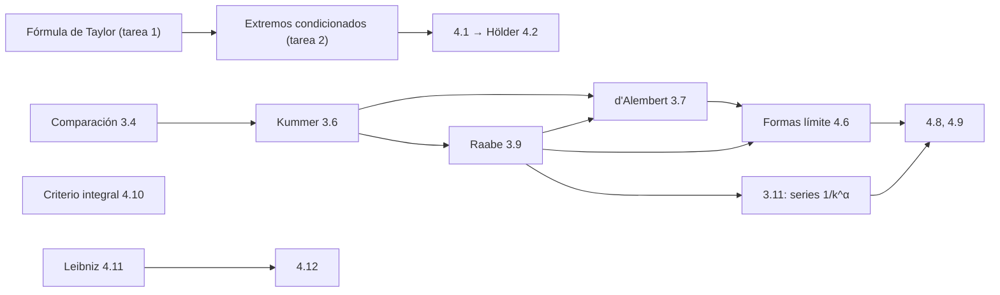

# Seminario NM-204, semestre 3: soluciones de las tareas y apuntes de los seminarios

[Русский](../../ru/seminar-sem3/index.md) · [English](../../en/seminar-sem3/index.md) · **Español**

[Índice del curso](../index.md) · [Lecciones 2025/26](../lectures-2025-26/index.md) · [Examen, semestre 3 (en ruso)](../../ru/exam-sem3/EXAM_SEM3.md)

Soluciones de las tareas 1–4 de la asignatura «Análisis matemático» (NM-204, 2026). Cada problema tiene la misma estructura: enunciado breve, solución o demostración, respuesta y un párrafo **«Por qué funciona»** que explica en qué se apoya el resultado y qué ocurre si se cambian las hipótesis. Los enunciados se cotejaron con los PDF originales (que están en ruso); las respuestas numéricas y los desarrollos se comprobaron por sustitución.

Los problemas pasan de una tarea a la siguiente con los mismos números, así que cada uno está resuelto una sola vez.

| Tarea | Archivo | Problemas | Tema |
|---|---|---|---|
| Tarea 1 | [Fórmula de Taylor](hw1-taylor.md) | 1.1–1.4 | polinomio de Taylor en $`\mathbb R^n`$, resto de Lagrange |
| Tarea 2 | [Extremos condicionados](hw2-conditional-extremum.md) | 2.1–2.3, 2'.1–2'.3 | multiplicadores de Lagrange, condiciones suficientes |
| Tarea 3 | [Series numéricas](hw3-numerical-series.md) | 3.1–3.11 | comparación, Kummer, d'Alembert, Raabe |
| Tarea 4 | [Series, desigualdades, bases](hw4-series-inequalities-bases.md) | 4.1–4.12 | Hölder, bases, criterios en forma límite, criterio integral, Leibniz |

**Control 1.** [Cómo prepararse](test1-guide.md): la estructura probable, métodos para cada ejercicio, errores típicos y un plan de tres días; [variantes de práctica](test1-variants.md): tres variantes con el formato 1.1, 1.2, 2.1, 2.2, 3, 4 y sus soluciones.

## Apuntes de los seminarios

Registros de las pizarras del 4 de septiembre al 11 de noviembre de 2026, reelaborados a partir de la transcripción OCR de la carpeta [`sem3_notes`](../../../sem3_notes/README.md) (en ruso). Los números de los enunciados se conservan como en la pizarra, los razonamientos están reescritos con más claridad, los errores de reconocimiento están corregidos y enumerados al final de cada parte, y cada enunciado enlaza con su problema de la tarea. En las soluciones de las tareas esos problemas llevan la nota «En el seminario» con el enlace de vuelta.

| Parte | Fechas | Contenido |
|---|---|---|
| [1. Fórmula de Taylor y extremos condicionados](notes-1-taylor-extremum.md) | 4–20 sep. | Taylor en $`\mathbb R^n`$, el teorema de la hessiana orlada con tabla de signos, problemas 1.1, 1.4, 2.1, 2.3 |
| [2. Fundamentos de series](notes-2-series-basics.md) | 2–7 oct. | convergencia, criterio de Cauchy, series no negativas, comparación, criterio de la raíz, comparación generalizada |
| [3. Criterios de Kummer, d'Alembert y Raabe](notes-3-kummer-dalembert-raabe.md) | 16–28 oct. | Kummer y sus casos particulares, por qué no basta «para infinitos $`n`$», series $`\sum\frac{c_k}{k^d}`$ |
| [4. Ejemplos y comparación de criterios](notes-4-examples-tests.md) | 28 oct. – 11 nov. | sumas de senos y cosenos, problemas 4.4, 4.6–4.8, qué criterio es más fuerte |

**Qué seminario corresponde a cada problema.**

| Fecha | Qué se resolvió | Tareas |
|---|---|---|
| 4 sep. | Taylor para $`x^3+y^3+z^3-3xyz`$, definición de extremo condicionado | [1.1](hw1-taylor.md#p-1-1) |
| 9 sep. | el teorema sobre extremos condicionados (hessiana orlada) | toda la [tarea 2](hw2-conditional-extremum.md) |
| 18 sep. | Taylor para $`x^2\sin(xy)e^{y+z}`$; $`x^3+y^3-3xy`$ sobre una recta | [1.4](hw1-taylor.md#p-1-4), [2.1](hw2-conditional-extremum.md#p-2-1) |
| 20 sep. | un extremo en $`\mathbb R^4`$ con dos ligaduras | [2.3](hw2-conditional-extremum.md#p-2-3), variante con $`y^2`$ |
| 2 oct., 3 oct. | condición necesaria, series no negativas, criterio de comparación | (F1)–(F3), [3.1](hw3-numerical-series.md#p-3-1), [3.5](hw3-numerical-series.md#p-3-5) |
| 7 oct. | $`\sum\sin(kx_0)`$, criterio de Cauchy, comparación generalizada | [3.3](hw3-numerical-series.md#p-3-3), [3.4](hw3-numerical-series.md#p-3-4) |
| 16 oct. | $`\sum\frac1{k!}`$, Kummer, d'Alembert, la serie de $`2^{-k}`$ y $`3^{-k}`$ | [3.5](hw3-numerical-series.md#p-3-5)–[3.8](hw3-numerical-series.md#p-3-8) |
| 21 oct. | criterio de Raabe, la condición «para infinitos $`n`$» | [3.9](hw3-numerical-series.md#p-3-9), [3.10](hw3-numerical-series.md#p-3-10) |
| 28 oct. | $`\sum\frac{c_k}{k^d}`$, sumas de senos acotadas | [3.11](hw3-numerical-series.md#p-3-11), [3.2](hw3-numerical-series.md#p-3-2) |
| 30 oct. | $`\sum\frac{\beta^kk!}{k^k}`$, $`\sum\frac{\sqrt{k+1}-\sqrt{k-1}}{k^d}`$, sumas de cosenos | [4.8](hw4-series-inequalities-bases.md#p-4-8), [3.3](hw3-numerical-series.md#p-3-3) |
| 11 nov. | una serie con $`c_k\to1`$, Raabe ⟹ d'Alembert, formas límite | [4.7](hw4-series-inequalities-bases.md#p-4-7), [4.4](hw4-series-inequalities-bases.md#p-4-4), [4.6](hw4-series-inequalities-bases.md#p-4-6) |

## Respuestas en una página

**Tarea 1.** Notación: $`h`$ es el incremento desde el punto del desarrollo.

- 1.1. En $`(1;1;1)`$: $`3(h_1^2+h_2^2+h_3^2-h_1h_2-h_1h_3-h_2h_3)+h_1^3+h_2^3+h_3^3-3h_1h_2h_3`$. En $`(1;-1;2)`$: $`14+9h_1-3h_2+15h_3+3h_1^2-3h_2^2+6h_3^2-6h_1h_2+3h_1h_3-3h_2h_3+h_1^3+h_2^3+h_3^3-3h_1h_2h_3`$.
- 1.2. $`322-448h_1-42h_2+254h_1^2+94h_1h_2+36h_2^2-60h_1^3-16h_1^2h_2+24h_1h_2^2+24h_2^3+5h_1^4-4h_1^2h_2^2+3h_2^4`$.
- 1.3. $`e^9\bigl[1+L+\bigl(\tfrac{L^2}2+Q\bigr)+\bigl(\tfrac{L^3}6+LQ\bigr)\bigr]+R_3`$, donde $`L=-2h_2+6h_3`$, $`Q=h_1h_2+h_3^2`$, $`R_3=\tfrac1{24}e^{9+L\theta+Q\theta^2}\bigl[(L+2Q\theta)^4+12Q(L+2Q\theta)^2+12Q^2\bigr]`$.
- 1.4. $`e^{\pi+2}\bigl[-\pi h_1+h_2+2\pi h_1^2+h_2^2-(3+\pi)h_1h_2-\pi h_1h_3+h_2h_3\bigr]+R_2`$; el resto $`R_2=\tfrac16d^3_cf(h)`$ está escrito en la solución.

**Tarea 2.**

- 2.1. $`(0;0)`$ es un máximo local condicionado ($`f=0`$), $`(1;1)`$ un mínimo local condicionado ($`f=-1`$).
- 2.2. $`\pm\sqrt{a/6}\,(1;1;1)`$: máximo $`e^{\sqrt{6a}}`$ y mínimo $`e^{-\sqrt{6a}}`$.
- 2.3. No hay puntos de extremo condicionado (hay puntos estacionarios, pero estorba el sumando $`2x^3`$). En la variante con $`y^2`$ la respuesta es otra; se trata en una observación.
- 2'.1. $`\max=\frac1{3\sqrt6}`$ en $`\frac1{\sqrt6}(1;1;2)`$, $`\frac1{\sqrt6}(1;-2;-1)`$, $`\frac1{\sqrt6}(-2;1;-1)`$; $`\min=-\frac1{3\sqrt6}`$ en los puntos opuestos.
- 2'.2. Para $`m=1`$ la función es constante sobre $`M`$. Para $`n,m\ge2`$ el único punto de extremo es $`(\frac an;\dots;\frac an)`$, un mínimo $`\frac{a^m}{n^{m-1}}`$ (global si $`m`$ es par, local si es impar).
- 2'.3. Un máximo local en $`x_k=\frac{a\,m_k}{m_1+\dots+m_n}`$; además, los puntos con coordenadas nulas para los que todos los $`m_k`$ correspondientes son pares son extremos con valor $`0`$.

**Tarea 3.**

- 3.3. La serie $`\sum\cos(kx_0)`$ diverge siempre; las sumas parciales están acotadas si y solo si $`x_0\notin2\pi\mathbb Z`$.
- 3.7 y 3.9. Criterio de Kummer con $`x_n=1`$ y $`x_n=n`$.
- 3.10. El ejemplo es la serie de 3.8.
- 3.11. Converge si y solo si $`\alpha>1`$.

**Tarea 4.**

- 4.1. Máximo $`1`$ en $`x_k=b_k^{\,p'-1}`$; mínimo $`\min_kb_k`$ en los vértices $`e_j`$ (o $`0`$ en la cara donde $`b_k=0`$).
- 4.5. $`a_{2m}=\frac1{m!}`$, $`a_{2m-1}=\bigl(1+\frac1{2m-1}\bigr)\frac1{m!}`$.
- 4.7. Las dos primeras series convergen, la tercera diverge ($`c_k\to1`$).
- 4.8. $`\sum a_k`$ converge para $`\alpha>\frac12`$; $`\sum b_k`$ converge para $`\beta<e`$.
- 4.9. $`\sum a_k`$ y $`\sum d_k`$ convergen, $`\sum b_k`$ y $`\sum c_k`$ divergen.
- 4.11$`^*`$. Sí, la afirmación sigue siendo cierta con $`a_ka_{k+1}\le0`$.

## Qué conviene aclarar con el profesor

1. **Problema 4.3, familias $`\mathcal M_3`$ y $`\mathcal M_5`$.** Con el parámetro $`r\in(0;+\infty)`$ sus uniones son $`\mathbb R\setminus\{0\}`$ y $`(0;+\infty)`$, no $`\mathbb R`$, de modo que la primera condición de la definición de base sobre $`\mathbb R`$ literalmente no se cumple. En la solución se demuestra lo que es cierto y se indica cómo corregir el enunciado.
2. **Problema 2.3.** En la tarea 2 figura $`y^3`$; en el archivo abreviado de la tarea 3, $`y^2`$. Las respuestas difieren; están resueltas ambas variantes, con $`y^3`$ como principal. En el seminario del 20 sep. se resolvió precisamente la variante con $`y^2`$ ([ejemplo 5.1](notes-1-taylor-extremum.md#ex-5-1)), así que el $`y^3`$ de la tarea 2 puede ser una errata.
3. **Problema 2'.2, la indicación.** «El caso trivial $`k=1`$» se ha leído como $`m=1`$ ($`k`$ es el índice de sumación en el enunciado).

## Cómo encajan las tareas

Las series de signo constante se estudian con una sola herramienta, la acotación de las sumas parciales, y con una cadena de series patrón cada vez más finas: la progresión geométrica (Cauchy, d'Alembert), las series de potencias $`\sum k^{-\alpha}`$ (Raabe). Las series de signo variable convergen por otra razón, las cancelaciones, y necesitan un criterio propio (Leibniz).
