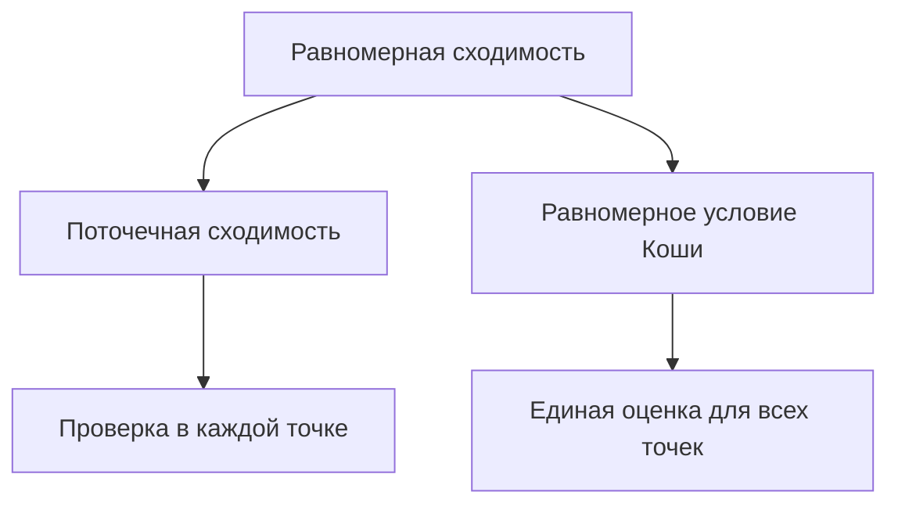

# 10. Последовательности и ряды функций

[← 9. Несобственные интегралы и приложения](09-improper-integrals-applications.md) · [Оглавление](index.md) · [Термины и теоремы](term-index.md) · [11. Степенные ряды и аналитические функции →](11-power-series.md)

> **Цель.** Различать поточечную и [равномерную сходимость](#sec-10-1) и знать, когда предел можно менять местами с операциями анализа.

<a id="sec-10-1"></a>
## 10.1 Два вида сходимости

Пусть $`f_n,f:E\to\mathbb R`$. Последовательность **сходится поточечно**, если

```math
\forall x\in E\;\forall\varepsilon>0\;\exists N\;\forall n\ge N:
|f_n(x)-f(x)|<\varepsilon.
```

Она **сходится равномерно**, если

```math
\forall\varepsilon>0\;\exists N\;\forall n\ge N\;\forall x\in E:
|f_n(x)-f(x)|<\varepsilon.
```

Равносильно, $`\sup_{x\in E}|f_n(x)-f(x)|\to0`$. При поточечной сходимости $`N`$ может зависеть от $`x`$, при равномерной — нет.

На $`[0,1]`$ функции $`f_n(x)=x^n`$ поточечно стремятся к $`0`$ при $`x<1`$ и к $`1`$ при $`x=1`$. Предел разрывен, поэтому сходимость не равномерна. На $`[0,r]`$ при $`r<1`$ она равномерна, поскольку $`\sup|f_n|=r^n\to0`$.



<a id="sec-10-2"></a>
## 10.2 Равномерный критерий Коши

Последовательность равномерно фундаментальна, если для любого $`\varepsilon>0`$ найдётся $`N`$ такое, что

```math
m,n\ge N\implies \sup_{x\in E}|f_n(x)-f_m(x)|<\varepsilon.
```

Для действительных функций равномерная сходимость равносильна равномерному условию Коши. Это основной инструмент, когда предел неизвестен.

Для ряда $`\sum f_n`$ определения применяются к [частичным суммам](04-numeric-series.md#sec-4-1) $`s_N=\sum_{n=1}^N f_n`$.

> <a id="weierstrass-m-test"></a>**Признак Вейерштрасса.** Если $`|f_n(x)|\le M_n`$ на $`E`$ и $`\sum M_n<\infty`$, то $`\sum f_n`$ сходится абсолютно и равномерно на $`E`$.

Это следует из $`|f_n(x)+\cdots+f_m(x)|\le M_n+\cdots+M_m`$.

<a id="sec-10-3"></a>
## 10.3 Непрерывность и интегрирование

> <a id="uniform-limit-continuity"></a>**Теорема о непрерывности.** Если все $`f_n`$ непрерывны и $`f_n\to f`$ равномерно, то $`f`$ непрерывна.

В доказательстве на $`3\varepsilon`$ выбирают $`n`$ с равномерно малым $`|f_n-f|`$, а затем используют непрерывность одной функции $`f_n`$.

> <a id="uniform-limit-integration"></a>**Теорема об интегрировании.** Если $`f_n`$ интегрируемы на $`[a,b]`$ и равномерно сходятся к $`f`$, то $`f`$ интегрируема и
> ```math
> \lim_{n\to\infty}\int_a^b f_n=\int_a^b f.
> ```

Разность интегралов не превосходит $`(b-a)\sup|f_n-f|`$. Поточечной сходимости мало: движущиеся треугольные «шапочки» на $`[0,1]`$ могут поточечно стремиться к нулю, а их интегралы оставаться равными единице.

<a id="sec-10-4"></a>
## 10.4 Дифференцирование

Равномерной сходимости $`f_n`$ недостаточно для дифференцирования предела. Достаточная теорема:

> Если $`f_n`$ [непрерывно дифференцируемы](15-multivariable-differentiation.md#sec-15-1) на ограниченном отрезке $`[a,b]`$, $`f_n(x_0)`$ сходится хотя бы в одной точке, а $`f_n'\to g`$ равномерно, то $`f_n`$ равномерно сходится на $`[a,b]`$ к [дифференцируемой](06-derivatives.md#sec-6-1) $`f`$ и $`f'=g`$.

На ограниченном промежутке ряд дифференцируют почленно, если ряд производных сходится равномерно, а исходный ряд сходится хотя бы в одной точке.

Теорема Дини: на [компакте](13-metric-spaces.md#sec-13-4) [монотонная последовательность](03-sequences.md#sec-3-3) непрерывных функций, поточечно сходящаяся к непрерывному пределу, сходится равномерно.

## Разобранный пример

При $`|x|\le r<1`$

```math
\sum_{n=0}^{\infty}x^n=\frac1{1-x}
```

равномерно по [признаку Вейерштрасса](#weierstrass-m-test) с $`M_n=r^n`$. Почленное дифференцирование законно на $`|x|\le r`$, поскольку $`\sum nx^{n-1}`$ также сходится равномерно. Поэтому

```math
\sum_{n=1}^{\infty}nx^{n-1}=\frac1{(1-x)^2}.
```

Так как $`r<1`$ произвольно, тождество верно для всех $`|x|<1`$.

## Типичные ошибки

1. Поточечная сходимость не сохраняет непрерывность.
2. Признак Вейерштрасса доказывает равномерную [абсолютную сходимость](04-numeric-series.md#sec-4-3), а не только сходимость в отдельных точках.
3. Для перестановки производной и предела нужно контролировать ещё и производные.

## Упражнения

1. Докажите, что $`f_n(x)=x/(1+nx^2)`$ равномерно стремится к нулю на $`\mathbb R`$.
2. Сходится ли $`\sum\sin(nx)/n^2`$ равномерно на $`\mathbb R`$?
3. Приведите пример, показывающий, что поточечная сходимость не сохраняет интеграл.

<details>
<summary>Краткие ответы</summary>

1. Максимум $`|x|/(1+nx^2)`$ равен $`1/(2\sqrt n)`$.
2. Да, по признаку Вейерштрасса с $`M_n=1/n^2`$.
3. Возьмите треугольный импульс на $`(0,1/n)`$ высоты $`2n`$ и площади $`1`$; он поточечно стремится к нулю.
</details>

---

[← 9. Несобственные интегралы и приложения](09-improper-integrals-applications.md) · [Оглавление](index.md) · [Термины и теоремы](term-index.md) · [11. Степенные ряды и аналитические функции →](11-power-series.md)
